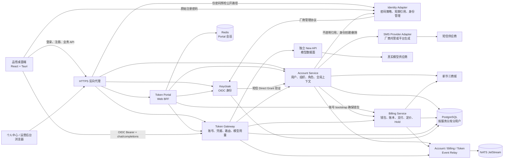

# 账号平台当前架构

> 状态：基于当前代码和数据库迁移校准的实现快照，不替代目标需求
>
> 校准日期：2026-08-23
>
> 代码审计基线：本轮连续实施起点 `e23005aaf6745d4b8c1ffa5ac73943e0f8f98ca5`，并包含本文件所在提交
>
> 文档版本：以本文件所在 Git 提交为准
>
> 目标需求：`requirements.md`、`role-system-design.md`

## 1. 架构结论

当前代码已经形成身份、业务账号、资金账务和模型访问四个服务边界，但部分目标能力仍停留在需求模型，不能按目标架构宣称已完成：

- Keycloak 是登录身份、密码和 OIDC 会话的事实源；OIDC Claim 只证明主体，不决定业务权限。迁移期保留的 `platform-admin` Realm Role 不再参与业务授权。
- Identity Adapter 是注册密码预检、策略版本、短期密码材料和 Keycloak 管理协议的唯一边界；Account 只接收不透明密码引用。
- Account Service 是永久内部用户 ID、独立用户编码、平台/组织角色、权限码、组织树、成员、管理命令审批策略/请求和用户级全局活动上下文的事实源；OIDC Session 只证明当前登录，不拥有独立计费上下文。
- Billing Service 是钱包、平衡账本、充值订单、BASE/BONUS 组成级权益、版本化计量单位、确定性价格生命周期、Hold 和已批准财务命令领域执行结果的事实源。
- Token Gateway 是 Token Account、加密凭据、共享/路由策略、版本化协议/安全公式和模型用量请求的事实源；当前已接入的数据面协议仍仅支持 `/v1/chat/completions`。
- New API 是模型数据面和上游用量证据源，不承载品悟用户、组织或钱包真相。
- Token Portal 是个人中心和运营后台的 Web BFF，采用 OIDC Authorization Code + PKCE、Redis 服务端会话和 CSRF 防护。
- 桌面端的内置模型路径使用与登录相同的 OIDC Access Token；旧内置模型运行时路径已移除，并已有本地迁移代码和测试。

当前代码尚未实现的关键目标包括账单逐行支付证据归并和完整关单中间态。独立模型目录、稳定模型身份、不可变能力/目录版本、托管路由 Provisioning、组织模型业务策略、资格管线、目录回滚联合依赖校验与运营修复已经在仓库闭环；客户端切换所需的无推理 Readiness、公开兼容范围和签名准入证明已有独立仓库实现，桌面动态目录消费、下架后的会话分支及发布/安装/运行门禁仍由后续客户端任务收口。用户级全局上下文、组成级组织授予、计量/公式/价格快照、目标普通退款、支付异常统一结案、独立应收/拒付会计链路、每日四方对账、晚到支付人工复核，以及注销资格、静默期、跨域阻断、Identity/资料/Commerce/邀请清理、组织授予隔离与标识墓碑已在仓库闭环；超级管理员安全恢复和客户端准入仍待生产等价演练。

## 2. 逻辑拓扑

仓库配置要求反向代理只公开认证、账号、Gateway 和 Portal 的受控路径。PostgreSQL、Redis、NATS、Relay、Billing 内部 API 和 New API 管理面保持在内部网络；这属于配置和代码基线，本次审计没有取得实际生产环境与版本证据。

当前注册密码先通过 TLS 进入 Identity Adapter 的公开预检路径，取得 15 分钟有效的不透明引用和冻结的 `password_policy_version`；Account 的预检、短信和注册 API 只接收该引用，最终身份创建由 Identity Adapter 使用原始序列再次权威校验。短期原文与带独立密钥的 HMAC 仅保存在 Identity 进程内，成功创建后清除原文，过期时删除记录。Identity 还把服务端生成的注册操作 ID 绑定到密码 HMAC 指纹，并把该 ID 作为 Keycloak 用户属性保存，Account 可先按该关联查询再幂等创建，避免不确定结果下重复建号。反向方向上，Keycloak 的短信 Direct Grant Authenticator 会携带内部服务凭据调用 Account `/internal/v1/auth/sms/verify` 完成验证码核验。

## 3. 服务边界

| 组件 | 当前职责 | 当前自有状态 | 主要目标差距 |
|---|---|---|---|
| Keycloak | 用户认证、密码、OIDC Token/Session；迁移期 Realm Role 不参与业务授权 | Keycloak 数据库 | 生产部署和后续密码重置/资料同步/会话撤销端口仍待环境及任务验证 |
| Identity Adapter | 密码原始字符校验、策略版本、短期引用/HMAC、注册操作关联查询、Keycloak 用户创建/资料更新/密码重置/会话撤销及受控停用协议 | 进程内 15 分钟短期密码记录；Keycloak 持久身份与操作关联 | MFA 和账号申诉仍不在当前闭环 |
| Account Service | 永久用户 ID/编码、用户/身份映射、平台/组织 RBAC、绑定有效期/撤销/自动回收、权限解析、持久注册及完整注销 Saga、短信挑战、异步钱包初始化、商城账号同步、组织/节点、成员/角色、用户级全局上下文、邀请、审计 | Account 数据库 | 超级管理员生产等价演练 |
| Billing Service | 钱包、账本、BASE/BONUS 组成级权益、组织购买与成员授予、版本化计量单位、全局/模型价格解析、价格生命周期、Hold/组成分配/租约及异常处理证据、独立应收与清偿分配、单流水拒付冲销、供应商中立支付能力/商品映射、目标退款、晚到支付复核、人工调整、到期/损失复核、支付修复和对账 | Billing 数据库 | 正式商品业务冻结、统一拒付/强制退款复核结案及账单证据归并 |
| Token Gateway | Token Account、加密凭据、共享策略、路由、协议/公式版本、独立模型目录与稳定身份、能力/目录版本、托管 Provisioning、组织模型策略、资格管线、非计费客户端 Readiness/准入证明、安全参数映射、动态预占、持久派发/重放、执行/交付隔离、取消意图、可信用量和 Model Gateway Adapter 核对 | Token 数据库 | 更多数据面协议及其显式 Provider 取消 Adapter；客户端准入生产联调 |
| Token Portal | OIDC PKCE、Redis Session、CSRF、个人中心、运营后台、路径白名单代理和制品级三语门禁 | Redis Session | 目标后台权限模型和尚未实现的业务页面 |
| Event Relay ×3 | 事务 Outbox 投递、重试和死信 | 各服务 Outbox/Inbox | 现有事件有限，不能替代缺失的跨域 Saga |
| New API | OpenAI 兼容代理、供应商调用日志和用量证据 | 独立数据库 | 仍需通过 Adapter 契约补齐协议、取消和证据能力 |

### 3.1 仓库交付形态

- 仓库同时提供 Docker Compose 和 Helm Chart；它们是可部署模板，不证明任何环境已经部署，也不证明高可用、备份、RPO 或 RTO。
- `mock-newapi` 和 `payment-simulator` 是 Compose 中的非生产测试支撑组件，不属于产品服务边界或生产逻辑拓扑；其隔离和替换决策见 `adr/ADR-007-payment-simulator.md`。
- Compose 包含上述测试支撑组件和可选真实 New API profile，供本地开发、合同测试、端到端验证和故障注入；生产 Helm 不部署这些工作负载。
- 当前真实支付 Adapter 是新华三商城；其代码能力只有下单、查询/同步和人工修复。非生产测试 Provider 提供的退款、回调和账单能力不得归入新华三或生产能力。
- 远程 Compose 把 `payment-simulator`、对应迁移和数据库初始化统一置于 `development-simulator` 显式开关后；Billing 对测试 Provider 只允许 `development/test` 环境，生产 Helm 仅配置正式 Adapter，且不包含 Simulator 工作负载或模拟器命名变量。
- 本文所有部署状态均以 `implementation-status.md` 的证据为准；本轮没有环境/制品版本证明，因此统一为 `NOT_DEPLOYED`。

## 4. 当前数据所有权

### 4.1 Account 域

当前迁移包含：

- `users`、`identities`：业务用户及 OIDC 身份映射；`users.id` 使用 UUIDv7，`user_code` 使用密码学安全随机载荷与 SHA-256 校验码，二者由数据库触发器禁止修改或物理删除；用户状态包括 `PROVISIONING`、`ACTIVE`、`DISABLED`、`DELETED`。
- `user_code_registry`：永久占用已经提交的用户编码，注销后也不释放；`user_code_lookup_attempts`：只保存操作者及来源、设备、目标编码的摘要维度，用于精确查询的限流和审计，不形成公开目录。
- `organizations`、`organization_creation_requests`、`organization_units`、`organization_unit_closure`、`organization_unit_commands`：顶层组织、独立单调结构版本、按操作者隔离且不可变的创建/节点命令幂等请求，以及组织树形闭包；活动同级节点名称按不区分大小写唯一，节点和组织删除都只写终态与时间戳。
- `organization_unit_governance_blockers`：Account 域尚未收敛的节点审批或扩展任务登记；成员、节点角色和受保护子节点直接从各自权威表判断，不以缓存替代。
- `invitations`、`membership_commands`：邀请只保存手机号/用户名/兼容邮箱目标摘要和脱敏提示，目标查询由当前认证身份反向匹配；一次性链接只保存 Token 摘要。成员新增、移除和所有权转让保存操作者隔离的稳定命令指纹与原结果，角色和邀请历史禁止物理删除。
- `permissions`、`roles`、`role_permissions`、`role_assignments`、`authorization_versions`：平台/组织原子权限、内置角色、带起止/撤销/来源的授权投影、作用域和单调授权版本。
- `memberships`、`membership_units`、`role_bindings`：成员和节点范围；`role_bindings` 是组织成员角色生命周期写模型，通过数据库触发器投影到 `role_assignments`，授权查询不直接读取写模型。
- `user_active_contexts`：以 `user_id` 唯一保存 PERSONAL/ORGANIZATION、目标组织和单调 `context_version`；最近有效 Session 只用于迁移初值，切换使用期望版本 CAS。
- `user_sessions`：按 issuer + OIDC Session 保存登录观察和兼容投影，不再作为聊天或计费上下文事实源。
- `slider_captcha_challenges`、`sms_challenges`：滑块和短信挑战元数据；平台生成验证码模式只保存带密钥校验数据，不保存明文。
- `sms_send_attempts`：手机号、来源和设备的单向摘要、用途、结果与时间，用于短信多维限流和反枚举审计。
- `profile_change_requests`：用户名/手机号变更的旧值、新值、独立资料版本、短信验证和 Identity/Account/会话阶段；活跃请求对用户字段及新值分别唯一预约。
- `password_reset_operations`：只保存已验证挑战、稳定用户/Identity 引用及完成事实，不保存密码、密码摘要或验证码。
- `commerce_customer_mappings`：用户/组织到外部客户的供应商中立映射，只保存 Provider ID、Adapter 版本、脱敏外部引用和通用状态；不参与认证或业务授权。
- `commerce_customer_sync_jobs`、`commerce_customer_sync_evidence`：客户开通/资料同步任务及不可变结果证据；任务冻结主体、Provider、Adapter 版本和类别，Provider 原始协议与错误不会进入核心表或公开 API。
- `audit_logs`、`outbox_events`、`inbox_messages`、`inbox_aggregate_versions`：审计和可靠事件。

手机注册在发送短信前原子创建服务端注册操作、5 分钟唯一值预约和挑战；短信核验成功后把预约提升为 30 分钟注册租约。Account 持久保存非秘密阶段事实，先按稳定操作 ID 查询 Identity，再幂等创建；Identity 成功后预约不再按 TTL 自动释放。Account 提交以候选 UUIDv7 用户 ID 为稳定主键，在一个串行事务内写入用户、永久用户编码、身份映射、Commerce Customer Mapping/同步任务、钱包初始化任务、Outbox 和审计，随后返回可登录的 `PROVISIONING`。

钱包初始化由后台任务使用稳定幂等键调用 Billing；成功后才把用户和注册操作激活为 `ACTIVE`，短暂失败按退避重试，超过快照化 SLA 后进入 `REPAIR_REQUIRED`。`PROVISIONING` 与 `REPAIR_REQUIRED` 均允许登录和资料管理，但 Token Gateway 与充值入口按稳定原因码拒绝平台模型和支付；本地独立模型不受影响。`/v1/account/bootstrap` 不再同步调用 Billing，也不把钱包故障改写为注册失败。

客户端使用操作 ID 与 48 小时签名查询令牌恢复轮询；桌面优先把查询凭据写入系统凭据库，写入失败时只在当前 WebView 会话保留短期降级副本。运营修复入口由 `platform.registrations.repair` 保护，只返回脱敏阶段、责任域、重试和 SLA 元数据。Identity 孤儿默认向前恢复；只有 Identity 创建满 24 小时，且串行事务证明候选 Account 用户、正式映射、钱包任务和 Account Outbox 均不存在时，才能先停用 Identity、撤销会话并确认不可认证，再复核事实并释放预约，不提供直接删除捷径。这里的跨域无事实证明来自封闭发布边界：候选 ID 在 Account 提交前不会通过用户表或 Outbox 发布，Billing/Token/成员/授予/订单入口均不能引用未提交用户；任一 Account 发布事实存在都会使证明失败。

用户名和手机号修改由 `profile_change_requests` 持久 Saga 编排。客户端必须先通过密码 Direct Grant 取得五分钟内的 `auth_time`；Account 保存 `PENDING` 请求并预约规范化新值，手机号再绑定专用滑块/SMS 挑战。Identity Adapter 幂等更新同一 Keycloak subject 后，Account 以独立 `profile_version` CAS 提交；Identity 已更新而 Account 未提交时只向前重试。提交后撤销 Keycloak Refresh Token/会话并清除 Account Session 投影；手机号同时为当前 Commerce Provider 递增 Mapping 版本并创建 `PROFILE_SYNC` 任务。旧版本迟到结果只追加证据，不能覆盖新映射；同步失败不回滚登录或模型能力，但继续阻止依赖该映射的新支付。30 分钟仍未收敛的请求进入 `REPAIR_REQUIRED`。

忘记密码沿用同一密码隔离边界：未登录端只获得 Identity 进程内短期密码引用，Account 的 `PASSWORD_RESET` 短信路径对已知和未知手机号保持同形响应；验证成功后 Account 只把不透明引用和稳定 subject 交给 Identity Adapter，由其重置 Keycloak 密码并撤销全部既有会话。Account 数据库只记录验证和完成事实。

Commerce Customer worker 只依赖 `CustomerAdapter` 端口，当前 H3C 实现位于平台 Adapter；核心任务不识别厂商 Action、响应或错误文本。状态统一为 `PENDING / IN_PROGRESS / READY / RETRY / REPAIR_REQUIRED / DETACHED`，连续失败达到上限后停止自动重试并保留脱敏修复原因。Account 的授权上下文不返回 Mapping；充值入口另行读取 `/v1/me/commerce-customer-mapping`，因此 Mapping 非 `READY` 只关闭依赖外部客户的下单，不影响登录、平台模型、组织管理或其他授权决策。

### 4.2 Billing 域

当前迁移实际包含：

- `organization_lifecycle_states`、`organization_governance_blockers`：Account 组织版本在 Billing 的单调生命周期投影和可扩展删除阻断登记。DISABLED 冻结组织钱包，DELETED 为不可恢复终态并关闭钱包；新建组织钱包按该投影决定初始状态。
- `organization_unit_lifecycle_states`、`organization_unit_governance_blockers`：Account 节点结构版本在 Billing 的限制态投影及未来组成级授予/分配任务阻断登记；进入 DELETION_PENDING 后拒绝新增登记，必须清零后才接受 DELETED。
- `organization_member_lifecycle_states`：Account 成员版本在 Billing 的单调投影；REVOKED 是组织授予的即时限制输入，重新加入只能用更高成员版本恢复 ACTIVE，组成级授予读写必须在同一事务边界消费该状态。
- `member_quota_grants`、`member_quota_revoke_commands`、`member_quota_hold_allocations`、`member_quota_grant_audits`：成员授予绑定组织钱包内的精确权益包和 BASE/BONUS 组成，保存互斥余额桶、成员/授予版本、稳定请求指纹、Hold 分配与不可变审计；批量入口为每项派生稳定子键并独立提交。

- `wallets`、`ledger_accounts`、`journal_entries`、`ledger_postings`：钱包缓存余额和平衡账本；数据库触发器保护分录平衡和已入账记录不可变。
- `credit_lots`、`entitlement_packages`、`entitlement_components`、`usage_hold_allocations`：批次、兼容聚合投影、BASE/BONUS 组成事实和组成级 Hold 分配。
- `usage_hold_lease_events`、`usage_hold_admin_actions`：Hold 创建/续租的不可变有效值历史，以及仅针对 REVIEW 或租约已过期 ACTIVE 的幂等安全释放证据；释放同时快照组成和成员分配结果。
- `usage_loss_reviews`：权益到期释放不确定 Hold 后，迟到真实用量的平台损失复核证据。
- `recharge_products`：可售商品及冻结的权益组成快照。
- `payment_product_mappings`：通用商品到 Provider/版本/外部 SKU 的不可变版本映射，保存金额、币种、渠道、状态和有效期；`TEST_ONLY` 映射在正式环境不可用。
- `metering_unit_definitions`、`pricing_versions`、`pricing_version_unit_rates`、`pricing_spaces`：版本化计量单位、全局/模型定价空间、逐单位固定价或显式继承，以及价格生命周期和发布冲突控制。
- `protocol_formula_bindings`：Billing 保存 Token 已发布协议公式与所引用计量单位的不可变绑定，价格解析只接受绑定集合完整覆盖的单位。
- `pricing_publish_commands`、`pricing_lifecycle_commands`、`pricing_version_audits`、`pricing_blocks`：发布与撤销/结束的幂等命令、不可变审计和显式阻断窗口。
- `usage_holds`、`idempotency_records`：预占/结算和通用幂等记录；Hold 冻结请求上下文、协议/公式、估算器、逐单位价格及来源，后续续租、追加预占和结算不重新定价。
- `payment_orders`、`payment_transactions`、`payment_evidence`、`refunds`、`refund_component_reservations`、`refund_grant_reservations`、`forced_refund_cases`、`payment_notifications`：当前支付和退款模型；订单冻结 Provider ID/版本、商品映射 ID、完整映射、能力声明、实际付款人及受益主体，后续不以新版本重新解释历史订单。一个订单可关联多笔不可变 Provider 支付流水；回调、查询、关单观察和人工修复先保存原始载荷摘要与快照，再归并流水状态。普通退款以支付流水和权益包为唯一目标，退款预约保存 BASE/BONUS 组成及授予快照；渠道强制退款保存独立外部资金事实并冻结目标权益包，不能覆盖支付成功事实。订单还冻结支付期限、晚到复核边界和最终归档期限。
- `manual_review_cases`、`manual_review_case_events`、`late_payment_review_cases`、`late_payment_review_evidence`：Billing 人工案件基础、不可变时间线和晚到支付复核事实；当前只接入 P2 晚到支付，P0/P1 及其他领域队列由 APT-051 统一接入。
- `provider_bill_imports`、`provider_bill_rows`、`payment_provider_controls`：不可变账单文件批次/逐行记录以及 Provider 版本新单开关；事实盲区可原子停用新单，修复后通过新 Provider/Adapter 版本重新准入，不能直接改写历史能力快照。
- `manual_adjustments`、`payment_order_repairs`：运营调整和支付修复。
- `manual_review_cases`、`manual_review_case_events`、`payment_anomaly_cases`、`payment_anomaly_commands`：跨拒付、强制退款、重复/晚到冲突、退款失败和非法迁移的统一责任人/SLA 投影、不可变证据时间线与幂等结论命令；支付、退款、拒付等原领域状态仍是各自事实源。
- `reconciliation_runs`、`provider_bill_imports`、`reconciliation_cases`、`reconciliation_case_commands`：按 Provider/Adapter 版本和上海业务日保存的独立四方对账运行、文件证据、不可变差异快照及受审计处理命令；手工重跑不覆盖历史，定时任务仅对同 Provider 版本、渠道和日期幂等一次。
- Billing 自有 Outbox/Inbox 表。

权益入账按冻结商品快照把总 `microcredit` 拆为且仅拆为 BASE/BONUS 组成，舍入余数归 BONUS。组织购买订单另外冻结实际付款用户及其 Commerce Mapping 快照和受益组织，履约再次校验组织钱包归属并只向该钱包创建组织权益包。每个支付来源权益包同时保存 `payment_order_id` 和唯一 `source_payment_transaction_id`；同一流水重复证据只归并一次，不同成功流水分别进入独立履约或复核，不能追加到既有权益包。`entitlement_components` 保存可用、Hold、已用、有效/暂停授予、过期与撤销互斥桶并由数据库强制守恒；成员授予从同包同组成可用桶转入活动/暂停授予桶，成员调用再同时占用授予和组织组成。分配、撤回、成员 Hold、结算、释放和到期均锁定精确组成/授予行，不允许跨钱包、跨包或跨组成补足。`entitlement_packages` 的合计字段只是触发器维护的兼容投影。

Token 域已经以 `usage_requests` 保存独立执行状态、交付状态和账务状态，并通过持久派发准备/意图、执行跃迁审计、加密流事件、加密聚合结果及防重墓碑表达模型执行事实；这些表不保存原始幂等键。Billing 已有目标化 `refunds`、组成/授予预约、独立 `forced_refund_cases`、`receivables`、不可变 `receivable_allocations` 和绑定证据/支付流水/订单/权益包的 `chargeback_cases`；用量超额与拒付缺口都通过账本和应收原子双记。Provider 账单可通过 API 或受控文件导入形成独立运行，并与订单/支付流水、退款/拒付和账本分录执行四方核对；账单行尚未逐条进入支付事实的统一证据归并器。强制退款与拒付先冻结确定权益包并进入 `payment_anomaly_cases`，只有匹配异常类型的受控结论才能幂等执行冲销或转入财务修复计划；因此 PAY-33/PAY-34/PAY-36 已闭环，而 PAY-12～PAY-14 仍因账单证据归并和完整关单状态而部分实现。

价格解析先在请求时间选择唯一模型覆盖版本；没有模型覆盖时才选择唯一全局版本。同一作用域缺失或歧义分别稳定返回 `PRICE_MISSING`、`PRICE_AMBIGUOUS`，不可用版本返回 `PRICE_UNAVAILABLE`。模型单位必须是 `FIXED_PRICE` 或 `INHERIT_GLOBAL`；固定零价是有效价格并阻止回退，缺少配置不能表达继承。发布在定价空间串行锁内校验 ETag、幂等指纹和未来时间区间，ACTIVE 版本只能通过显式阻断、全局继承接续或替代版本提前结束。既有 Hold 始终使用创建时冻结的价格事实。

账本和额度使用整数 `microcredit`，当前换算为 `10,000 microcredits = 1 展示积分`；支付金额使用人民币分。

### 4.3 Token 域

当前迁移包含：

- `organization_lifecycle_states`：Account 组织版本在 Token 域的单调投影；DISABLED/DELETED 拒绝创建新的组织用量请求，DELETED 前强校验 `CREATED / RESERVED / UPSTREAM_ACTIVE / SETTLEMENT_PENDING / REVIEW` 均已收敛。
- `organization_unit_lifecycle_states`、`organization_unit_governance_blockers`：节点删除的单调限制态投影；DELETION_PENDING 后拒绝创建节点 Token Account 或新治理事实，已有 Token Account、路由关联及未终态用量全部阻断 DELETED。
- `token_accounts`、`provider_credentials`：模型访问账号和加密凭据；管理模式为 `USER` 或 `PLATFORM`。
- `token_share_policies`、`token_explicit_members`、`routing_policies`：共享和路由策略。
- `route_provisionings`、`route_provisioning_attempts`：按作用域、模型、协议和目标代次持久化托管资源的 PENDING/READY/FAILED/REPAIR_REQUIRED 状态、Worker 租约、退避、SLA、实际资源引用和逐次脱敏证据；平台托管候选只有同代 READY 聚合关联的活动账号、有效凭据和健康路由可以进入候选集合，显式指定的兼容 USER 路由仍按原有所有权与共享策略独立校验。
- `route_provisioning_commands`、`route_provisioning_audit`：人工修复的幂等命令与不可变审计；修复只能从失败终态开启新的受限轮次，不能由接口直接写 READY。
- `organization_model_policies`、`organization_model_policy_commands`、`organization_model_policy_audit`：组织允许全部、允许列表或禁止列表的业务模型策略、CAS 版本、原结果重放和不可变审计；该边界不接受也不返回真实 Token Account、凭据、路由或 Provisioning 配置。
- `usage_requests`、`usage_attempts`、`usage_execution_transitions`：模型请求的稳定用户级键摘要、版本化规范请求指纹、冻结上下文/路由/价格、独立执行/交付/结算状态、上游关联及不可变 CAS 跃迁审计。
- `usage_dispatch_preparations`、`usage_dispatch_intents`：Hold 前加密冻结的派发材料，以及 Hold 确认后原子提升的唯一派发意图和一次性 Worker 租约；进入上游派发后缺少确定结果且 Adapter 不保证请求级幂等时只转 REVIEW，不重发。
- `usage_cancel_commands`、`usage_cancellation_evidence`、`usage_delivery_confirmations`：原稳定用户的唯一幂等取消命令、不可变脱敏取消证据和各客户端最后确认事件序号；不保存用户正文或 Provider 凭据。
- `usage_reconciliation_commands`、`usage_platform_loss_reviews`：只查询原上游证据的幂等人工核对命令，以及期限后释放 Hold、永久禁止再次向用户扣款的晚到成本/平台交付损失边界。
- `usage_stream_events`、`usage_replay_results`、`usage_idempotency_tombstones`：先于客户端确认落库的加密规范事件、完整/聚合结果和零正文防重墓碑，普通业务最大保留期分别为24小时、30天和90天。
- `usage_replay_retention_cases`、`usage_replay_case_payloads`：法律保全或未结案件的独立受限存储及原因、范围、责任人、复核/到期/解除后清除事实；普通在线重放表不借案件名义延长保留。
- `protocol_definitions`、`protocol_formula_versions`：版本化协议定义和已发布后不可变的安全预占公式；当前 CHAT v1 公式绑定版本化计量单位和确定性 UTF-8 估算器。
- `authorization_cache_versions`、`token_audit_logs` 以及 Token 自有 Outbox/Inbox 表。

首次请求或目标配置变化时，Gateway 在作用域、模型、协议锁下声明唯一目标代次，并立即以稳定原因码返回非 READY；后台 Worker 使用短租约和 `FOR UPDATE SKIP LOCKED` 认领任务，幂等创建或更新平台 Token Account、加密凭据和路由，验证实际路由代次后才写 READY。短暂失败按快照化指数退避重试，超过最大次数或 30 分钟 SLA 进入 REPAIR_REQUIRED；平台模型管理员可带原因和幂等键开启新修复轮次。动态目录模型会加入目标凭据允许列表，不以旧环境模型清单作为业务目录门禁。

模型数据面要求客户端提供16至128字符的每逻辑请求唯一键。Gateway 只保存 SHA-256 摘要，唯一域固定为稳定 `user_id + model-inference`；JSON 经带版本的确定性规范化后计算指纹，Session、活动上下文和传输头均不参与缩小作用域。同键同指纹先恢复原执行，同键异指纹在任何 Hold 或选路副作用前返回 `IDEMPOTENCY_KEY_REUSED`。首次执行按 `RECEIVED → HOLD_RESERVING → HOLD_RESERVED → DISPATCH_INTENT_PERSISTED → UPSTREAM_DISPATCHING → STREAMING/SETTLEMENT_PENDING → SUCCEEDED/FAILED/REVIEW` 推进；派发意图前的取消可以从前三个状态 CAS 到 `CANCELLED_BEFORE_DISPATCH`。Billing 以 `usage_request_id` 幂等确保唯一 Hold，派发准备快照让崩溃重试继续同一个 Hold，正式派发意图则最多被一个 Worker 首次取得。HTTP/SSE 断开只更新交付状态，上游读取继续使用脱离客户端取消信号的受限后台上下文；流事件取得连续序号并加密持久化后才写客户端，重连以原键和 `Last-Event-ID` 补发，结果过期但墓碑仍在时返回410而不是创建新执行。

取消命令只按请求冻结的稳定 `user_id` 授权，不重新要求原 Session、活动上下文或组织成员关系。用量行锁统一裁决 Hold 建立、派发意图提升和取消：意图尚未形成时，取消先阻止提升，再幂等释放整个 Hold，并原子写入 `LOCAL_CONFIRMED + CANCELLED_BEFORE_DISPATCH + RELEASED`；意图已经或可能形成后，不因用户停止或断线提前释放 Hold。Adapter 必须声明 `EXPLICIT_CANCEL`、`STREAM_ABORT_CONFIRMED_CANCEL` 或 `UNSUPPORTED`，当前 OpenAI-compatible 与 New API 均明确为 `UNSUPPORTED`，所以 Gateway 只停止该客户端交付并继续受控消费原响应/查询原上游引用。`execution_status`、`cancel_status`、`delivery_status` 与 `settlement_status` 互不冒充，完成事实优先于较晚取消。

结算只消费 Adapter 归一化且达到可信等级的 Provider 最终或累计用量。Provider 用量、最后持久化事件序号、各客户端最后确认序号、用户停止时间和最终用量时间分别保存；最大 Hold、已发送字节和客户端已显示量只用于授权或展示，不能成为结算事实。请求冻结核对策略版本、最大执行时长、最终用量延迟和取消核对期限；期限内沿原 Hold 续租并退避查询，期限最后一次仍无可信用量时释放未结算 Hold、转 `REVIEW` 并建立 `customer_debit_prohibited` 平台损失案件。之后到达的用量只能补充平台成本证据，不得重新冻结、扣其他权益或形成用户应收。

个人中心已移除自管 Token Account 页面；Gateway 仍保留普通用户 Token Account API，但会过滤平台托管账号，并禁止普通用户修改 `PLATFORM` 账号。平台后台的列表、详情、启停、路由和凭据检查反向限定 `management_mode=PLATFORM`，不会借运营权限读取或改写兼容 USER 账号；平台模型运营员可为个人、组织或节点作用域创建 PLATFORM 账号，组织模型策略始终不接受内部资源引用。`platform.tokens.read`、`platform.tokens.manage` 和 `platform.tokens.credentials.validate` 只授予平台模型运营角色，超级管理员及任何组织角色均不隐式获得。供应商密钥只在 Gateway 内存中解密，检查结果只返回 `VALID/INVALID`、稳定脱敏错误码和最小元数据，普通用户及后台接口均不返回明文、密文、Key ID、Provider 地址或原始错误。

个人中心的信息架构固定为概览、额度、权益、用量和按有效成员关系显示的组织导航。额度始终读取当前活动上下文；个人上下文可以购买套餐并查看个人订单、发票说明和权益包，组织上下文不复用这些个人资源。组织上下文按 Account 返回的原子权限分别显示购买、读取、授予和撤回能力；额度分配只通过 `org.quota.allocate` 保护的最小成员目录读取用户 ID、展示名和成员版本，不借此暴露邮箱、角色或节点范围。成员没有自领入口，缺少权限或组织数据时展示组织空态，不得以个人权益回退填充。普通用户导航不承载 Token Account、供应商凭据、共享策略或路由管理。

## 5. 身份、上下文和权限

### 5.1 当前权限模型

- 平台运营后台使用 Account 平台角色和原子权限码；Account、Billing、Token Gateway 都默认拒绝，并分别按接口所需权限调用 Account 授权解析。Keycloak `platform-admin` Realm Role 不能绕过拒绝。
- 本人资料接口返回格式化 `user_code`，桌面与 Web 不展示内部 `user_id`。运营端用户列表/详情展示编码；编码查询是单独的完整等值接口，先校验格式和校验码，再检查 `platform.users.read`，并按操作者、来源 IP、设备和目标编码摘要限流。不存在、无权和输入无效对调用方使用不泄露存在性的结果；编码不是登录、找回、会话或授权凭据。
- `OWNER`、`ORG_ADMIN`、`BILLING_ADMIN`、`UNIT_ADMIN`、`MEMBER`、`AUDITOR` 是 Account 域组织角色，通过 `role_assignments` 解析权限和组织/节点作用域；旧 `role_bindings` 仅作为迁移期写入兼容投影。
- 平台/组织角色绑定支持开始/到期时间、来源、单绑定幂等撤销和自动回收。所有权限解析都直接按数据库时间过滤未来、过期或已撤销绑定；数据库触发器维护单调 `authorization_versions`，成员与角色变化递增用户/Session 兼容授权版本但不伪造活动上下文切换，worker 将到期事实固化并写审计与 Outbox。组织 `role_bindings` 是写模型，平台直接授权写入 `role_assignments`。
- 普通授权接口拒绝 `OWNER`、基础 `MEMBER` 和平台角色；运营通用接口拒绝 `PLATFORM_SUPER_ADMIN` 与 `OWNER`。超级管理员由专用安全生命周期维护：数据库同时保护最后一个有效超级管理员的角色绑定和用户状态，停用、删除及注销预检统一返回 `LAST_ACTIVE_SUPER_ADMIN`。旧管理员仍须按 `deploy/runbooks/account-rbac-migration.md` 明确映射，不能自动全部升级为超级管理员。
- 首个 `admin` 身份由主机/集群受控的 `account-security` 离线命令幂等创建，业务用户在正式密码安全激活前保持 `BOOTSTRAP_PENDING`，Identity 身份保持禁用且没有超级管理员绑定。正式密码只进入 CLI 与 Identity Adapter；Account 数据库只保存一次性凭据的用途/部署代次绑定 SHA-256 校验值和生命周期事实。
- Break-glass 与普通角色交接分离：仓库不提供公网恢复 API；离线命令必须记录“全部超级管理员异常失联”的显式确认、运维工作负载身份、事故理由、证据摘要、目标和最长 60 分钟有效期，并立即产生不可变审计与 CRITICAL 告警。它不能绕过最后管理员主动注销门禁。
- 注销由 Account 持有唯一 `account_closure_requests` 聚合，并以 `CLOSURE_REQUESTED → QUIESCING → FINANCIAL_CLEARANCE → IDENTITY_CLEANUP → ANONYMIZED → COMPLETED` 表达只前进阶段；命令指纹、不可变审计、版本、租约、退避和 SLA 共同提供崩溃恢复。
- 所有者或最后有效超级管理员先停在 `CLOSURE_REQUESTED`，用户保持 ACTIVE 以完成交接；门禁通过的同一事务才将用户改为 `CLOSING`。普通 Account 授权和 Token 新业务返回稳定 `ACCOUNT_CLOSING`，历史读取及既有订单关闭、支付申诉、用量取消使用服务端白名单，客户端不能自报修复模式。
- Account Worker 通过服务身份读取 Billing 与 Token 的强一致评估。Billing 覆盖个人余额/应收、Hold、支付/退款/拒付、资金性对账、晚到支付和支付异常；Token 覆盖执行、结算和核对，只有具有“平台承担且禁止以后向用户追扣”证据的安全终态例外。用户响应删除内部资源 ID，运营接口只允许幂等重试当前阶段。
- `IDENTITY_CLEANUP` 先在 Account 串行事务中递增主体生命周期与授权版本，撤销当前及未来平台/组织角色、成员关系和 Session；Identity 未更新的资料 Saga 被取消，已经更新 Identity 的资料 Saga 先向前归并到原用户，再统一清理。邀请被取消并随机覆盖目标摘要、提示和令牌；非资金 Commerce 任务被取消，资金任务必须先收敛。Commerce 的认领、完成和重试均校验 `ACTIVE` 主体及原生命周期，迟到结果只能保留为 `STALE` 证据，不能重建 Mapping。
- Account 随后以服务身份删除该主体的全部 Identity 身份，并让 Billing 将其全部有效或普通暂停的组织授予隔离为 `SUSPENDED/ACCOUNT_CLOSED`。两项外部副作用各自保存幂等完成证明；任一项不可确认时保持在清理阶段重试，不得释放标识或宣称完成。
- 两项证明齐备后，Account 在单一事务中删除本地身份映射、将 Commerce Mapping 置为 `DETACHED`、随机墓碑化用户名和手机号并把用户置为 `DELETED`。永久 `user_id`、`user_code` 及法律记录的不可逆主体引用保留；三年分类保留记录支持法律保全，到期 worker 仅清除保留状态。事务同时写 `account.user.anonymized.v1` Outbox，只有该事件确认发布后 Saga 才从 `ANONYMIZED` 进入 `COMPLETED`。
- `ACCOUNT_CLOSED` 授予继续占用原权益包和 BASE/BONUS 组成，不能恢复、消费、创建 Hold 或走普通撤回。具有 `organization.grant.reclaim_closed` 的组织管理员只能在账号已不可逆 `ANONYMIZED` 且无 Hold、核对、退款、拒付、支付异常或资金对账冻结时，对单条授予执行幂等的整笔当前剩余回收；金额原子返回原权益包原组成，授予终态为 `RECLAIMED_ACCOUNT_CLOSED`，批量接口逐项独立返回。
- 后台写命令必须经 `approvalpolicy` 的版本化 `command_type` 注册表分类；当前九类直接改写财务事实的命令固定为 `APPROVAL_REQUIRED`，普通退款、组织删除、治理配置和确定性任务固定为 `AUDIT_ONLY`，未知命令或分类冲突失败关闭。审批申请、不可变快照、决定、状态事件和执行记录归 Account 所有，禁止申请人按稳定用户 ID 自审。
- 批准事务只写 `account.approval-command.authorized.v1` Outbox，不直接改写账本。Billing 的 `billing-command-executor` 先向 Account 强一致复核申请人/审批人的当前绑定、权限、有效期、授权版本、策略和关键资源版本，再以 `approval_request_id + command_type + command_fingerprint` 派生稳定执行键；人工钱包调整的领域事务保存申请 ID/执行键并由数据库触发器拒绝新的直接入账。九类命令先完整占用稳定分类，当前只有已存在领域语义的 `WALLET_ADJUSTMENT` 可创建申请；其他类型在对应资金领域任务交付执行器前拒绝创建，不能进入永远无法执行的批准状态。当前服务间认证仍使用共享长期令牌，APT-047 负责替换为短期工作负载身份，不改变审批/执行所有权边界。
- 顶层组织生命周期由 Account 编排，Billing 对资金事实、Token 对未终态用量事实分别作权威判断。创建请求以操作者、幂等键和规范化请求指纹唯一；搜索使用状态过滤及 `updated_at + organization_id` 复合游标。停用先让 Billing 与 Token 以 Account 下一版本进入限制态，再由 Account 冻结成员、递增授权版本并将命中的用户级活动上下文回退到个人；启用仅在下游投影均可恢复时执行。删除必须已停用：Account 先核验邀请和治理审批，再以两阶段协议先对 Billing/Token 执行无副作用预检并汇总阻断原因；Billing 在提交阶段再次串行核验余额/预留、权益、Hold、支付、退款、对账差异、待核对用量、人工调整和扩展阻断登记，Token 核验所有可能继续结算的用量已收敛，随后按 Billing、Token、Account 的顺序写入不可逆 `DELETED` 终态。停用后禁止产生新的组织资金和用量事实，因此超时重试只会保持或进入更严格状态；任一远端事实不可确认均失败关闭，账本、订单、用量、审计和幂等记录不物理删除。
- 组织节点命令以操作者、目标组织、命令类型和幂等键唯一，保存版本化规范请求指纹及原结果；同键异请求冲突。组织的 `structure_version` 独立于顶层生命周期版本，创建、重命名、移动和删除在串行事务内递增；移动以调用方读取的结构版本作 CAS，并原子重建受影响闭包路径。节点删除先让 Billing/Token 在同一节点锁命名空间进入 `DELETION_PENDING`，从此拒绝新增授予登记、节点 Token Account 和治理事实；Account 随后在提交事务内重检受保护子节点、成员、角色、审批和任务，Billing/Token 分别权威检查授予登记、Token Account/路由和未终态用量。全部清零后各域按更高结构版本固化 DELETED；超时只留下可重试的更严格状态，节点、闭包、命令及关联历史均不物理删除。
- 邀请统一使用 PHONE、USERNAME、LINK（并保留 EMAIL 兼容入口）实体：创建不查询或暴露目标是否存在，手机号/用户名只保存规范值摘要和提示；本人待接受列表只用当前认证用户已验证标识反向匹配，接受时再次绑定当前稳定用户 ID。Token/邀请 ID 均在串行事务内一次消费，过期、撤销和接受终态永久保留。成员新增、移除和所有权转让以稳定幂等键及请求指纹提交；移除同事务撤销全部当前/未来角色、递增授权版本、使命中的用户级活动上下文回退个人并发出唯一成员事件，随后同步 Billing REVOKED 投影。有效组织的唯一 OWNER 由延迟数据库约束复核，所有权只能通过专用事务先撤销旧绑定、保留历史再建立新绑定。

### 5.2 当前上下文

当前上下文以用户为全局唯一聚合：

- `PERSONAL`：个人钱包和个人路由。
- `ORGANIZATION`：指定用户已加入的有效组织，使用组织角色、路由和钱包。

`user_active_contexts` 为每个用户保存一条记录。切换请求携带 `expected_context_version`，Account 在串行事务中校验成员与组织状态并递增版本；旧端写入返回冲突，不能覆盖更新的选择。成员移除或组织停用在各自事务内自动回到 PERSONAL。Account、Token Gateway 和跨服务授权响应通过 `X-Context-Version` 返回当前版本，组织管理响应同时返回 `X-Authorization-Version`；Portal 原样转发，桌面桥接显式承载。Web/桌面只接受更高版本，并在版本提升、窗口聚焦或切换成功后中止旧请求、清空旧上下文资源并重读。

## 6. 当前模型调用与计费链路

当前 `/v1/chat/completions` 链路为：

1. 解析 OIDC 主体和 Account 用户级全局上下文，并冻结请求开始时的版本与钱包事实。
2. 解析稳定模型目录身份、生命周期和协议；未显式指定兼容 USER Token Account 时，声明或读取当前作用域目标 Provisioning，组织上下文同时复核 `model.invoke` 与组织模型策略，非 READY 失败关闭。
3. 平台托管路径只从同代 READY Provisioning 关联的活动账号、有效凭据和健康路由中确定性选择候选；显式 USER 路由仍执行所有权、共享策略、有效凭据和健康检查。
4. 按 CHAT 协议公式使用版本化 UTF-8 估算器计算请求输入和输出边界，从 Billing 解析唯一模型覆盖或全局价格，并冻结逐单位最终价格与来源。
5. 创建 `usage_request`，向 Billing 创建 Hold；长调用定时续租，预计成本超过已授权最大值前按原快照追加预占。
6. 解密所选凭据，记录上游尝试，调用 New API。
7. 根据返回 usage 结算；证据不确定时进入 `REVIEW`，后台按 New API 请求日志核对，不自动重发模型请求。

当前边界和目标差距：

- Gateway 已通过 Adapter 定时/手动同步独立模型目录，使用稳定 UUID、不可变能力/目录版本、DRAFT/PUBLISHED/DEPRECATED/REMOVED 生命周期、连续缺失核验和历史墓碑；公开列表只返回 `CATALOG_VISIBLE`，并附当前上下文/授权版本和非权威资格提示。请求按 `CATALOG_VISIBLE → Provisioning READY → CONTEXT_ELIGIBLE → RESERVABLE → Hold → 上游调用` 重新校验；目录回滚逐模型校验当前价格及同代 READY 账号、凭据和路由，并在目录事务内重检路由依赖。
- Hold 在上游调用前创建，并按组成到期时间、同日 BONUS→BASE、入账时间和稳定组件 ID 分配及结算；续租和追加预占复用原价格快照，失败时中止可控上游并进入复核。持久派发、断线恢复、取消期续租和期限释放已形成独立状态机。组成到期或用量核对期限 Worker 会先释放相关不确定 Hold，再把迟到确认的真实用量写入平台损失复核，禁止改扣其他权益。
- Model Gateway 通过配置注入 Adapter；Adapter 独占请求路径/认证头、上游请求引用提取、Provider 日志查询和用量归一化。通用领域、迁移、API 与三语运营界面只使用 `provider_id`、`adapter_version`、`upstream_request_id` 和摘要，历史核对按创建时 Adapter 版本匹配，不用当前 Provider 解释旧记录。
- `/v1/model-protocols` 暴露版本化协议能力；路由以 `model + protocol_code` 显式声明可调用协议，当前仅发布 `CHAT v1`（JSON/SSE）。协议/公式框架已覆盖 CHAT 及输入、缓存输入、输出单位；图片、请求和文档单位已有定义，但在 Adapter 与模型目录同时显式声明前不可推断可用。
- 幂等键可显式传入或稳定派生，但重复请求返回 `USAGE_REPLAY_BLOCKED`，不会回放既有结果；也没有版本化规范请求指纹、同键异请求 `409`、流事件存储、结果/墓碑分层保留或 `410` 语义。
- 流式响应直接转发给客户端，未先持久化；请求上下文取消可能中止上游，不具备断线继续执行和按序重放。
- 没有持久派发租约/意图状态机，也没有模型请求取消命令及 Provider 取消能力契约。

## 7. 当前支付、权益与退款

充值以 Billing `product_id` 为可信输入。金额与 BASE/BONUS、展示积分、有效期来自通用商品目录；外部 SKU、Provider 金额/币种/渠道来自独立版本映射，两者与当前 Provider 能力取交集后才可售。当前 UAT 目录为：

| 商品 | 商城 SKU | 金额 | 总展示积分 | 有效期 | 状态 |
|---|---|---:|---:|---:|---|
| 体验版 | `0502AJON` | ¥0.10 | 2,000 | 30 天 | UAT 暂定 |
| 标准版 | `0502AJ0Q` | ¥10.00 | 4,000 | 30 天 | UAT 暂定 |
| 高级版 | `0502AJOR` | ¥30.00 | 9,000 | 30 天 | UAT 暂定 |
| 旗舰版 | `0502AJOP` | ¥200.00 | 50,000 | 30 天 | UAT 暂定 |

`internal/platform/payment` 定义供应商中立端口和版本化能力；H3C 与开发 Simulator 分别位于 `internal/platform/h3cpayment`、`internal/platform/paymentsimulator`，Billing 不识别厂商状态或客户端。`/v1/payment-capabilities` 公开渠道、查询/保留/最小间隔、支付与晚到窗口、权威终态、关单、退款、通知、账单、对账模式和人工修复能力；用户/组织 UI、后台轮询及领域动作统一据此门禁，订单同时冻结能力快照。正式 `FROZEN` 映射若没有回调和账单，必须同时具备长期历史查询、有限支付/晚到窗口、权威未支付终态和覆盖归档期的证据保留，否则创建订单失败关闭。

新华三 Adapter 当前只声明支付宝下单、订单查询/同步和人工修复，不声明主动退款、关单、回调或账单，对账模式为 `QUERY_DEGRADED`。客户端关闭二维码页后，Billing 后台按 Adapter 最小查询间隔继续查询；订单在72小时边界执行最后查询并转入唯一 P2 案件，前7天每日、此后每周复核。仓库中的非生产测试 Provider 可声明更多动作，但带 `test_only` 标记且只允许开发/测试环境，不能扩张生产能力。所有当前 H3C 和 Simulator 映射均为 `TEST_ONLY`；正式收款前必须由 APT-048 对 SKU、金额、权益和 Provider 映射取得业务确认并发布满足正式准入条件的 `FROZEN` 新版本，不能直接修改已有映射。

Provider 确认支付成功后，Billing 以 Provider 流水为幂等边界创建独立权益包、BASE/BONUS 组成及逐组成账本分录；回调、主动查询和受审计修复复用同一归并器，金额、币种、归属或多次成功冲突保留证据并转人工复核。订单只保存可重建的支付、退款、拒付和关注摘要兼容投影，不以摘要覆盖支付流水的历史成功事实。72小时仍未收敛的订单进入带责任人和 SLA 的晚到复核；用户申诉只追加不可变证据，运营查询发现成功后仍经同一归并器履约。最终归档要求越过支付窗口、晚到窗口和七日宽限期，且期限后存在成功的权威未支付查询、没有流水/冲突/未复核申诉；否则案件升级 `PROVIDER_BLIND`，停用该 Provider 版本新订单，并继续保留处置队列。组织购买在订单上明确实际付款用户和受益组织并直接履约到组织钱包。具有原子权限的管理员可把组织权益的精确包/组成授予有效成员，批量逐项提交；成员移除时授予暂停且不回池，更高成员版本重新加入时才可在到期前恢复。组织用量 Hold、释放和结算同时维护成员授予与组织组成。实际费用超出原 Hold 时，受 Hold 支撑部分正常消费，超额以应收资产和独立应收同事务记录；未清应收只冻结对应钱包上下文。后续现金充值 BASE 先按最老应收分配，BONUS 不抵债。拒付和 Provider 强制退款先保留原支付成功事实并冻结目标权益包，再进入统一异常案件；确认结论仅撤销原流水唯一权益包的可撤销 BASE/关联 BONUS，现金 BASE 缺口转订单应收，驳回则恢复冻结前可恢复权益。Provider 账单每日按上海自然日与支付、退款/拒付及账本四方核对并保存独立差异证据；账单逐行支付证据归并仍待 PAY-12～PAY-14。

普通退款已移除旧订单级按金额部分退款语义，并按以下边界执行：

- 请求必须同时绑定 `payment_order_id`、`payment_transaction_id` 与 `entitlement_package_id`；金额由目标支付流水派生，调用方不能输入。
- 创建意图在串行事务中锁定目标流水、权益包、组成和授予，拒绝任何已消费/预占/到期/撤销组成或未收敛资金异常，保存组成与授予预约、冻结权益并原子写 Outbox。
- Provider 明确失败时按预约恢复权益；结果不确定时保持请求和冻结，不自动制造成功。确认成功后在一个 Billing 事务中撤销目标全部 BASE 与关联 BONUS、冲销对应 Credit Lot 和钱包负债、写平衡退款分录并把权益包置为 `REVOKED`。
- 支付流水的 `PAID/LATE_PAID` 是不可变历史事实；历史 `PARTIALLY_REFUNDED/REFUNDED` 订单摘要在迁移时归一为支付成功摘要，退款终态只存在退款记录中。
- Provider 主动产生的强制退款以独立证据和 `forced_refund_cases` 保存，不经过普通退款资格拒绝；目标权益包在复核前冻结，并由统一案件认领。`CONFIRM_FORCED_REFUND` 按退款现金占原流水现金的比例向上取整计算各 BASE/BONUS 组成的目标撤销量，只撤销原权益包可撤销余额，无法撤销的现金 BASE 形成应收；结论与会计动作均幂等留痕。

## 8. 一致性与事件

平台不使用跨服务分布式事务。三个服务具备本地 Outbox/Inbox、Relay、重试和死信基础，当前主要事件为：

- `account.membership.changed.v1`
- `billing.recharge.succeeded.v1`
- `token.usage.settled.v1`

本地业务状态与对应 Outbox 写入具备事务原子性；Relay 以至少一次语义重试投递，默认达到 12 次失败后进入死信，需审计后人工重新入队。因此该机制保留并重试事件，但业务最终收敛仍依赖死信处置，不能无条件宣称最终投递。注册 Account 提交会原子写入 `account.wallet.provisioning.requested.v1`，钱包成功写入 `account.wallet.provisioning.completed.v1`；财务审批成功写入绑定命令指纹、策略、目标和关键版本的 `account.approval-command.authorized.v1`，Billing 重复消费使用同一领域执行键。目标退款意图原子写入 `billing.refund.requested.v1`，明确成功或失败再写对应终态事件；Provider 不确定结果保持冻结并等待证据收敛。托管路由 Provisioning 由 Token 数据库内的聚合、尝试、命令和审计协调；账号注销也由 Account 数据库的持久聚合协调，跨域评估是无副作用强一致读取，不把消息送达误当成门禁结论。

## 9. 客户端与 Portal

- Portal 采用 OIDC Authorization Code + PKCE、Redis 服务端 Session、CSRF 和严格代理路径白名单。
- 系统运行聚合不拥有固定组件清单：部署通过 `SYSTEM_PROBES_JSON` 注册本地、通用 HTTP（可选 JSON 布尔断言）或 Relay 指标探针；Portal 主流程只按 Adapter 类型并发执行、脱敏汇总和排序，新增 Identity/模型网关/事件组件无需增加厂商判断分支。
- 桌面 OIDC Access Token 保留在 Rust 进程，Refresh Token 只存系统凭据库，不持久化密码。
- 旧内置模型迁移具备盘点报告、配置备份、会话/计划任务模型 ID 迁移和旧凭据清理重试；当前测试覆盖迁移幂等以及运行时不再引用旧 `llmapi_hub` 路径。
- 桌面模型选择器实时读取 `/v1/models`，只允许当前上下文可用且生命周期允许的新会话模型。会话创建时把实际模型引用写入自身元数据；全局默认变化不会改变旧会话。模型移除或继续截止后，旧会话保持可读，用户必须显式选择替代模型并创建带来源会话、来源轮次、原模型和替代模型证据的新分支。
- 客户端切换由三层失败关闭：发布脚本核验公开兼容范围、OIDC 发现、制品摘要和 TOK-37 签名证明；更新器核验环境固定公钥、制品摘要、有效期、检查项、系统包签名并执行只读迁移预检；运行时只接受完成的新 schema，失败时返回修复原因且没有旧模型回退。`check-client-migration-scope.mjs` 把该迁移提交限制在客户端、客户端测试/工具和直接相关文档内。
- 登录后的账号弹层只调用专用命令打开固定的受信 Portal `/account.html`；WebView 不能提供目标 URL，OIDC Token 不进入 URL、查询串或 Portal JavaScript。
- 当前个人中心没有 Token Account 管理入口；管理后台仍提供平台 Token Account、凭据元数据、路由、用量、钱包、订单、调整和修复等能力。
- 桌面账号弹层、Web 个人中心和管理后台共用受校验的中/英/日词条目录。门禁双向比对键集、类型与空值，扫描账号平台 UI 的单语硬编码和原始后端错误回退，并验证构建后 Portal JavaScript 仍包含全部静态词条；任一步失败都阻断 verify 和客户端发布。
- 三层门禁和非计费 readiness 已形成仓库实现；生产签名身份、正式制品原子替换/回滚和真实环境连续无副作用验收尚未完成，因此正式切换仍失败关闭。

## 10. 安全边界

- 远程用户入口要求 HTTPS；开发态 HTTP 仅限 loopback。
- Portal 内部服务凭据不下发浏览器或桌面端；桌面 OIDC Token 不进入 WebView JavaScript。
- 注册原始密码只进入 Identity Adapter 的预检和最终创建边界；Account、短信、Billing、Commerce、事件和普通可观测链路只接收不透明引用或非秘密注册事实。Identity 不 trim、规范化、转换或截断密码，并在创建完成或引用到期后清除短期原文。
- Provider 地址使用 HTTPS 和主机白名单；production-new 禁止本地 KEK，Helm 通过 ExternalSecret 从 KMS/Vault SecretStore 同步运行时秘密。Gateway 新写入只使用当前 Key，解密使用每行持久的 Key ID；轮换 Worker 对 Provider 凭据、派发准备/意图、流事件和结果使用 `FOR UPDATE SKIP LOCKED` 分批重加密并重算完整性摘要，生产 readiness 在旧 Key 密文归零前保持失败。本地 KEK 只用于开发/测试。
- Keycloak `/admin/` 应限制在受控网络或隧道内。
- 所有服务使用共享安全日志 Handler：稳定事件名和字段白名单失败关闭，未知动态消息折叠，原始 error、密码、验证码、Token、Cookie、请求/响应正文、模型正文和 Payload 不进入日志。入口只接受格式/长度合法的 Request ID；同步 HTTP 传播 Request ID/W3C Trace Context，Outbox 固化 Trace ID，Relay/NATS Consumer 恢复父 Trace，后台任务创建任务 Span。Trace ID 只进入日志和 Prometheus Exemplar，不作为普通指标标签。
- 数据迁移采用三重不可修改边界：仓库 `migrations/manifest.json` 固化全部历史脚本的规范化 SHA-256且只允许追加更高版本；迁移器以目标库 `schema_migrations` 再次校验已执行版本；生产迁移还必须先取得24小时内的一致性快照证据，并在事务完成后输出实际版本/校验和摘要。应用回滚不回滚数据库，结构变化一律以前向新版本修复。
- 恢复与保留目标由 `deploy/recovery-policy.json` 机器定义，环境证据门禁同时检查资金/配置两级 RPO、核心/非关键两级 RTO、WAL/日增量/周全量/迁移前快照、TLS与静态加密、KMS分离、异地不可变副本、月/季/年恢复演练和分类删除收据。Payment Simulator 不进入生产恢复边界。仓库门禁只定义和校验证据，未取得真实生产等价报告前不得宣称满足 RPO/RTO 或备份闭环。
- 正式 Helm 形态把可水平扩展的核心服务、Portal、Relay、Keycloak 和 New API 设为至少双副本，通过跨区/跨节点拓扑约束、零不可用滚动策略和 PDB 维持独立容量；单副本内置 Redis/NATS 在生产被禁止，必须接入 TLS 的外部高可用依赖。Identity Adapter 的短期密码材料刻意只在单进程内存，Pod 丢失时引用失效并由持久 Saga 补偿，核心登录由多副本 Keycloak 保持；不能为追求副本数把明文密码复制到普通缓存。
- HTTP 工作负载在业务监听提供独立 liveness/readiness，在受限 `:9090` 提供请求、错误状态、延迟、并发和 readiness 指标；Relay 的 liveness 只代表进程，readiness 同时验证 Outbox PostgreSQL 与 NATS，并输出周期结果、积压和死信指标。普通健康检查不执行收费业务或客户端切换准入。

## 11. 审计证据与主要风险

本次代码级校准使用以下验证：

- `node scripts/account-platform.mjs test unit`：所有 Go 包测试通过（项目内置 Go 工具链，`nomsgpack` 标签）。
- `npm test`（`account-platform/`）：OpenAPI lint 和 118 个合同测试通过。
- `node --test tests/account_platform_state.test.mjs tests/ui_language_coverage.test.mjs tests/scheduled_tasks_unit.test.js`（`pinvou3-app/`）：40 个测试通过。
- `node scripts/account-platform.mjs verify`：Go 单测与 Vet、合同测试、架构守卫和差异检查通过。

| 项目 | 当前事实 | 风险/下一步 |
|---|---|---|
| 部署 | Helm 已具备多故障域调度、PDB、零不可用滚动、外部HA Redis/NATS边界及机器化故障验收；Compose仍是单机 | 未取得真实集群容量、选主及Pod/节点/区域故障证据，不得宣称生产HA或RPO/RTO完成 |
| 注册 | 唯一值预约、持久恢复、Identity 关联查询、异步钱包任务、SLA、`REPAIR_REQUIRED` 和证明门禁补偿已闭环 | Identity 短期密码材料仍为单副本内存能力；生产运行和故障注入证据待部署补齐 |
| 权限与审批 | 平台和组织接口使用 Account 原子权限码、显式作用域、绑定有效期、单条撤销、自动回收和默认拒绝；最后超级管理员保护、完整注销 Saga、安全恢复及版本化管理命令审批/幂等执行已有仓库实现 | 补短期工作负载身份和生产等价安全恢复/审批故障演练 |
| 模型调用 | 独立目录、稳定身份、不可变能力/目录版本、管理生命周期、请求版本快照，以及版本化公式、价格快照、Hold 前置/续租/追加和事后核对已有基础 | 补 Provisioning/上下文资格、回滚联合依赖校验、桌面目录消费、派发持久化、重放和取消 |
| 权益 | BASE/BONUS 组成、组织购买、精确成员授予、生命周期、确定消费/到期、目标退款与拒付定向撤销、注销隔离/整笔剩余回收和守恒约束已实现 | 补生产等价并发压力证据 |
| 支付 | 新华三仅声明下单、查询与人工修复并采用查询降级对账；订单支持多支付流水，回调/查询/修复证据不可变归并，每笔成功流水独立履约或复核；72小时晚到案件、统一支付异常案件、强制退款/拒付受控结论、每日四方对账、严格归档和 Provider blind 停单已实现 | 补 Provider 账单逐行证据归并和完整关单中间态；在生产等价环境验证真实账单、并发定时运行与财务故障恢复 |
| 客户端切换 | 动态目录、显式替代会话分支、迁移预检、发布/安装/运行三层门禁和非计费 readiness 仓库实现已完成 | 补生产签名身份、正式安装制品原子替换/回滚和连续无副作用环境证明 |
| 测试 | 单元、合同和定向桌面测试通过 | 本轮未执行 Compose 集成、E2E、故障注入、性能或部署验收 |
