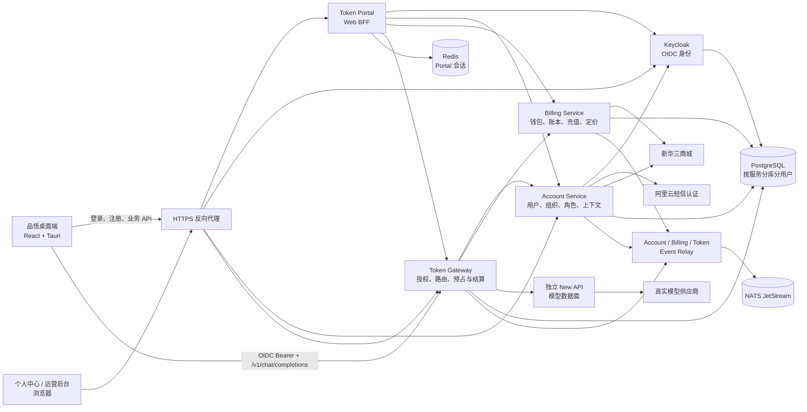

# 账号平台当前架构

> 状态：当前实现基线
>
> 校准日期：2026-08-22
>
> 适用范围：品悟桌面端、账号平台服务、Token Portal、Keycloak、Billing、Token Gateway、New API、阿里云短信认证和新华三商城支付
>
> 目标变更提示：本文保留“当前实现”事实。需求基线已经确认 Identity Provider/Account/Commerce 三事实源、注册持久 `PROVISIONING` 与异步钱包初始化、用户级全局活动上下文、组织在线购买权益、完整支付生命周期、版本化计量单位与协议预占公式、动态 Hold 追加预占以及移除个人中心自管 Token Account；公式缺省参数为 0。这些目标以 `requirements.md` 和 `role-system-design.md` 为准，完成实现前不得把本文件中的现状描述当作最终需求。

## 1. 架构结论

账号平台采用身份、业务账号、资金账本、模型访问四个事实域分离的架构：

- Keycloak 是登录身份、密码、OIDC 会话和 Realm 管理角色的事实源。
- Account Service 是用户业务资料、组织树、成员角色和会话活动上下文的事实源。
- Billing Service 是钱包、积分账本、充值、权益包、定价和预占结算的唯一事实源。
- Token Gateway 是模型 Token Account、授权、路由、New API 调用关联和用量请求的事实源。
- New API 只作为模型数据面和上游用量证据源，不承载品悟用户、组织或钱包真相。
- Token Portal 是个人中心和运营后台的 Web BFF；浏览器不直接持有或调用内部服务凭据。

桌面端启用账号平台后，登录与内置模型聊天使用同一 OIDC 身份。Access Token 保留在 Rust 进程中，聊天请求直接进入 Token Gateway，不再以设备身份或旧 New API 用户身份执行。

客户端从旧内置模型路径切换到上述架构采用三层门禁：发布门禁在服务端兼容能力或非计费 readiness 未就绪时不发布新构建；安装门禁在隔离暂存副本完成迁移预检，失败时不替换旧二进制与配置；运行门禁保证已经安装的新构建只包含新路径，平台不可用时显示原因和修复动作而不复活旧路径。切换 readiness 不创建真实用户 Hold 或费用；端到端协议验证使用与用户/组织钱包隔离的专用合成身份。

## 2. 当前逻辑拓扑

反向代理只公开经过确认的认证、账号、Gateway 和 Portal 路径。PostgreSQL、Redis、NATS、三个 Relay、Billing 内部接口和 New API 管理面都应保持在私网。

## 3. 服务边界

| 组件 | 主要职责 | 自有状态 | 公网边界 |
|---|---|---|---|
| Keycloak | 用户认证、密码校验、OIDC Token、登录会话、`platform-admin` Realm 角色、短信登录扩展 | Keycloak 数据库 | 仅公开 Realm 登录所需路径；`/admin/` 不公开 |
| Account Service | 用户与身份映射、手机注册、商城账号同步、组织/节点、成员和角色、活动上下文、审计 | Account 数据库 | 桌面所需账号 API 可经受控反代公开；内部接口不公开 |
| Billing Service | 个人/组织钱包、不可变平衡账本、权益包、充值订单、预占、结算、定价、调整与对账 | Billing 数据库 | 不直接面向普通客户端；由 Gateway/Portal BFF 调用 |
| Token Gateway | Token Account、加密凭据、共享策略、确定性路由、聊天代理、用量记录、自动核对、充值 BFF | Token 数据库 | 公开 OIDC 保护的模型和个人业务入口 |
| Token Portal | Authorization Code + PKCE、Redis 服务端会话、CSRF、个人中心、运营后台、内部 API 代理、系统状态 | Redis 会话 | 公开 `/account.html`、`/admin.html` 和受控 `/api/*` |
| Event Relay ×3 | 事务 Outbox 投递、重试和死信 | 各业务库 Outbox/Inbox | 不公开 |
| NATS JetStream | 领域事件传输和持久化 | JetStream 卷 | 不公开 |
| PostgreSQL | 一个数据库引擎，按服务使用独立数据库和用户 | 业务持久数据 | 不公开 |
| Redis | Portal 服务端会话；独立 New API 可使用自己的逻辑库 | 短期会话/缓存 | 不公开 |
| New API | OpenAI 兼容模型代理、供应商调用、请求日志和用量证据 | 独立 New API 数据库 | 只允许 Token Gateway 私网访问；管理页面受限访问 |
| Payment Simulator | 开发/自动化测试的支付回调、退款、对账模拟 | 测试数据库 | 生产流量不得使用或公开 |

### 3.1 当前运行形态与仓库目标形态

- 当前实际部署是单台 Linux 主机上的 Docker Compose，宿主机反向代理终止 HTTPS；版本目录与稳定符号链接用于切换发布。
- 仓库同时提供 Helm Chart，作为 Kubernetes 生产目标和可验证的部署模板；它不是当前单机环境已经具备高可用的证明。
- Compose 中保留 `mock-newapi`、`payment-simulator` 和可选 `real-newapi` profile 供开发与测试。实际生产模型流量应指向独立 New API，实际充值应使用新华三商城 Provider。
- 测试组件即使随 Compose 运行，也不得被反向代理公开，且生产配置不得选择它们作为真实 Provider。

## 4. 数据所有权

### 4.1 Account 域

主要表包括：

- `users`、`identities`：业务用户及 Keycloak/OIDC 身份映射。
- `organizations`、`organization_units`、`organization_unit_closure`：组织及树形节点闭包。
- `memberships`、`membership_units`、`role_bindings`：组织成员、节点范围和角色。
- `invitations`：邀请生命周期。
- `user_sessions`：按 OIDC Session 保存的当前个人/组织上下文。
- `slider_captcha_challenges`、`sms_challenges`：一次性滑块和短信挑战元数据。
- `mall_user_sync_jobs`：新华三商城同手机号账号的异步同步任务。
- `audit_logs`、`outbox_events`、`inbox_messages`、`inbox_aggregate_versions`：审计和可靠事件。

### 4.2 Billing 域

主要表包括：

- `wallets`、`ledger_accounts`、`journal_entries`、`ledger_postings`：钱包和不可变平衡账本。
- `credit_lots`、`entitlement_packages`、`usage_hold_allocations`：充值批次、权益包和 Hold 分配；支付来源权益包以唯一 `source_payment_transaction_id` 绑定一笔确认成功流水。
- `recharge_products`：充值商品。
- `metering_unit_definitions`、`protocol_reservation_formula_versions`、`pricing_versions`、`pricing_version_unit_rates`：版本化计量单位、协议公式和模型价格。目标约束是每个价格版本的单位行集合与绑定公式引用集合完全一致；`unit_price = 0` 是有效且可审计的显式零价，价格行不存在是配置缺失，二者不能使用同一默认值表达。
- `usage_holds`：请求预占、续租、释放和结算引用。
- `model_usage_requests`、`idempotency_records`：模型逻辑请求状态、初次执行快照、用户级幂等键摘要、版本化请求指纹、防重墓碑和结果引用。
- `stream_response_events`、`upstream_dispatch_attempts`：加密的供应商中立流事件、单调序号、派发意图/租约、上游幂等键和不确定执行证据。
- `payment_orders`：订单意图、关闭流程和可重建的资金摘要投影；一个订单可以包含多笔支付流水，摘要不是资金事实源。
- `payment_transactions`、`refund_requests`、`refund_amount_reservations`、`chargeback_cases`、`forced_refund_cases`：支付流水、主动退款意图/金额预约、拒付和渠道强制退款异常分别维护状态机，不以订单单一状态相互覆盖。
- `payment_notifications`、`payment_evidence`：保存回调、查询和账单的不可变外部证据，再按对象类型归并到各自状态机。
- `manual_adjustments`、`payment_order_repairs`：审批调整和支付人工修复。
- `reconciliation_runs`、`reconciliation_cases`：对账运行和异常案例。
- Billing 自有 Outbox/Inbox 表。

账本值以整数 `microcredit` 存储，当前换算为 `10,000 microcredits = 1 展示积分`；金额以人民币分存储。任何 UI 都只能换算显示，不能以浮点数作为记账事实。

### 4.3 Token 域

主要表包括：

- `token_accounts`：个人、组织或组织节点拥有的模型访问账号。
- `provider_credentials`：加密后的供应商凭据及元数据。
- `token_share_policies`、`token_explicit_members`：共享范围和显式成员。
- `routing_policies`：模型、上下文、优先级和默认范围路由。
- `managed_route_provisionings`：按作用域、模型、协议和期望代记录托管 Token Account/路由的 PENDING、READY、FAILED、REPAIR_REQUIRED 状态、重试计划和修复审计引用。
- `usage_requests`、`usage_attempts`：请求、New API 关联、预占和结算状态。
- `authorization_cache_versions`：授权缓存版本。
- `token_audit_logs`：Token 运维审计。
- Token 自有 Outbox/Inbox 表。

供应商密钥只在 Gateway 内存中解密使用。个人中心和管理后台只能看到类型、状态、更新时间和指纹等元数据，不能返回真实密钥。

## 5. 身份、上下文和权限

### 5.1 两类角色不可混淆

- `platform-admin` 是 Keycloak Realm 角色，仅用于平台运营后台授权。
- `OWNER`、`ORG_ADMIN`、`BILLING_ADMIN`、`UNIT_ADMIN`、`MEMBER`、`AUDITOR` 是 Account 域的组织角色。

组织角色通过 `role_bindings` 与成员关联。`OWNER` 不允许通过普通分配接口增删，必须走所有者转让；系统始终要求组织保留所有者。个人用户不能从个人中心创建顶层组织，顶层组织由平台管理员创建。

### 5.2 当前上下文

当前上下文绑定 OIDC Session，而不是用户全局值：

- `PERSONAL`：使用个人钱包、个人 Token 路由和个人用量。
- `ORGANIZATION`：必须指定一个用户已加入的有效组织，使用对应角色、组织路由和组织钱包。

同一用户在不同设备或不同登录会话中可以选择不同上下文；每个会话同一时刻最多激活一个组织。用户无组织时，个人中心不显示“组织”页签。

## 6. 模型访问与计费边界

Gateway 对路由结果采用确定性选择：

1. 过滤停用、健康异常、模型不匹配和不满足共享范围的 Token Account。
2. 个人上下文只使用该用户拥有的个人账号。
3. 组织上下文按组织、节点和角色检查 `ORG_ALL`、`OWNER_UNIT_ONLY`、`OWNER_SUBTREE`、`EXPLICIT_MEMBERS`。
4. 优先使用节点默认路由，其次组织默认路由，再按唯一最高优先级选择；歧义时拒绝，不随机选择。
5. 请求显式指定 Token Account 时，失败不会回退到平台默认路由。
6. 未显式指定且不存在 READY 托管路由时，Gateway 幂等确保平台托管 Token Account、加密凭据引用和默认路由的 Provisioning；Provisioning 未 READY 前不进入上下文资格和请求预占。

目标调用管线固定为：`CATALOG_VISIBLE → 托管路由 Provisioning READY → CONTEXT_ELIGIBLE → 请求级 RESERVABLE → 原子创建 Hold → 调用上游`。目录可见不承诺路由已经准备；PENDING、FAILED、REPAIR_REQUIRED 均不得参与路由。FAILED 按退避计划自动重试，超过 SLA、达到最大次数或遇到不可安全归并的配置/凭据问题后进入 REPAIR_REQUIRED；人工修复只能受审计地重新进入 PENDING，不能直接写 READY。

模型调用采用“预占—调用—结算/释放”模型。最大预占按平台配置的最大输入 Token（默认 128,000）和本次最大输出 Token 结合当前定价计算；输出默认 4,096，允许上限 128,000。并发对话不受“一次只能一条”限制，只要钱包可用积分足以覆盖所有并发 Hold。

目标计价模型不再固定为 Token 三元组或上述统一 Token 上限，而由各协议的版本化公式输出计量单位数量。价格只能覆盖公式引用单位，引用单位缺价时禁止发布或创建 Hold，显式零价则正常生成零费用快照。Model Gateway Adapter 必须把输入规范化为互斥的 `INPUT_TOKEN`（非缓存输入）和 `CACHED_INPUT_TOKEN`（缓存输入）；如果 Provider 的总输入已包含缓存，必须先减去缓存量，不能把总输入与缓存输入重复计费。Provider 证据矛盾或返回公式未引用的非零单位时进入核对，不临时扩展计价集合。

Gateway 不自动重试模型请求，以避免上游已执行但客户端未收到结果时产生重复消费。网络不确定、5xx、流中断或缺失 usage 会进入 `REVIEW`/`SETTLEMENT_PENDING`，后台通过 New API 请求日志核对后结算或释放。

模型请求幂等以 `(stable_account_user_id, "model-inference", idempotency_key_digest)` 唯一，不以 OIDC Session、活动上下文、设备、协议或模型缩小作用域。初次请求保存可信上下文、路由、价格、公式和协议版本快照；请求指纹只覆盖客户端请求语义并保存算法版本。同键同指纹读取原执行，同键异指纹返回 `409 IDEMPOTENCY_KEY_REUSED`。非终态记录保留至收敛；终态逐条流事件、结果载荷和防重墓碑分别至少保留 24 小时、30 天和 90 天，载荷过期但墓碑仍在时返回 `410`，绝不静默发起新上游调用。

流式输出先以加密、供应商中立事件和单调 `sequence` 持久化，再确认给客户端。客户端携带原幂等键和最后确认序号重连时，Gateway 先补发缺失事件再订阅实时流；传输断开不取消服务端执行，也不释放 Hold。已完成请求返回剩余事件或聚合结果，处于 `SETTLEMENT_PENDING`/`REVIEW` 时返回状态查询引用，不重复调用上游。

派发状态按 `RECEIVED → HOLD_RESERVING → HOLD_RESERVED → DISPATCH_INTENT_PERSISTED → UPSTREAM_DISPATCHING → STREAMING/SETTLEMENT_PENDING → SUCCEEDED/FAILED/REVIEW` 持久推进。Billing 以 `usage_request_id` 幂等确保唯一 Hold。只有能证明 Worker 尚未取得派发租约时才能从持久派发意图继续；进入 `UPSTREAM_DISPATCHING` 后结果不确定时，只有上游支持请求级幂等才能用原键查询或重试，否则进入 REVIEW 并保留/续租 Hold。确定未派发且 Hold 已过期时以 `HOLD_EXPIRED_BEFORE_DISPATCH` 结束，客户端必须使用新键；可能已经派发时不得因 Hold 到期释放资金或重建执行。

## 7. 支付与权益边界

当前真实支付 Provider 是新华三商城，特殊协议和状态规则隔离在 H3C Mall 平台适配层，不能渗入通用账本逻辑。

充值商品以 Billing 的 `product_id` 为可信输入。金额、SKU、展示积分、基础积分、赠送积分和有效期都由服务端目录派生；客户端提交的金额或积分不可信。当前 UAT 商品目录为：

| 商品 | 商城 SKU | 金额 | 总展示积分 | 有效期 | 状态 |
|---|---|---:|---:|---:|---|
| 体验版 | `0502AJON` | ¥0.10 | 2,000 | 30 天 | UAT 暂定 |
| 标准版 | `0502AJ0Q` | ¥10.00 | 4,000 | 30 天 | UAT 暂定 |
| 高级版 | `0502AJOR` | ¥30.00 | 9,000 | 30 天 | UAT 暂定 |
| 旗舰版 | `0502AJOP` | ¥200.00 | 50,000 | 30 天 | UAT 暂定 |

UAT 暂定价格必须由显式配置允许；正式上线前必须与商城冻结 SKU、金额和权益，改为正式目录状态。

当前商城接口能力：支付宝下单、订单查询、服务端轮询和人工修复。当前不支持主动关单、退款、支付回调和日终账单对账，因此这些操作在前端/后台禁用或返回 Provider 不支持，不能用本地状态伪装商城成功。二维码和支付金额必须完全使用商城返回事实，不允许本地生成。

商城确认支付成功后，Billing 以幂等事务创建权益包和账本分录。消费优先从较早到期的有效权益包扣除；到期任务处理未消费额度。客户端关闭二维码页不会停止 Billing 的服务端订单查询。

目标支付模型不使用一条订单状态链覆盖全部资金事实。支付流水保留 `PAID/LATE_PAID`，主动退款只有整笔剩余金额退款且没有 `PARTIALLY_REFUNDED`；退款和拒付分别保存独立状态。Provider 若主动产生部分强制退款，则建立独立异常并进入权益冻结、应收和人工复核流程。订单页面使用从这些对象重建的分项摘要，任何摘要优先级只用于展示，不能驱动入账或冲销。

`payment_order` 与 `payment_transaction` 为一对多。支付来源权益包与确认成功流水在普通履约路径保持一对一：每笔可正常履约的成功流水幂等创建自己的权益包，多笔成功流水不能共同引用或补充同一个权益包；重复扣款、晚到冲突或金额/商品事实不一致时先进入复核。

普通退款以 `payment_transaction_id + entitlement_package_id` 为唯一业务目标，`payment_order_id` 只用于归属、筛选和审计。目标权益包任一 BASE 或该支付产生的关联 BONUS 曾消费时拒绝普通退款；现金退款只按全部未消费 BASE 计算，关联 BONUS 不折现。退款意图在 Billing 单事务中按固定顺序锁定支付流水和权益包、冻结新分配/Hold、复查 BASE/BONUS 累计消费、授予、Hold 和资金异常、冻结待撤销 BASE/关联 BONUS、预约全部剩余现金可退金额、写 `refund_request`、权益冲销快照和 Outbox。Provider 确认后原子冲销全部未消费 BASE 与该支付产生的全部未消费关联 BONUS。事务提交后 Worker 才使用稳定幂等键调用 Provider；提交后崩溃由 Outbox 恢复。只有 Provider 明确保证退款幂等时才允许自动重发外部调用，否则不确定结果只能查询原请求或转人工复核，并持续保持权益冻结。渠道强制部分退款作为已发生外部资金事实独立保存和复核，不适用普通退款资格拒绝。

## 8. 一致性与事件

平台不使用跨服务分布式事务。每个服务在本地事务中同时写业务状态和 Outbox，由三个 Event Relay 投递到 NATS JetStream；消费端使用 Inbox 和聚合版本保证幂等和顺序。

当前主要事件：

- `account.membership.changed.v1`
- `billing.recharge.succeeded.v1`
- `token.usage.settled.v1`

投递失败会重试并进入统一死信主题。NATS 暂时不可用不会回滚已经提交的本地账本事务，但相关跨域投影会延迟，必须通过积压指标和运维页面监控。

## 9. 安全边界

- 所有远程用户入口必须使用 HTTPS；仅回环地址允许开发态 HTTP。
- OIDC Access Token 不进入 WebView JavaScript；桌面 Refresh Token 仅存系统凭据库，失败时不降级到明文文件。
- Portal 使用 Authorization Code + PKCE、Redis 服务端会话、同源 Cookie 和 CSRF 防护。
- 服务间内部接口使用独立服务凭据；不能把它暴露给浏览器或桌面端。
- 生产 Provider 地址必须通过 HTTPS 和精确主机白名单。
- 本地 KEK 只允许开发/测试；生产必须使用 KMS/Vault 类密钥服务。
- Keycloak `/admin/` 只能通过 VPN、受限网络、SSH 隧道或 Kubernetes port-forward 访问。
- 日志包含请求/Trace 标识和状态，不得记录密码、短信验证码、OIDC Token、供应商密钥或支付密钥。

## 10. 当前架构限制与风险

| 项目 | 当前状态 | 风险/处理 |
|---|---|---|
| 部署高可用 | 当前实际为单机 Compose | 主机或本地数据库故障会整体中断；Helm 只是目标模板 |
| 商城能力 | 仅下单与查询形成 MVP 闭环 | 退款、主动关单、回调、账单对账只能禁用或人工处理 |
| 商品目录 | UAT 暂定 | 正式收款前必须冻结 SKU、金额和权益 |
| 支付收敛 | Billing 后台轮询 + 人工修复 | 依赖商城查询可用性；需持续监控超时与晚到支付 |
| 用量核对 | 自动查询 New API 日志，超时后人工 | New API 必须保留稳定请求 ID 和可查询用量日志 |
| 测试组件 | Compose 保留模拟支付和 Mock New API | 必须确保生产 Provider 选择和反向代理隔离正确 |
| 数据恢复 | 具备 Runbook，不等于已有持续备份 | 必须由部署环境落实备份保留、恢复演练和 RPO/RTO |
