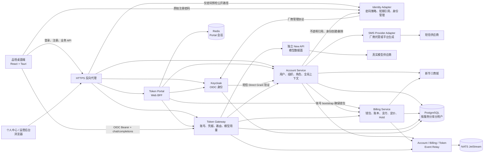

# 账号平台当前架构

> 状态：基于当前代码和数据库迁移校准的实现快照，不替代目标需求
>
> 校准日期：2026-08-23
>
> 代码审计基线：本轮连续实施起点 `e23005aaf6745d4b8c1ffa5ac73943e0f8f98ca5`，并包含本文件所在提交
>
> 文档版本：以本文件所在 Git 提交为准
>
> 目标需求：`requirements.md`、`role-system-design.md`

## 1. 架构结论

当前代码已经形成身份、业务账号、资金账务和模型访问四个服务边界，但部分目标能力仍停留在需求模型，不能按目标架构宣称已完成：

- Keycloak 是登录身份、密码和 OIDC 会话的事实源；OIDC Claim 只证明主体，不决定业务权限。迁移期保留的 `platform-admin` Realm Role 不再参与业务授权。
- Identity Adapter 是注册密码预检、策略版本、短期密码材料和 Keycloak 管理协议的唯一边界；Account 只接收不透明密码引用。
- Account Service 是永久内部用户 ID、独立用户编码、平台/组织角色、权限码、组织树、成员、管理命令审批策略/请求和用户级全局活动上下文的事实源；OIDC Session 只证明当前登录，不拥有独立计费上下文。
- Billing Service 是钱包、平衡账本、充值订单、BASE/BONUS 组成级权益、固定三元组定价、Hold 和已批准财务命令领域执行结果的事实源。
- Token Gateway 是 Token Account、加密凭据、共享/路由策略和模型用量请求的事实源；当前模型推理协议仅支持 `/v1/chat/completions`。
- New API 是模型数据面和上游用量证据源，不承载品悟用户、组织或钱包真相。
- Token Portal 是个人中心和运营后台的 Web BFF，采用 OIDC Authorization Code + PKCE、Redis 服务端会话和 CSRF 防护。
- 桌面端的内置模型路径使用与登录相同的 OIDC Access Token；旧内置模型运行时路径已移除，并已有本地迁移代码和测试。

当前代码尚未实现的关键目标包括：托管路由 Provisioning 状态机、模型目录/协议/公式版本、模型结果重放、组成级组织授予、目标退款模型、应收/拒付/强制退款状态机和账号注销 Saga。用户级全局上下文已在仓库闭环；超级管理员安全恢复已有仓库实现但仍待生产等价演练。

## 2. 逻辑拓扑

仓库配置要求反向代理只公开认证、账号、Gateway 和 Portal 的受控路径。PostgreSQL、Redis、NATS、Relay、Billing 内部 API 和 New API 管理面保持在内部网络；这属于配置和代码基线，本次审计没有取得实际生产环境与版本证据。

当前注册密码先通过 TLS 进入 Identity Adapter 的公开预检路径，取得 15 分钟有效的不透明引用和冻结的 `password_policy_version`；Account 的预检、短信和注册 API 只接收该引用，最终身份创建由 Identity Adapter 使用原始序列再次权威校验。短期原文与带独立密钥的 HMAC 仅保存在 Identity 进程内，成功创建后清除原文，过期时删除记录。Identity 还把服务端生成的注册操作 ID 绑定到密码 HMAC 指纹，并把该 ID 作为 Keycloak 用户属性保存，Account 可先按该关联查询再幂等创建，避免不确定结果下重复建号。反向方向上，Keycloak 的短信 Direct Grant Authenticator 会携带内部服务凭据调用 Account `/internal/v1/auth/sms/verify` 完成验证码核验。

## 3. 服务边界

| 组件 | 当前职责 | 当前自有状态 | 主要目标差距 |
|---|---|---|---|
| Keycloak | 用户认证、密码、OIDC Token/Session；迁移期 Realm Role 不参与业务授权 | Keycloak 数据库 | 生产部署和后续密码重置/资料同步/会话撤销端口仍待环境及任务验证 |
| Identity Adapter | 密码原始字符校验、策略版本、短期引用/HMAC、注册操作关联查询、Keycloak 用户创建/资料更新/密码重置/会话撤销及受控停用协议 | 进程内 15 分钟短期密码记录；Keycloak 持久身份与操作关联 | MFA 和账号申诉仍不在当前闭环 |
| Account Service | 永久用户 ID/编码、用户/身份映射、平台/组织 RBAC、绑定有效期/撤销/自动回收、权限解析、持久注册 Saga、短信挑战、异步钱包初始化、商城账号同步、组织/节点、成员/角色、用户级全局上下文、邀请、审计 | Account 数据库 | 超级管理员生产等价演练、注销 Saga |
| Billing Service | 钱包、账本、BASE/BONUS 组成级权益、充值、固定定价、Hold、人工调整、到期/损失复核、支付修复和对账 | Billing 数据库 | 组成级组织授予、版本化单位/公式、目标支付退款状态机、应收与组织购买 |
| Token Gateway | Token Account、加密凭据、共享策略、路由、聊天代理、用量和 New API 核对 | Token 数据库 | 模型目录、协议能力、托管 Provisioning、请求重放、持久派发和取消 |
| Token Portal | OIDC PKCE、Redis Session、CSRF、个人中心、运营后台和路径白名单代理 | Redis Session | 目标后台权限模型、缺失业务页面和发布级三语门禁 |
| Event Relay ×3 | 事务 Outbox 投递、重试和死信 | 各服务 Outbox/Inbox | 现有事件有限，不能替代缺失的跨域 Saga |
| New API | OpenAI 兼容代理、供应商调用日志和用量证据 | 独立数据库 | 仍需通过 Adapter 契约补齐协议、取消和证据能力 |

### 3.1 仓库交付形态

- 仓库同时提供 Docker Compose 和 Helm Chart；它们是可部署模板，不证明任何环境已经部署，也不证明高可用、备份、RPO 或 RTO。
- `mock-newapi` 和 `payment-simulator` 是 Compose 中的非生产测试支撑组件，不属于产品服务边界或生产逻辑拓扑；其隔离和替换决策见 `adr/ADR-007-payment-simulator.md`。
- Compose 包含上述测试支撑组件和可选真实 New API profile，供本地开发、合同测试、端到端验证和故障注入；生产 Helm 不部署这些工作负载。
- 当前真实支付 Adapter 是新华三商城；其代码能力只有下单、查询/同步和人工修复。非生产测试 Provider 提供的退款、回调和账单能力不得归入新华三或生产能力。
- 远程 Compose 已把 `payment-simulator` 主进程放入 `development-simulator` profile，但基础数据库初始化和 `payment-simulator-migrate` 尚未一并隔离；Billing 启动和 Helm 模板也仍保留 `PAYMENT_SIMULATOR_URL`、`PAYMENT_SIM_HMAC_*` 等模拟器命名的配置耦合。这些是待迁移为供应商中立 Payment Provider 配置并从生产清单彻底排除的实现债务，不代表模拟器属于生产架构。
- 本文所有部署状态均以 `implementation-status.md` 的证据为准；本轮没有环境/制品版本证明，因此统一为 `NOT_DEPLOYED`。

## 4. 当前数据所有权

### 4.1 Account 域

当前迁移包含：

- `users`、`identities`：业务用户及 OIDC 身份映射；`users.id` 使用 UUIDv7，`user_code` 使用密码学安全随机载荷与 SHA-256 校验码，二者由数据库触发器禁止修改或物理删除；用户状态包括 `PROVISIONING`、`ACTIVE`、`DISABLED`、`DELETED`。
- `user_code_registry`：永久占用已经提交的用户编码，注销后也不释放；`user_code_lookup_attempts`：只保存操作者及来源、设备、目标编码的摘要维度，用于精确查询的限流和审计，不形成公开目录。
- `organizations`、`organization_creation_requests`、`organization_units`、`organization_unit_closure`、`organization_unit_commands`：顶层组织、独立单调结构版本、按操作者隔离且不可变的创建/节点命令幂等请求，以及组织树形闭包；活动同级节点名称按不区分大小写唯一，节点和组织删除都只写终态与时间戳。
- `organization_unit_governance_blockers`：Account 域尚未收敛的节点审批或扩展任务登记；成员、节点角色和受保护子节点直接从各自权威表判断，不以缓存替代。
- `invitations`、`membership_commands`：邀请只保存手机号/用户名/兼容邮箱目标摘要和脱敏提示，目标查询由当前认证身份反向匹配；一次性链接只保存 Token 摘要。成员新增、移除和所有权转让保存操作者隔离的稳定命令指纹与原结果，角色和邀请历史禁止物理删除。
- `permissions`、`roles`、`role_permissions`、`role_assignments`、`authorization_versions`：平台/组织原子权限、内置角色、带起止/撤销/来源的授权投影、作用域和单调授权版本。
- `memberships`、`membership_units`、`role_bindings`：成员和节点范围；`role_bindings` 是组织成员角色生命周期写模型，通过数据库触发器投影到 `role_assignments`，授权查询不直接读取写模型。
- `user_active_contexts`：以 `user_id` 唯一保存 PERSONAL/ORGANIZATION、目标组织和单调 `context_version`；最近有效 Session 只用于迁移初值，切换使用期望版本 CAS。
- `user_sessions`：按 issuer + OIDC Session 保存登录观察和兼容投影，不再作为聊天或计费上下文事实源。
- `slider_captcha_challenges`、`sms_challenges`：滑块和短信挑战元数据；平台生成验证码模式只保存带密钥校验数据，不保存明文。
- `sms_send_attempts`：手机号、来源和设备的单向摘要、用途、结果与时间，用于短信多维限流和反枚举审计。
- `profile_change_requests`：用户名/手机号变更的旧值、新值、独立资料版本、短信验证和 Identity/Account/会话阶段；活跃请求对用户字段及新值分别唯一预约。
- `password_reset_operations`：只保存已验证挑战、稳定用户/Identity 引用及完成事实，不保存密码、密码摘要或验证码。
- `commerce_customer_mappings`：用户/组织到外部客户的供应商中立映射，只保存 Provider ID、Adapter 版本、脱敏外部引用和通用状态；不参与认证或业务授权。
- `commerce_customer_sync_jobs`、`commerce_customer_sync_evidence`：客户开通/资料同步任务及不可变结果证据；任务冻结主体、Provider、Adapter 版本和类别，Provider 原始协议与错误不会进入核心表或公开 API。
- `audit_logs`、`outbox_events`、`inbox_messages`、`inbox_aggregate_versions`：审计和可靠事件。

手机注册在发送短信前原子创建服务端注册操作、5 分钟唯一值预约和挑战；短信核验成功后把预约提升为 30 分钟注册租约。Account 持久保存非秘密阶段事实，先按稳定操作 ID 查询 Identity，再幂等创建；Identity 成功后预约不再按 TTL 自动释放。Account 提交以候选 UUIDv7 用户 ID 为稳定主键，在一个串行事务内写入用户、永久用户编码、身份映射、Commerce Customer Mapping/同步任务、钱包初始化任务、Outbox 和审计，随后返回可登录的 `PROVISIONING`。

钱包初始化由后台任务使用稳定幂等键调用 Billing；成功后才把用户和注册操作激活为 `ACTIVE`，短暂失败按退避重试，超过快照化 SLA 后进入 `REPAIR_REQUIRED`。`PROVISIONING` 与 `REPAIR_REQUIRED` 均允许登录和资料管理，但 Token Gateway 与充值入口按稳定原因码拒绝平台模型和支付；本地独立模型不受影响。`/v1/account/bootstrap` 不再同步调用 Billing，也不把钱包故障改写为注册失败。

客户端使用操作 ID 与 48 小时签名查询令牌恢复轮询；桌面优先把查询凭据写入系统凭据库，写入失败时只在当前 WebView 会话保留短期降级副本。运营修复入口由 `platform.registrations.repair` 保护，只返回脱敏阶段、责任域、重试和 SLA 元数据。Identity 孤儿默认向前恢复；只有 Identity 创建满 24 小时，且串行事务证明候选 Account 用户、正式映射、钱包任务和 Account Outbox 均不存在时，才能先停用 Identity、撤销会话并确认不可认证，再复核事实并释放预约，不提供直接删除捷径。这里的跨域无事实证明来自封闭发布边界：候选 ID 在 Account 提交前不会通过用户表或 Outbox 发布，Billing/Token/成员/授予/订单入口均不能引用未提交用户；任一 Account 发布事实存在都会使证明失败。

用户名和手机号修改由 `profile_change_requests` 持久 Saga 编排。客户端必须先通过密码 Direct Grant 取得五分钟内的 `auth_time`；Account 保存 `PENDING` 请求并预约规范化新值，手机号再绑定专用滑块/SMS 挑战。Identity Adapter 幂等更新同一 Keycloak subject 后，Account 以独立 `profile_version` CAS 提交；Identity 已更新而 Account 未提交时只向前重试。提交后撤销 Keycloak Refresh Token/会话并清除 Account Session 投影；手机号同时为当前 Commerce Provider 递增 Mapping 版本并创建 `PROFILE_SYNC` 任务。旧版本迟到结果只追加证据，不能覆盖新映射；同步失败不回滚登录或模型能力，但继续阻止依赖该映射的新支付。30 分钟仍未收敛的请求进入 `REPAIR_REQUIRED`。

忘记密码沿用同一密码隔离边界：未登录端只获得 Identity 进程内短期密码引用，Account 的 `PASSWORD_RESET` 短信路径对已知和未知手机号保持同形响应；验证成功后 Account 只把不透明引用和稳定 subject 交给 Identity Adapter，由其重置 Keycloak 密码并撤销全部既有会话。Account 数据库只记录验证和完成事实。

Commerce Customer worker 只依赖 `CustomerAdapter` 端口，当前 H3C 实现位于平台 Adapter；核心任务不识别厂商 Action、响应或错误文本。状态统一为 `PENDING / IN_PROGRESS / READY / RETRY / REPAIR_REQUIRED / DETACHED`，连续失败达到上限后停止自动重试并保留脱敏修复原因。Account 的授权上下文不返回 Mapping；充值入口另行读取 `/v1/me/commerce-customer-mapping`，因此 Mapping 非 `READY` 只关闭依赖外部客户的下单，不影响登录、平台模型、组织管理或其他授权决策。

### 4.2 Billing 域

当前迁移实际包含：

- `organization_lifecycle_states`、`organization_governance_blockers`：Account 组织版本在 Billing 的单调生命周期投影和可扩展删除阻断登记。DISABLED 冻结组织钱包，DELETED 为不可恢复终态并关闭钱包；新建组织钱包按该投影决定初始状态。
- `organization_unit_lifecycle_states`、`organization_unit_governance_blockers`：Account 节点结构版本在 Billing 的限制态投影及未来组成级授予/分配任务阻断登记；进入 DELETION_PENDING 后拒绝新增登记，必须清零后才接受 DELETED。
- `organization_member_lifecycle_states`：Account 成员版本在 Billing 的单调投影；REVOKED 是组织授予的即时限制输入，重新加入只能用更高成员版本恢复 ACTIVE，APT-017 的组成级授予读写必须在同一事务边界消费该状态。

- `wallets`、`ledger_accounts`、`journal_entries`、`ledger_postings`：钱包缓存余额和平衡账本；数据库触发器保护分录平衡和已入账记录不可变。
- `credit_lots`、`entitlement_packages`、`entitlement_components`、`usage_hold_allocations`：批次、兼容聚合投影、BASE/BONUS 组成事实和组成级 Hold 分配。
- `usage_loss_reviews`：权益到期释放不确定 Hold 后，迟到真实用量的平台损失复核证据。
- `recharge_products`、`pricing_versions`：商品以及固定 `input/output/cached_input` 三元组价格。
- `usage_holds`、`idempotency_records`：预占/结算和通用幂等记录。
- `payment_orders`、`payment_transactions`、`refunds`、`payment_notifications`：当前支付和退款模型。
- `manual_adjustments`、`payment_order_repairs`、`reconciliation_runs`、`reconciliation_cases`：运营调整、修复和对账。
- Billing 自有 Outbox/Inbox 表。

权益入账按冻结商品快照把总 `microcredit` 拆为且仅拆为 BASE/BONUS 组成，舍入余数归 BONUS。`entitlement_components` 保存可用、Hold、已用、有效/暂停授予、过期与撤销互斥桶并由数据库强制守恒；`entitlement_packages` 的合计字段只是触发器维护的兼容投影。当前包仍以 `payment_order_id` 关联订单，且 `payment_transactions` 对 `payment_order_id` 有唯一约束，实际是订单一对一支付流水；这与目标的一对多流水及“每个成功流水独立权益包”仍不同。

当前没有 `metering_unit_definitions`、`protocol_reservation_formula_versions`、`pricing_version_unit_rates`、`model_usage_requests`、`stream_response_events`、`upstream_dispatch_attempts`、`refund_requests`、`refund_amount_reservations`、`chargeback_cases`、`forced_refund_cases`、`payment_evidence` 或独立应收表。这些名称属于目标模型，不是现有数据结构。

账本和额度使用整数 `microcredit`，当前换算为 `10,000 microcredits = 1 展示积分`；支付金额使用人民币分。

### 4.3 Token 域

当前迁移包含：

- `organization_lifecycle_states`：Account 组织版本在 Token 域的单调投影；DISABLED/DELETED 拒绝创建新的组织用量请求，DELETED 前强校验 `CREATED / RESERVED / UPSTREAM_ACTIVE / SETTLEMENT_PENDING / REVIEW` 均已收敛。
- `organization_unit_lifecycle_states`、`organization_unit_governance_blockers`：节点删除的单调限制态投影；DELETION_PENDING 后拒绝创建节点 Token Account 或新治理事实，已有 Token Account、路由关联及未终态用量全部阻断 DELETED。
- `token_accounts`、`provider_credentials`：模型访问账号和加密凭据；管理模式为 `USER` 或 `PLATFORM`。
- `token_share_policies`、`token_explicit_members`、`routing_policies`：共享和路由策略。
- `usage_requests`、`usage_attempts`：模型请求、上游关联、Hold 和结算状态。
- `authorization_cache_versions`、`token_audit_logs` 以及 Token 自有 Outbox/Inbox 表。

当前没有 `managed_route_provisionings`。首次请求缺省路由时，Gateway 在请求内通过数据库 advisory lock 同步创建平台 Token Account 和默认路由；没有 `PENDING/READY/FAILED/REPAIR_REQUIRED` 代次、退避或人工修复状态机。

个人中心已移除自管 Token Account 页面；Gateway 仍保留普通用户 Token Account API，但会过滤平台托管账号，并禁止普通用户修改 `PLATFORM` 账号。供应商密钥只在 Gateway 内存中解密，普通用户接口不返回明文。

## 5. 身份、上下文和权限

### 5.1 当前权限模型

- 平台运营后台使用 Account 平台角色和原子权限码；Account、Billing、Token Gateway 都默认拒绝，并分别按接口所需权限调用 Account 授权解析。Keycloak `platform-admin` Realm Role 不能绕过拒绝。
- 本人资料接口返回格式化 `user_code`，桌面与 Web 不展示内部 `user_id`。运营端用户列表/详情展示编码；编码查询是单独的完整等值接口，先校验格式和校验码，再检查 `platform.users.read`，并按操作者、来源 IP、设备和目标编码摘要限流。不存在、无权和输入无效对调用方使用不泄露存在性的结果；编码不是登录、找回、会话或授权凭据。
- `OWNER`、`ORG_ADMIN`、`BILLING_ADMIN`、`UNIT_ADMIN`、`MEMBER`、`AUDITOR` 是 Account 域组织角色，通过 `role_assignments` 解析权限和组织/节点作用域；旧 `role_bindings` 仅作为迁移期写入兼容投影。
- 平台/组织角色绑定支持开始/到期时间、来源、单绑定幂等撤销和自动回收。所有权限解析都直接按数据库时间过滤未来、过期或已撤销绑定；数据库触发器维护单调 `authorization_versions`，成员与角色变化递增用户/Session 兼容授权版本但不伪造活动上下文切换，worker 将到期事实固化并写审计与 Outbox。组织 `role_bindings` 是写模型，平台直接授权写入 `role_assignments`。
- 普通授权接口拒绝 `OWNER`、基础 `MEMBER` 和平台角色；运营通用接口拒绝 `PLATFORM_SUPER_ADMIN` 与 `OWNER`。超级管理员由专用安全生命周期维护：数据库同时保护最后一个有效超级管理员的角色绑定和用户状态，停用、删除及注销预检统一返回 `LAST_ACTIVE_SUPER_ADMIN`。旧管理员仍须按 `deploy/runbooks/account-rbac-migration.md` 明确映射，不能自动全部升级为超级管理员。
- 首个 `admin` 身份由主机/集群受控的 `account-security` 离线命令幂等创建，业务用户在正式密码安全激活前保持 `BOOTSTRAP_PENDING`，Identity 身份保持禁用且没有超级管理员绑定。正式密码只进入 CLI 与 Identity Adapter；Account 数据库只保存一次性凭据的用途/部署代次绑定 SHA-256 校验值和生命周期事实。
- Break-glass 与普通角色交接分离：仓库不提供公网恢复 API；离线命令必须记录“全部超级管理员异常失联”的显式确认、运维工作负载身份、事故理由、证据摘要、目标和最长 60 分钟有效期，并立即产生不可变审计与 CRITICAL 告警。它不能绕过最后管理员主动注销门禁。
- 注销 Saga 尚由 APT-014 实现；Account 已提供 ACC-48 的所有者/最后管理员预检和全量角色撤销原语，在 Identity 清理前使有效及未来绑定失效、递增授权/用户版本并清除 Account Session。跨 Identity Refresh Token 撤销仍由注销协调器完成。
- 后台写命令必须经 `approvalpolicy` 的版本化 `command_type` 注册表分类；当前九类直接改写财务事实的命令固定为 `APPROVAL_REQUIRED`，普通退款、组织删除、治理配置和确定性任务固定为 `AUDIT_ONLY`，未知命令或分类冲突失败关闭。审批申请、不可变快照、决定、状态事件和执行记录归 Account 所有，禁止申请人按稳定用户 ID 自审。
- 批准事务只写 `account.approval-command.authorized.v1` Outbox，不直接改写账本。Billing 的 `billing-command-executor` 先向 Account 强一致复核申请人/审批人的当前绑定、权限、有效期、授权版本、策略和关键资源版本，再以 `approval_request_id + command_type + command_fingerprint` 派生稳定执行键；人工钱包调整的领域事务保存申请 ID/执行键并由数据库触发器拒绝新的直接入账。九类命令先完整占用稳定分类，当前只有已存在领域语义的 `WALLET_ADJUSTMENT` 可创建申请；其他类型在对应资金领域任务交付执行器前拒绝创建，不能进入永远无法执行的批准状态。当前服务间认证仍使用共享长期令牌，APT-047 负责替换为短期工作负载身份，不改变审批/执行所有权边界。
- 顶层组织生命周期由 Account 编排，Billing 对资金事实、Token 对未终态用量事实分别作权威判断。创建请求以操作者、幂等键和规范化请求指纹唯一；搜索使用状态过滤及 `updated_at + organization_id` 复合游标。停用先让 Billing 与 Token 以 Account 下一版本进入限制态，再由 Account 冻结成员、递增授权版本并将命中的用户级活动上下文回退到个人；启用仅在下游投影均可恢复时执行。删除必须已停用：Account 先核验邀请和治理审批，再以两阶段协议先对 Billing/Token 执行无副作用预检并汇总阻断原因；Billing 在提交阶段再次串行核验余额/预留、权益、Hold、支付、退款、对账差异、待核对用量、人工调整和扩展阻断登记，Token 核验所有可能继续结算的用量已收敛，随后按 Billing、Token、Account 的顺序写入不可逆 `DELETED` 终态。停用后禁止产生新的组织资金和用量事实，因此超时重试只会保持或进入更严格状态；任一远端事实不可确认均失败关闭，账本、订单、用量、审计和幂等记录不物理删除。
- 组织节点命令以操作者、目标组织、命令类型和幂等键唯一，保存版本化规范请求指纹及原结果；同键异请求冲突。组织的 `structure_version` 独立于顶层生命周期版本，创建、重命名、移动和删除在串行事务内递增；移动以调用方读取的结构版本作 CAS，并原子重建受影响闭包路径。节点删除先让 Billing/Token 在同一节点锁命名空间进入 `DELETION_PENDING`，从此拒绝新增授予登记、节点 Token Account 和治理事实；Account 随后在提交事务内重检受保护子节点、成员、角色、审批和任务，Billing/Token 分别权威检查授予登记、Token Account/路由和未终态用量。全部清零后各域按更高结构版本固化 DELETED；超时只留下可重试的更严格状态，节点、闭包、命令及关联历史均不物理删除。
- 邀请统一使用 PHONE、USERNAME、LINK（并保留 EMAIL 兼容入口）实体：创建不查询或暴露目标是否存在，手机号/用户名只保存规范值摘要和提示；本人待接受列表只用当前认证用户已验证标识反向匹配，接受时再次绑定当前稳定用户 ID。Token/邀请 ID 均在串行事务内一次消费，过期、撤销和接受终态永久保留。成员新增、移除和所有权转让以稳定幂等键及请求指纹提交；移除同事务撤销全部当前/未来角色、递增授权版本、使命中的用户级活动上下文回退个人并发出唯一成员事件，随后同步 Billing REVOKED 投影。有效组织的唯一 OWNER 由延迟数据库约束复核，所有权只能通过专用事务先撤销旧绑定、保留历史再建立新绑定。

### 5.2 当前上下文

当前上下文以用户为全局唯一聚合：

- `PERSONAL`：个人钱包和个人路由。
- `ORGANIZATION`：指定用户已加入的有效组织，使用组织角色、路由和钱包。

`user_active_contexts` 为每个用户保存一条记录。切换请求携带 `expected_context_version`，Account 在串行事务中校验成员与组织状态并递增版本；旧端写入返回冲突，不能覆盖更新的选择。成员移除或组织停用在各自事务内自动回到 PERSONAL。Account、Token Gateway 和跨服务授权响应通过 `X-Context-Version` 返回当前版本，组织管理响应同时返回 `X-Authorization-Version`；Portal 原样转发，桌面桥接显式承载。Web/桌面只接受更高版本，并在版本提升、窗口聚焦或切换成功后中止旧请求、清空旧上下文资源并重读。

## 6. 当前模型调用与计费链路

当前 `/v1/chat/completions` 链路为：

1. 解析 OIDC 主体和 Account 用户级全局上下文，并冻结请求开始时的版本与钱包事实。
2. 解析模型和最大输出 Token，列出并确定性选择可用路由；无缺省路由时同步确保平台路由。
3. 从 Billing 读取固定三元组价格，以平台最大输入 Token 和请求最大输出 Token 计算最大费用。
4. 创建 `usage_request`，向 Billing 创建 Hold。
5. 解密所选凭据，记录上游尝试，调用 New API。
6. 根据返回 usage 结算；证据不确定时进入 `REVIEW`，后台按 New API 请求日志核对，不自动重发模型请求。

当前边界和目标差距：

- 路由已有确定性优先级、显式账号失败不回退、上下文/共享策略检查，但没有独立模型目录和 `CATALOG_VISIBLE → Provisioning READY → CONTEXT_ELIGIBLE → RESERVABLE` 状态管线。
- Hold 在上游调用前创建，并按组成到期时间、同日 BONUS→BASE、入账时间和稳定组件 ID 分配及结算；仍没有追加预占、长调用续租和完整派发不确定状态机。组成到期 Worker 会先释放相关不确定 Hold，再把迟到确认的真实用量写入平台损失复核，禁止改扣其他权益。
- 定价只支持输入、输出、缓存输入三元组；没有协议公式、版本化计量单位、显式零价/配置缺失区分和逐单位来源快照。
- 幂等键可显式传入或稳定派生，但重复请求返回 `USAGE_REPLAY_BLOCKED`，不会回放既有结果；也没有版本化规范请求指纹、同键异请求 `409`、流事件存储、结果/墓碑分层保留或 `410` 语义。
- 流式响应直接转发给客户端，未先持久化；请求上下文取消可能中止上游，不具备断线继续执行和按序重放。
- 没有持久派发租约/意图状态机，也没有模型请求取消命令及 Provider 取消能力契约。

## 7. 当前支付、权益与退款

充值以 Billing `product_id` 为可信输入，金额、外部 SKU、BASE/BONUS 商品字段、展示积分和有效期由服务端目录派生。当前 UAT 目录为：

| 商品 | 商城 SKU | 金额 | 总展示积分 | 有效期 | 状态 |
|---|---|---:|---:|---:|---|
| 体验版 | `0502AJON` | ¥0.10 | 2,000 | 30 天 | UAT 暂定 |
| 标准版 | `0502AJ0Q` | ¥10.00 | 4,000 | 30 天 | UAT 暂定 |
| 高级版 | `0502AJOR` | ¥30.00 | 9,000 | 30 天 | UAT 暂定 |
| 旗舰版 | `0502AJOP` | ¥200.00 | 50,000 | 30 天 | UAT 暂定 |

新华三 Adapter 当前只支持支付宝下单、订单查询/同步和人工修复，不支持主动退款、关单、回调或账单。客户端关闭二维码页后，Billing 后台仍可继续查询。仓库中的非生产测试 Provider 支持更多动作，但只用于开发/测试，不能扩张生产能力声明。

商城确认支付成功后，Billing 幂等创建一个权益包、BASE/BONUS 组成及逐组成账本分录；Hold 与人工扣减使用确定的组成级消费顺序。组织授予和目标退款尚未迁移到该组成模型。

现有普通退款是兼容旧模型的订单级、可输入金额的部分退款：

- 请求绑定 `payment_order_id`，接受 `amount_fen`，按订单聚合积分比例计算撤销量，并包含 `PARTIALLY_REFUNDED`。
- 本地事务会先预约退款/额度，再调用 Provider；但没有退款 Outbox 恢复，也没有支付流水 + 权益包目标锁定。
- 组成表已保存 BASE/BONUS 各自累计已用与剩余证据，但现有退款流程尚未用该证据执行“任一组成已消费即拒绝”，也尚未在成功后原子撤销全部未消费 BASE 和关联 BONUS。

因此，最新目标规则——普通退款不接受部分金额，任一关联 BASE/BONUS 曾消费即拒绝；成功时现金只退全部 BASE，并撤销全部未消费 BASE 与关联 BONUS——与当前实现冲突，当前退款必须重构而不是复用比例退款逻辑。

## 8. 一致性与事件

平台不使用跨服务分布式事务。三个服务具备本地 Outbox/Inbox、Relay、重试和死信基础，当前主要事件为：

- `account.membership.changed.v1`
- `billing.recharge.succeeded.v1`
- `token.usage.settled.v1`

本地业务状态与对应 Outbox 写入具备事务原子性；Relay 以至少一次语义重试投递，默认达到 12 次失败后进入死信，需审计后人工重新入队。因此该机制保留并重试事件，但业务最终收敛仍依赖死信处置，不能无条件宣称最终投递。注册 Account 提交会原子写入 `account.wallet.provisioning.requested.v1`，钱包成功写入 `account.wallet.provisioning.completed.v1`；财务审批成功写入绑定命令指纹、策略、目标和关键版本的 `account.approval-command.authorized.v1`，Billing 重复消费使用同一领域执行键。账号注销、目标退款和托管路由 Provisioning 等 Saga 仍未实现。

## 9. 客户端与 Portal

- Portal 采用 OIDC Authorization Code + PKCE、Redis 服务端 Session、CSRF 和严格代理路径白名单。
- 桌面 OIDC Access Token 保留在 Rust 进程，Refresh Token 只存系统凭据库，不持久化密码。
- 旧内置模型迁移具备盘点报告、配置备份、会话/计划任务模型 ID 迁移和旧凭据清理重试；当前测试覆盖迁移幂等以及运行时不再引用旧 `llmapi_hub` 路径。
- 当前个人中心没有 Token Account 管理入口；管理后台仍提供平台 Token Account、凭据元数据、路由、用量、钱包、订单、调整和修复等能力。
- 桌面与 Web 当前路由已有中/英/日词条测试，但尚无覆盖全部目标页面、错误码和发布制品的三语发布门禁。
- 发布、安装、运行三层迁移门禁及不计费 readiness 仍未形成完整、可部署证明。

## 10. 安全边界

- 远程用户入口要求 HTTPS；开发态 HTTP 仅限 loopback。
- Portal 内部服务凭据不下发浏览器或桌面端；桌面 OIDC Token 不进入 WebView JavaScript。
- 注册原始密码只进入 Identity Adapter 的预检和最终创建边界；Account、短信、Billing、Commerce、事件和普通可观测链路只接收不透明引用或非秘密注册事实。Identity 不 trim、规范化、转换或截断密码，并在创建完成或引用到期后清除短期原文。
- Provider 地址使用 HTTPS 和主机白名单；生产密钥目标为 KMS/Vault，本地 KEK 只用于开发/测试。
- Keycloak `/admin/` 应限制在受控网络或隧道内。
- 日志不得记录密码、短信验证码、OIDC Token、供应商密钥或支付密钥。

## 11. 审计证据与主要风险

本次代码级校准使用以下验证：

- `node scripts/account-platform.mjs test unit`：所有 Go 包测试通过（项目内置 Go 工具链，`nomsgpack` 标签）。
- `npm test`（`account-platform/`）：OpenAPI lint 和 37 个合同测试通过。
- `node --test tests/account_platform_state.test.mjs tests/ui_language_coverage.test.mjs tests/scheduled_tasks_unit.test.js`（`pinvou3-app/`）：39 个测试通过。
- `node scripts/account-platform.mjs verify`：Go 单测与 Vet、合同测试、架构守卫和差异检查通过。

| 项目 | 当前事实 | 风险/下一步 |
|---|---|---|
| 部署 | 只有 Compose/Helm 仓库模板，本轮无环境证据 | 不得宣称生产部署、HA、备份或 RPO/RTO 已完成 |
| 注册 | 唯一值预约、持久恢复、Identity 关联查询、异步钱包任务、SLA、`REPAIR_REQUIRED` 和证明门禁补偿已闭环 | Identity 短期密码材料仍为单副本内存能力；生产运行和故障注入证据待部署补齐 |
| 权限与审批 | 平台和组织接口使用 Account 原子权限码、显式作用域、绑定有效期、单条撤销、自动回收和默认拒绝；最后超级管理员保护、安全恢复及版本化管理命令审批/幂等执行已有仓库实现 | 补注销 Saga 集成、短期工作负载身份和生产等价安全恢复/审批故障演练 |
| 模型调用 | Hold 前置和事后核对已有基础 | 补目录/公式/Provisioning、派发持久化、重放和取消 |
| 权益 | BASE/BONUS 组成、确定消费/到期和守恒约束已实现 | 补组织授予，并让目标退款/拒付/注销回收复用组成级事务边界 |
| 支付 | 新华三只有下单与查询；数据模型是一单一流水 | 目标一对多流水、独立状态机、退款/拒付/应收和证据模型均待实现 |
| 客户端切换 | 运行时旧路径已删除，迁移测试已通过 | 补发布/安装门禁、非计费 readiness 和制品级回滚证明 |
| 测试 | 单元、合同和定向桌面测试通过 | 本轮未执行 Compose 集成、E2E、故障注入、性能或部署验收 |
