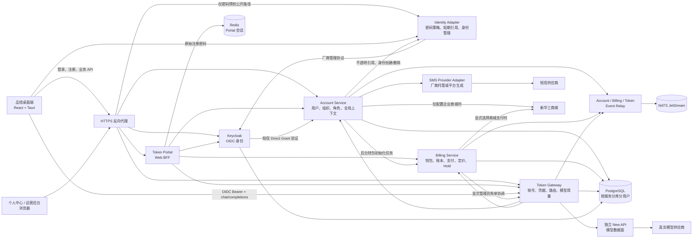

# 账号平台当前架构

> 状态：基于当前代码和数据库迁移校准的实现快照，不替代目标需求
>
> 校准日期：2026-10-06
>
> 继承实现基线：已审 A09 `0f296df2d4844959a413db793dd2a93454b4cbd4`；本波原始 A10 历史终点为 `36ce0a72e28887cb96c1c984c6374386d9acb112`。本文件描述本波待审实现边界，验证结论以最终固定提交的审核记录为准；代码存在不等于本地审核或生产验收通过。
>
> 文档版本：以本文件所在 Git 提交为准
>
> 目标需求：`requirements.md`、`role-system-design.md`

## 1. 架构结论

当前代码已经形成身份、业务账号、资金账务和模型访问四个服务边界，但部分目标能力仍停留在需求模型，不能按目标架构宣称已完成：

- Keycloak 是登录身份、密码和 OIDC 会话的事实源；OIDC Claim 只证明主体，不决定业务权限。迁移期保留的 `platform-admin` Realm Role 不再参与业务授权。
- Identity Adapter 是注册密码预检、策略版本、短期密码材料和 Keycloak 管理协议的唯一边界；Account 只接收不透明密码引用。
- Account Service 是永久内部用户 ID、独立用户编码、平台/组织角色、权限码、组织树、成员、管理命令审批策略/请求和用户级全局活动上下文的事实源；OIDC Session 只证明当前登录，不拥有独立计费上下文。
- Billing Service 是钱包、平衡账本、充值订单、BASE/BONUS 组成级权益、版本化计量单位、确定性价格生命周期、Hold 和已批准财务命令领域执行结果的事实源。
- Token Gateway 是 Token Account、加密凭据、共享/路由策略、版本化协议/安全公式和模型用量请求的事实源；当前已接入的数据面协议仍仅支持 `/v1/chat/completions`。
- New API 是模型数据面和上游用量证据源，不承载品悟用户、组织或钱包真相。
- Token Portal 是个人中心和运营后台的 Web BFF，采用 OIDC Authorization Code + PKCE、Redis 服务端会话和 CSRF 防护。
- 桌面端账户 Gateway 路径使用与登录相同的 OIDC Access Token。A07 已完成旧内置模型入口迁移、孤立引用转换、凭据清理和失败恢复的本地审核；本波必须保全这些行为。生产安装与发布验收仍须另行执行。

当前代码尚未实现的关键目标包括：托管路由 Provisioning 状态机、独立模型目录、模型结果重放、账单逐行支付证据归并、完整关单中间态和账号注销 Saga。用户级全局上下文与组成级组织授予继承已审 A09；本波包含计量/公式/价格快照、目标普通退款、支付异常统一结案、独立应收/拒付会计链路、每日四方对账和晚到支付人工复核的待审实现。用户已确认未发布的 LEGACY 普通退款采用定向整笔契约，移除旧的部分金额输入，PLAN 不可退款；超级管理员安全恢复已有仓库实现但仍待生产等价演练。

## 2. 逻辑拓扑

仓库配置要求反向代理只公开认证、账号、Gateway 和 Portal 的受控路径。PostgreSQL、Redis、NATS、Relay、Billing 内部 API 和 New API 管理面保持在内部网络；这属于配置和代码基线，本次审计没有取得实际生产环境与版本证据。

当前注册密码先通过 TLS 进入 Identity Adapter 的公开预检路径，取得 15 分钟有效的不透明引用和冻结的 `password_policy_version`；Account 的预检、短信和注册 API 只接收该引用，最终身份创建由 Identity Adapter 使用原始序列再次权威校验。短期原文与带独立密钥的 HMAC 仅保存在 Identity 进程内，成功创建后清除原文，过期时删除记录。Identity 还把服务端生成的注册操作 ID 绑定到密码 HMAC 指纹，并把该 ID 作为 Keycloak 用户属性保存，Account 可先按该关联查询再幂等创建，避免不确定结果下重复建号。A06 遗留未完成意图只有经本地持久审计证明后才使用其原命名空间；不按用户名或手机号猜测身份。反向方向上，Keycloak 的短信 Direct Grant Authenticator 携带内部服务凭据调用 Account `/internal/v1/auth/sms/verify`，并按 `/internal/v1/auth/mobile/identity` 返回的当前权威 subject 登录。

## 3. 服务边界

| 组件 | 当前职责 | 当前自有状态 | 主要目标差距 |
|---|---|---|---|
| Keycloak | 用户认证、密码、OIDC Token/Session；迁移期 Realm Role 不参与业务授权 | Keycloak 数据库 | 生产部署和后续密码重置/资料同步/会话撤销端口仍待环境及任务验证 |
| Identity Adapter | 密码原始字符校验、策略版本、短期引用/HMAC、注册操作关联查询、Keycloak 用户创建/资料更新/密码重置/会话撤销及受控停用协议 | 进程内 15 分钟短期密码记录；Keycloak 持久身份与操作关联 | MFA 和账号申诉仍不在当前闭环 |
| Account Service | 永久用户 ID/编码、用户/身份映射、平台/组织 RBAC、绑定有效期/撤销/自动回收、权限解析、持久注册 Saga、短信挑战、异步钱包初始化、商城账号同步、组织/节点、成员/角色、用户级全局上下文、Session 登录观察、安全管理员生命周期、邀请、审计 | Account 数据库 | 注销 Saga；安全恢复仍需生产等价演练 |
| Billing Service | 钱包、账本、BASE/BONUS 组成级权益、组织购买与成员授予、版本化计量单位、全局/模型价格解析、价格生命周期、Hold/组成分配/租约及异常处理证据、独立应收与清偿分配、单流水拒付冲销、供应商中立支付能力/商品映射、目标退款、晚到支付复核、人工调整、到期/损失复核、支付修复和对账 | Billing 数据库 | 统一拒付/强制退款结案实现待本波固定审核；正式商品业务冻结与生产验收、账单证据归并仍待完成 |
| Token Gateway | Token Account、加密凭据、共享策略、路由、协议/公式版本、安全参数映射、动态预占、聊天代理、用量和 New API 核对 | Token 数据库 | 独立模型目录、更多数据面协议 Adapter、托管 Provisioning、请求重放、持久派发和取消 |
| Token Portal | OIDC PKCE、Redis Session、CSRF、个人中心、运营后台和路径白名单代理 | Redis Session | 目标后台权限模型、缺失业务页面和发布级三语门禁 |
| Event Relay ×3 | 事务 Outbox 投递、重试和死信 | 各服务 Outbox/Inbox | 现有事件有限，不能替代缺失的跨域 Saga |
| New API | OpenAI 兼容代理、供应商调用日志和用量证据 | 独立数据库 | 仍需通过 Adapter 契约补齐协议、取消和证据能力 |

### 3.1 仓库交付形态

- 仓库同时提供 Docker Compose 和 Helm Chart；它们是可部署模板，不证明任何环境已经部署，也不证明高可用、备份、RPO 或 RTO。
- `mock-newapi` 和 `payment-simulator` 是 Compose 中的非生产测试支撑组件，不属于产品服务边界或生产逻辑拓扑；其隔离和替换决策见 `adr/ADR-007-payment-simulator.md`。
- Compose 包含上述测试支撑组件和可选真实 New API profile，供本地开发、合同测试、端到端验证和故障注入；生产 Helm 不部署这些工作负载。
- 当前真实支付 Adapter 是新华三商城；其代码能力只有下单、查询/同步和人工修复。非生产测试 Provider 提供的退款、回调和账单能力不得归入新华三或生产能力。
- 远程 Compose 将模拟器进程、迁移和数据库初始化统一置于显式开发配置后。开发 Provider 使用一组明确配置；正式环境的测试能力和资金门禁按实际生产接线验证，不把渲染成功当作启动或收款验收。
- 生产部署状态仍未验证；A06 隔离 Compose 执行已有固定输入与环境证据，边界见 `implementation-status.md` 第 0 节。不能把历史矩阵中的 `NOT_DEPLOYED` 当作这些本地执行从未发生，也不能把本地执行升级为生产部署证明。

## 4. 当前数据所有权

### 4.1 Account 域

当前迁移包含：

- `users`、`identities`：业务用户及 OIDC 身份映射；`users.id` 使用 UUIDv7，`user_code` 使用密码学安全随机载荷与 SHA-256 校验码，二者由数据库触发器禁止修改或物理删除；用户状态包括 `PROVISIONING`、`ACTIVE`、`DISABLED`、`DELETED`。
- `user_code_registry`：永久占用已经提交的用户编码，注销后也不释放；`user_code_lookup_attempts`：只保存操作者及来源、设备、目标编码的摘要维度，用于精确查询的限流和审计，不形成公开目录。
- `organizations`、`organization_creation_requests`、`organization_units`、`organization_unit_closure`、`organization_unit_commands`：顶层组织、独立单调结构版本、按操作者隔离且不可变的创建/节点命令幂等请求，以及组织树形闭包；活动同级节点名称按不区分大小写唯一，节点和组织删除都只写终态与时间戳。
- `organization_unit_governance_blockers`：Account 域尚未收敛的节点审批或扩展任务登记；成员、节点角色和受保护子节点直接从各自权威表判断，不以缓存替代。
- `invitations`、`membership_commands`：邀请只保存手机号/用户名/兼容邮箱目标摘要和脱敏提示，目标查询由当前认证身份反向匹配；一次性链接只保存 Token 摘要。成员新增、移除和所有权转让保存操作者隔离的稳定命令指纹与原结果，角色和邀请历史禁止物理删除。
- `permissions`、`roles`、`role_permissions`、`role_assignments`、`authorization_versions`：平台/组织原子权限、内置角色、带起止/撤销/来源的授权投影、作用域和单调授权版本。
- `memberships`、`membership_units`、`role_bindings`：成员和节点范围；`role_bindings` 是组织成员角色生命周期写模型，通过数据库触发器投影到 `role_assignments`，授权查询不直接读取写模型。
- `user_active_contexts`：以 `user_id` 唯一保存 PERSONAL/ORGANIZATION、目标组织和单调 `context_version`；最近有效 Session 只用于迁移初值，切换使用期望版本 CAS。
- `user_sessions`：按 issuer + OIDC Session 保存登录观察和兼容投影，不再作为聊天或计费上下文事实源。
- `slider_captcha_challenges`、`sms_challenges`：滑块和短信挑战元数据；平台生成验证码模式只保存带密钥校验数据，不保存明文。
- `sms_send_attempts`：手机号、来源和设备的单向摘要、用途、结果与时间，用于短信多维限流和反枚举审计。
- `profile_change_requests`：用户名/手机号变更的旧值、新值、独立资料版本、短信验证和 Identity/Account/会话阶段；活跃请求对用户字段及新值分别唯一预约。
- `password_reset_operations`：只保存已验证挑战、稳定用户/Identity 引用及完成事实，不保存密码、密码摘要或验证码。
- `commerce_customer_mappings`：用户/组织到外部客户的供应商中立映射，只保存 Provider ID、Adapter 版本、脱敏外部引用和通用状态；不参与认证或业务授权。
- `commerce_customer_sync_jobs`、`commerce_customer_sync_evidence`：客户开通/资料同步任务及不可变结果证据；任务冻结主体、Provider、Adapter 版本和类别，Provider 原始协议与错误不会进入核心表或公开 API。
- `audit_logs`、`outbox_events`、`inbox_messages`、`inbox_aggregate_versions`：审计和可靠事件。

手机注册在发送短信前原子创建服务端注册操作、5 分钟唯一值预约和挑战；短信核验成功后把预约提升为 30 分钟注册租约。Account 持久保存非秘密阶段事实，先按稳定操作 ID 查询 Identity，再幂等创建；Identity 成功后预约不再按 TTL 自动释放。Account 提交以候选 UUIDv7 用户 ID 为稳定主键，在一个串行事务内写入用户、永久用户编码、身份映射、Commerce Customer Mapping/同步任务、钱包初始化任务、Outbox 和审计，随后返回可登录的 `PROVISIONING`。

钱包初始化由后台任务使用稳定幂等键调用 Billing；成功后才把用户和注册操作激活为 `ACTIVE`，短暂失败按退避重试，超过快照化 SLA 后进入 `REPAIR_REQUIRED`。`PROVISIONING` 与 `REPAIR_REQUIRED` 均允许登录和资料管理，但 Token Gateway 与充值入口按稳定原因码拒绝平台模型和支付；本地独立模型不受影响。`/v1/account/bootstrap` 不再同步调用 Billing，也不把钱包故障改写为注册失败。

客户端使用操作 ID 与 48 小时签名查询令牌恢复轮询；桌面由 Rust 管理查询凭据，优先写入系统凭据库，写入失败时仅保留绑定当前会话代次、服务地址及注册事实的进程内记录，界面提示不能跨重启恢复。查询令牌不进入 WebView。运营修复入口由 `platform.registrations.repair` 保护，只返回脱敏阶段、责任域、重试和 SLA 元数据。Identity 孤儿默认向前恢复；只有 Identity 创建满 24 小时，且串行事务证明候选 Account 用户、正式映射、钱包任务和 Account Outbox 均不存在时，才能先停用 Identity、撤销会话并确认不可认证，再复核事实并释放预约，不提供直接删除捷径。这里的跨域无事实证明来自封闭发布边界：候选 ID 在 Account 提交前不会通过用户表或 Outbox 发布，Billing/Token/成员/授予/订单入口均不能引用未提交用户；任一 Account 发布事实存在都会使证明失败。远端创建结果未知时，即使密码引用失效也不能当作从未创建而释放预约。

用户名和手机号修改由 `profile_change_requests` 持久 Saga 编排。客户端必须先通过密码 Direct Grant 取得五分钟内的 `auth_time`；Account 保存 `PENDING` 请求并预约规范化新值，手机号再绑定专用滑块/SMS 挑战。Identity Adapter 幂等更新同一 Keycloak subject 后，Account 以独立 `profile_version` CAS 提交；Identity 已更新而 Account 未提交时只向前重试。提交后撤销 Keycloak Refresh Token/会话并清除 Account Session 投影；手机号同时为当前 Commerce Provider 递增 Mapping 版本并创建 `PROFILE_SYNC` 任务。旧版本迟到结果只追加证据，不能覆盖新映射；同步失败不回滚登录或模型能力，但继续阻止依赖该映射的新支付。30 分钟仍未收敛的请求进入 `REPAIR_REQUIRED`。

资料变更首次撤销会话前，Account 持久占用调用权并冻结当时的 Account 会话身份集合；迟到的本地投影只清理该集合，保留用户后来建立的新登录。Identity Adapter 按资料变更 ID 和 subject 保存独立的进程内撤销确认：已经确认的操作只回复成功，不能再次撤销远端会话；调用结果未知、或重启后非首次请求缺少确认时，不猜测执行结果或自动重新撤销，而进入既有 `REPAIR_REQUIRED`。确认记录保留至该服务进程退出，不属于密码预检记录，也不提供跨重启的远端完成证明。

忘记密码沿用同一密码隔离边界：未登录端只获得 Identity 进程内短期密码引用，Account 的 `PASSWORD_RESET` 短信路径对已知和未知手机号保持同形响应；验证成功后 Account 只把不透明引用和稳定 subject 交给 Identity Adapter，由其重置 Keycloak 密码并撤销全部既有会话。Account 数据库只记录验证和完成事实。

Commerce Customer worker 只依赖 `CustomerAdapter` 端口，当前 H3C 实现位于平台 Adapter；核心任务不识别厂商 Action、响应或错误文本。状态统一为 `PENDING / IN_PROGRESS / READY / RETRY / REPAIR_REQUIRED / DETACHED`，连续失败达到上限后停止自动重试并保留脱敏修复原因。Account 的授权上下文不返回 Mapping；充值入口另行读取 `/v1/me/commerce-customer-mapping`，因此 Mapping 非 `READY` 只关闭依赖外部客户的下单，不影响登录、平台模型、组织管理或其他授权决策。

### 4.2 Billing 域

当前迁移实际包含：

- `organization_lifecycle_states`、`organization_governance_blockers`：Account 组织版本在 Billing 的单调生命周期投影和可扩展删除阻断登记。DISABLED 冻结组织钱包，DELETED 为不可恢复终态并关闭钱包；新建组织钱包按该投影决定初始状态。
- `organization_unit_lifecycle_states`、`organization_unit_governance_blockers`：Account 节点结构版本在 Billing 的限制态投影及未来组成级授予/分配任务阻断登记；进入 DELETION_PENDING 后拒绝新增登记，必须清零后才接受 DELETED。
- `organization_member_lifecycle_states`：Account 成员版本在 Billing 的单调投影；REVOKED 是组织授予的即时限制输入，重新加入只能用更高成员版本恢复 ACTIVE，组成级授予读写必须在同一事务边界消费该状态。Account 成员版本事件覆盖成员命令、角色变更和组织绑定到期，Billing 成员消费者与 HTTP 生命周期入口共用投影事务，保持当前成员版本和授予版本一致。该事件是完整成员状态快照，接收方以稳定成员聚合绑定组织/用户并只接受更新版本，允许从保留期内首个较高版本恢复；重复、旧版和同版本异事实不能反转投影。Inbox、成员限制态、授予及其审计/Outbox 在同一事务提交，其他增量事件继续使用原连续版本门禁。授予到期资金只由既有权益到期事务同步钱包、批次和账本，成员恢复不提前修改过期资金桶。
- `member_quota_grants`、`member_quota_revoke_commands`、`member_quota_hold_allocations`、`member_quota_grant_audits`：成员授予绑定组织钱包内的精确权益包和 BASE/BONUS 组成，保存互斥余额桶、成员/授予版本、稳定请求指纹、Hold 分配与不可变审计；批量入口为每项派生稳定子键并独立提交。

- `wallets`、`ledger_accounts`、`journal_entries`、`ledger_postings`：钱包缓存余额和平衡账本；数据库触发器保护分录平衡和已入账记录不可变。
- `credit_lots`、`entitlement_packages`、`entitlement_components`、`usage_hold_allocations`：批次、兼容聚合投影、BASE/BONUS 组成事实和组成级 Hold 分配。
- `usage_hold_lease_events`、`usage_hold_admin_actions`：Hold 创建/续租的不可变有效值历史，以及只在 Token 权威终态免单、无活动上游及唯一财务胜者确认后的幂等安全释放证据；释放同时快照组成和成员分配结果。
- `usage_loss_reviews`：已显式终态免单的到期 Hold 收到迟到真实用量时的平台损失复核证据；到期本身不自动释放不确定预占。
- `recharge_products`：可售商品及冻结的权益组成快照。
- `payment_product_mappings`：通用商品到 Provider/版本/外部 SKU 的不可变版本映射，保存金额、币种、渠道、状态和有效期；`TEST_ONLY` 映射在正式环境不可用。
- `metering_unit_definitions`、`pricing_versions`、`pricing_version_unit_configs`、`pricing_space_versions`：版本化计量单位、全局/模型定价空间、逐单位固定价或显式继承，以及共享价格空间 ETag 的发布/编辑冲突控制。
- `billing_protocol_formula_bindings`：Billing 保存 Token 已发布协议公式与所引用计量单位的不可变绑定；单位代码、版本 UUID 和表达式须精确对应，不能仅比较排序后的 UUID 集合。
- `pricing_operation_commands`、`pricing_publish_commands`、`pricing_lifecycle_commands`、`pricing_audits`、`pricing_blocks`：创建/编辑、发布与撤销/结束的幂等命令、不可变原结果、审计和显式阻断窗口；丢失响应后的同请求重放先读取原回执，不因空间 ETag 后续变化重复执行。
- `usage_holds`、`idempotency_records`：预占/结算和通用幂等记录；Hold 冻结请求上下文、协议/公式、估算器、逐单位价格及来源，后续续租、追加预占和结算不重新定价。
- `payment_orders`、`payment_transactions`、`payment_evidence`、`refunds`、`refund_component_reservations`、`refund_grant_reservations`、`forced_refund_cases`、`payment_notifications`：当前支付和退款模型；订单冻结 Provider ID/版本、商品映射 ID、完整映射、能力声明、实际付款人及受益主体，后续不以新版本重新解释历史订单。一个订单可关联多笔不可变 Provider 支付流水；回调、查询、关单观察和人工修复先保存原始载荷摘要与快照，再归并流水状态。普通退款以支付流水和权益包为唯一目标，退款预约保存 BASE/BONUS 组成及授予快照；渠道强制退款保存独立外部资金事实并冻结目标权益包，不能覆盖支付成功事实。订单还冻结支付期限、晚到复核边界和最终归档期限。
- `manual_review_cases`、`manual_review_case_events`、`late_payment_review_cases`、`late_payment_review_evidence`：Billing 人工案件基础、不可变时间线和晚到支付复核事实；本波接入晚到支付和支付异常队列，其他领域队列仍以各自实际实现为准。
- `provider_bill_imports`、`provider_bill_import_rows`、`payment_provider_controls`：不可变账单文件批次/逐行记录以及 Provider 版本新单开关；事实盲区可原子停用新单，修复后通过新 Provider/Adapter 版本重新准入，不能直接改写历史能力快照。
- `manual_adjustments`、`payment_order_repairs`：运营调整和支付修复。
- `manual_review_cases`、`manual_review_case_events`、`payment_anomaly_cases`、`payment_anomaly_commands`、`payment_anomaly_resolution_intents`：跨拒付、强制退款、重复/晚到冲突、退款失败和非法迁移的统一责任人/SLA 投影、不可变证据时间线与幂等结论命令。结案先持久绑定操作者、逻辑键、结论、理由及目标快照，再执行独立资金事务；同键异事实或已结案的竞争请求在资金动作前拒绝。同事实重试使用原意图恢复并返回固定成功回执。支付、退款、拒付等原领域状态仍是各自事实源。
- `reconciliation_runs`、`provider_bill_imports`、`reconciliation_cases`、`reconciliation_case_commands`：按 Provider/Adapter 版本和上海业务日保存的独立四方对账运行、文件证据、不可变差异快照及受审计处理命令；手工重跑不覆盖历史，定时任务仅对同 Provider 版本、渠道和日期幂等一次。
- Billing 自有 Outbox/Inbox 表。

权益入账按冻结商品快照把总 `microcredit` 拆为且仅拆为 BASE/BONUS 组成，舍入余数归 BONUS。组织购买订单另外冻结实际付款用户及其 Commerce Mapping 快照和受益组织，履约再次校验组织钱包归属并只向该钱包创建组织权益包。每个支付来源权益包同时保存 `payment_order_id` 和唯一 `source_payment_transaction_id`；同一流水重复证据只归并一次，不同成功流水分别进入独立履约或复核，不能追加到既有权益包。`entitlement_components` 保存可用、Hold、已用、有效/暂停授予、过期与撤销互斥桶并由数据库强制守恒；成员授予从同包同组成可用桶转入活动/暂停授予桶，成员调用再同时占用授予和组织组成。分配、撤回、成员 Hold、结算、释放和到期均锁定精确组成/授予行，不允许跨钱包、跨包或跨组成补足。`entitlement_packages` 的合计字段只是触发器维护的兼容投影。

当前仍没有 `model_usage_requests`、`stream_response_events` 或 `upstream_dispatch_attempts`。Billing 已有目标化 `refunds`、组成/授予预约、独立 `forced_refund_cases`、`receivables`、不可变 `receivable_allocations` 和绑定证据/支付流水/订单/权益包的 `chargeback_cases`；用量超额与拒付缺口都通过账本和应收原子双记。Provider 账单可通过 API 或受控文件导入形成独立运行，并与订单/支付流水、退款/拒付和账本分录执行四方核对；账单行尚未逐条进入支付事实的统一证据归并器。强制退款与拒付先冻结确定权益包并进入 `payment_anomaly_cases`，只有匹配异常类型的受控结论才能幂等执行冲销或转入财务修复计划。本波包含 PAY-33/PAY-34/PAY-36 的统一异常结案和四方对账实现，完整闭环以固定输入的独立审核与实际验证为准；PAY-12～PAY-14 仍因账单证据归并和完整关单状态而部分实现。

价格解析先在请求时间选择唯一模型覆盖版本；没有模型覆盖时才选择唯一全局版本。同一作用域缺失或歧义分别稳定返回 `PRICE_MISSING`、`PRICE_AMBIGUOUS`，不可用版本返回 `PRICE_UNAVAILABLE`。模型单位必须是 `FIXED_PRICE` 或 `INHERIT_GLOBAL`；固定零价是有效价格并阻止回退，缺少配置不能表达继承。发布在定价空间串行锁内校验 ETag、幂等指纹和未来时间区间，ACTIVE 版本只能通过显式阻断、全局继承接续或替代版本提前结束。既有 Hold 始终使用创建时冻结的价格事实。

账本和额度使用整数 `microcredit`，当前换算为 `10,000 microcredits = 1 展示积分`；支付金额使用人民币分。

### 4.3 Token 域

当前迁移包含：

- `organization_lifecycle_states`：Account 组织版本在 Token 域的单调投影；DISABLED/DELETED 拒绝创建新的组织用量请求，DELETED 前强校验 `CREATED / RESERVED / UPSTREAM_ACTIVE / SETTLEMENT_PENDING / REVIEW` 均已收敛。
- `organization_unit_lifecycle_states`、`organization_unit_governance_blockers`：节点删除的单调限制态投影；DELETION_PENDING 后拒绝创建节点 Token Account 或新治理事实，已有 Token Account、路由关联及未终态用量全部阻断 DELETED。
- `token_accounts`、`provider_credentials`：模型访问账号和加密凭据；管理模式为 `USER` 或 `PLATFORM`。
- `token_share_policies`、`token_explicit_members`、`routing_policies`：共享和路由策略。
- `usage_requests`、`usage_attempts`：模型请求、上游关联、Hold 和结算状态。
- `protocol_definitions`、`protocol_formula_versions`：版本化协议定义和已发布后不可变的安全预占公式；当前 CHAT v1 公式绑定版本化计量单位和确定性 UTF-8 估算器。
- `authorization_cache_versions`、`token_audit_logs` 以及 Token 自有 Outbox/Inbox 表。

当前没有 `managed_route_provisionings`。首次请求缺省路由时，Gateway 在请求内通过数据库 advisory lock 同步创建平台 Token Account 和默认路由；没有 `PENDING/READY/FAILED/REPAIR_REQUIRED` 代次、退避或人工修复状态机。

原已审自管 Token Account、凭据、eligible 和单笔 usage API 及 Portal 白名单继续保留；普通接口过滤平台托管账号并禁止修改 `PLATFORM` 账号。新内置模型迁移不能据目标设计删除原业务能力。供应商密钥只在 Gateway 内存中解密，普通用户接口不返回明文；本波客户端入口以最终源码审核为准。

继承 A07 已审的 `GET /v1/models` 只读契约，返回当前上下文授权模型的去重 `data: [{id}]`，不输出凭据/所有者，不按钱包余额隐藏，不创建路由、Hold 或用量。初次尚未创建托管账号时可只读投影已配置的受支持默认模型；已有平台托管账号必须尊重管理员禁用决定。响应上限 4096 个模型、2 MiB，超限失败而非截断。该接口与客户端各自独立审核，不等同于目标 TOK-37 或完整版本化目录已交付；最终完成度以固定输入与实际验证为准。

个人中心的信息架构固定为概览、额度、权益、用量和按有效成员关系显示的组织导航。额度始终读取当前活动上下文；个人上下文可以购买套餐并查看个人订单、发票说明和权益包，组织上下文不复用这些个人资源。组织上下文按 Account 返回的原子权限分别显示购买、读取、授予和撤回能力；额度分配只通过 `org.quota.allocate` 保护的最小成员目录读取用户 ID、展示名和成员版本，不借此暴露邮箱、角色或节点范围。成员没有自领入口，缺少权限或组织数据时展示组织空态，不得以个人权益回退填充。原有自管 Token、角色与资料入口继续保留，自管接口仅访问本人或已授权组织资源并过滤平台托管账号；不能把本波导航调整解释为删除已审的自管能力。

## 5. 身份、上下文和权限

### 5.1 当前权限模型

- 平台运营后台使用 Account 平台角色和原子权限码；Account、Billing、Token Gateway 都默认拒绝，并分别按接口所需权限调用 Account 授权解析。Keycloak `platform-admin` Realm Role 不能绕过拒绝。
- 本人资料接口返回格式化 `user_code`，桌面与 Web 不展示内部 `user_id`。运营端用户列表/详情展示编码；编码查询是单独的完整等值接口，先校验格式和校验码，再检查 `platform.users.read`，并按操作者、来源 IP、设备和目标编码摘要限流。不存在、无权和输入无效对调用方使用不泄露存在性的结果；编码不是登录、找回、会话或授权凭据。
- `OWNER`、`ORG_ADMIN`、`BILLING_ADMIN`、`UNIT_ADMIN`、`MEMBER`、`AUDITOR` 是 Account 域组织角色，通过 `role_assignments` 解析权限和组织/节点作用域；旧 `role_bindings` 仅作为迁移期写入兼容投影。
- 平台/组织角色绑定支持开始/到期时间、来源、单绑定幂等撤销和自动回收。所有权限解析都直接按数据库时间过滤未来、过期或已撤销绑定；数据库触发器维护单调 `authorization_versions`，成员与角色变化递增用户/Session 兼容授权版本但不伪造活动上下文切换，worker 将到期事实固化并写审计与 Outbox。组织 `role_bindings` 是写模型，平台直接授权写入 `role_assignments`。
- 普通授权接口拒绝 `OWNER`、基础 `MEMBER` 和平台角色；运营通用接口拒绝 `PLATFORM_SUPER_ADMIN` 与 `OWNER`。超级管理员由专用安全生命周期维护：数据库同时保护最后一个有效超级管理员的角色绑定和用户状态，停用、删除及注销预检统一返回 `LAST_ACTIVE_SUPER_ADMIN`。旧管理员仍须按 `deploy/runbooks/account-rbac-migration.md` 明确映射，不能自动全部升级为超级管理员。
- 首个 `admin` 身份由主机/集群受控的 `account-security` 离线命令幂等创建，业务用户在正式密码安全激活前保持 `BOOTSTRAP_PENDING`，Identity 身份保持禁用且没有超级管理员绑定。正式密码只进入 CLI 与 Identity Adapter；Account 数据库只保存一次性凭据的用途/部署代次绑定 SHA-256 校验值和生命周期事实。
- Break-glass 与普通角色交接分离：仓库不提供公网恢复 API；离线命令必须记录“全部超级管理员异常失联”的显式确认、运维工作负载身份、事故理由、证据摘要、目标和最长 60 分钟有效期，并立即产生不可变审计与 CRITICAL 告警。它不能绕过最后管理员主动注销门禁。
- 注销 Saga 尚由 APT-014 实现；Account 已提供 ACC-48 的所有者/最后管理员预检和全量角色撤销原语，在 Identity 清理前使有效及未来绑定失效、递增授权/用户版本并清除 Account Session。跨 Identity Refresh Token 撤销仍由注销协调器完成。
- 后台写命令必须经 `approvalpolicy` 的版本化 `command_type` 注册表分类；当前九类直接改写财务事实的命令固定为 `APPROVAL_REQUIRED`，普通退款、组织删除、治理配置和确定性任务固定为 `AUDIT_ONLY`，未知命令或分类冲突失败关闭。审批申请、不可变快照、决定、状态事件和执行记录归 Account 所有，禁止申请人按稳定用户 ID 自审。
- 批准事务只写 `account.approval-command.authorized.v1` Outbox，不直接改写账本。Billing 的 `billing-command-executor` 首次进入 `EXECUTING` 前向 Account 强一致复核申请人/审批人的当前绑定、权限、有效期、授权版本、策略和关键资源版本，再以 `approval_request_id + command_type + command_fingerprint` 派生稳定执行键；已经进入 `EXECUTING` 的重投沿用同一 JobRun 和已冻结执行事实，不因后续撤权改写已开始的资金执行。人工钱包调整的领域事务保存申请 ID/执行键并由数据库触发器拒绝新的直接入账，完成回执必须核对冻结命令和执行结果。九类命令先完整占用稳定分类，当前只有已存在领域语义的 `WALLET_ADJUSTMENT` 可创建申请；其他类型在对应资金领域任务交付执行器前拒绝创建，不能进入永远无法执行的批准状态。当前服务间认证仍使用共享长期令牌，APT-047 负责替换为短期工作负载身份，不改变审批/执行所有权边界。
- 顶层组织生命周期由 Account 编排，Billing 对资金事实、Token 对未终态用量事实分别作权威判断。创建请求以操作者、幂等键和规范化请求指纹唯一；搜索使用状态过滤及 `updated_at + organization_id` 复合游标。停用先让 Billing 与 Token 以 Account 下一版本进入限制态，再由 Account 冻结成员、递增授权版本并将命中的用户级活动上下文回退到个人；启用仅在下游投影均可恢复时执行。删除必须已停用：Account 先核验邀请和治理审批，再以两阶段协议先对 Billing/Token 执行无副作用预检并汇总阻断原因；Billing 在提交阶段再次串行核验余额/预留、权益、Hold、支付、退款、对账差异、待核对用量、人工调整和扩展阻断登记，Token 核验所有可能继续结算的用量已收敛，随后按 Billing、Token、Account 的顺序写入不可逆 `DELETED` 终态。停用后禁止产生新的组织资金和用量事实，因此超时重试只会保持或进入更严格状态；任一远端事实不可确认均失败关闭，账本、订单、用量、审计和幂等记录不物理删除。
- 组织节点命令以操作者、目标组织、命令类型和幂等键唯一，保存版本化规范请求指纹及原结果；同键异请求冲突。组织的 `structure_version` 独立于顶层生命周期版本，创建、重命名、移动和删除在串行事务内递增；移动以调用方读取的结构版本作 CAS，并原子重建受影响闭包路径。节点删除先让 Billing/Token 在同一节点锁命名空间进入 `DELETION_PENDING`，从此拒绝新增授予登记、节点 Token Account 和治理事实；Account 随后在提交事务内重检受保护子节点、成员、角色、审批和任务，Billing/Token 分别权威检查授予登记、Token Account/路由和未终态用量。全部清零后各域按更高结构版本固化 DELETED；超时只留下可重试的更严格状态，节点、闭包、命令及关联历史均不物理删除。
- 邀请统一使用 PHONE、USERNAME、LINK（并保留 EMAIL 兼容入口）实体：创建不查询或暴露目标是否存在，手机号/用户名只保存规范值摘要和提示；本人待接受列表只用当前认证用户已验证标识反向匹配，接受时再次绑定当前稳定用户 ID。Token/邀请 ID 均在串行事务内一次消费，过期、撤销和接受终态永久保留。成员新增、移除和所有权转让以稳定幂等键及请求指纹提交；移除同事务撤销全部当前/未来角色、递增授权版本、使命中的用户级活动上下文回退个人并发出唯一成员事件，随后同步 Billing REVOKED 投影。有效组织的唯一 OWNER 由延迟数据库约束复核，所有权只能通过专用事务先撤销旧绑定、保留历史再建立新绑定。

### 5.2 当前上下文

当前上下文以用户为全局唯一聚合：

- `PERSONAL`：个人钱包和个人路由。
- `ORGANIZATION`：指定用户已加入的有效组织，使用组织角色、路由和钱包。

`user_active_contexts` 为每个用户保存一条记录。切换请求携带 `expected_context_version`，Account 在串行事务中校验成员与组织状态并递增版本；旧端写入返回冲突，不能覆盖更新的选择。成员移除或组织停用在各自事务内自动回到 PERSONAL。`membership_version` 继续表示用户汇总成员版本；内部授权上下文另以 `member_version` 绑定当前组织的精确成员版本，组织授予和 Hold 不用汇总版本代替成员事实。Account、Token Gateway 和跨服务授权响应通过 `X-Context-Version` 返回当前版本，组织管理响应同时返回 `X-Authorization-Version`；Portal 原样转发，桌面桥接显式承载。`context_version` 在同一用户登录生命周期内单调递增；`authorization_version` 按用户与平台/组织作用域分别计数，不能跨组织取最大值。客户端在上下文提升时绑定返回的授权版本，在同一当前上下文观察到非零授权版本变化时重新读取权威上下文，包括版本数值降低的情况；较旧上下文的迟到响应不改写当前授权观察。版本变化、窗口聚焦或切换成功后中止旧请求、清空旧上下文资源并重读。

## 6. 当前模型调用与计费链路

当前 `/v1/chat/completions` 链路为：

1. 解析 OIDC 主体和 Account 用户级全局上下文，并冻结请求开始时的版本与钱包事实。
2. 解析模型和最大输出 Token，列出并确定性选择可用路由；无缺省路由时同步确保平台路由。
3. 按 CHAT 协议公式使用版本化 UTF-8 估算器计算请求输入和输出边界，从 Billing 解析唯一模型覆盖或全局价格，并冻结逐单位最终价格与来源。
4. 创建 `usage_request`，向 Billing 创建 Hold；长调用定时续租，预计成本超过已授权最大值前按原快照追加预占。
5. 解密所选凭据，记录上游尝试，调用 New API。
6. 根据返回 usage 结算；证据不确定时进入 `REVIEW`，后台按 New API 请求日志核对，不自动重发模型请求。

当前边界和目标差距：

- 路由已有确定性优先级、显式账号失败不回退、上下文/共享策略检查，但没有独立模型目录和 `CATALOG_VISIBLE → Provisioning READY → CONTEXT_ELIGIBLE → RESERVABLE` 状态管线。
- Hold 在上游调用前创建，按组成到期时间（无期限最后）、同期限 BONUS→BASE、入账时间和稳定组件 ID 分配及结算。续租和追加预占复用冻结价格快照；失败时停止仍可控制的上游输出并进入复核。未知消费和到期仍保留预占，不自动免单；组成到期任务跳过预占部分。显式免单须由 Token 确认终态、无活动上游及唯一财务结果，并保留真实 usage/成本证据。完整派发不确定状态机仍属后续目标。
- 当前协议/公式框架已覆盖 CHAT 及输入、缓存输入、输出单位；图片、请求和文档单位已有定义但尚无对应 Provider Adapter。跨 Provider 协议规范化由 APT-026 继续扩展。
- 每次逻辑调用必须提供独立幂等键，同调用重试复用，新调用使用新键；不从用户、Session 或 body 派生永久键。重复请求仍返回 `USAGE_REPLAY_BLOCKED`/409，不回放结果；完整重放、墓碑和版本化规范指纹属于后续目标。
- 流式响应直接转发给客户端，未先持久化；请求上下文取消可能中止上游，不具备断线继续执行和按序重放。
- 没有持久派发租约/意图状态机，也没有模型请求取消命令及 Provider 取消能力契约。

## 7. 当前支付、权益与退款

充值以 Billing `product_id` 为可信输入。金额与 BASE/BONUS、展示积分、有效期来自通用商品目录；外部 SKU、Provider 金额/币种/渠道来自独立版本映射，两者与当前 Provider 能力取交集后才可售。当前 UAT 目录为：

| 商品 | 商城 SKU | 金额 | 总展示积分 | 有效期 | 状态 |
|---|---|---:|---:|---:|---|
| 体验版 | `0502AJON` | ¥0.10 | 2,000 | 30 天 | UAT 暂定 |
| 标准版 | `0502AJ0Q` | ¥10.00 | 4,000 | 30 天 | UAT 暂定 |
| 高级版 | `0502AJOR` | ¥30.00 | 9,000 | 30 天 | UAT 暂定 |
| 旗舰版 | `0502AJOP` | ¥200.00 | 50,000 | 30 天 | UAT 暂定 |

`internal/platform/payment` 定义供应商中立端口和版本化能力；H3C 与开发 Simulator 分别位于 `internal/platform/h3cpayment`、`internal/platform/paymentsimulator`，Billing 不识别厂商状态或客户端。`/v1/payment-capabilities` 公开渠道、查询/保留/最小间隔、支付与晚到窗口、权威终态、关单、退款、通知、账单、对账模式和人工修复能力；用户/组织 UI、后台轮询及领域动作统一据此门禁，订单同时冻结能力快照。正式 `FROZEN` 映射若没有回调和账单，必须同时具备长期历史查询、有限支付/晚到窗口、权威未支付终态和覆盖归档期的证据保留，否则创建订单失败关闭。

新华三 Adapter 当前只声明支付宝下单、订单查询/同步和人工修复，不声明主动退款、关单、回调或账单，对账模式为 `QUERY_DEGRADED`。客户端关闭二维码页后，Billing 后台按 Adapter 最小查询间隔继续查询；订单在72小时边界执行最后查询并转入唯一 P2 案件，前7天每日、此后每周复核。仓库中的非生产测试 Provider 可声明更多动作，但带 `test_only` 标记且只允许开发/测试环境，不能扩张生产能力。所有当前 H3C 和 Simulator 映射均为 `TEST_ONLY`；正式收款前必须由 APT-048 对 SKU、金额、权益和 Provider 映射取得业务确认并发布满足正式准入条件的 `FROZEN` 新版本，不能直接修改已有映射。
新个人及显式组织 PLAN 保持 30 天期限和不可普通退款；原 LEGACY 额度保留原期限、可用、预占、已用及撤销事实。组织成员授予、移除暂停、更高局部版本恢复及组织钱包守恒继续沿用已审规则。

Provider 确认支付成功后，Billing 以 Provider 流水为幂等边界创建独立权益包、BASE/BONUS 组成及逐组成账本分录；回调、主动查询和受审计修复复用同一归并器，金额、币种、归属或多次成功冲突保留证据并转人工复核。订单只保存可重建的支付、退款、拒付和关注摘要兼容投影，不以摘要覆盖支付流水的历史成功事实。72小时仍未收敛的订单进入带责任人和 SLA 的晚到复核；用户申诉只追加不可变证据，运营查询发现成功后仍经同一归并器履约。最终归档要求越过支付窗口、晚到窗口和七日宽限期，且期限后存在成功的权威未支付查询、没有流水/冲突/未复核申诉；否则案件升级 `PROVIDER_BLIND`，停用该 Provider 版本新订单，并继续保留处置队列。组织购买在订单上明确实际付款用户和受益组织并直接履约到组织钱包。具有原子权限的管理员可把组织权益的精确包/组成授予有效成员，批量逐项提交；成员移除时授予暂停且不回池，更高成员版本重新加入时才可在到期前恢复。组织用量 Hold、释放和结算同时维护成员授予与组织组成。实际费用超出原 Hold 时，受 Hold 支撑部分正常消费，超额以应收资产和独立应收同事务记录；未清应收只冻结对应钱包上下文。后续现金充值 BASE 先按最老应收分配，BONUS 不抵债。拒付和 Provider 强制退款先保留原支付成功事实并冻结目标权益包，再进入统一异常案件；确认结论仅撤销原流水唯一权益包的可撤销 BASE/关联 BONUS，现金 BASE 缺口转订单应收，驳回则恢复冻结前可恢复权益。Provider 账单每日按上海自然日与支付、退款/拒付及账本四方核对并保存独立差异证据；账单逐行支付证据归并仍待 PAY-12～PAY-14。

普通退款已移除旧订单级按金额部分退款语义，并按以下边界执行：

- 普通定向退款仅适用既有可退款 LEGACY 权益；新个人和显式组织 PLAN 不开放普通退款。首次观察到部分或全额外部退款、而本地尚未入账时，仍进入 `MANUAL_REVIEW`，不得猜测原额或净额自动履约。
- 请求必须同时绑定 `payment_order_id`、`payment_transaction_id` 与 `entitlement_package_id`；金额由目标支付流水派生，调用方不能输入。
- 创建意图在串行事务中锁定目标流水、权益包、组成和授予，拒绝任何已消费/预占/到期/撤销组成或未收敛资金异常，保存组成与授予预约、冻结权益并原子写 Outbox。
- Provider 明确失败时按预约恢复权益；结果不确定时保持请求和冻结，不自动制造成功。确认成功后在一个 Billing 事务中撤销目标全部 BASE 与关联 BONUS、冲销对应 Credit Lot 和钱包负债、写平衡退款分录并把权益包置为 `REVOKED`。
- 支付流水的 `PAID/LATE_PAID` 是不可变历史事实；历史 `PARTIALLY_REFUNDED/REFUNDED` 订单摘要在迁移时归一为支付成功摘要，退款终态只存在退款记录中。
- Provider 主动产生的强制退款以独立证据和 `forced_refund_cases` 保存，不经过普通退款资格拒绝；目标权益包在复核前冻结，并由统一案件认领。`CONFIRM_FORCED_REFUND` 按退款现金占原流水现金的比例向上取整计算各 BASE/BONUS 组成的目标撤销量，只撤销原权益包可撤销余额，无法撤销的现金 BASE 形成应收；结论与会计动作均幂等留痕。

## 8. 一致性与事件

平台不使用跨服务分布式事务。三个服务具备本地 Outbox/Inbox、Relay、重试和死信基础，当前主要事件为：

- `account.membership.changed.v1`
- `billing.recharge.succeeded.v1`
- `token.usage.settled.v1`

本地业务状态与对应 Outbox 写入具备事务原子性；Relay 以至少一次语义重试投递，默认达到 12 次失败后进入死信，需审计后人工重新入队。因此该机制保留并重试事件，但业务最终收敛仍依赖死信处置，不能无条件宣称最终投递。注册 Account 提交会原子写入 `account.wallet.provisioning.requested.v1`，钱包成功写入 `account.wallet.provisioning.completed.v1`；财务审批成功写入绑定命令指纹、策略、目标和关键版本的 `account.approval-command.authorized.v1`，Billing 重复消费使用同一领域执行键。目标退款意图原子写入 `billing.refund.requested.v1`，明确成功或失败再写对应终态事件；Provider 不确定结果保持冻结并等待证据收敛。账号注销和托管路由 Provisioning 等 Saga 仍未实现。

## 9. 客户端与 Portal

- Portal 采用 OIDC Authorization Code + PKCE、Redis 服务端 Session、CSRF 和严格代理路径白名单。
- 桌面 OIDC Access Token 保留在 Rust 进程，Refresh Token 只存系统凭据库，不持久化密码。
- 继承 A07 已审客户端迁移的盘点、配置备份、会话/计划任务模型 ID 转换和旧凭据清理重试；须按最终源码实际验证孤立引用、坏数据、失败恢复及运行时不再调用旧路径，不能沿用原审计的测试结论。
- 自管 Token 与平台托管 Token 的权限边界保留；管理后台提供平台 Token Account、凭据元数据、路由、用量、钱包、订单、调整和修复。客户端入口不能仅因本轮旧内置模型迁移而删除。
- 桌面与 Web 当前路由已有中/英/日词条测试，但尚无覆盖全部目标页面、错误码和发布制品的三语发布门禁。
- 发布、安装、运行三层迁移门禁及不计费 readiness 仍未形成完整、可部署证明。

## 10. 安全边界

- 远程用户入口要求 HTTPS；开发态 HTTP 仅限 loopback。
- Portal 内部服务凭据不下发浏览器或桌面端；桌面 OIDC Token 不进入 WebView JavaScript。
- 注册原始密码只进入 Identity Adapter 的预检和最终创建边界；Account、短信、Billing、Commerce、事件和普通可观测链路只接收不透明引用或非秘密注册事实。Identity 不 trim、规范化、转换或截断密码，并在创建完成或引用到期后清除短期原文。
- Provider 地址使用 HTTPS 和主机白名单；生产密钥目标为 KMS/Vault，本地 KEK 只用于开发/测试。
- Keycloak `/admin/` 应限制在受控网络或隧道内。
- 日志不得记录密码、短信验证码、OIDC Token、供应商密钥或支付密钥。

## 11. 审计证据与主要风险

以下是原 `75a29f8` 文档审计列出的历史验证，不表示本波重跑；当前固定提交、执行日志和限制另由本地分波审核记录给出：

- `node scripts/account-platform.mjs test unit`：所有 Go 包测试通过（项目内置 Go 工具链，`nomsgpack` 标签）。
- `npm test`（`account-platform/`）：OpenAPI lint 和 92 个合同测试通过。
- `node --test tests/account_platform_state.test.mjs tests/ui_language_coverage.test.mjs tests/scheduled_tasks_unit.test.js`（`pinvou3-app/`）：40 个测试通过。
- `node scripts/account-platform.mjs verify`：Go 单测与 Vet、合同测试、架构守卫和差异检查通过。

| 项目 | 当前事实 | 风险/下一步 |
|---|---|---|
| 部署 | Compose/Helm 模板及 A06 隔离运行证据；本波改变的输入需重新验证 | 不得宣称生产部署、HA、备份或 RPO/RTO 已完成 |
| 注册 | 唯一值预约、持久恢复、Identity 关联查询、异步钱包任务、SLA、`REPAIR_REQUIRED` 和证明门禁补偿已闭环 | Identity 短期密码材料仍为单副本内存能力；生产运行和故障注入证据待部署补齐 |
| 权限与审批 | 平台和组织接口使用 Account 原子权限码、显式作用域、绑定有效期、单条撤销、自动回收和默认拒绝；最后超级管理员保护、安全恢复及版本化管理命令审批/幂等执行已有仓库实现 | 补注销 Saga 集成、短期工作负载身份和生产等价安全恢复/审批故障演练 |
| 模型调用 | 版本化公式、价格快照、Hold 前置/续租/追加和事后核对已有基础 | 补目录/Provisioning、派发持久化、重放和取消 |
| 权益 | BASE/BONUS 组成、组织购买、精确成员授予、生命周期、确定消费/到期、目标退款与拒付定向撤销和守恒约束已实现 | 让注销专用回收复用组成级事务边界，并补生产等价并发压力证据 |
| 支付 | 新华三仅声明下单、查询与人工修复并采用查询降级对账；订单支持多支付流水，回调/查询/修复证据不可变归并，每笔成功流水独立履约或复核；72小时晚到案件、统一支付异常案件、强制退款/拒付受控结论、每日四方对账、严格归档和 Provider blind 停单已实现 | 补 Provider 账单逐行证据归并和完整关单中间态；在生产等价环境验证真实账单、并发定时运行与财务故障恢复 |
| 客户端切换 | 继承迁移的变化输入须按本波最终固定输入独立审核与实测 | 不把旧快照、源码存在或开发测试作为发布/安装准入及制品回滚证明 |
| 测试 | A06 已实际执行真 PG/NATS/Redis、Keycloak 扩展、Compose devup/E2E/fault/auth 与真实 NewAPI HTTP 健康 | A07 同输入才可继承；改变输入须重验。模拟支付/模型/短信、离线 Helm/TLS 测试不代表真实供应商、生产 TLS、Kubernetes 或发布验收 |
