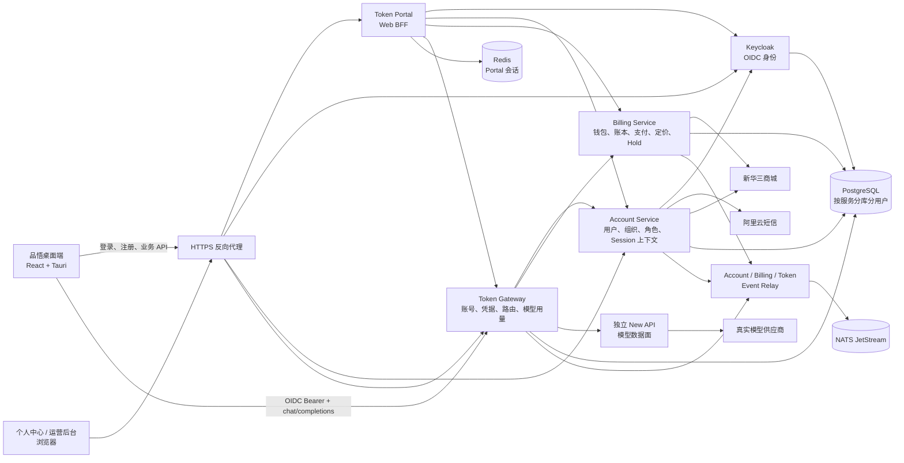

# 账号平台当前架构

> 状态：基于当前代码和数据库迁移校准的实现快照，不替代目标需求
>
> 校准日期：2026-08-23
>
> 审计提交：`75a29f822f339787c3a3457f521209368e2f6f34`
>
> 目标需求：`requirements.md`、`role-system-design.md`

## 1. 架构结论

当前代码已经形成身份、业务账号、资金账务和模型访问四个服务边界，但部分目标能力仍停留在需求模型，不能按目标架构宣称已完成：

- Keycloak 是登录身份、密码、OIDC 会话和当前 `platform-admin` Realm 角色的事实源。
- Account Service 是业务用户、组织树、成员、组织角色和活动上下文的事实源；当前活动上下文按 OIDC Session 保存，不是用户级全局上下文。
- Billing Service 是钱包、平衡账本、充值订单、聚合权益包、固定三元组定价和 Hold 的事实源。
- Token Gateway 是 Token Account、加密凭据、共享/路由策略和模型用量请求的事实源；当前只代理 `/v1/chat/completions`。
- New API 是模型数据面和上游用量证据源，不承载品悟用户、组织或钱包真相。
- Token Portal 是个人中心和运营后台的 Web BFF，采用 OIDC Authorization Code + PKCE、Redis 服务端会话和 CSRF 防护。
- 桌面端的内置模型路径使用与登录相同的 OIDC Access Token；旧内置模型运行时路径已移除，并已有本地迁移代码和测试。

当前代码尚未实现的关键目标包括：注册钱包 Outbox Saga、用户级全局上下文、平台业务 RBAC、托管路由 Provisioning 状态机、模型目录/协议/公式版本、模型结果重放、组成级 BASE/BONUS 权益、目标退款模型、应收/拒付/强制退款状态机和账号注销 Saga。

## 2. 逻辑拓扑

仓库配置要求反向代理只公开认证、账号、Gateway 和 Portal 的受控路径。PostgreSQL、Redis、NATS、Relay、Billing 内部 API 和 New API 管理面保持在内部网络；这属于配置和代码基线，本次审计没有取得实际生产环境与版本证据。

## 3. 服务边界

| 组件 | 当前职责 | 当前自有状态 | 主要目标差距 |
|---|---|---|---|
| Keycloak | 用户认证、密码、OIDC Token/Session、`platform-admin` Realm 角色、身份创建删除 | Keycloak 数据库 | 密码策略与注册幂等需收敛到 Identity 边界；平台业务角色不应继续依赖 Realm Role |
| Account Service | 用户/身份映射、手机注册、商城账号同步、组织/节点、成员/角色、Session 上下文、邀请、审计 | Account 数据库 | 注册 Saga、全局上下文、平台 RBAC、注销 Saga、标识预约与恢复 |
| Billing Service | 钱包、账本、聚合权益包、充值、固定定价、Hold、人工调整、支付修复和对账 | Billing 数据库 | 组成级权益、版本化单位/公式、目标支付退款状态机、应收与组织购买 |
| Token Gateway | Token Account、加密凭据、共享策略、路由、聊天代理、用量和 New API 核对 | Token 数据库 | 模型目录、协议能力、托管 Provisioning、请求重放、持久派发和取消 |
| Token Portal | OIDC PKCE、Redis Session、CSRF、个人中心、运营后台和路径白名单代理 | Redis Session | 目标后台权限模型、缺失业务页面和发布级三语门禁 |
| Event Relay ×3 | 事务 Outbox 投递、重试和死信 | 各服务 Outbox/Inbox | 现有事件有限，不能替代缺失的跨域 Saga |
| New API | OpenAI 兼容代理、供应商调用日志和用量证据 | 独立数据库 | 仍需通过 Adapter 契约补齐协议、取消和证据能力 |
| Payment Simulator | 开发/测试支付、退款和账单模拟 | 测试数据 | 不构成真实 Provider 能力或生产完成证据 |

### 3.1 仓库交付形态

- 仓库同时提供 Docker Compose 和 Helm Chart；它们是可部署模板，不证明任何环境已经部署，也不证明高可用、备份、RPO 或 RTO。
- Compose 包含 `mock-newapi`、`payment-simulator` 和可选真实 New API profile，供开发和自动化验证。
- 当前真实支付 Adapter 是新华三商城；其代码能力只有下单、查询/同步和人工修复。模拟器提供的退款、回调和账单能力不得归入新华三或生产能力。
- 本文所有部署状态均以 `implementation-status.md` 的证据为准；本轮没有环境/制品版本证明，因此统一为 `NOT_DEPLOYED`。

## 4. 当前数据所有权

### 4.1 Account 域

当前迁移包含：

- `users`、`identities`：业务用户及 OIDC 身份映射；用户状态包括 `PROVISIONING`、`ACTIVE`、`DISABLED`、`DELETED`。
- `organizations`、`organization_units`、`organization_unit_closure`：组织及树形闭包。
- `memberships`、`membership_units`、`role_bindings`：成员、节点范围和组织角色。
- `invitations`：当前邀请使用电子邮箱和一次性 Token，不支持需求目标中的手机号/用户名邀请。
- `user_sessions`：按 issuer + OIDC Session 保存当前上下文。
- `slider_captcha_challenges`、`sms_challenges`：滑块和短信挑战元数据。
- `mall_user_sync_jobs`：新华三商城用户同步任务。
- `audit_logs`、`outbox_events`、`inbox_messages`、`inbox_aggregate_versions`：审计和可靠事件。

注册当前先持久化 `PROVISIONING` 用户，再同步调用 Billing `EnsurePersonalWallet`，成功后激活用户；钱包失败会让本次注册返回失败，但 Account 记录仍可能保持 `PROVISIONING`。这不是目标中的“注册成功与钱包故障解耦 + Outbox 异步初始化 + SLA/REPAIR_REQUIRED”。

### 4.2 Billing 域

当前迁移实际包含：

- `wallets`、`ledger_accounts`、`journal_entries`、`ledger_postings`：钱包缓存余额和平衡账本；数据库触发器保护分录平衡和已入账记录不可变。
- `credit_lots`、`entitlement_packages`、`usage_hold_allocations`：批次、聚合权益包和 Hold 分配。
- `recharge_products`、`pricing_versions`：商品以及固定 `input/output/cached_input` 三元组价格。
- `usage_holds`、`idempotency_records`：预占/结算和通用幂等记录。
- `payment_orders`、`payment_transactions`、`refunds`、`payment_notifications`：当前支付和退款模型。
- `manual_adjustments`、`payment_order_repairs`、`reconciliation_runs`、`reconciliation_cases`：运营调整、修复和对账。
- Billing 自有 Outbox/Inbox 表。

当前权益包以 `payment_order_id` 关联订单，只保存总积分，不保存 BASE/BONUS 组成及各自累计消费。`payment_transactions` 对 `payment_order_id` 有唯一约束，实际是订单一对一支付流水；这与目标的一对多流水及“每个成功流水独立权益包”不同。

当前没有 `metering_unit_definitions`、`protocol_reservation_formula_versions`、`pricing_version_unit_rates`、`model_usage_requests`、`stream_response_events`、`upstream_dispatch_attempts`、`refund_requests`、`refund_amount_reservations`、`chargeback_cases`、`forced_refund_cases`、`payment_evidence` 或独立应收表。这些名称属于目标模型，不是现有数据结构。

账本和额度使用整数 `microcredit`，当前换算为 `10,000 microcredits = 1 展示积分`；支付金额使用人民币分。

### 4.3 Token 域

当前迁移包含：

- `token_accounts`、`provider_credentials`：模型访问账号和加密凭据；管理模式为 `USER` 或 `PLATFORM`。
- `token_share_policies`、`token_explicit_members`、`routing_policies`：共享和路由策略。
- `usage_requests`、`usage_attempts`：模型请求、上游关联、Hold 和结算状态。
- `authorization_cache_versions`、`token_audit_logs` 以及 Token 自有 Outbox/Inbox 表。

当前没有 `managed_route_provisionings`。首次请求缺省路由时，Gateway 在请求内通过数据库 advisory lock 同步创建平台 Token Account 和默认路由；没有 `PENDING/READY/FAILED/REPAIR_REQUIRED` 代次、退避或人工修复状态机。

个人中心已移除自管 Token Account 页面；Gateway 仍保留普通用户 Token Account API，但会过滤平台托管账号，并禁止普通用户修改 `PLATFORM` 账号。供应商密钥只在 Gateway 内存中解密，普通用户接口不返回明文。

## 5. 身份、上下文和权限

### 5.1 当前权限模型

- 平台运营后台当前直接依赖 Keycloak `platform-admin` Realm Role，尚未实现目标中的 Account 平台角色、临时有效期、授权版本和 Break-glass 恢复机制。
- `OWNER`、`ORG_ADMIN`、`BILLING_ADMIN`、`UNIT_ADMIN`、`MEMBER`、`AUDITOR` 是 Account 域组织角色，通过 `role_bindings` 关联成员。
- 组织所有者具备普通接口保护，但“禁止最后一个有效超级管理员主动注销”无法由当前业务模型完整执行，因为用户主动注销和平台超级管理员生命周期均未实现。目标上 Break-glass 只能用于管理员异常失联后的恢复，不能作为主动注销绕过手段。

### 5.2 当前上下文

当前上下文绑定 OIDC Session：

- `PERSONAL`：个人钱包和个人路由。
- `ORGANIZATION`：指定用户已加入的有效组织，使用组织角色、路由和钱包。

同一用户的不同设备/会话可以选择不同上下文。目标需求要求用户级全局活动上下文、版本递增、跨端刷新和请求开始快照，当前尚未实现。

## 6. 当前模型调用与计费链路

当前 `/v1/chat/completions` 链路为：

1. 解析 OIDC 主体和 Account 当前 Session 上下文。
2. 解析模型和最大输出 Token，列出并确定性选择可用路由；无缺省路由时同步确保平台路由。
3. 从 Billing 读取固定三元组价格，以平台最大输入 Token 和请求最大输出 Token 计算最大费用。
4. 创建 `usage_request`，向 Billing 创建 Hold。
5. 解密所选凭据，记录上游尝试，调用 New API。
6. 根据返回 usage 结算；证据不确定时进入 `REVIEW`，后台按 New API 请求日志核对，不自动重发模型请求。

当前边界和目标差距：

- 路由已有确定性优先级、显式账号失败不回退、上下文/共享策略检查，但没有独立模型目录和 `CATALOG_VISIBLE → Provisioning READY → CONTEXT_ELIGIBLE → RESERVABLE` 状态管线。
- Hold 在上游调用前创建，并按较早到期权益包分配；没有组成级消费顺序、追加预占、长调用续租或派发不确定时的过期保护。
- 定价只支持输入、输出、缓存输入三元组；没有协议公式、版本化计量单位、显式零价/配置缺失区分和逐单位来源快照。
- 幂等键可显式传入或稳定派生，但重复请求返回 `USAGE_REPLAY_BLOCKED`，不会回放既有结果；也没有版本化规范请求指纹、同键异请求 `409`、流事件存储、结果/墓碑分层保留或 `410` 语义。
- 流式响应直接转发给客户端，未先持久化；请求上下文取消可能中止上游，不具备断线继续执行和按序重放。
- 没有持久派发租约/意图状态机，也没有模型请求取消命令及 Provider 取消能力契约。

## 7. 当前支付、权益与退款

充值以 Billing `product_id` 为可信输入，金额、外部 SKU、BASE/BONUS 商品字段、展示积分和有效期由服务端目录派生。当前 UAT 目录为：

| 商品 | 商城 SKU | 金额 | 总展示积分 | 有效期 | 状态 |
|---|---|---:|---:|---:|---|
| 体验版 | `0502AJON` | ¥0.10 | 2,000 | 30 天 | UAT 暂定 |
| 标准版 | `0502AJ0Q` | ¥10.00 | 4,000 | 30 天 | UAT 暂定 |
| 高级版 | `0502AJOR` | ¥30.00 | 9,000 | 30 天 | UAT 暂定 |
| 旗舰版 | `0502AJOP` | ¥200.00 | 50,000 | 30 天 | UAT 暂定 |

新华三 Adapter 当前只支持支付宝下单、订单查询/同步和人工修复，不支持主动退款、关单、回调或账单。客户端关闭二维码页后，Billing 后台仍可继续查询。模拟器支持更多动作，但只用于开发/测试。

商城确认支付成功后，Billing 幂等创建一个聚合权益包和账本分录。虽然商品保存 BASE/BONUS 数值，履约后只保存合计额度，因此无法执行目标中的 BONUS 优先消费、组成级授予或精确退款撤销。

现有普通退款是兼容旧模型的订单级、可输入金额的部分退款：

- 请求绑定 `payment_order_id`，接受 `amount_fen`，按订单聚合积分比例计算撤销量，并包含 `PARTIALLY_REFUNDED`。
- 本地事务会先预约退款/额度，再调用 Provider；但没有退款 Outbox 恢复，也没有支付流水 + 权益包目标锁定。
- 没有“任一 BASE/BONUS 已消费即拒绝”的累计消费证据，也无法在成功后精确撤销该支付产生的全部未消费 BASE 和关联 BONUS。

因此，最新目标规则——普通退款不接受部分金额，任一关联 BASE/BONUS 曾消费即拒绝；成功时现金只退全部 BASE，并撤销全部未消费 BASE 与关联 BONUS——与当前实现冲突，当前退款必须重构而不是复用比例退款逻辑。

## 8. 一致性与事件

平台不使用跨服务分布式事务。三个服务具备本地 Outbox/Inbox、Relay、重试和死信基础，当前主要事件为：

- `account.membership.changed.v1`
- `billing.recharge.succeeded.v1`
- `token.usage.settled.v1`

这些机制能保证已有事件的最终投递，但现有事件集没有实现注册钱包初始化、账号注销、目标退款和托管路由 Provisioning 等 Saga。

## 9. 客户端与 Portal

- Portal 采用 OIDC Authorization Code + PKCE、Redis 服务端 Session、CSRF 和严格代理路径白名单。
- 桌面 OIDC Access Token 保留在 Rust 进程，Refresh Token 只存系统凭据库，不持久化密码。
- 旧内置模型迁移具备盘点报告、配置备份、会话/计划任务模型 ID 迁移和旧凭据清理重试；当前测试覆盖迁移幂等以及运行时不再引用旧 `llmapi_hub` 路径。
- 当前个人中心没有 Token Account 管理入口；管理后台仍提供平台 Token Account、凭据元数据、路由、用量、钱包、订单、调整和修复等能力。
- 桌面与 Web 当前路由已有中/英/日词条测试，但尚无覆盖全部目标页面、错误码和发布制品的三语发布门禁。
- 发布、安装、运行三层迁移门禁及不计费 readiness 仍未形成完整、可部署证明。

## 10. 安全边界

- 远程用户入口要求 HTTPS；开发态 HTTP 仅限 loopback。
- Portal 内部服务凭据不下发浏览器或桌面端；桌面 OIDC Token 不进入 WebView JavaScript。
- Provider 地址使用 HTTPS 和主机白名单；生产密钥目标为 KMS/Vault，本地 KEK 只用于开发/测试。
- Keycloak `/admin/` 应限制在受控网络或隧道内。
- 日志不得记录密码、短信验证码、OIDC Token、供应商密钥或支付密钥。

## 11. 审计证据与主要风险

本次代码级校准使用以下验证：

- `node scripts/account-platform.mjs test unit`：所有 Go 包测试通过（项目内置 Go 工具链，`nomsgpack` 标签）。
- `npm test`（`account-platform/`）：OpenAPI lint 和 36 个合同测试通过。
- `node --test tests/account_platform_state.test.mjs tests/ui_language_coverage.test.mjs tests/scheduled_tasks_unit.test.js`（`pinvou3-app/`）：39 个测试通过。
- `node scripts/account-platform.mjs verify`：Go 单测与 Vet、合同测试、架构守卫和差异检查通过。

| 项目 | 当前事实 | 风险/下一步 |
|---|---|---|
| 部署 | 只有 Compose/Helm 仓库模板，本轮无环境证据 | 不得宣称生产部署、HA、备份或 RPO/RTO 已完成 |
| 注册 | 钱包同步调用，失败仍影响注册响应 | 改为持久 Saga、Outbox 初始化和可恢复状态 |
| 权限 | 平台后台依赖 Keycloak Realm Role | 建立 Account 平台 RBAC、临时授权、最后超级管理员保护和受限 Break-glass |
| 模型调用 | Hold 前置和事后核对已有基础 | 补目录/公式/Provisioning、派发持久化、重放和取消 |
| 权益 | 权益包仅聚合总额 | 重构为 BASE/BONUS 组成和守恒约束后才能实现目标退款 |
| 支付 | 新华三只有下单与查询；数据模型是一单一流水 | 目标一对多流水、独立状态机、退款/拒付/应收和证据模型均待实现 |
| 客户端切换 | 运行时旧路径已删除，迁移测试已通过 | 补发布/安装门禁、非计费 readiness 和制品级回滚证明 |
| 测试 | 单元、合同和定向桌面测试通过 | 本轮未执行 Compose 集成、E2E、故障注入、性能或部署验收 |
