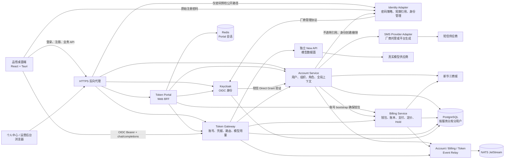

# 账号平台当前架构

> 状态：基于当前代码和数据库迁移校准的实现快照，不替代目标需求
>
> 校准日期：2026-08-23
>
> 代码审计基线：本轮连续实施起点 `e23005aaf6745d4b8c1ffa5ac73943e0f8f98ca5`，并包含本文件所在提交
>
> 文档版本：以本文件所在 Git 提交为准
>
> 目标需求：`requirements.md`、`role-system-design.md`

## 1. 架构结论

当前代码已经形成身份、业务账号、资金账务和模型访问四个服务边界，但部分目标能力仍停留在需求模型，不能按目标架构宣称已完成：

- Keycloak 是登录身份、密码和 OIDC 会话的事实源；OIDC Claim 只证明主体，不决定业务权限。迁移期保留的 `platform-admin` Realm Role 不再参与业务授权。
- Identity Adapter 是注册密码预检、策略版本、短期密码材料和 Keycloak 管理协议的唯一边界；Account 只接收不透明密码引用。
- Account Service 是永久内部用户 ID、独立用户编码、个人/平台/组织角色、权限码、对象作用域、组织树、成员、管理命令审批策略/请求和用户级全局活动上下文的事实源；OIDC Session 只证明当前登录，不拥有独立计费上下文。
- Billing Service 是钱包、平衡账本、充值订单、BASE/BONUS 组成级权益、版本化计量单位、确定性价格生命周期、Hold 和已批准财务命令领域执行结果的事实源。
- Token Gateway 是 Token Account、加密凭据、共享/路由策略、版本化协议/安全公式和模型用量请求的事实源；当前已接入的数据面协议仍仅支持 `/v1/chat/completions`。
- New API 是模型数据面和上游用量证据源，不承载品悟用户、组织或钱包真相。
- Token Portal 是个人中心和运营后台的 Web BFF，采用 OIDC Authorization Code + PKCE、Redis 服务端会话和 CSRF 防护。
- 桌面端的内置模型路径使用与登录相同的 OIDC Access Token；旧内置模型运行时路径已移除，并已有本地迁移代码和测试。

当前代码尚未实现的关键目标包括账单逐行支付证据归并和完整关单中间态。独立模型目录、稳定模型身份、不可变能力/目录版本、托管路由 Provisioning、组织模型业务策略、资格管线、目录回滚联合依赖校验与运营修复已经在仓库闭环；客户端切换所需的无推理 Readiness、公开兼容范围、签名准入证明、桌面动态目录消费、下架后的会话分支、发布/安装/运行门禁以及 N/N-1/N-2 兼容淘汰闭环均已在仓库实现。用户级全局上下文、组成级组织授予、计量/公式/价格快照、目标普通退款领域实现及其默认关闭产品门禁、支付异常统一结案、独立应收/拒付会计链路、每日四方对账、晚到支付人工复核，以及注销资格、静默期、跨域阻断、Identity/资料/Commerce/邀请清理、组织授予隔离与标识墓碑已在仓库闭环。超级管理员安全恢复和客户端准入仍待生产等价演练。

## 2. 逻辑拓扑

仓库配置要求反向代理只公开认证、账号、Gateway 和 Portal 的受控路径。PostgreSQL、Redis、NATS、Relay、Billing 内部 API 和 New API 管理面保持在内部网络；这属于配置和代码基线，本次审计没有取得实际生产环境与版本证据。

当前注册密码先通过 TLS 进入 Identity Adapter 的公开预检路径，取得 15 分钟有效的不透明引用和冻结的 `password_policy_version`；Account 的预检、短信和注册 API 只接收该引用，最终身份创建由 Identity Adapter 使用原始序列再次权威校验。短期原文与带独立密钥的 HMAC 仅保存在 Identity 进程内，成功创建后清除原文，过期时删除记录。Identity 还把服务端生成的注册操作 ID 绑定到密码 HMAC 指纹，并把该 ID 作为 Keycloak 用户属性保存，Account 可先按该关联查询再幂等创建，避免不确定结果下重复建号。反向方向上，Keycloak 的短信 Authenticator 会携带工作负载身份调用 Account `/internal/v1/auth/sms/verify` 完成验证码核验；浏览器及 Direct Grant 的密码/短信凭据成功后，还必须在 `context.success()` 前调用 `/internal/v1/authorization/check` 强一致校验精确 issuer/subject 的 `personal.session.login`，Account 拒绝、响应畸形或不可用时均不创建客户端/Portal 会话。

## 3. 服务边界

| 组件 | 当前职责 | 当前自有状态 | 主要目标差距 |
|---|---|---|---|
| Keycloak | 用户认证、密码、OIDC Token/Session；迁移期 Realm Role 不参与业务授权 | Keycloak 数据库 | 生产部署和后续密码重置/资料同步/会话撤销端口仍待环境及任务验证 |
| Identity Adapter | 密码原始字符校验、策略版本、短期引用/HMAC、注册操作关联查询、Keycloak 用户创建/资料更新/密码重置/会话撤销及受控停用协议 | 进程内 15 分钟短期密码记录；Keycloak 持久身份与操作关联 | MFA 和账号申诉仍不在当前闭环 |
| Account Service | 永久用户 ID/编码、用户/身份映射、个人/平台/组织 RBAC、对象级绑定有效期/撤销/自动回收、权限解析、持久注册及完整注销 Saga、短信挑战、异步钱包初始化、商城账号同步、组织/节点、成员/角色、用户级全局上下文、邀请、审计及受控审计导出 | Account 数据库 | 三类权限数据库运行级迁移验证、超级管理员与大规模审计导出的生产等价演练 |
| Billing Service | 钱包、账本、BASE/BONUS 组成级权益、组织购买与成员授予、版本化计量单位、全局/模型价格解析、价格生命周期、Hold/组成分配/租约及异常处理证据、独立应收与清偿分配、单流水拒付冲销、供应商中立支付能力/商品映射、目标退款及其独立产品门禁、晚到支付复核、人工调整、到期/损失复核、支付修复和对账 | Billing 数据库 | 正式商品业务冻结、统一拒付/强制退款复核结案及账单证据归并 |
| Token Gateway | Token Account、加密凭据、共享策略、路由、协议/公式版本、独立模型目录与稳定身份、能力/目录版本、托管 Provisioning、组织模型策略、资格管线、非计费客户端 Readiness/准入证明、安全参数映射、动态预占、持久派发/重放、执行/交付隔离、取消意图、可信用量和 Model Gateway Adapter 核对 | Token 数据库 | 更多数据面协议及其显式 Provider 取消 Adapter；客户端准入生产联调 |
| Token Portal | OIDC PKCE、Redis Session、CSRF、个人中心、运营后台、路径白名单代理和制品级三语门禁 | Redis Session | 目标后台权限模型和尚未实现的业务页面 |
| Event Relay ×3 | 事务 Outbox 投递、重试和死信 | 各服务 Outbox/Inbox | 现有事件有限，不能替代缺失的跨域 Saga |
| New API | OpenAI 兼容代理、供应商调用日志和用量证据 | 独立数据库 | 仍需通过 Adapter 契约补齐协议、取消和证据能力 |

四个对外服务由同一客户端兼容策略包裹，所有响应声明 API 契约版本和当前最小支持版本。正式清单至少包含当前桌面小版本及前两个小版本，旧版的 `sunset_at` 必须晚于后继正式发布90天，普通弃用通知必须至少提前60天；严重安全例外可缩至7天，但清单必须携带审批号。桌面直连请求及经 CodeWhale 发出的平台模型请求都使用 `X-Pinvou-Client-Version` 标识真实制品版本。版本到期后仅远程写操作返回稳定 `426 CLIENT_UPGRADE_REQUIRED`、`Link: rel="latest-version"` 和 HTTPS 升级地址；只读远程数据、本地数据与本地独立模型不经过该淘汰门禁。

### 3.1 仓库交付形态

- 仓库同时提供 Docker Compose 和 Helm Chart；它们是可部署模板，不证明任何环境已经部署，也不证明高可用、备份、RPO 或 RTO。
- `mock-newapi` 和 `payment-simulator` 是 Compose 中的非生产测试支撑组件，不属于产品服务边界或生产逻辑拓扑；其隔离和替换决策见 `adr/ADR-007-payment-simulator.md`。
- Compose 包含上述测试支撑组件和可选真实 New API profile，供本地开发、合同测试、端到端验证和故障注入；生产 Helm 不部署这些工作负载。
- 当前真实支付 Adapter 是新华三商城；其代码能力包括支付宝下单、查询/同步、支付回调和人工修复，不包含退款、主动关单或账单。非生产测试 Provider 提供的退款和账单能力不得归入新华三或生产能力。
- 远程 Compose 把 `payment-simulator`、对应迁移和数据库初始化统一置于 `development-simulator` 显式开关后；Billing 对测试 Provider 只允许 `development/test` 环境，生产 Helm 仅配置正式 Adapter，且不包含 Simulator 工作负载或模拟器命名变量。
- 本文所有部署状态均以 `implementation-status.md` 的证据为准；本轮没有环境/制品版本证明，因此统一为 `NOT_DEPLOYED`。

## 4. 当前数据所有权

### 4.1 Account 域

当前迁移包含：

- `users`、`identities`：业务用户及 OIDC 身份映射；`users.id` 使用 UUIDv7，`user_code` 使用密码学安全随机载荷与 SHA-256 校验码，二者由数据库触发器禁止修改或物理删除；用户状态包括 `PROVISIONING`、`ACTIVE`、`DISABLED`、`DELETED`。
- `user_code_registry`：永久占用已经提交的用户编码，注销后也不释放；`user_code_lookup_attempts`：只保存操作者及来源、设备、目标编码的摘要维度，用于精确查询的限流和审计，不形成公开目录。
- `organizations`、`organization_creation_requests`、`organization_units`、`organization_unit_closure`、`organization_unit_commands`：顶层组织、独立单调结构版本、按操作者隔离且不可变的创建/节点命令幂等请求，以及组织树形闭包；活动同级节点名称按不区分大小写唯一，节点和组织删除都只写终态与时间戳。
- `organization_unit_governance_blockers`：Account 域尚未收敛的节点审批或扩展任务登记；成员、节点角色和受保护子节点直接从各自权威表判断，不以缓存替代。
- `invitations`、`membership_commands`：邀请只保存手机号/用户名/兼容邮箱目标摘要和脱敏提示，目标查询由当前认证身份反向匹配；一次性链接只保存 Token 摘要。成员新增、移除和所有权转让保存操作者隔离的稳定命令指纹与原结果，角色和邀请历史禁止物理删除。
- `permissions`、`roles`、`role_permissions`、`role_assignments`、`authorization_versions`：个人/平台/组织原子权限、内置角色、带起止/撤销/来源与对象作用域的授权投影，以及按个人、平台、组织/节点独立失效的单调授权版本。
- `memberships`、`membership_units`、`role_bindings`：成员和节点范围；`role_bindings` 是组织成员角色生命周期写模型，通过数据库触发器投影到 `role_assignments`，授权查询不直接读取写模型。
- `user_active_contexts`：以 `user_id` 唯一保存 PERSONAL/ORGANIZATION、目标组织和单调 `context_version`；最近有效 Session 只用于迁移初值，切换使用期望版本 CAS。
- `user_sessions`：按 issuer + OIDC Session 保存登录观察和兼容投影，不再作为聊天或计费上下文事实源。
- `slider_captcha_challenges`、`sms_challenges`：滑块和短信挑战元数据；平台生成验证码模式只保存带密钥校验数据，不保存明文。
- `sms_send_attempts`：手机号、来源和设备的单向摘要、用途、结果与时间，用于短信多维限流和反枚举审计。
- `profile_change_requests`：用户名/手机号变更的旧值、新值、独立资料版本、短信验证和 Identity/Account/会话阶段；活跃请求对用户字段及新值分别唯一预约。
- `password_reset_operations`：只保存已验证挑战、稳定用户/Identity 引用及完成事实，不保存密码、密码摘要或验证码。
- `commerce_customer_mappings`：用户/组织到外部客户的供应商中立映射，只保存 Provider ID、Adapter 版本、脱敏外部引用和通用状态；不参与认证或业务授权。
- `commerce_customer_sync_jobs`、`commerce_customer_sync_evidence`：客户开通/资料同步任务及不可变结果证据；任务冻结主体、Provider、Adapter 版本和类别，Provider 原始协议与错误不会进入核心表或公开 API。
- `audit_logs`、`audit_export_jobs`、`audit_export_events`：行为审计、服务端导出任务及其不可变创建/生成/下载/失败/过期时间线；导出文件只以短期加密载荷存在，成功下载或过期即清除。
- `outbox_events`、`inbox_messages`、`inbox_aggregate_versions`：可靠事件。

手机注册在发送短信前原子创建服务端注册操作、5 分钟唯一值预约和挑战；短信核验成功后把预约提升为 30 分钟注册租约。Account 持久保存非秘密阶段事实，先按稳定操作 ID 查询 Identity，再幂等创建；Identity 成功后预约不再按 TTL 自动释放。Account 提交以候选 UUIDv7 用户 ID 为稳定主键，在一个串行事务内写入用户、永久用户编码、身份映射、Commerce Customer Mapping/同步任务、钱包初始化任务、Outbox 和审计，随后返回可登录的 `PROVISIONING`。

审计筛选和详情继续由 Account 按原子权限执行服务端查询；导出不复用浏览器当前加载的行，而是创建带明确时间范围、原因和幂等指纹的异步任务。创建与下载票据均要求十五分钟内重新认证；默认文件只含不可逆主体标识和脱敏引用，未脱敏个人字段还需独立、最长二十四小时的临时 `platform.audit.pii.export` 绑定及原因。Worker 在服务端执行31天、100,000行、500MB和每用户2并发/10每日配额，使用每任务随机文件密钥生成 AES-256-GCM 加密、HMAC-SHA-256 签名且内容/文件名带稳定水印的封装；文件密钥只通过创建响应或同一幂等请求的恢复响应返回，普通状态查询不返回。下载票据十五分钟有效且原子消费一次，成功、失败或过期均追加事件与审计并清除服务端载荷及包裹密钥。密码、验证码、Token、Cookie、供应商/支付秘密和模型正文不进入任何导出权限路径。

钱包初始化由后台任务使用稳定幂等键调用 Billing；成功后才把用户和注册操作激活为 `ACTIVE`，短暂失败按退避重试，超过快照化 SLA 后进入 `REPAIR_REQUIRED`。`PROVISIONING` 与 `REPAIR_REQUIRED` 均允许登录和资料管理，但 Token Gateway 与充值入口按稳定原因码拒绝平台模型和支付；本地独立模型不受影响。`/v1/account/bootstrap` 不再同步调用 Billing，也不把钱包故障改写为注册失败。

客户端使用操作 ID 与 48 小时签名查询令牌恢复轮询；桌面优先把查询凭据写入系统凭据库，写入失败时只在当前 WebView 会话保留短期降级副本。运营修复入口由 `platform.registrations.repair` 保护，只返回脱敏阶段、责任域、重试和 SLA 元数据。Identity 孤儿默认向前恢复；只有 Identity 创建满 24 小时，且串行事务证明候选 Account 用户、正式映射、钱包任务和 Account Outbox 均不存在时，才能先停用 Identity、撤销会话并确认不可认证，再复核事实并释放预约，不提供直接删除捷径。这里的跨域无事实证明来自封闭发布边界：候选 ID 在 Account 提交前不会通过用户表或 Outbox 发布，Billing/Token/成员/授予/订单入口均不能引用未提交用户；任一 Account 发布事实存在都会使证明失败。

用户名和手机号修改由 `profile_change_requests` 持久 Saga 编排。Web 个人中心通过 Portal BFF 发起 Authorization Code + PKCE 重新认证，并设置 `prompt=login`、`max_age=0` 取得五分钟内的 `auth_time`；密码只进入 Identity Provider，不经过 Portal 或 Account，因此个人中心不提供内嵌密码验证或密码代理接口。近期认证的规范回跳使用根文档 `/?section=accountSettings&profile=username|mobile`，默认重新认证、资料修改入口和修改完成后的重新登录都只生成根路径，不保留已删除的 `/account` 页面路由。Account 保存 `PENDING` 请求并预约规范化新值，手机号再绑定专用滑块/SMS 挑战。Identity Adapter 幂等更新同一 Keycloak subject 后，Account 以独立 `profile_version` CAS 提交；Identity 已更新而 Account 未提交时只向前重试。提交后撤销 Keycloak Refresh Token/会话并清除 Account Session 投影；手机号同时为当前 Commerce Provider 递增 Mapping 版本并创建 `PROFILE_SYNC` 任务。旧版本迟到结果只追加证据，不能覆盖新映射；同步失败不回滚登录或模型能力，但继续阻止依赖该映射的新支付。30 分钟仍未收敛的请求进入 `REPAIR_REQUIRED`。品悟客户端不封装资料变更方法，也不呈现“资料与安全”修改区域。

密码恢复沿用同一密码隔离边界：品悟客户端的未登录“忘记密码”流程只获得 Identity 进程内短期密码引用，Account 的 `PASSWORD_RESET` 短信路径对已知和未知手机号保持同形响应，只有在 Account 强一致证明 `personal.security.manage` 和允许的生命周期时才发送短信；验证成功后 Account 只把不透明引用和稳定 subject 交给 Identity Adapter，由其重置 Keycloak 密码并撤销全部既有会话。已登录改密使用受保护的 `/v1/me/password-changes`，同时要求五分钟内认证、同一个人安全权限和生命周期矩阵。Account 数据库只记录验证方式与完成事实，不接收原始密码。

Commerce Customer worker 只依赖 `CustomerAdapter` 端口，当前 H3C 实现位于平台 Adapter；核心任务不识别厂商 Action、响应或错误文本。状态统一为 `PENDING / IN_PROGRESS / READY / RETRY / REPAIR_REQUIRED / DETACHED`，连续失败达到上限后停止自动重试并保留脱敏修复原因。Account 的授权上下文不返回 Mapping；充值入口另行读取 `/v1/me/commerce-customer-mapping`，因此 Mapping 非 `READY` 只关闭依赖外部客户的下单，不影响登录、平台模型、组织管理或其他授权决策。

### 4.2 Billing 域

当前迁移实际包含：

- `organization_lifecycle_states`、`organization_governance_blockers`：Account 组织版本在 Billing 的单调生命周期投影和可扩展删除阻断登记。DISABLED 冻结组织钱包，DELETED 为不可恢复终态并关闭钱包；新建组织钱包按该投影决定初始状态。
- `organization_unit_lifecycle_states`、`organization_unit_governance_blockers`：Account 节点结构版本在 Billing 的限制态投影及未来组成级授予/分配任务阻断登记；进入 DELETION_PENDING 后拒绝新增登记，必须清零后才接受 DELETED。
- `organization_member_lifecycle_states`：Account 成员版本在 Billing 的单调投影；REVOKED 是组织授予的即时限制输入，重新加入只能用更高成员版本恢复 ACTIVE，组成级授予读写必须在同一事务边界消费该状态。
- `member_quota_grants`、`member_quota_revoke_commands`、`member_quota_hold_allocations`、`member_quota_grant_audits`：成员授予绑定组织钱包内的精确权益包和 BASE/BONUS 组成，保存互斥余额桶、成员/授予版本、稳定请求指纹、Hold 分配与不可变审计；批量入口为每项派生稳定子键并独立提交。

- `wallets`、`ledger_accounts`、`journal_entries`、`ledger_postings`：钱包缓存余额和平衡账本；数据库触发器保护分录平衡和已入账记录不可变。
- `credit_lots`、`entitlement_packages`、`entitlement_components`、`usage_hold_allocations`：批次、兼容聚合投影、BASE/BONUS 组成事实和组成级 Hold 分配。
- `usage_hold_lease_events`、`usage_hold_admin_actions`：Hold 创建/续租的不可变有效值历史，以及仅针对 REVIEW 或租约已过期 ACTIVE 的幂等安全释放证据；释放同时快照组成和成员分配结果。
- `usage_loss_reviews`：权益到期释放不确定 Hold 后，迟到真实用量的平台损失复核证据。
- `recharge_products`：业务可售目录及冻结的权益组成快照；`enabled` 只表达业务发布/下架，不承载 Provider 故障或自动止损。
- `payment_product_mappings`：通用商品到 Provider/版本/外部 SKU 的不可变版本映射，保存金额、币种、渠道、状态和有效期；`TEST_ONLY` 映射在正式环境不可用。
- `payment_provider_controls`、`payment_product_controls`：Provider 版本级和 Provider 商品级的新单安全控制。两层都使用版本化 CAS、触发案件、原因和操作者证据；自动止损只关闭控制，不修改商品目录，创建订单必须同时通过目录、映射和两层控制。
- `payment_provider_attempts`、`payment_provider_health_observations`、`payment_observation_gaps`：Provider 调用前意图、调用后脱敏健康事实和结果缺口。尝试 ID 全局唯一，观察按 Provider/版本/动作/渠道/路由分区并保存可信接收时间、规则版本和证据摘要；业务拒绝不进入可用性分母。
- `payment_stop_loss_policies`、`payment_stop_loss_evaluations`、`payment_stop_loss_evaluation_members`：只读版本策略、不可变 L1/L2/L3 评估及冻结成员。评估唯一键绑定作用域、策略、控制前版本和阈值穿越事实，高水位阻止并发 Worker 重复放大样本。
- `metering_unit_definitions`、`pricing_versions`、`pricing_version_unit_rates`、`pricing_spaces`：版本化计量单位、全局/模型定价空间、逐单位固定价或显式继承，以及价格生命周期和发布冲突控制。
- `protocol_formula_bindings`：Billing 保存 Token 已发布协议公式与所引用计量单位的不可变绑定，价格解析只接受绑定集合完整覆盖的单位。
- `pricing_publish_commands`、`pricing_lifecycle_commands`、`pricing_version_audits`、`pricing_blocks`：发布与撤销/结束的幂等命令、不可变审计和显式阻断窗口。
- `usage_holds`、`idempotency_records`：预占/结算和通用幂等记录；Hold 冻结请求上下文、协议/公式、估算器、逐单位价格及来源，后续续租、追加预占和结算不重新定价。
- `payment_orders`、`payment_transactions`、`payment_evidence`、`refunds`、`refund_component_reservations`、`refund_grant_reservations`、`forced_refund_cases`、`payment_notifications`：当前支付和退款模型；订单冻结 Provider ID/版本、商品映射 ID、完整映射、能力声明、实际付款人及受益主体，后续不以新版本重新解释历史订单。一个订单可关联多笔不可变 Provider 支付流水；回调、查询、Provider 账单、关单观察和人工修复先保存原始载荷摘要与快照，再归并流水状态。普通退款以支付流水和权益包为唯一目标，退款预约保存 BASE/BONUS 组成及授予快照；渠道强制退款保存独立外部资金事实并冻结目标权益包，不能覆盖支付成功事实。订单还冻结支付期限、晚到复核边界和最终归档期限。
- `manual_review_cases`、`manual_review_case_events`、`manual_review_assignments`：Account、Billing、Token 各自在领域数据库保存形状一致的人工案件投影、不可变时间线和转派证据；共享 `manualreview` 时钟从源案件创建时间冻结 P0/P1 的 7×24 SLA 与 P2 上海工作时 SLA，任何认领、重试或转派都不重置截止时间。生产必须配置有序值班负责人链，逾期 worker 实际更新 `owner_id` 并递增升级级别。Billing 另以 `late_payment_review_cases`、`late_payment_review_evidence` 保存晚到支付复核事实。
- `provider_bill_imports`、`provider_bill_rows`：不可变账单文件批次和逐行记录；事实盲区可原子停用关联 Provider/商品的新单，但不能直接改写历史能力快照或目录发布事实。
- `manual_adjustments`、`payment_order_repairs`：运营调整和支付修复。
- `manual_review_cases`、`manual_review_case_events`、`payment_anomaly_cases`、`payment_anomaly_commands`：跨拒付、强制退款、重复/晚到冲突、退款失败和非法迁移的统一责任人/SLA 投影、不可变证据时间线与幂等结论命令；支付、退款、拒付等原领域状态仍是各自事实源。
- `payment_provider_failure_confirmations`：`CONFIRM_PROVIDER_FAILED` 的不可变现场查询证明，保存案件/订单、Provider 与 Adapter 版本、原始状态、身份及金额校验摘要、查询时间、操作者和原因；不保存凭据或允许调用方提供资金结论。
- `manual_review_stop_loss_evaluations`：P0/P1 止损期限逾期后的不可变评估事实。Billing 原子停用关联 Provider 版本与 Provider 商品控制并发出路由/高风险命令停用请求；Token 将关联模型路由标记为不健康并停止自动用量重试；Account 对执行失败的高风险命令保持暂停并要求重新授权。注册、资料、注销、路由 Provisioning 和非资金用量复核以 P2 接入同一时钟。
- `reconciliation_runs`、`provider_bill_imports`、`reconciliation_cases`、`reconciliation_case_commands`：按 Provider/Adapter 版本和上海业务日保存的独立四方对账运行、文件证据、不可变差异快照及受审计处理命令；手工重跑不覆盖历史，定时任务仅对同 Provider 版本、渠道和日期幂等一次。
- Billing 自有 Outbox/Inbox 表。

权益入账按冻结商品快照把总 `microcredit` 拆为且仅拆为 BASE/BONUS 组成，舍入余数归 BONUS。组织购买订单另外冻结实际付款用户及其 Commerce Mapping 快照和受益组织，履约再次校验组织钱包归属并只向该钱包创建组织权益包。每个支付来源权益包同时保存 `payment_order_id` 和唯一 `source_payment_transaction_id`；同一流水重复证据只归并一次，不同成功流水分别进入独立履约或复核，不能追加到既有权益包。`entitlement_components` 保存可用、Hold、已用、有效/暂停授予、过期与撤销互斥桶并由数据库强制守恒；成员授予从同包同组成可用桶转入活动/暂停授予桶，成员调用再同时占用授予和组织组成。分配、撤回、成员 Hold、结算、释放和到期均锁定精确组成/授予行，不允许跨钱包、跨包或跨组成补足。`entitlement_packages` 的合计字段只是触发器维护的兼容投影。

Token 域以 `usage_requests` 保存独立执行、交付、取消和账务状态，并通过持久派发准备/意图、执行跃迁审计、加密流事件、加密聚合结果、防重墓碑及只追加 `usage_convergence_evidence` 表达模型执行事实；证据时间线只保存 Provider/Adapter/上游引用摘要、载荷摘要和脱敏决策快照，不保存模型正文。派发取得租约、上游引用、完整结果、只读 Provider 查询、不确定复核以及最终结算/客户 Hold 释放均先留证；同一请求出现不同完整结果时首个结果不被覆盖并转复核，已取得非幂等派发租约的未知结果不自动重发。Billing 以同样原则用 `payment_evidence` 收敛回调、查询、账单和修复。两域共用“先证据、后决策；不猜测成功；高风险不自动重发”的外部收敛边界，但各自保留独立领域状态机和数据库事务。

价格解析先在请求时间选择唯一模型覆盖版本；没有模型覆盖时才选择唯一全局版本。同一作用域缺失或歧义分别稳定返回 `PRICE_MISSING`、`PRICE_AMBIGUOUS`，不可用版本返回 `PRICE_UNAVAILABLE`。模型单位必须是 `FIXED_PRICE` 或 `INHERIT_GLOBAL`；固定零价是有效价格并阻止回退，缺少配置不能表达继承。发布在定价空间串行锁内校验 ETag、幂等指纹和未来时间区间，ACTIVE 版本只能通过显式阻断、全局继承接续或替代版本提前结束。既有 Hold 始终使用创建时冻结的价格事实。

账本和额度使用整数 `microcredit`，当前换算为 `10,000 microcredits = 1 展示积分`；支付金额使用人民币分。

### 4.3 Token 域

当前迁移包含：

- `organization_lifecycle_states`：Account 组织版本在 Token 域的单调投影；DISABLED/DELETED 拒绝创建新的组织用量请求，DELETED 前强校验 `CREATED / RESERVED / UPSTREAM_ACTIVE / SETTLEMENT_PENDING / REVIEW` 均已收敛。
- `organization_unit_lifecycle_states`、`organization_unit_governance_blockers`：节点删除的单调限制态投影；DELETION_PENDING 后拒绝创建节点 Token Account 或新治理事实，已有 Token Account、路由关联及未终态用量全部阻断 DELETED。
- `token_accounts`、`provider_credentials`：模型访问账号和加密凭据；管理模式为 `USER` 或 `PLATFORM`。
- `token_share_policies`、`token_explicit_members`、`routing_policies`：共享和路由策略。
- `route_provisionings`、`route_provisioning_attempts`：按作用域、模型、协议和目标代次持久化托管资源的 PENDING/READY/FAILED/REPAIR_REQUIRED 状态、Worker 租约、退避、SLA、实际资源引用和逐次脱敏证据；平台托管候选只有同代 READY 聚合关联的活动账号、有效凭据和健康路由可以进入候选集合，显式指定的兼容 USER 路由仍按原有所有权与共享策略独立校验。
- `route_provisioning_commands`、`route_provisioning_audit`：人工修复的幂等命令与不可变审计；修复只能从失败终态开启新的受限轮次，不能由接口直接写 READY。
- `organization_model_policies`、`organization_model_policy_commands`、`organization_model_policy_audit`：组织允许全部、允许列表或禁止列表的业务模型策略、CAS 版本、原结果重放和不可变审计；该边界不接受也不返回真实 Token Account、凭据、路由或 Provisioning 配置。
- `usage_requests`、`usage_attempts`、`usage_execution_transitions`：模型请求的稳定用户级键摘要、版本化规范请求指纹、冻结上下文/路由/价格、独立执行/交付/结算状态、上游关联及不可变 CAS 跃迁审计。
- `usage_dispatch_preparations`、`usage_dispatch_intents`：Hold 前加密冻结的派发材料，以及 Hold 确认后原子提升的唯一派发意图和一次性 Worker 租约；进入上游派发后缺少确定结果且 Adapter 不保证请求级幂等时只转 REVIEW，不重发。
- `usage_cancel_commands`、`usage_cancellation_evidence`、`usage_delivery_confirmations`：原稳定用户的唯一幂等取消命令、不可变脱敏取消证据和各客户端最后确认事件序号；不保存用户正文或 Provider 凭据。
- `usage_reconciliation_commands`、`usage_platform_loss_reviews`：只查询原上游证据的幂等人工核对命令，以及期限后释放 Hold、永久禁止再次向用户扣款的晚到成本/平台交付损失边界。
- `usage_stream_events`、`usage_replay_results`、`usage_idempotency_tombstones`：先于客户端确认落库的加密规范事件、完整/聚合结果和零正文防重墓碑，普通业务最大保留期分别为24小时、30天和90天。
- `usage_replay_retention_cases`、`usage_replay_case_payloads`：法律保全或未结案件的独立受限存储及原因、范围、责任人、复核/到期/解除后清除事实；普通在线重放表不借案件名义延长保留。
- `protocol_definitions`、`protocol_formula_versions`：版本化协议定义和已发布后不可变的安全预占公式；当前 CHAT v1 公式绑定版本化计量单位和确定性 UTF-8 估算器。
- `authorization_cache_versions`、`token_audit_logs` 以及 Token 自有 Outbox/Inbox 表。

首次请求或目标配置变化时，Gateway 在作用域、模型、协议锁下声明唯一目标代次，并立即以稳定原因码返回非 READY；后台 Worker 使用短租约和 `FOR UPDATE SKIP LOCKED` 认领任务，幂等创建或更新平台 Token Account、加密凭据和路由，验证实际路由代次后才写 READY。短暂失败按快照化指数退避重试，超过最大次数或 30 分钟 SLA 进入 REPAIR_REQUIRED；平台模型管理员可带原因和幂等键开启新修复轮次。动态目录模型会加入目标凭据允许列表，不以旧环境模型清单作为业务目录门禁。

模型数据面要求客户端提供16至128字符的每逻辑请求唯一键。Gateway 只保存 SHA-256 摘要，唯一域固定为稳定 `user_id + model-inference`；JSON 经带版本的确定性规范化后计算指纹，Session、活动上下文和传输头均不参与缩小作用域。同键同指纹先恢复原执行，同键异指纹在任何 Hold 或选路副作用前返回 `IDEMPOTENCY_KEY_REUSED`。桌面 Account Platform 适配层另为同一用户消息至助手回复的逻辑轮次生成稳定、无正文的 `logical_turn_id`，同一轮内的工具循环和多次模型请求复用该标识，下一轮轮换；Gateway 只把它冻结在请求快照并通过本人用量查询返回，Portal 仅在标识精确相同时合计 Token 和实际 microcredit。该展示归组不合并执行、Hold、幂等键、取消或账本事实，旧记录没有标识时逐请求展示。首次执行按 `RECEIVED → HOLD_RESERVING → HOLD_RESERVED → DISPATCH_INTENT_PERSISTED → UPSTREAM_DISPATCHING → STREAMING/SETTLEMENT_PENDING → SUCCEEDED/FAILED/REVIEW` 推进；派发意图前的取消可以从前三个状态 CAS 到 `CANCELLED_BEFORE_DISPATCH`。Billing 以 `usage_request_id` 幂等确保唯一 Hold，派发准备快照让崩溃重试继续同一个 Hold，正式派发意图则最多被一个 Worker 首次取得。HTTP/SSE 断开只更新交付状态，上游读取继续使用脱离客户端取消信号的受限后台上下文；流事件取得连续序号并加密持久化后才写客户端，重连以原键和 `Last-Event-ID` 补发，结果过期但墓碑仍在时返回410而不是创建新执行。

取消命令只按请求冻结的稳定 `user_id` 授权，不重新要求原 Session、活动上下文或组织成员关系。用量行锁统一裁决 Hold 建立、派发意图提升和取消：意图尚未形成时，取消先阻止提升，再幂等释放整个 Hold，并原子写入 `LOCAL_CONFIRMED + CANCELLED_BEFORE_DISPATCH + RELEASED`；意图已经或可能形成后，不因用户停止或断线提前释放 Hold。Adapter 必须声明 `EXPLICIT_CANCEL`、`STREAM_ABORT_CONFIRMED_CANCEL` 或 `UNSUPPORTED`，当前 OpenAI-compatible 与 New API 均明确为 `UNSUPPORTED`，所以 Gateway 只停止该客户端交付并继续受控消费原响应/查询原上游引用。`execution_status`、`cancel_status`、`delivery_status` 与 `settlement_status` 互不冒充，完成事实优先于较晚取消。

安全、合规或供应商紧急 REMOVED 设置 `force_cancel_inflight` 时，目录版本与不可变紧急取消策略在同一发布事务提交。后台 Worker 按模型和生效时间持续补捉生效前已受理但仍在派发链的请求，以租约认领并标记 `MODEL_EMERGENCY` 来源：派发意图前复用正常取消链释放原 Hold；派发后中止本实例持有的上游传输，并把 Adapter 声明能力、本地是否实际中止和供应商取消结果分别留证。当前 Adapter 不支持供应商取消时明确记录 `UNSUPPORTED`，不把关闭连接推断为供应商停止生成。任务只有在原请求取得可信实际用量且 Hold 已 `SETTLED/RELEASED`，或复核期限终止并形成平台损失边界后才写 `CONVERGED`，最终证据冻结生成量、Hold、执行/取消/结算状态；紧急下架本身不产生免费、失败或取消成功语义。

结算只消费 Adapter 归一化且达到可信等级的 Provider 最终或累计用量。Provider 用量、最后持久化事件序号、各客户端最后确认序号、用户停止时间和最终用量时间分别保存；最大 Hold、已发送字节和客户端已显示量只用于授权或展示，不能成为结算事实。管理端用量 evidence 只读投影以 `(source_kind,source_id)` 作跨表唯一键：`CANCELLATION` 将 `usage_cancellation_evidence.occurred_at` 映射为 `observed_at`，`CONVERGENCE` 使用 `usage_convergence_evidence.observed_at`，并固定按 `(observed_at,source_kind,source_id)` 排序和编码 cursor。请求冻结核对策略版本、最大执行时长、最终用量延迟和取消核对期限；期限内沿原 Hold 续租并退避查询，期限最后一次仍无可信用量时释放未结算 Hold、转 `REVIEW` 并建立 `customer_debit_prohibited` 平台损失案件。之后到达的用量只能补充平台成本证据，不得重新冻结、扣其他权益或形成用户应收。

个人中心不承载自管 Token Account。普通认证命名空间中的 `/v1/token-accounts*`、真实路由及凭据管理接口必须删除或永久无泄露拒绝；存量非平台凭据隔离后不得被个人或组织角色重新启用。平台后台的列表、详情、启停、路由和凭据检查反向限定 `management_mode=PLATFORM`；平台超级管理员和平台模型运营员可为个人、组织或节点作用域创建 PLATFORM 账号，组织模型策略始终不接受内部资源引用。`platform.tokens.read`、`platform.tokens.manage`、`platform.tokens.owner-candidates.read` 和 `platform.tokens.credentials.validate` 只授予 `PLATFORM_SUPER_ADMIN` 与 `PLATFORM_MODEL_ADMIN`，任何组织角色均不隐式获得；创建入口同时要求 manage 与 owner-candidates，缺任一项都失败关闭。供应商密钥只在 Gateway 内存中解密，检查结果只返回 `VALID/INVALID`、稳定脱敏错误码和最小元数据，普通用户及后台接口均不返回明文、密文、Key ID、Provider 地址或原始错误。

凭据通路按是否接触 Secret 严格分离：仅新增和轮换通过固定 credential origin 的隔离顶层 POST 页完成；现场验证由 Portal 直接调用 Token 脱敏命令，不读取明文；撤销由 Portal 向 Account 创建审批申请，批准后由 `token-command-executor` 执行 Token 内部命令。校验与撤销都不打开隔离页，人类直接 revoke 路由失败关闭。

Web 个人中心的信息架构固定为三个一级 Tab：“额度与用量”合并当前活动上下文的额度、权益包和用量记录，标题后不重复解释文本，主可用积分和有效权益包剩余汇总向下取整为整数，用量按精确 `logical_turn_id` 汇总并固定显示两位小数；“订单与发票”合并当前个人身份的全部充值订单和发票能力说明，直接消费 Billing 历史查询返回的全状态集合，按 `created_at` 和订单号稳定倒序，不在前端应用支付成功白名单；“账号设置”合并原概览的账号状态/身份切换、用户名与手机号修改、注销流程，并在活动上下文为有效成员组织时嵌入组织管理区。历史订单中的非终态不等于可付款：二维码和待支付列表仍单独执行 `CREATED/PENDING + OPEN + 未超期` 门禁。旧页面深链在客户端映射到这三个稳定 Tab，不创建兼容性隐藏页面。个人上下文可以购买套餐，组织上下文不复用个人订单或个人权益；组织上下文按 Account 返回的原子权限分别显示购买、读取、授予和撤回能力。额度分配只通过 `org.quota.allocate` 保护的最小成员目录读取用户 ID、展示名和成员版本，不借此暴露邮箱、角色或节点范围。成员没有自领入口，缺少权限或组织数据时展示组织空态，不得以个人权益回退填充。普通用户导航不承载 Token Account、供应商凭据、共享策略或路由管理。

## 5. 身份、上下文和权限

### 5.1 目标权限模型

- 人类业务权限严格分为 `personal.*`、`platform.*`、`org.*` 三类；角色只是不带隐式特权的权限集合。非人类工作负载使用独立 `internal.*` 权限，不进入人类角色。Account、Identity、Billing、Token Gateway 都默认拒绝，并按入口要求向 Account 解析稳定权限和精确对象作用域；Keycloak Realm Role 不能绕过业务授权。
- 每个有效普通用户拥有 `PERSONAL_USER`，但实际可用权限仍由账号生命周期约束。密码/短信凭据验证后必须在会话签发前强一致检查 `personal.session.login`；充值、模型调用、用量、本人资料、安全设置、上下文和注销分别检查自己的 `personal.*` 原子权限，不能以“已登录”替代授权。
- 本人资料接口返回格式化 `user_code`，桌面与 Web 不展示内部 `user_id`。运营端用户列表/详情展示编码；编码查询是单独的完整等值接口，先校验格式和校验码，再检查 `platform.users.read`，并按操作者、来源 IP、设备和目标编码摘要限流。不存在、无权和输入无效对调用方使用不泄露存在性的结果；编码不是登录、找回、会话或授权凭据。
- `OWNER`、`ORG_ADMIN`、`BILLING_ADMIN`、`ORG_MODEL_ADMIN`、`UNIT_ADMIN`、`MEMBER`、`AUDITOR` 是 Account 域组织角色，通过 `role_assignments` 解析权限及组织/节点对象作用域；旧 `role_bindings` 仅作为迁移期写入兼容投影。`UNIT_ADMIN` 的决定必须始终携带 `organization_id + unit_id + scope`，不得聚合成组织级布尔权限。
- 个人、平台和组织角色绑定支持开始/到期时间、来源、单绑定幂等撤销和自动回收。授权解析按数据库时间过滤未来、过期或已撤销绑定；数据库触发器维护个人、平台、组织/节点相互独立的单调授权版本，worker 将到期事实固化并写审计与 Outbox。组织管理始终以显式目标组织/节点鉴权，不要求该组织成为用户当前计费上下文。
- 普通授权接口拒绝 `OWNER`、基础 `MEMBER` 和平台角色；运营通用接口拒绝 `PLATFORM_SUPER_ADMIN` 与 `OWNER`。超级管理员由专用安全生命周期维护：数据库同时保护最后一个有效超级管理员的角色绑定和用户状态，停用、删除及注销预检统一返回 `LAST_ACTIVE_SUPER_ADMIN`。旧管理员仍须按 `deploy/runbooks/account-rbac-migration.md` 明确映射，不能自动全部升级为超级管理员。
- 首个 `admin` 身份由主机/集群受控的 `account-security` 离线命令幂等创建，业务用户在正式密码安全激活前保持 `BOOTSTRAP_PENDING`，Identity 身份保持禁用且没有超级管理员绑定。正式密码只进入 CLI 与 Identity Adapter；Account 数据库只保存一次性凭据的用途/部署代次绑定 SHA-256 校验值和生命周期事实。
- Break-glass 与普通角色交接分离：仓库不提供公网恢复 API；离线命令必须记录“全部超级管理员异常失联”的显式确认，并从受信 OS/集群身份、mTLS 或签名恢复凭据派生操作者，禁止命令行参数或请求体自报身份；事故理由、证据摘要、目标和最长 60 分钟有效期立即进入不可变审计与 CRITICAL 告警。它不能绕过最后管理员主动注销门禁。
- 注销由 Account 持有唯一 `account_closure_requests` 聚合，并以 `CLOSURE_REQUESTED → QUIESCING → FINANCIAL_CLEARANCE → IDENTITY_CLEANUP → ANONYMIZED → COMPLETED` 表达只前进阶段；命令指纹、不可变审计、版本、租约、退避和 SLA 共同提供崩溃恢复。
- 所有者或最后有效超级管理员先停在 `CLOSURE_REQUESTED`，用户保持 ACTIVE 以完成交接；门禁通过的同一事务才将用户改为 `CLOSING`。普通 Account 授权和 Token 新业务返回稳定 `ACCOUNT_CLOSING`，历史读取及既有订单关闭、支付申诉、用量取消使用服务端白名单，客户端不能自报修复模式。
- Account Worker 通过服务身份读取 Billing 与 Token 的强一致评估。Billing 覆盖个人余额/应收、Hold、支付/退款/拒付、资金性对账、晚到支付和支付异常；Token 覆盖执行、结算和核对，只有具有“平台承担且禁止以后向用户追扣”证据的安全终态例外。用户响应删除内部资源 ID，运营接口只允许幂等重试当前阶段。
- `IDENTITY_CLEANUP` 先在 Account 串行事务中递增主体生命周期与授权版本，撤销当前及未来平台/组织角色、成员关系和 Session；Identity 未更新的资料 Saga 被取消，已经更新 Identity 的资料 Saga 先向前归并到原用户，再统一清理。邀请被取消并随机覆盖目标摘要、提示和令牌；非资金 Commerce 任务被取消，资金任务必须先收敛。Commerce 的认领、完成和重试均校验 `ACTIVE` 主体及原生命周期，迟到结果只能保留为 `STALE` 证据，不能重建 Mapping。
- Account 随后以服务身份删除该主体的全部 Identity 身份，并让 Billing 将其全部有效或普通暂停的组织授予隔离为 `SUSPENDED/ACCOUNT_CLOSED`。两项外部副作用各自保存幂等完成证明；任一项不可确认时保持在清理阶段重试，不得释放标识或宣称完成。
- 两项证明齐备后，Account 在单一事务中删除本地身份映射、将 Commerce Mapping 置为 `DETACHED`、随机墓碑化用户名和手机号并把用户置为 `DELETED`。永久 `user_id`、`user_code` 及法律记录的不可逆主体引用保留；三年分类保留记录支持法律保全，到期 worker 仅清除保留状态。事务同时写 `account.user.anonymized.v1` Outbox，只有该事件确认发布后 Saga 才从 `ANONYMIZED` 进入 `COMPLETED`。
- `ACCOUNT_CLOSED` 授予继续占用原权益包和 BASE/BONUS 组成，不能恢复、消费、创建 Hold 或走普通撤回。具有 `org.grants.reclaim_closed` 的组织管理员只能在账号已不可逆 `ANONYMIZED` 且无 Hold、核对、退款、拒付、支付异常或资金对账冻结时，对单条授予执行幂等的整笔当前剩余回收；金额原子返回原权益包原组成，授予终态为 `RECLAIMED_ACCOUNT_CLOSED`，批量接口逐项独立返回。
- 后台写命令必须经 `approvalpolicy` 的版本化 `command_type` 注册表分类；九类直接改写财务事实、`PAYMENT_PROVIDER_RESUME`、`PAYMENT_PRODUCT_RESUME` 以及 ADM-64 的 `TOKEN_MODEL_LIFECYCLE_CHANGE`、`TOKEN_MODEL_CATALOG_ROLLBACK`、`TOKEN_CREDENTIAL_REVOKE` 固定为 `APPROVAL_REQUIRED`。后三者是 ADM-38 对治理命令通常 `AUDIT_ONLY` 的明确例外；生命周期/回滚现有 v1 历史保持不可变并追加 v2，凭据撤销新增 v1，禁止原地改写策略。交付必须同步更新 `internal/platform/approvalpolicy` 注册表为 lifecycle v2/rollback v2/revoke v1，并将三项加入 `executableApprovalCommands` allowlist；自动门禁对真实迁移后数据库与代码注册表逐字段比对 command type、version、mode、申请/审批权限、risk、人数、禁止自审、快照 schema/关键字段、有效期、执行窗口和执行身份，并验证 allowlist，任一偏差阻断发布。普通退款、Provider 失败确认、组织删除、其余治理配置和确定性任务固定为 `AUDIT_ONLY`，未知命令或分类冲突失败关闭。审批申请、不可变快照、决定、状态事件和执行记录归 Account 所有，禁止申请人按稳定用户 ID 自审；恢复批准人还不得是目标异常的确认人。
- 三个 Token 强制审批策略的 13 字段值与 exact ordered `critical_resource_fields` 数组固定于专项设计第 7.3 节，DB 和 registry 不得各自推导。allowlist 只做增量扩展：保留 `WALLET_ADJUSTMENT`、`PAYMENT_PROVIDER_RESUME`、`PAYMENT_PRODUCT_RESUME` 及其他既有合法项，并断言新增 `TOKEN_*` 可执行子集恰为生命周期 v2、目录回滚 v2、凭据撤销 v1；其他 Token 治理命令仍不可执行。
- 批准事务只写 `account.approval-command.authorized.v1` Outbox，不直接改写账本或 Token 事实。审批查询、决定与执行复核都从冻结策略解析所需权限，不能硬编码单一审批权限。Billing 的 `billing-command-executor` 与新增 `token-command-executor` 分别先向 Account 强一致复核申请人/审批人的当前绑定、权限、有效期、授权版本、策略和关键资源版本，再以 `approval_request_id + command_type + command_fingerprint` 派生稳定执行键；Token 执行器只持有 approval begin/complete 与三个 command-specific `internal.token.*.execute` 权限，无任何 `platform.*` 权限。三个 Token 人类 direct API 在 v2/v1 策略启用时关闭，只能经 Account 创建申请；执行器消费授权事件并调用非公网内部领域事务。涉及人类授权的内部命令只消费 Account 签发、短期、受众/动作/资源/版本/原始请求摘要绑定且不可篡改的委托，不能信任请求体 `actor_user_id/created_by`；审计同时保存服务主体、委托人、委托 ID、权限和授权版本。正式部署为 Account、Identity、Billing、Token、`token-command-executor`、Keycloak 和三个 Relay 分配独立 ServiceAccount；服务调用使用 audience 绑定、最长 15 分钟的 OIDC 投射令牌，接收路由显式声明精确 `internal.*` 权限，Helm 将 Subject 直接映射到最小权限清单，不再以方法和路径前缀隐式扩权。开发/测试可兼容受限静态凭据，staging/production 缺少 OIDC 配置时失败关闭，不改变审批/执行所有权边界。
- APT-138 激活前的 adapter 所有权按三批固定收敛：APT-122-R2 只把协议/公式四命令接入通用命令事务，APT-123-R2 只接即时模型发布/草稿、Token Account 创建/状态和目录回滚，APT-125-R1 只接路由 upsert/delete 并移除 Portal v2 直写。除账户创建外，每个 adapter 都必须在单一 Token 事务内提交领域事实、通用结果、脱敏审计与 Outbox；账户创建明确使用 Token reservation、Billing wallet receipt、Token finalize 三阶段 Saga，各域仅保证本域事务原子，绝不宣称跨域原子或在 Billing 成功后仍“零 wallet”。actor/command/key/digest 重放首次结果，响应不确定只 GET；旧专用入口读取同一 activation state/epoch 或失败关闭，不能成为 `ACTIVE` 的旁路。三批不得实现 activation 基础设施或消费审批事件；APT-123-R2 唯一拥有 Token `000029_token_account_owner_cap_policy`（含内部 account provisioning reservation）、Billing `000053_token_account_wallet_provisioning_receipts` 及账户创建恢复 worker，`000030` activation、生产 reader/transaction guard/credential authority guard、Account activation 校验、三项审批 consumer 和 NATS 注册仍唯一归 APT-138。三批依次独立审核提交且全部通过前，APT-138 状态固定为 `PENDING / BLOCKED_BY_REMEDIATION`，生产继续 PRE，不存在逐命令激活。
- APT-122-R2 的公式发布必须保留跨域可恢复边界：Billing 对同一 canonical command/T1 existing-first 返回完整 binding receipt，Token 不把两域伪装成单事务；Billing 已成功而 Token 回滚、超时或丢响应时，只能使用原 key/reference 恢复并拒绝异内容重放。Token 逐字段复核 receipt 后，才在单一 Token 事务写不可变 formula version、通用 result、脱敏 audit 和 outbox。
- APT-123-R2 的 Token `000029` 提供共享 owner cap 的“不可变 revision + singleton active pointer”：revision 固定 `policy_version>=1`、`max_per_owner=1..1000`、canonical config/request/key/principal SHA-256 digest、actor/time/reason/request/idempotency；pointer 初始为 `active_policy_version=null/pointer_version=0`，初始 null 表示账户创建能力未配置而非无限。配置 digest 输入固定为 UTF-8 无空白 JSON `{"max_per_owner":<base10 integer>,"policy_version":<base10 integer>}`；request digest 固定字段顺序为 max、expected active version、NFC且无首尾空白的RFC8259 reason，且明确不含幂等键/request_id/actor。对象由 `token_cap_policy_deployer NOLOGIN` 持有；`token_migrator LOGIN NOINHERIT` 通过独立 migration URL 并显式 assume 现有 Token schema owner/deployer 完成 up/down，但不能 apply；五参数 apply 函数只授予不属于 owner 的 `token_policy_operator LOGIN NOINHERIT`，并精确校验 `session_user`。Token runtime 不是 deployer 成员，对 revisions/pointer 两表只有 SELECT 且不能调用函数。函数锁 active pointer 后再次 existing-first，再校验 expected/CAS，并同事务恰写一条 revision事实与既有 `outbox_events/token.account-owner-cap-policy.changed.v1` 事实后切换 pointer；同key同payload并发返回同revision/outbox reference，同key异payload 409，不同key同expected仅一成功。Relay按NFR-07至少一次投递，consumer按`event_id + aggregate_version`幂等去重。production必须显式bootstrap，dev/test fixture才可显式使用20；升、降、恢复旧值也必须追加更高version，禁止原地更新或删除历史。Token普通readiness保持可用，独立`token_account_create` capability在schema/active revision/digest/只读权限任一异常时失败关闭，并分别返回`TOKEN_ACCOUNT_POLICY_UNAVAILABLE`或`TOKEN_ACCOUNT_POLICY_CONFIG_MISMATCH`。
- N/N-1 不具备隐式创建兼容。升级前必须对全部 write-capable 实例和入口做 create quiescence：关闭管理员 generic/direct/PRE 创建，停止 system/default-route/background creator和account provisioning worker，先以create关闭的N承接其他合法写，再排空并停止全部N-1 writer或撤销其账户INSERT/UPDATE/函数EXECUTE；确认旧writer DB连接、创建PENDING/MANUAL_REVIEW reservation与租约均为零后，才依次以 `token_migrator` 执行`000029`、以`token_policy_operator`执行production bootstrap并验证active/digest/计数/headroom。新N在PRE阶段的generic/direct创建能力必须始终关闭并返回`TOKEN_ACCOUNT_CREATE_NOT_ACTIVE / 503`；只有APT138执行`000030`切ACTIVE、生产main注册DB-polling worker且ready后，才向N打开create。SAFE先关create再停止新lease；Portal仅显示维护不可用且不发创建请求。N-1只能用只读数据库身份服务读取，并证明其他请求无间接创建副作用，停写后不得恢复create。回滚同样先全主体停/排空create；N-1可承担读与其他无创建副作用的兼容流量，但create持续关闭。`000030` down必须先于`000029`，后者在active/revision/reservation/outbox/audit/command reference或writer依赖存在时拒绝删除并保留读。命令快照冻结平台授权版本、creator生命周期版本/归一状态/非PII摘要、owner生命周期版本/归一状态/非PII摘要、ACTIVE/DISABLED/FROZEN的PLATFORM账户总数、cap、cap policy version和canonical `creation_version:0`；旧pending在当前policy下重验，不得沿用旧无限策略。ACTIVE下的正式/legacy创建及系统/default-route创建都按owner取得同一事务锁，在 Token T1 前调用Account内部service-auth combined snapshot：单一RR事务读取creator、双权/platform authorization、owner精确记录与三组版本，禁止拼接AuthorizeComposite与owner-candidates。通过后才建立计入cap的内部reservation。Portal候选仅作交互提示，candidate item和公网分页envelope维持无授权版本的四字段最小投影，版本只存在Account→Token内部authority envelope与命令证据。

- Token Account 创建跨域状态机固定为 `PRECHECKED → TOKEN_RESERVED → BILLING_RECEIPTED → ACCOUNT_ACTIVE`，自动恢复耗尽旁路为 `MANUAL_REVIEW`，确定终态为 `FAILED`，传输不确定投影为 `UNKNOWN`。Token T1 原子写 reservation/PENDING result/audit/outbox；Billing T2 原子写 owner wallet/ledger（existing-first）和 immutable receipt；Token T3 原子创建可见 account、完成 reservation/result/audit/outbox。Token worker使用冻结随机fencing token、activation/recovery epoch、reservation version的有界lease；Billing POST/GET与Token finalize均以command reference和canonical digest幂等。双权限撤销、creator生命周期失效或owner失效只接受Account combined snapshot闭合200 authority decision及对应更高版本证据；actor/owner将真实ACTIVE映射ACTIVE，存在的任何其他非ACTIVE状态映射INACTIVE，版本化DELETED tombstone映射NOT_FOUND，物理缺行视authority unavailable。policy变化不挤出T1已占容量，activation SAFE/epoch漂移阻止T3并保留可恢复事实。自动T3只处理PENDING；MANUAL_REVIEW可由新的当前ACTIVE、具双权限且近期认证的operator处置，原creator失效不阻断人工处置且其冻结证据不得被替换。Billing成功后不得删除可能被其他业务复用的owner共享wallet；失败可见性仅限脱敏command/recovery状态和运维告警，不向Portal返回reservation、receipt、wallet内部版本或自由文本。
- 无reference恢复不依赖数据库旁路：Portal以原actor、`TOKEN_ACCOUNT_CREATE`和header中的原Idempotency-Key调用固定lookup。缺创建双权限为403；授权通过后SQL直接按actor+command+key查自己的事实，自己的200恢复result/ref，自己的不存在与他人记录统一字节级404且禁止global probe，503保持UNKNOWN。Billing T2的`000053` receipt以command reference为PK，闭合owner identity/request digest/status/wallet/error/attempt/time不变量；内部POST/GET只接受同时通过mTLS/service token且具execute/read窄权限的token-gateway workload，N-1 Billing不接新端点。
- account provisioning正确性由Token DB polling reservation表驱动，不依赖NATS；APT-123-R2实现repository/lease/recovery seam，生产main注册由APT-138控制。Token是唯一reservation authority：worker先在Token DB claim有效lease并冻结fencing token、activation/recovery epoch与reservation version，之后只能从持久事实构造typed T3请求；无lease、过期claim或Portal伪造actor/owner/expected字段均在Token边界失败且Account零调用。Account `POST /internal/v1/token-account-authority/snapshot`只验token-gateway workload、schema/JCS digest和Account域事实，不能访问或证明Token reservation。transport固定`authority_schema_version="1"`并分四mode：创建`T1_SNAPSHOT`；人工恢复先`OPERATOR_AUTHORIZE`，identity非null而actor/owner/command digest/expected均null，reference仅作echo/digest绑定，Account同RR映射operator、查ACTIVE+双权且不读owner/探测目标；`T3_CREATOR_RECHECK`只接受reservation original creator active checkpoint+owner checkpoint，供自动worker；`T3_OPERATOR_RECHECK`只接受OPERATOR响应形成的独立operator checkpoint+reservation owner checkpoint，供人工owner-bound复核。两种T3 identity null且actor/owner/digest/expected非null，mode进入摘要并禁止证据互换。人工恢复严格按JWT本地校验零下游→OPERATOR authorize→resolved operator恒定形Token reservation lookup→仅内存typed operator checkpoint→backend T3_OPERATOR→Token重锁/CAS执行，未命中统一404且不调用Billing。所有caller禁止透传authority JSON；raw subject/JWT不入日志、审计、Outbox或公网。authority SHA排除自身/raw subject并按RFC8785 JCS绑定固定15字段；T1向量SHA保持`2766a2598657ccd2a69eea7f74816a92e0e056c4e36209868da1a3d541bde491`，OPERATOR为`76dc44d593cec9c4944faab4c94e98d5d67eae12b63ccd569c0cc38003d1e475`，T3_CREATOR完整15字段JCS为794 UTF-8字节、SHA=`af5fe3148c2d352552c1b54b62f70b16182ed469bd061aee30e5b573b75454ac`，T3_OPERATOR为795字节、SHA=`5d2038e2bea0487ea4ff23b7c6c1ad8366d9ddaf406078c8626e49f8044abba4`；完整JSON以requirements/design为规范源。Account响应后Token同tx重锁并CAS lease/fencing、reservation version、recovery/activation epoch及对应checkpoint；CREATOR只推进creator active，OPERATOR仅在T3 ALLOW且最终全部CAS通过后同tx把expected/observed写action result、双actor audit与Outbox，不覆盖creator frozen/active；T3失败/TOCTOU零action事实，commit UNKNOWN只GET恢复；过期/偷取/SAFE漂移不得finalize或写action。creator禁用可终结自动Saga但不阻合格operator人工恢复。三组同版ALLOW仅actor/owner ACTIVE且digest匹配时继续；更高版本ALLOW完整再预检；有效DENY按固定优先级和更高version/status/digest终结，stale/echo错/同版伪DENY/非200/畸形保持PENDING或恢复态。PRE不启动worker且create关闭，ACTIVE ready后开create，SAFE先关create再停新lease；MANUAL_REVIEW、action GET恢复、双actor审计与共享wallet边界不变。
- Billing`000053`对象由`billing_wallet_receipt_deployer NOLOGIN`持有，`billing_migrator LOGIN NOINHERIT`用独立URL/显式assume role执行up/down，runtime仅拥有端点所需最小DML。升级顺序固定“全create/worker quiesce→Billing000053→N Billing endpoint capability→Token000029→policy bootstrap且N create关闭→APT138 000030 ACTIVE+worker注册/ready→N Token开create”，down反序；SAFE立即关create/停新lease，旧N停写后不恢复create；任何receipt/reservation/result/audit/outbox历史或PENDING/MANUAL_REVIEW引用存在即保留schema并失败关闭。
- APT-134 lifecycle worker 的生产 main 注册、activation 联动和多实例租约总装唯一归 APT-138，不归整改批次或 APT-137。PRE 不启动；ACTIVE 启动并把 activation epoch 纳入领取/提交 guard；SAFE_ROLLBACK 停止新租约，在手租约提交前重验并失败关闭。多实例只允许单一有效租约，epoch 切换或恢复 ACTIVE 不得重复应用计划领域效果。
- 顶层组织生命周期由 Account 编排，Billing 对资金事实、Token 对未终态用量事实分别作权威判断。创建请求以操作者、幂等键和规范化请求指纹唯一；搜索使用状态过滤及 `updated_at + organization_id` 复合游标。停用先让 Billing 与 Token 以 Account 下一版本进入限制态，再由 Account 冻结成员、递增授权版本并将命中的用户级活动上下文回退到个人；启用仅在下游投影均可恢复时执行。删除必须已停用：Account 先核验邀请和治理审批，再以两阶段协议先对 Billing/Token 执行无副作用预检并汇总阻断原因；Billing 在提交阶段再次串行核验余额/预留、权益、Hold、支付、退款、对账差异、待核对用量、人工调整和扩展阻断登记，Token 核验所有可能继续结算的用量已收敛，随后按 Billing、Token、Account 的顺序写入不可逆 `DELETED` 终态。停用后禁止产生新的组织资金和用量事实，因此超时重试只会保持或进入更严格状态；任一远端事实不可确认均失败关闭，账本、订单、用量、审计和幂等记录不物理删除。
- 组织节点命令以操作者、目标组织、命令类型和幂等键唯一，保存版本化规范请求指纹及原结果；同键异请求冲突。组织的 `structure_version` 独立于顶层生命周期版本，创建、重命名、移动和删除在串行事务内递增；移动以调用方读取的结构版本作 CAS，并原子重建受影响闭包路径。节点删除先让 Billing/Token 在同一节点锁命名空间进入 `DELETION_PENDING`，从此拒绝新增授予登记、节点 Token Account 和治理事实；Account 随后在提交事务内重检受保护子节点、成员、角色、审批和任务，Billing/Token 分别权威检查授予登记、Token Account/路由和未终态用量。全部清零后各域按更高结构版本固化 DELETED；超时只留下可重试的更严格状态，节点、闭包、命令及关联历史均不物理删除。
- 邀请统一使用 PHONE、USERNAME、LINK（并保留 EMAIL 兼容入口）实体：创建不查询或暴露目标是否存在，手机号/用户名只保存规范值摘要和提示；本人待接受列表只用当前认证用户已验证标识反向匹配，接受时再次绑定当前稳定用户 ID。Token/邀请 ID 均在串行事务内一次消费，过期、撤销和接受终态永久保留。成员新增、移除和所有权转让以稳定幂等键及请求指纹提交；移除同事务撤销全部当前/未来角色、递增授权版本、使命中的用户级活动上下文回退个人并发出唯一成员事件，随后同步 Billing REVOKED 投影。有效组织的唯一 OWNER 由延迟数据库约束复核，所有权只能通过专用事务先撤销旧绑定、保留历史再建立新绑定。

### 5.2 当前上下文

当前上下文以用户为全局唯一聚合：

- `PERSONAL`：个人钱包和个人路由。
- `ORGANIZATION`：指定用户已加入的有效组织，使用组织角色、路由和钱包。

`user_active_contexts` 为每个用户保存一条记录。切换请求携带 `expected_context_version`，Account 在串行事务中校验成员与组织状态并递增版本；旧端写入返回冲突，不能覆盖更新的选择。成员移除或组织停用在各自事务内自动回到 PERSONAL。Account、Token Gateway 和跨服务授权响应通过 `X-Context-Version` 返回当前版本，组织管理响应同时返回 `X-Authorization-Version`；Portal 原样转发，桌面桥接显式承载。Web/桌面只接受更高版本，并在版本提升、窗口聚焦或切换成功后中止旧请求、清空旧上下文资源并重读。

## 6. 当前模型调用与计费链路

当前 `/v1/chat/completions` 链路为：

1. 解析 OIDC 主体和 Account 用户级全局上下文，并冻结请求开始时的版本与钱包事实。
2. 解析稳定模型目录身份、生命周期和协议；未显式指定兼容 USER Token Account 时，声明或读取当前作用域目标 Provisioning，组织上下文同时复核 `model.invoke` 与组织模型策略，非 READY 失败关闭。
3. 平台托管路径只从同代 READY Provisioning 关联的活动账号、有效凭据和健康路由中确定性选择候选；显式 USER 路由仍执行所有权、共享策略、有效凭据和健康检查。
4. 按 CHAT 协议公式使用版本化 UTF-8 估算器计算请求输入和输出边界，从 Billing 解析唯一模型覆盖或全局价格，并冻结逐单位最终价格与来源。
5. 创建 `usage_request`，向 Billing 创建 Hold；长调用定时续租，预计成本超过已授权最大值前按原快照追加预占。
6. 解密所选凭据，记录上游尝试，调用 New API。
7. 根据返回 usage 结算；证据不确定时进入 `REVIEW`，后台按 New API 请求日志核对，不自动重发模型请求。

当前边界和目标差距：

- Gateway 已通过 Adapter 定时/手动同步独立模型目录，使用稳定 UUID、不可变能力/目录版本、DRAFT/PUBLISHED/DEPRECATED/REMOVED 生命周期、连续缺失核验和历史墓碑；公开列表只返回 `CATALOG_VISIBLE`，并附当前上下文/授权版本和非权威资格提示。请求按 `CATALOG_VISIBLE → Provisioning READY → CONTEXT_ELIGIBLE → RESERVABLE → Hold → 上游调用` 重新校验；目录回滚逐模型校验当前价格及同代 READY 账号、凭据和路由，并在目录事务内重检路由依赖。
- Hold 在上游调用前创建，并按组成到期时间、同日 BONUS→BASE、入账时间和稳定组件 ID 分配及结算；续租和追加预占复用原价格快照，失败时中止可控上游并进入复核。持久派发、断线恢复、取消期续租和期限释放已形成独立状态机。组成到期或用量核对期限 Worker 会先释放相关不确定 Hold，再把迟到确认的真实用量写入平台损失复核，禁止改扣其他权益。
- Model Gateway 通过配置注入 Adapter；Adapter 独占请求路径/认证头、上游请求引用提取、Provider 日志查询和用量归一化。通用领域、迁移、API 与三语运营界面只使用 `provider_id`、`adapter_version`、`upstream_request_id` 和摘要，历史核对按创建时 Adapter 版本匹配，不用当前 Provider 解释旧记录。
- `/v1/model-protocols` 暴露版本化协议能力；路由以 `model + protocol_code` 显式声明可调用协议，当前仅发布 `CHAT v1`（JSON/SSE）。协议/公式框架已覆盖 CHAT 及输入、缓存输入、输出单位；图片、请求和文档单位已有定义，但在 Adapter 与模型目录同时显式声明前不可推断可用。
- 用户级幂等键只保存摘要；同键同指纹恢复既有状态/事件/结果，同键异指纹在 Hold 前返回 `409`。流事件先加密持久化取得连续序号再交付，结果与零正文墓碑按24小时/30天/90天分层保留，过期结果返回 `410`。
- HTTP 断线只改变交付状态，不取消后台上游读取、证据持久化和结算；`Last-Event-ID` 只重放更大序号，不创建第二次调用。
- 持久派发准备、正式意图和一次性租约区分“可证明未派发”与“结果未知”；取消命令、Adapter 取消能力和可信用量期限独立推进，未知结果只查询证据或进入人工复核。

## 7. 支付、权益与退款

充值以 Billing `product_id` 为可信输入。金额与 BASE/BONUS、展示积分、有效期来自通用商品目录；外部 SKU/BOM、Provider 金额/币种/渠道来自独立版本映射，两者与当前 Provider 能力取交集后才可售。当前在售商品、金额和权益属于环境运行数据，只能通过后台目录与审计查询；需求、架构、任务和实现状态不保存商品清单。

### 7.1 运营化充值商品目录

Billing 新增 `recharge_product_catalog_items` 聚合，保存供应商中立的稳定商品 ID、中英日展示名、权益、有效期、发票、展示顺序、替代关系及 `DRAFT / ON_SALE / OFF_SALE / DELETED` 生命周期；独立映射草稿保存 Provider/Adapter、外部 SKU/BOM、金额、币种和渠道，证据引用初始为空，验证完成后以独立追加证据和绑定关联；`payment_product_mappings` 继续保存发布后的不可变 Provider 映射版本。订单继续冻结通用商品、映射及 Provider 能力快照。目录聚合只负责运营生命周期，不承载支付故障止损。

后台添加商品只产生不带准入证据、不可购买的 DRAFT。发布权限人员通过独立幂等端点创建验证轮次：DRAFT 冻结当前草稿版本，ON_SALE/OFF_SALE 冻结指定不可变发布映射快照。`billing-admission-verifier` 现场校验 Provider，将 PENDING 收敛为 VERIFIED/FAILED 并在成功时写入追加证据表，失败可创建关联旧轮次的新重试。证据保存签发与到期事实，撤销由独立追加事实派生，并以 canonical publish fingerprint 绑定环境及完整快照。首次发布重新计算草稿指纹；续证只能匹配冻结发布快照。安全定义目录转换函数原子发布新的不可变映射并更新兼容投影；下架和重新上架使用同一函数结束/创建映射版本。删除只接受 DRAFT/OFF_SALE 并写逻辑墓碑。通用商品 ID 永不复用，只有未曾发布 DRAFT 的外部 SKU/BOM 可释放纠错，曾上架映射、订单快照和审计不得复用或删除。商品事实变化通过“添加新商品、上架新商品、下架旧商品”表达，不提供已发布事实原地编辑。

准入证据持续参与新单门禁。不可变映射保留首次发布证据；`product_admission_bindings` 以追加版本和有效区间选择当前运行时证据。证据本身不更新为 REVOKED：人类发布权限命令或 `internal.billing.product-admission.revoke` 工作负载向 `product_admission_revocations` 追加证据 ID、单调序号、来源、原因与时间，派生撤销状态。续证事务只在指纹匹配且证据无撤销事实时原子结束旧绑定并追加新绑定，唯一约束确保并发最多一个当前版本。撤销、续证和订单按 catalog_item_id 共用串行锁/admission_version；撤销当前证据会结束绑定并关闭控制，续证永不打开控制，因而并发不能短暂恢复新单。到期监控同样关闭 `payment_product_controls`，订单事务以撤销事实反连接现场复核以覆盖监控延迟。目录保持 ON_SALE，用户得到 PRODUCT_PAUSED。失效后取得新 VERIFIED 绑定仍走 `PAYMENT_PRODUCT_RESUME` 双人审批，验证任务不得自动恢复控制。

`recharge_product_catalog_items.lifecycle_status` 是业务上架唯一事实源；`recharge_products.enabled` 仅为旧读路径兼容投影。生产运行身份被撤销对兼容列的直接写权限，只能调用安全定义目录转换函数；约束触发器在提交时拒绝生命周期、活动映射和兼容投影漂移，所有新读路径联结权威生命周期。

`PaymentCoordinator` 不再持有启动时固定商品映射。商品列表按数据库当前有效目录计算；创建订单的第一笔本地事务锁定通用商品、目录聚合和当前有效映射，冻结同一版本、生成稳定商户订单号、写 Provider 调用意图后提交并释放锁。只有此后才以稳定订单号调用供应商中立 `PaymentProvider`，结果由第二笔事务归并。提交后崩溃或网络超时进入 `RESULT_UNKNOWN`，恢复 Worker 先查询外部事实，只有 Provider 明确声明创建幂等才以原键重投；禁止持锁网络调用或生成第二外部订单。因此管理动作提交后无需重启服务，且并发上/下架不会产生混合快照。首次迁移仅用 `INSERT ... SELECT` 导入部署环境当前有效目录，不写任何具体商品值；历史迁移保留为既有部署事实，未来商品变化不再产生代码迁移。

后台管理接口以 `/admin/v1/recharge-products` 为根，读、添加、上架、下架、删除分别要求 `platform.products.read/create/publish/unpublish/delete`；验证查询要求 read，验证发起/重试/撤销要求 publish。生命周期动作使用 `POST /{catalog_item_id}/publish|unpublish|delete`，验证使用 `GET|POST /{catalog_item_id}/admission-verifications` 与 `POST /{catalog_item_id}/admission-verifications/{verification_id}/retry|revoke`；Portal 仅代理精确路径，UI 只按权限码显示动作。列表以游标分页、生命周期过滤和显式墓碑开关提供稳定排序。全部写命令登记为 `AUDIT_ONLY`，统一使用 `Idempotency-Key`、请求体 expected_version/reason。Billing 直接校验终端用户 OIDC Access Token，并只信 IdP 签发的 auth_time；此接口不消费 Account 人类委托或代理转述时间。Portal step-up 属于 UI-23：通过 state/nonce/PKCE 和 `prompt=login&max_age=900` 更新会话并丢弃原写请求，用户刷新版本后重新确认，绝不自动重放。所有动作保存不可抵赖审计，且不得改写任何已确认资金、权益、账本或历史订单事实。

`internal/platform/payment` 定义供应商中立端口和版本化能力；具体 Provider Adapter 位于 `internal/platform/` 对应适配模块，Billing 不识别厂商状态或客户端。`/v1/payment-capabilities` 公开渠道、查询/保留/最小间隔、支付与晚到窗口、权威终态、关单、退款、通知、账单、对账模式和人工修复能力；用户/组织 UI、后台轮询及领域动作统一消费能力声明，订单同时冻结能力快照。Provider 的 `refund_supported` 只描述技术能力，`normal_refund_creation_enabled` 是独立产品门禁；两者同时为真才可显示或接受新建普通退款，所有交付环境默认后者为 `false`。该门禁只阻断创建意图，不参与既有退款 Consumer、强制退款证据或只读查询。正式 `FROZEN` 映射若没有回调和账单，必须同时具备长期历史查询、有限支付/晚到窗口、权威未支付终态和覆盖归档期的证据保留，否则创建订单失败关闭。

外部回调入口由 `internal/platform/paymentcallback` 提供 Provider 中立鉴权与 Profile 注册。每个客户端凭据在服务端绑定唯一 Provider、Adapter 版本和商户，短期 Token 携带这些不可由请求体覆盖的身份；Billing HTTP 层只从 Token 选择 Profile 并使用同一身份持久化证据，不识别厂商字段或状态。固定公网契约地址为 `https://account.pinvou.com`，独立账号网关只把 `/api/v1/payment-callback/token` 与 `/api/v1/payment-callbacks` 两个精确路径代理到 Billing，其余同源请求进入 Portal，服务器迁移仅调整 upstream。具体商城 Profile 可声明下单、订单查询/同步、支付回调和人工修复能力；下单以付款人的永久 `user_id` 作为外部客户稳定标识，手机号只用于商城用户和联系方式。同一 Adapter 映射必须同时服务主动查询和回调 Profile，避免两套厂商 DTO 漂移；回调和查询均校验订单冻结的客户、SKU/BOM、金额和流水证据。客户端关闭二维码页后，Billing 后台仍按 Adapter 最小查询间隔补偿漏回调；仓库中的非生产测试 Provider 只允许开发/测试环境，不能扩张生产能力。正式收款准入由后台上架命令依据当前 Provider 能力和证据决定，不能直接修改已有映射或在文档中固化当前商品。

新华三原始 `FAILED` 由 Adapter 保守映射为 `REVIEW_REQUIRED`，不能在 Adapter 内猜测为权威未支付。运营确认链路由 Billing 编排：异常必须先由当前支付运营认领；处理命令只携带案件、原因和幂等键；Billing 使用订单冻结的 Provider/版本、外部订单号和付款人标识现场调用 `PaymentProvider.Get`，再由领域层校验原始 `FAILED`、订单/客户/SKU/金额/币种一致、无支付流水、无支付权益、无本人付款申诉及无更强证据。外部查询不占用数据库事务；查询完成后事务重新锁定案件、订单和相关证据并再次验证版本，随后原子写入 `payment_provider_failure_confirmations`、`PROVIDER_FAILURE_CONFIRMED` 时间线、订单 `FAILED`、异常/人工案件终态和 Outbox。版本或证据在查询窗口变化时失败关闭并要求重新执行。之后到达的成功证据仍按晚到支付链路处理。

商品可售性由三层事实派生：权威目录 `recharge_product_catalog_items.lifecycle_status='ON_SALE'`、当前有效 `payment_product_mappings`、Provider/商品运行时控制。新列表和下单不得读取兼容 `recharge_products.enabled` 作决定。列表接口返回目录与 `availability_status=AVAILABLE|PROVIDER_PAUSED|PRODUCT_PAUSED`，并只暴露稳定 `availability_reason_code`；创建订单在数据库事务中重新检查同一控制版本，不能依赖前端禁用。自动止损写 Provider/商品控制和不可变案件关联，不更新目录。兼容迁移仅将存在 `manual_review_stop_loss_evaluations` 证明的历史误下架投影恢复为与权威生命周期一致，并建立等价商品暂停，无法证明来源的禁用投影保持原状并进入修复队列。

支付止损采用独立升级层级。L1 仅冻结异常订单的自动履约；L2 只消费受信规则标记为影响新单且绑定商品映射/故障签名的案件，单个完整性 P0、同商品多订单阈值、止损 SLA 或准入失效只关闭该商品；L3 才关闭 Provider。L3 只聚合新单关键动作的去重健康观察或具有共同 Provider 故障证据的跨商品 L2；退款、拒付、用户争议、业务拒绝、单用户资料问题、熔断拒绝和非新单动作不参与 Provider 新单聚合。`PROVIDER_BLIND` 保留为可立即关闭 Provider 的权威事实盲区。

短时熔断按 Provider/版本/动作/渠道/路由分区并可自动半开；持久 L3 控制只能双人恢复，两个状态机互不写入。Provider 调用前事务提交 `payment_provider_attempts` 和 Outbox，释放数据库锁后调用外部服务，调用后第二事务归并结果、观察与 Outbox；缺少结果事务时生成/派生 `OBSERVATION_GAP`，恢复器只用原幂等键和只读查询收敛。聚合使用 Billing `received_at`、半开窗口、冻结观察高水位和不可变成员，按 Provider→商品→订单顺序加锁并以控制版本 CAS。案件/观察变化实时触发，分钟 Worker 独立补偿，不受人工通知节流。

Provider 与商品恢复使用不同审批命令。Provider 恢复只修改 Provider 控制；Provider 暂停期间商品恢复直接拒绝，Provider 恢复后必须为商品重新申请双人审批。两类执行都冻结并复核控制版本、案件、策略、观察高水位、缺口、映射/准入和最新受信探测，任何变化失败关闭。历史缺少分级证据的已关闭控制标记 `LEGACY_UNCLASSIFIED` 并保持关闭，生成唯一迁移复核案件；新聚合器从部署冻结高水位后开始消费，旧样本不能重复触发。

收款恢复复用 Account 既有审批聚合，不在 Billing 另建审批系统。`PAYMENT_PROVIDER_RESUME` 与 `PAYMENT_PRODUCT_RESUME` 都是 `APPROVAL_REQUIRED` 命令：前者冻结目标 Provider 控制、当前活动映射集合、策略/评估/观察高水位，后者额外冻结唯一目标商品、目录、准入和映射版本。Account 禁止申请人自审并固化批准人身份。授权事件由 `billing-command-executor` 消费，执行前从 Account 强一致复核双方当前权限，并在 Billing 事务中重新计算全部快照、排除异常确认人与批准人冲突、验证只读现场探测、观察缺口和开放 P0/P1 案件；一致时只打开命令指定的一层控制并保存不可变执行审计，变化时把执行标记为失效。单个案件结案绝不隐式恢复新单，超级管理员和 Break-glass 均不绕过该链路。

Provider 确认支付成功后，Billing 以 Provider 流水为幂等边界创建独立权益包、BASE/BONUS 组成及逐组成账本分录；回调、主动查询、Provider 账单和受审计修复复用同一不可变证据归并器，金额、币种、归属或多次成功冲突保留证据并转人工复核，未匹配账单也以可空订单引用完整留证。支付、退款、拒付和关单各自拥有状态机；订单只保存可重建的支付、退款、拒付和关注摘要兼容投影，不以摘要覆盖支付流水的历史成功事实，应收、人工复核和处理中状态按确定优先级投影。创建响应中的 `expires_at` 是服务端冻结的 Pinvou 最后付款期限，优先采用 Provider 的精确最终付款时间（新华三 `payEndTime`），缺失时才按冻结能力窗口派生；到期任务先执行末次查询，仍未付款时在本地事务中把订单 `status` 单调提交为 `EXPIRED`、清除支付指令，并把独立的 Provider 关闭观察从 `OPEN` 推进到 `CLOSE_REQUESTED`、`LOCALLY_CLOSED_EXTERNAL_PENDING`。本地 `EXPIRED` 是个人中心与客户端的付款生命周期权威终态，不依赖商城能否关单；Provider 订单只是支付指令和外部证据，支持关单时在本地事务提交后继续调用并核验，成功再把关闭观察推进到 `PROVIDER_CLOSED`，不支持或仍为待付款则保留观察并按不高于每5分钟一次的频率继续查询。后台收敛和回调不会恢复本地付款入口，之后到达的成功支付按 `LATE_PAID` 处理；正常到期未付款不进入支付异常和分级止损样本。72小时仍未取得外部终态的订单进入带责任人和 SLA 的晚到复核，但不恢复成普通 `PENDING`；用户申诉只追加不可变证据，运营查询发现成功后仍经同一归并器履约。最终归档要求越过支付窗口、晚到窗口和七日宽限期，且期限后存在成功的权威未支付查询、没有流水/冲突/未复核申诉；否则案件升级 `PROVIDER_BLIND`，停用该 Provider 版本新订单，并继续保留处置队列。组织购买在订单上明确实际付款用户和受益组织并直接履约到组织钱包。具有原子权限的管理员可把组织权益的精确包/组成授予有效成员，批量逐项提交；成员移除时授予暂停且不回池，更高成员版本重新加入时才可在到期前恢复。组织用量 Hold、释放和结算同时维护成员授予与组织组成。实际费用超出原 Hold 时，受 Hold 支撑部分正常消费，超额以应收资产和独立应收同事务记录；未清应收只冻结对应钱包上下文。后续现金充值 BASE 先按最老应收分配，BONUS 不抵债。拒付和 Provider 强制退款先保留原支付成功事实并冻结目标权益包，再进入统一异常案件；确认结论仅撤销原流水唯一权益包的可撤销 BASE/关联 BONUS，现金 BASE 缺口转订单应收，驳回则恢复冻结前可恢复权益。Provider 账单每日按上海自然日与支付、退款/拒付及账本四方核对并保存独立差异证据。

普通退款已移除旧订单级按金额部分退款语义。领域实现、迁移、状态机、Outbox Consumer、证据和既有请求收敛能力继续保留，但当前产品阶段不开放任何新的普通退款。Billing 以默认 `false` 的 `BILLING_NORMAL_REFUND_CREATION_ENABLED` 建立独立产品门禁，公开 capability 返回对应状态；用户端不提供入口，运营端只有产品门禁与 Provider capability 同时开放才显示动作，内部与后台创建端点在解析或写入领域数据前统一返回 `NORMAL_REFUND_CREATION_DISABLED`。保留实现遵循以下边界：

- 请求必须同时绑定 `payment_order_id`、`payment_transaction_id` 与 `entitlement_package_id`；金额由目标支付流水派生，调用方不能输入。
- 创建意图在串行事务中锁定目标流水、权益包、组成和授予，拒绝任何已消费/预占/到期/撤销组成或未收敛资金异常，保存组成与授予预约、冻结权益并原子写 Outbox。
- Provider 明确失败时按预约恢复权益；结果不确定时保持请求和冻结，不自动制造成功。确认成功后在一个 Billing 事务中撤销目标全部 BASE 与关联 BONUS、冲销对应 Credit Lot 和钱包负债、写平衡退款分录并把权益包置为 `REVOKED`。
- 支付流水的 `PAID/LATE_PAID` 是不可变历史事实；历史 `PARTIALLY_REFUNDED/REFUNDED` 订单摘要在迁移时归一为支付成功摘要，退款终态只存在退款记录中。
- Provider 主动产生的强制退款以独立证据和 `forced_refund_cases` 保存，不经过普通退款资格拒绝；目标权益包在复核前冻结，并由统一案件认领。`CONFIRM_FORCED_REFUND` 按退款现金占原流水现金的比例向上取整计算各 BASE/BONUS 组成的目标撤销量，只撤销原权益包可撤销余额，无法撤销的现金 BASE 形成应收；结论与会计动作均幂等留痕。

## 8. 一致性与事件

平台不使用跨服务分布式事务。三个服务具备本地 Outbox/Inbox、Relay、重试和死信基础，当前主要事件为：

- `account.membership.changed.v1`
- `billing.recharge.succeeded.v1`
- `token.usage.settled.v1`

本地业务状态与对应 Outbox 写入具备事务原子性；Relay 以至少一次语义重试投递，默认达到 12 次失败后进入死信，需审计后人工重新入队。三个 Relay 分别只接受本域 `account.>`、`billing.>`、`token.>` Subject，并分别挂载 NATS 凭据；跨域 Subject 在进入 Broker 前失败关闭。Relay 周期审计明确记录 `actor_type=SERVICE`、服务、任务类型和 `job_run_id`，不能借用人类角色。因此该机制保留并重试事件，但业务最终收敛仍依赖死信处置，不能无条件宣称最终投递。注册 Account 提交会原子写入 `account.wallet.provisioning.requested.v1`，钱包成功写入 `account.wallet.provisioning.completed.v1`；财务审批成功写入绑定命令指纹、策略、目标和关键版本的 `account.approval-command.authorized.v1`，Billing 重复消费使用同一领域执行键。目标退款意图原子写入 `billing.refund.requested.v1`，明确成功或失败再写对应终态事件；Provider 不确定结果保持冻结并等待证据收敛。托管路由 Provisioning 由 Token 数据库内的聚合、尝试、命令和审计协调；账号注销也由 Account 数据库的持久聚合协调，跨域评估是无副作用强一致读取，不把消息送达误当成门禁结论。

死信恢复不允许直接改表或仅凭事件 ID 清零状态。运维先以只读 `--inspect` 获取原事件不可变包络的 SHA-256，再以稳定幂等键、同一摘要、至少20字符原因和 `EVENT_REPLAY` 服务任务身份执行；Account、Billing、Token 各自在串行事务中登记不可变 `event_replay_requests` 后才重新排队。同键异请求、已发布、非死信或摘要变化均失败关闭。

## 9. 客户端与 Portal

- Portal 采用 OIDC Authorization Code + PKCE、Redis 服务端 Session、CSRF 和严格代理路径白名单。未登录个人中心不在 Portal 内渲染或处理认证表单，而是直接进入 Keycloak 的 Pinvou 登录主题；Keycloak 浏览器 Authenticator 在 Identity 边界内完成用户名/手机号密码校验、一次性滑块、短信登录和手机注册，短信发送、核验、注册预约和恢复仍调用 Account/Identity 的同一权威服务。密码不经过 Portal，OIDC Token 不进入浏览器业务 JavaScript。
- 系统运行聚合不拥有固定组件清单：部署通过 `SYSTEM_PROBES_JSON` 注册本地、通用 HTTP（可选 JSON 布尔断言）或 Relay 指标探针；Portal 主流程只按 Adapter 类型并发执行、脱敏汇总和排序，新增 Identity/模型网关/事件组件无需增加厂商判断分支。
- 桌面 OIDC Access Token 保留在 Rust 进程，Refresh Token 只存系统凭据库，不持久化密码。
- 旧内置模型迁移具备盘点报告、配置备份、会话/计划任务模型 ID 迁移和旧凭据清理重试；当前测试覆盖迁移幂等以及运行时不再引用旧 `llmapi_hub` 路径。
- 桌面模型目录只由“设置 → 模型”和普通对话输入区消费，账号 Popover 不拥有模型选择职责。客户端实时读取 `/v1/models`，以 `ACCOUNT_PLATFORM + model_id` 表示平台目录模型，以 `LOCAL_CONFIG + saved_model_id` 表示本地或用户自配模型，禁止再用一个可变的内置 SavedModel 同时代表全部平台模型。
- `default_model_ref` 是空白新会话的全局默认，`session_model_ref` 是会话创建或会话内选择时冻结的实际引用；修改前者不改变旧会话，修改后者不反向改写全局默认。既有 `active_model_id`、`account_platform_default_model` 和旧会话模型 ID 通过幂等迁移收敛，不能确定原平台模型时要求重新选择。
- 模型选择器只允许当前上下文可用且生命周期允许的新会话/继续模型。模型移除或继续截止后，旧会话保持可读，用户必须显式选择替代模型并创建带来源会话、来源轮次、原模型和替代模型证据的新分支；禁止静默回退。
- 客户端切换由三层失败关闭：发布脚本核验公开兼容范围、OIDC 发现、制品摘要和 TOK-37 签名证明；更新器核验环境固定公钥、制品摘要、有效期、检查项、系统包签名并执行只读迁移预检；运行时只接受完成的新 schema，失败时返回修复原因且没有旧模型回退。`check-client-migration-scope.mjs` 把该迁移提交限制在客户端、客户端测试/工具和直接相关文档内。
- 登录后的账号弹层只调用专用命令打开固定的受信 Portal `https://account.pinvou.com/`；WebView 不能提供目标 URL，OIDC Token 不进入 URL、查询串或 Portal JavaScript。账号子域名是个人中心和公开支付回调的独立 HTTPS 边界，`pinvou.com` 不再承载个人中心、Portal 会话或 BFF。
- 当前个人中心没有 Token Account 管理入口；管理后台的“模型与 Token”采用模型管理、Token 资源、运行与用量三个独立 section，分别按模型、定价、Token、用量原子权限裁剪区块。模型详情的唯一信息架构为“概览 / 能力、协议与公式 / 路由与运行 / 价格与计量 / 生命周期与依赖 / 审计”，价格与审计页签分别额外要求对应读取权限。至少以 model-only、pricing-only、token-only、usage-only 四种能力组合验证页面。九类数据源使用专项设计第 4.1 节的一一 URL→API 映射与固定服务端排序，分别持有 `model/protocol/formula/token/provisioning/usage/reconciliation/owner_candidate` cursor；模型与 Token 资源审计使用 `model_audit_cursor/token_audit_cursor`，嵌套 Provisioning 使用 `model_provisioning_cursor/token_provisioning_cursor`，客户端不发送 sort。跨 section 先清除其他两区全部状态。旧 `section=tokens` 先清除旧聚合状态与三个新区状态，再按固定顺序以一次 replaceState 规范化到首个可访问页，三页均无权时进入统一 403，不退回总览。任一无权深链先按请求 section 清理全部详情、页签、筛选与 cursor 参数，再以一次 replaceState 进入 403；合法 UUID 无权、非法 UUID、互斥详情及无权页签均不发起详情请求，目标 ID 不进入 DOM、日志或遥测。
- 模型管理页中的价格与计量是 Portal 的跨域只读/命令编排视图：模型身份、协议和公式来自 Token，价格、计量单位与生命周期来自 Billing；Portal 复用定价组件并分别调用两域合同，Token 不保存或代理 Billing 价格写入，Billing 不反向拥有模型目录。Billing 价格读取失败时保留局部错误并阻止依赖有效价格的发布动作，不形成跨库写事务。
- 管理模型、协议、公式、Token Account、Provisioning、用量、核对队列、资源审计和所有者候选均使用 ADM-56/NFR-56 的稳定快照 cursor envelope，筛选、分页和详情目标进入 URL。一期 Provisioning/Usage 详情是运行页主内容子视图，二期 Model/Token Account 是独立资产详情主内容页。首屏快照构建、已有快照读取、跨域预检分别只有 10/3/5 秒不可累加的墙钟预算，稳定超时码为 `PAGINATION_SNAPSHOT_UNAVAILABLE`/`QUERY_TIMEOUT`/`PRECHECK_TIMEOUT`；Portal 入口代理超时分别为 12/5/7 秒，确保领域服务先返回稳定错误。平台级目录差异、健康和异常趋势由各事实源的权限裁剪聚合提供，Portal 不扫描列表推算指标。趋势只传 `24h/7d/30d` 规范枚举，Token 以同一事务 `transaction_timestamp()` 生成并响应权威 UTC `[from,to)`；24h/7d/30d 分别闭合为 24 个小时桶、7/30 个日桶，全零是无数据而非伪柱。30 日聚合依赖 APT-136 的全局用量时间索引和精确核对案件部分时间索引；性能库完整保留生产 schema 及 `domain='TOKEN'` CHECK，合法干扰只来自生产允许的其他 case/resource 组合。固定分布只在种子阶段校验并完成 `VACUUM (ANALYZE)`；保留卷重启后，measure 进程首次事实表访问必须直接执行生产 SQL 的冷缓存 `EXPLAIN (ANALYZE, BUFFERS)`，不得用 count/抽样预热，随后才执行三次暖缓存。四次单 SQL 均须不超过 3 秒，并分别只扫描一次窗口用量、点时待核对和窗口核对案件三个逻辑集合，不以“每张表一次”掩盖两种不同用量口径，也不重复或全表扫描同一集合。
- 目录同步的 preview observation 与写入使用同一规范数据集合。若实现选择写前重取，最多重取一次，并在任何持久化前精确比对覆盖 Provider、Adapter 和全部实际消费模型字段的固定全序 fingerprint；写入直接消费这次已校验集合，禁止再发现。漂移时目录、命令、审计和 Outbox 全部零写；未知响应仅按原引用恢复，不重发同步。
- Token Account 所有者候选直接读取 Account 用户目录或 Organization 组织/节点目录，统一要求专用窄权限 `platform.tokens.owner-candidates.read`；该权限通过 Account 追加迁移创建并原子授予 `PLATFORM_SUPER_ADMIN` 与 `PLATFORM_MODEL_ADMIN`，迁移对两个角色全部有效绑定递增 authorization version，使旧缓存和 cursor 立即失效。它不开放通用用户/组织目录。缺权限返回无泄露 403，已授权但目标不可见/不存在返回空候选页；manage-only 创建入口显示失败关闭死路，不退化为 UUID 输入。只传最小显示字段和稳定引用，Token 不复制目录。路由只持久化稳定模型/协议版本，Provider upstream 由 Token 服务端依据受保护 Adapter 配置解析；健康是带 5 分钟 TTL 的服务端探测投影，客户端不能提交健康值。
- Provider 凭据二期仅对会接触 Secret 的新增/轮换使用 Token 服务独立 origin 隔离写入页，不使用 Portal 凭据表单或外部交接备选。Production 固定 `https://credentials.pinvou.com`，Cloud UAT 固定 `https://credentials-uat.pinvou.com`。Portal 暴露同源、固定且无 ID/query/fragment 的 `GET /credential-handoff`：该响应不创建 session/Cookie，不加载主 App、第三方、字体、像素、遥测或 Service Worker，并固定 no-store、Referrer-Policy origin 与最小 CSP。handoff 内联脚本由专用构建步骤冻结字节并输出 SHA-256；CSP 只允许以该精确 hash 授权的内联脚本，并禁止 `script-src 'self'`、`'unsafe-inline'`、`'unsafe-eval'`。脚本在 READY 前与 BIND 后都检查 `navigator.serviceWorker.controller===null`。构建和部署扫描所有 Service Worker 注册 scope，APT-137 在生产等价双 origin 浏览器复核；任何 scope（特别是 root scope）覆盖 handoff 时必须先收窄/迁移，否则发布失败关闭。真实用户手势先打开 handoff；弹窗、READY 或 BIND 失败时不创建 launch，BOUND 后才创建 5 分钟 launch，后续失败原子撤销同一 `result_ref`。Portal 与 handoff 双向校验精确 origin 和 `event.source`，以至少 256-bit CSPRNG nonce、闭合 v1 schema 和专属 `MessageChannel` 完成 READY→BOUND→SUBMIT→ACCEPTED 一次有序握手；重复、乱序、超时及跨窗口消息失败关闭。handoff 只在运行时内存、MessagePort 和瞬时不可见 DOM form 中持有 launch ID；收到 ACCEPTED 后清理端口/监听/nonce、设置 `window.opener=null`，再以 `_self` form POST 单个 `launch_id` 到固定 credential `/launch`。直接跨 origin `_blank` POST、fetch/XHR、GET/query/fragment/path、iframe 或同页 Portal 降级禁止。`/launch` 独立要求当前环境精确、非 null Portal Origin，拒绝请求零消费；原子消费后的首个 303 固定 `Location: /session`，并从该响应起由 credential origin 始终返回 `COOP: same-origin`、`Referrer-Policy: no-referrer`、`Cache-Control: no-store`。launch/result ID 与秘密不得进入可见 DOM、URL、Cookie、storage、IndexedDB、Cache、window.name、Clipboard、Referer、History、Performance、代理/应用日志或遥测；未知结果只轮询原 `result_ref`，禁止重 POST。10 秒 heartbeat、关窗、取消、撤权和关 gate 均按阶段有界撤销。隔离 origin 自行执行专用 audience 的 OIDC Authorization Code + PKCE 和 `max_age=900` step-up，校验 state、nonce、PKCE、auth_time、subject、CSRF、Origin 与浏览器绑定，不接受 Portal 会话转述。兑换后的 HttpOnly/Secure/SameSite=Lax 会话仅用于顶层 OIDC 回调，仍绑定主体、环境、账户、动作、槽位、版本和幂等摘要，5 分钟过期、一次成功、最多 3 次尝试。轮换按 CANDIDATE→ACTIVE 与旧版本 RETIRING→REVOKED 收敛；现场验证直调 Token 脱敏命令，撤销由 Portal→Account 审批后交最小执行身份完成，两者均不启动隔离页。
- 模型/Token Account 详情中的审计页签读取 Token 基于本域既有不可变审计事实提供的资源投影，同时要求资源读权限与 `platform.audit.read`；服务端固定单资源等值过滤并脱敏分页。Portal 仅复用审计展示组件，不拼接 Account 全局审计、不在 Token 域复制第二份可写事实，也不隐式授予导出。
- 三页面按数据库/策略前向迁移 → 服务 N → Portal N 灰度 → 二期逐能力的顺序发布，N/N-1 共存且由 API、导航、凭据三个 feature gate 隔离。回滚先停 Portal 新写及全部未消费凭据会话，再回滚 Portal/服务；数据库不执行破坏性 down migration，新 cursor 无法继续时返回 410 并从原筛选首屏恢复。旧 `section=tokens` 自 GA 起兼容至少 90 天或两个生产版本取较长者。
- 桌面账号弹层、Web 个人中心和管理后台共用受校验的中/英/日词条目录。门禁双向比对键集、类型与空值，扫描账号平台 UI 的单语硬编码和原始后端错误回退，并验证构建后 Portal JavaScript 仍包含全部静态词条；任一步失败都阻断 verify 和客户端发布。
- 三层门禁和非计费 readiness 已形成仓库实现；生产签名身份、正式制品原子替换/回滚和真实环境连续无副作用验收尚未完成，因此正式切换仍失败关闭。

## 10. 安全边界

- 远程用户入口要求 HTTPS；开发态 HTTP 仅限 loopback。
- Portal 内部服务凭据不下发浏览器或桌面端；桌面 OIDC Token 不进入 WebView JavaScript。
- Web 身份页只在 Keycloak Authentication Session 中暂存手机号、用户名、设备维度、密码不透明引用、短信挑战和注册恢复令牌；原始密码由 Keycloak 立即送入 Identity Adapter 预检且不写入 Authentication Session、HTML 隐藏字段或日志。滑块与短信挑战沿用 Account 的用途绑定、一次性消费、反枚举和多维限流。
- 注册原始密码只进入 Identity Adapter 的预检和最终创建边界；Account、短信、Billing、Commerce、事件和普通可观测链路只接收不透明引用或非秘密注册事实。Identity 不 trim、规范化、转换或截断密码，并在创建完成或引用到期后清除短期原文。
- Provider 地址使用 HTTPS 和主机白名单；production-new 禁止本地 KEK，Helm 通过 ExternalSecret 从 KMS/Vault SecretStore 同步运行时秘密。Gateway 新写入只使用当前 Key，解密使用每行持久的 Key ID；轮换 Worker 对 Provider 凭据、派发准备/意图、流事件和结果使用 `FOR UPDATE SKIP LOCKED` 分批重加密并重算完整性摘要，生产 readiness 在旧 Key 密文归零前保持失败。本地 KEK 只用于开发/测试。
- Keycloak `/admin/` 应限制在受控网络或隧道内。
- 所有服务使用共享安全日志 Handler：稳定事件名和字段白名单失败关闭，未知动态消息折叠，原始 error、密码、验证码、Token、Cookie、请求/响应正文、模型正文和 Payload 不进入日志。入口只接受格式/长度合法的 Request ID；同步 HTTP 传播 Request ID/W3C Trace Context，Outbox 固化 Trace ID，Relay/NATS Consumer 恢复父 Trace，后台任务创建任务 Span。Trace ID 只进入日志和 Prometheus Exemplar，不作为普通指标标签。
- 数据迁移采用三重不可修改边界：仓库 `migrations/manifest.json` 固化全部历史脚本的规范化 SHA-256且只允许追加更高版本；迁移器以目标库 `schema_migrations` 再次校验已执行版本；生产迁移还必须先取得24小时内的一致性快照证据，并在事务完成后输出实际版本/校验和摘要。应用回滚不回滚数据库，结构变化一律以前向新版本修复。
- 恢复与保留目标由 `deploy/recovery-policy.json` 机器定义，环境证据门禁同时检查资金/配置两级 RPO、核心/非关键两级 RTO、WAL/日增量/周全量/迁移前快照、TLS与静态加密、KMS分离、异地不可变副本、月/季/年恢复演练和分类删除收据。Payment Simulator 不进入生产恢复边界。仓库门禁只定义和校验证据，未取得真实生产等价报告前不得宣称满足 RPO/RTO 或备份闭环。
- 正式 Helm 形态把可水平扩展的核心服务、Portal、Relay、Keycloak 和 New API 设为至少双副本，通过跨区/跨节点拓扑约束、零不可用滚动策略和 PDB 维持独立容量；单副本内置 Redis/NATS 在生产被禁止，必须接入 TLS 的外部高可用依赖。Identity Adapter 的短期密码材料刻意只在单进程内存，Pod 丢失时引用失效并由持久 Saga 补偿，核心登录由多副本 Keycloak 保持；不能为追求副本数把明文密码复制到普通缓存。
- 性能容量不由副本数或单次冒烟推断。`deploy/performance-policy.json` 冻结生产等价资源/数据/样本口径、平台/Provider/排队/客户端分段时延、流式并发、Hold/支付数据规模与事件积压目标；发布只消费聚合摘要证据，低样本、超过声明容量70%、守恒/幂等异常或高水位未阻断均失败关闭。
- 公网 OIDC Token 精确路径先进入 Identity Adapter 的 Redis 原子风险门禁，再由内网调用 Keycloak；密码/短信登录与 Refresh 分别按来源IP、设备、账号标识、已学习稳定用户、Session和Provider限流，凭据失败只返回统一 `invalid_grant` 并进入固定耗时桶和渐进延迟，成功不立即清除风险历史。桌面始终提交持久设备标识。短信发送和核验由 Account 使用独立单向摘要表，按手机号、来源、设备、用途和Provider 80%安全容量计数；Keycloak 短信 Authenticator 只转发 Identity 已固化的来源和设备维度，不能以内部Pod地址合并所有用户。
- Billing 在下单、订单查询和目标退款的领域操作前，以 PostgreSQL 事务锁按付款人、受益组织、来源、订单、动作和 Provider 原子准入；Provider 回调走独立容量域，模拟 Provider 使用 HMAC 验签，新华三使用专用短期 Bearer Token，二者都先写不可变 Inbox 并返回 `202`，再由后台 Worker 幂等归并，因此用户侧限流不能丢弃合法通知。Token Gateway 在创建新逻辑用量请求前，以同一数据库事务按用户、组织成员、组织、模型、路由和全局速率/在途数准入；幂等重放先返回既有请求，超限在 Hold 和上游派发前返回 `429`/`Retry-After`。
- 租户隔离不是单一路由约定：发布合同矩阵同时核验个人对象所有权、显式目标组织、组织闭包节点范围、角色有效期、活动上下文、生命周期撤权、批量逐项、搜索行过滤、授权版本缓存和事件聚合目标。外部拒绝统一收敛为不泄露资源存在性的 `NOT_FOUND` 或 `PERMISSION_DENIED`；新增租户导出面必须先在矩阵中声明授权行过滤，否则发布失败。
- `deploy/authorization-entrypoints.json` 是敏感入口授权分类的机器真相源；发布门禁自动扫描生产 Go 源码中的 HTTP 路由文件、后台任务、事件 Consumer/Relay 和全部 CLI，逐项校验稳定人类权限、精确 `internal.*` 权限或专用登录/注册/支付回调/探针协议策略。新增文件或入口、删除登记、未知权限、作用域错配和陈旧登记均阻断统一验证及正式客户端发布。
- 支付和模型外部调用共享按Provider、能力/动作和路由隔离的进程内熔断状态；基础设施失败进入滚动窗口，明确业务拒绝排除，高风险不确定支付/退款/模型派发不能成为自动半开探针。生产HTTP服务还强制配置三个独立NTP源，使用中位偏差驱动250ms告警和1秒readiness/新写入门禁；NetworkPolicy只向明确授时CIDR开放UDP/123。跨副本状态聚合、真实只读探针和环境告警属于部署验收，不从仓库代码推断。
- HTTP 工作负载在业务监听提供独立 liveness/readiness，在受限 `:9090` 提供请求、错误状态、延迟、并发和 readiness 指标；Relay 的 liveness 只代表进程，readiness 同时验证 Outbox PostgreSQL 与 NATS，并输出周期结果、积压和死信指标。普通健康检查不执行收费业务或客户端切换准入。

## 11. 审计证据与主要风险

本次代码级校准使用以下验证：

- `node scripts/account-platform.mjs test unit`：所有 Go 包测试通过（项目内置 Go 工具链，`nomsgpack` 标签）。
- `npm test`（`account-platform/`）：OpenAPI lint 和 194 个合同测试通过。
- `node --test tests/account_platform_state.test.mjs tests/ui_language_coverage.test.mjs tests/scheduled_tasks_unit.test.js`（`pinvou3-app/`）：41 个测试通过。
- `node scripts/account-platform.mjs verify`：Go 单测与 Vet、合同测试、架构守卫和差异检查通过。

| 项目 | 当前事实 | 风险/下一步 |
|---|---|---|
| 部署 | Helm 已具备多故障域调度、PDB、零不可用滚动、外部HA Redis/NATS边界及机器化故障验收；Compose仍是单机 | 未取得真实集群容量、选主及Pod/节点/区域故障证据，不得宣称生产HA或RPO/RTO完成 |
| 注册 | 唯一值预约、持久恢复、Identity 关联查询、异步钱包任务、SLA、`REPAIR_REQUIRED` 和证明门禁补偿已闭环 | Identity 短期密码材料仍为单副本内存能力；生产运行和故障注入证据待部署补齐 |
| 权限与审批 | 三类人类权限、角色真值表、对象作用域、独立授权版本、策略驱动审批、短期人类委托与精确工作负载权限以 `role-system-design.md` 为约束；APT-069–APT-082 的全部 CODE 任务已落地三类作用域、入口原子权限、可信恢复、签名委托消费、双主体审计、精确 `internal.*` 路由权限、权限/版本驱动界面及全 HTTP/任务/事件/回调/CLI 自动发布门禁；最后超级管理员保护、完整注销 Saga 和版本化审批聚合已有仓库实现 | 补生产等价安全恢复、撤权传播、工作负载轮换和审批故障演练 |
| 模型调用 | 独立目录、稳定身份、不可变能力/目录版本、托管 Provisioning、上下文资格、版本化公式/价格、持久派发/重放/取消，以及用户、组织成员、组织、模型、路由和全局的 Hold 前原子准入均已闭环 | 补更多数据面协议和生产等价并发/故障注入证据 |
| 权益 | BASE/BONUS 组成、组织购买、精确成员授予、生命周期、确定消费/到期、目标退款与拒付定向撤销、注销隔离/整笔剩余回收和守恒约束已实现；普通退款实现当前保持休眠 | 补普通退款产品级默认关闭门禁和生产等价并发压力证据 |
| 支付 | 新华三声明下单、查询、支付回调与人工修复并采用查询降级对账；专用短期 Token 授权和回调公网适配层先持久化再异步归并，订单支持多支付流水，回调/查询/修复证据不可变归并，每笔成功流水独立履约或复核；`FAILED` 保守进入复核，当前 H3C 退款入口因 capability 不支持而隐藏 | 补独立于 Provider capability 的退款产品门禁、Provider 账单逐行证据归并和完整关单中间态；在生产等价环境验证真实商城回调突发、并发查询补偿与财务故障恢复 |
| 客户端切换 | 动态目录、显式替代会话分支、迁移预检、发布/安装/运行三层门禁和非计费 readiness 仓库实现已完成 | 补生产签名身份、正式安装制品原子替换/回滚和连续无副作用环境证明 |
| 测试 | 单元、合同和定向桌面测试通过 | 本轮未执行 Compose 集成、E2E、故障注入、性能或部署验收 |
