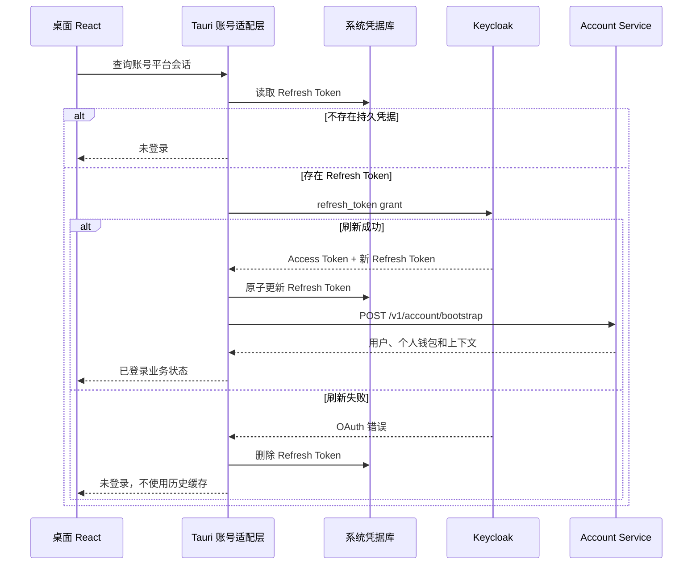
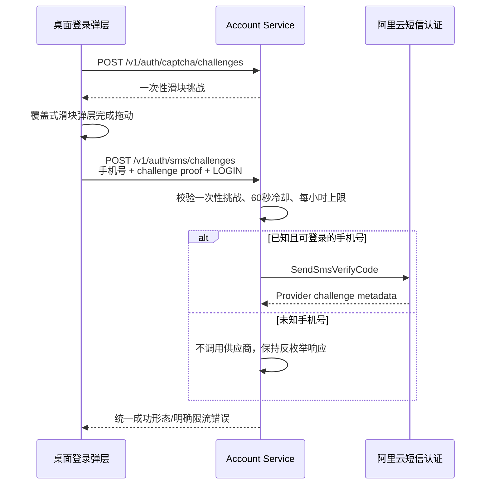
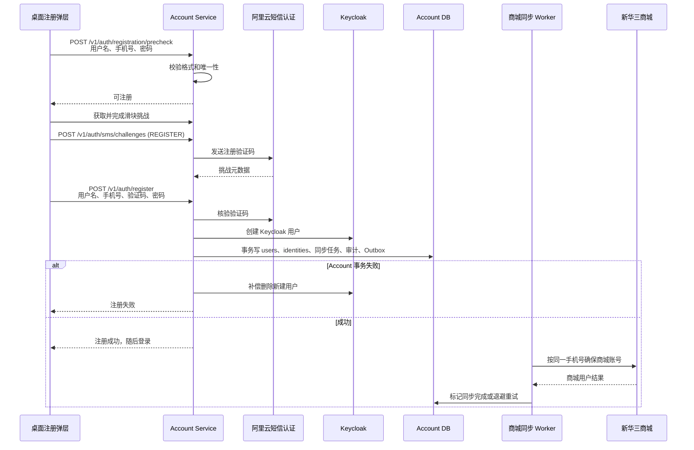
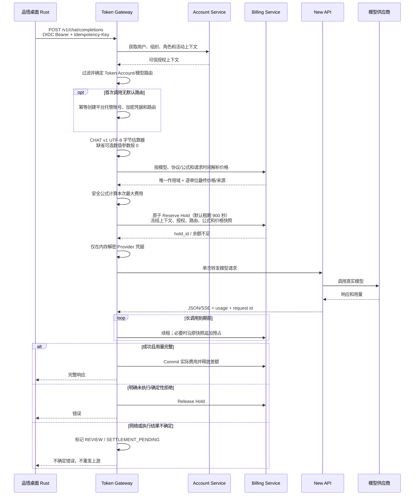
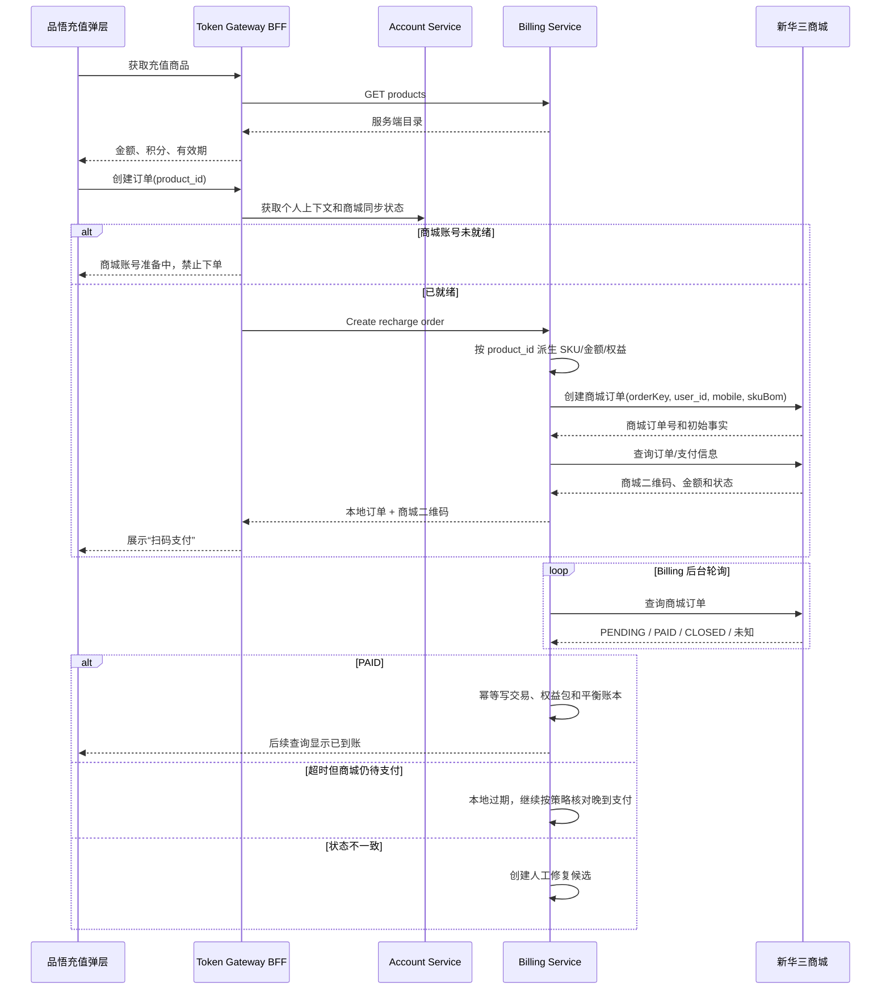
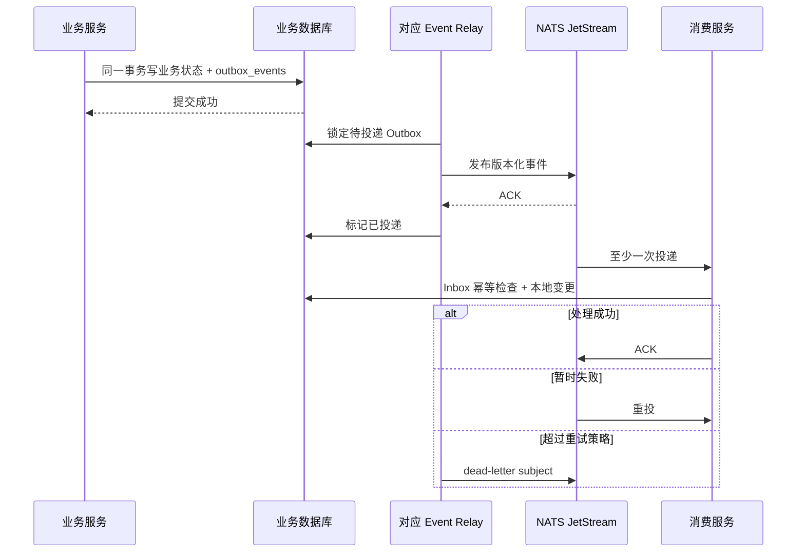

# 账号平台端到端调用流程

> 状态：当前实现基线
>
> 校准日期：2026-08-24
>
> 说明：本文描述业务调用顺序和失败收敛方式；具体字段以 `contracts/openapi/` 和事件 Schema 为准。
>
> 目标变更提示：本文已按用户级全局上下文、异步钱包 bootstrap 和版本化计量/定价链路更新。注册在 Identity 与 Account 成功后持久进入 `PROVISIONING`，钱包通过 Outbox 异步初始化；钱包完成前可登录和管理资料但不能调用平台模型或充值，超过 SLA 才进入 `REPAIR_REQUIRED`，Billing 短暂不可用不得删除已验证身份。新华三支付回调与查询证据已在仓库统一收敛；目标支付流水+权益包的整笔剩余退款领域实现继续保留，当前新建入口由独立、默认关闭的产品门禁统一阻断，既有请求仍可安全收敛。尚未实现的完整关单等能力以 `requirements.md` 和 `role-system-design.md` 为准。

## 账号注销资格与静默期

1. 用户在最近五分钟完成认证后，以幂等键和精确确认文本创建唯一注销请求。
2. Account 在串行化事务中检查组织所有权和最后有效超级管理员。存在阻断时请求保持 `CLOSURE_REQUESTED/BLOCKED`，用户仍为 ACTIVE，可完成所有权或管理员交接。
3. 本地角色门禁通过后，Account 原子写入 `QUIESCING` 并将用户置为 `CLOSING`；普通 Account 授权和 Token 新业务统一返回 `ACCOUNT_CLOSING`，只读历史及既有订单/用量修复走显式白名单。
4. Worker 使用租约认领请求，分别调用 Billing 与 Token 的服务身份评估接口，保存脱敏阻断快照。任何评估不可用都按退避重试，不能按“无阻断”处理。
5. 所有账务和用量阻断清除后进入 `IDENTITY_CLEANUP`。Account 先递增主体生命周期，撤销角色、成员关系和 Session，取消或向前归并资料 Saga、未接受邀请及非资金 Commerce 任务；资金 Commerce 任务未收敛时继续失败关闭。旧生命周期的 Commerce 迟到结果只能记为 `STALE` 证据。
6. Worker 幂等删除该用户的全部远端 Identity 主体，并调用 Billing 将全部有效或普通暂停的组织授予隔离为 `SUSPENDED/ACCOUNT_CLOSED`。任一远端副作用没有持久完成证明时均不进入去标识化。
7. 两项证明齐备后，Account 在单一事务中删除本地 Identity 映射、分离 Commerce Mapping、随机墓碑化可复用用户名和手机号，并将永久 `user_id`、`user_code` 和三年法律记录留在 `DELETED` 主体上；同一事务写出 `account.user.anonymized.v1`，阶段进入 `ANONYMIZED`。
8. Relay 确认匿名化事件已发布后才将 Saga 标记为 `COMPLETED`。超过 SLA 的请求进入 `REPAIR_REQUIRED`；管理员只能用独立权限和幂等命令重试当前阶段，不能强制完成或恢复管理员直删入口。
9. `ACCOUNT_CLOSED` 授予不能恢复、消费或普通撤回。账号达到 `ANONYMIZED` 后，具备 `organization.grant.reclaim_closed` 的组织管理员可对无冻结的单条授予幂等回收其全部当前剩余量至原权益包原 BASE/BONUS 组成；批量请求逐项独立处理，不接受客户端指定金额。

## 客户端切换 Readiness 与准入证明

1. 受信发布系统使用短期工作负载身份调用 Token Gateway 内部 Readiness；普通桌面和公网用户不能访问该入口。
2. Gateway 只读检查自身契约、OIDC 元数据、Account 契约、当前目录、至少一条目标协议的 READY 托管路由，以及该模型的有效价格/公式。该路径不解析用户上下文，不创建或续租 Hold，不写用户用量，也不调用推理接口。
3. 全部检查通过后，发布系统提交目标环境、客户端版本和制品 SHA-256；Gateway 用生产专用 Ed25519 密钥生成最长十五分钟的证明，并把声明摘要与检查快照写入不可变审计表。
4. 更新器仅访问公开 `/v1/client-compatibility` 获取当前兼容范围和验签公钥；它校验证明签名、环境、制品摘要、客户端/服务/契约版本及有效期，不持有内部 Readiness 凭据。
5. 生产密钥注入、真实环境连续无副作用验证和发布系统联调属于 APT-052 外部验收；验收完成前客户端正式发布门禁保持 No-Go。

## 1. 入口与凭据

| 调用方 | 身份/凭据 | 主要入口 |
|---|---|---|
| 品悟桌面端 | Keycloak OIDC Access Token；Refresh Token 仅存系统凭据库 | Account Service、Token Gateway |
| 个人中心/运营后台 | Portal 服务端 OIDC 会话 Cookie + CSRF | Token Portal `/api/*` |
| Token Portal | 当前服务端会话中的 OIDC Token | Account、Billing、Token Gateway |
| 服务间调用 | 内部服务凭据 | `/internal/*` |
| Event Relay | 数据库凭据 + NATS 连接 | Outbox -> JetStream |
| Token Gateway -> New API | 内存中解密的 Provider 凭据 | 私网 OpenAI 兼容入口和日志查询入口 |

桌面 WebView 只能通过白名单 Tauri 命令访问账号平台。Access Token、Refresh Token、商城密钥和 Provider 密钥均不返回 React。

## 2. 应用启动与自动登录

密码登录和短信登录成功后也执行 bootstrap，再保存 Refresh Token。系统凭据库写入失败时，登录必须明确失败，不能降级到设置文件或 Web 存储。

用户主动登出时：

1. Rust 尽力结束当前认证会话。
2. 删除系统凭据库中的 Refresh Token。
3. 清空进程内 Access Token 和业务会话。
4. UI 立即恢复未登录弹层；下次启动不自动登录。

## 3. 密码登录

1. 用户在桌面弹层输入“手机号或用户名”和密码。
2. React 只做必填和长度提示，将数据通过 Tauri 命令交给 Rust。
3. Rust 调用 Keycloak Direct Access Grant；密码只在该请求期间存在。
4. Keycloak 校验账号状态和密码，返回 OIDC Token 或标准 OAuth 错误。
5. 成功后 Rust 调用 Account bootstrap，确保业务用户、身份映射、个人钱包和当前会话上下文存在。
6. Rust 将 Refresh Token 写入系统凭据库；UI 只收到用户展示信息、余额和上下文。
7. 密码错误、账号停用或 bootstrap 失败不允许用本地旧用户数据伪装登录成功。

## 4. 手机短信登录

### 4.1 请求验证码

前端收到成功后立即启动 60 秒倒计时并禁用发送按钮。供应商明确返回发送失败时，服务端不占用冷却时间，前端可提示重试。

### 4.2 交换登录 Token

1. 用户提交手机号和短信验证码。
2. Rust 通过 Keycloak 自定义 Direct Grant 发起短信登录。
3. Keycloak 调用 Account 内部 `/internal/v1/auth/sms/verify`。
4. Account 调用阿里云核验验证码，并检查挑战用途、过期、尝试次数和一次性状态。
5. 核验成功后 Keycloak 签发 OIDC Token；之后执行与密码登录相同的 bootstrap 和安全持久化。
6. 验证码正确但用户身份不存在、停用或映射异常时，登录仍失败并留下可关联 Request/Trace ID，不能自动创建未知用户。

## 5. 手机注册

> 本节时序图保留当前实现；目标持久 Provisioning Saga 见 `requirements.md` 3.2 节。图中的补偿删除只适用于 Account 从未成功提交，不适用于 Account 已提交后的钱包初始化失败。

注册约束：

- 仅支持中国大陆手机号，统一规范化为 `+86` 身份。
- 用户名 3–32 位，以英文字母开头，后续可使用字母、数字、点、下划线和连字符；服务端按规范化值唯一。
- 密码 8–128 位可打印 ASCII，至少一个英文字母和一个数字；前端两次输入必须一致，后端不信任前端结果。
- 预检用于减少短信浪费，但最终提交仍必须在数据库唯一约束和事务中再次校验，防止并发注册竞争。
- 商城同步是注册后的异步步骤；同步完成前账号可以登录和聊天，但充值入口必须明确显示“商城账号准备中”。

## 6. Portal 登录与页面调用

1. 普通用户浏览器访问账号独立域名根路径 `/`；运营人员访问 `/admin.html`。
2. 未登录时 Portal 发起 Keycloak Authorization Code + PKCE。
3. 回调由 Portal 服务端交换 Token，并将会话保存在 Redis；浏览器仅持有 HttpOnly 会话 Cookie。
4. 浏览器调用同源 `/api/*`，写操作携带 CSRF 证明。
5. Portal 只代理白名单内的 Account、Billing 和 Gateway API。
6. `/admin.html` 只复用 OIDC 主体；Account、Billing 和 Token Gateway 分别向 Account 权限系统校验当前操作的原子平台权限，迁移期 `platform-admin` Claim 不能授予或绕过权限。
7. Portal 登出删除 Redis 会话并结束浏览器身份会话。

Web 首次进入未登录态时不再停留在 Portal 的单按钮中转页，而是直接进入 Keycloak `pinvou-browser` Flow。Cookie execution 先恢复既有统一身份会话；没有会话时由 Pinvou 浏览器 Authenticator 渲染密码、短信和注册表单。密码登录在 Keycloak 内校验；短信登录先调用 Account 创建/消费一次性滑块、发送 LOGIN 短信，再通过服务身份调用内部核验并绑定权威 Identity Subject；注册先由 Identity Adapter 生成密码不透明引用，再由 Account 完成注册预检、REGISTER 滑块/短信、唯一值预约和持久注册 Saga。认证成功后才继续原 PKCE 回调，Portal 始终看不到密码、验证码或浏览器可读 Token。

## 7. 账号 Bootstrap 与活动上下文

### 7.1 Bootstrap

每次新登录或恢复会话后，桌面端调用 `POST /v1/account/bootstrap`：

1. Account 通过 OIDC issuer + subject 查找身份映射。
2. 幂等确保业务用户存在并更新最近活动信息。
3. 通过内部接口要求 Billing 幂等确保个人钱包。
4. 确保用户存在唯一活动上下文；新用户默认个人上下文，OIDC Session 只登记登录观察。
5. 返回用户展示信息和全局活动上下文，并通过标准响应头返回上下文/授权版本。

### 7.2 切换上下文

1. 用户在个人中心选择“个人”或某个已加入组织。
2. 客户端提交目标类型、组织 ID 和当前 `expected_context_version` 到 `/v1/sessions/current/active-context`。
3. Account 锁定用户级上下文，校验期望版本、成员状态、组织状态和当前 OIDC Session；旧版本返回冲突并要求重读。
4. Account 原子更新唯一上下文、递增版本并返回新的授权上下文；其他 Session 不拥有独立选择。
5. 后续 Gateway 请求每次从 Account 解析可信上下文；Account/Token 响应传播版本，客户端发现更高版本或重新聚焦时清空旧资源并重读。

成员被移除或组织被停用后，Account 在治理事务内把命中的用户级上下文回退个人并递增版本；角色变化递增独立授权版本。版本响应和事件共同用于客户端及下游授权缓存收敛。

### 7.3 邀请与成员生命周期

1. 组织管理员按手机号、用户名或一次性链接创建邀请；请求带稳定幂等键，Account 不以目标是否已经注册改变外部响应。
2. 手机号和用户名邀请仅出现在当前认证用户的待接受邀请列表；用户以邀请 ID 接受时，Account 再次核对当前身份。链接邀请只能用一次性令牌接受。
3. 接受邀请或管理员直接添加成员后，Account 原子创建或恢复成员关系和角色历史，递增成员版本，再将 Billing 的成员限制态同步为 `ACTIVE`。
4. 移除成员时，Account 原子撤销全部当前有效和未来角色绑定，保留历史记录，递增用户、成员和授权版本，并把命中的用户级活动上下文回退个人；随后将 Billing 限制态同步为 `REVOKED`。
5. Billing 同步失败时接口返回可重试错误；调用方使用同一幂等键重试，Account 重放既有结果并继续修复 Billing 投影，不重复创建成员、角色或审计事件。
6. 所有权转让由专用幂等命令完成，数据库在事务提交时强制每个有效组织恰好一个有效所有者，普通角色接口不能修改所有者。

## 8. 内置模型聊天完整流程

### 8.1 请求约束

- 模型字段必填；普通请求体上限 4 MiB。
- 最大输出优先读取 `max_completion_tokens`，其次 `max_tokens`；未提供时公式参数为 `0`，显式值上限 128,000。
- 流式请求强制要求最终 usage；桌面端用原生流式运行时，不通过普通业务 JSON 代理。
- CHAT v1 使用版本化 `UTF8_BYTES_DIV4_CEIL` 估算器测量本次请求内容，不再按全局 128,000 输入上限统一预占；超过当前模型/协议上限时在 Hold 前拒绝。
- Billing 先唯一选择模型覆盖或全局版本，再逐单位解析 `FIXED_PRICE`/`INHERIT_GLOBAL`；固定零价不回退，缺价、歧义和阻断分别稳定失败。
- 长调用每四分钟续租九分钟租约；流式输出按已传输证据保守追加预占，追加失败停止仍可控制的输出并进入复核。非流式最终响应在交付前完成必要追加。
- 未提供 `Idempotency-Key` 时，Gateway 使用用户、OIDC Session 和请求体派生稳定键；相同请求的网络重试不再次调用 New API。

### 8.2 路由顺序

1. 若请求显式指定 Token Account，只检查该账号，失败即返回，不回退。
2. 过滤非 ACTIVE、健康异常、模型不允许或共享范围不符的候选。
3. 组织上下文优先节点默认，再组织默认，再选择唯一最高优先级。
4. 个人上下文只能使用当前用户拥有的个人账号。
5. 无显式账号且无候选时，创建平台托管默认路由后重试一次路由解析。

### 8.3 结算分类

| 上游结果 | Gateway 状态 | Billing 动作 |
|---|---|---|
| 2xx 且 usage 完整 | `SETTLED` | 按 Hold 内逐单位价格快照和规范化用量提交，释放差额 |
| 400/401/403/404/422/429 等确定性拒绝 | `RELEASED`/失败 | 释放全部 Hold |
| 传输超时、连接断开、5xx | `REVIEW` | 暂保留 Hold，等待核对 |
| SSE 中途断开或没有最终 usage | `SETTLEMENT_PENDING` | 暂保留 Hold，等待核对 |
| 成功响应但缺失 usage | `SETTLEMENT_PENDING` | 暂保留 Hold，等待核对 |

同一时间可以有多次对话。每次请求独立预占，Billing 的可用余额等于已入账额度减去所有有效 Hold；余额不足时只拒绝新请求，不影响已在执行的请求。

## 9. New API 自动核对与人工补偿

1. Gateway 保存 New API 返回的请求 ID、Token Account、模型、定价版本、Hold 和尝试结果。
2. 后台 Usage Reconciler 周期扫描 `REVIEW`/`SETTLEMENT_PENDING`。
3. Reconciler 通过 New API 管理日志按请求 ID 查询实际用量。
4. 查到明确用量：使用请求/Hold 内冻结的逐单位价格与来源快照结算，不查询当前价格重算。
5. 查到明确未执行/拒绝：释放 Hold。
6. 仍不确定：按退避策略重试；自动窗口最长 24 小时。
7. 超出窗口后保留人工复核状态和完整证据，不自动猜测。
8. 平台管理员可查看请求、New API 关联、尝试历史并触发人工重试；任何人工资金动作必须审计和幂等。

过期 Hold 回收不能无条件释放仍可能已消费的请求。回收任务必须结合用量请求状态和核对证据，无法证明未执行时进入人工处理。

## 10. 充值完整流程

### 10.1 客户端行为

1. 点击“充值”总是从商品选择开始，不直接打开历史二维码。
2. 客户端只提交 `product_id`，不提交可信金额、SKU 或积分。
3. 二维码、商城订单号和应付金额均显示商城返回结果。
4. 客户端轮询只用于刷新界面；服务端轮询负责最终收敛。
5. 客户端关闭应用或二维码页面后，Billing 仍继续查询订单。
6. PAID 后重新读取强一致余额和权益包，不能仅在前端加数。

### 10.2 商城账号同步

注册成功后 Account 的商城同步 Worker：

1. 读取待同步任务和规范化手机号。
2. 调用商城用户查询/创建能力，确保一一对应账号。
3. 成功后记录商城用户引用和完成状态。
4. 暂时失败采用指数退避；永久冲突进入可运营处理状态。
5. 充值前 Gateway/Account 检查同步完成状态，避免先收款后无法归属。

### 10.3 当前 Provider 降级规则

| 能力 | 当前处理 |
|---|---|
| 支付渠道 | 仅支付宝 |
| 主动关单 | UI 禁用；只查询商城，商城明确 CLOSED 后同步本地 |
| 普通退款 | 用户和运营新建入口均由独立产品门禁屏蔽，服务端创建请求返回稳定 `NORMAL_REFUND_CREATION_DISABLED`；Provider capability 不能自动解锁，既有请求查询/收敛和被动退款异常处置继续可用 |
| 支付回调 | 商城通过专用客户端凭据换取短期 Token，并直接投递与 `queryOrder.content` 相同的原生订单对象；H3C Profile 与主动查询复用同一 DTO 和映射，Billing 先持久化通知再归并，后台轮询继续补偿漏回调 |
| 日终商城账单 | 无接口，不能自动完成外部账单对账 |
| 晚到支付 | 继续核对；能确认 PAID 则幂等入账，否则进入人工修复 |
| 重复通知/查询 | 以商城订单号、支付交易和账本幂等键防重复入账 |

创建订单时 `merchantCustomerKey` 固定为实际付款人的永久不可变 `user_id`；商城返回/回调的客户标识、`skuBom` 和订单号必须与本地冻结事实一致。商城金额以十进制元精确换算为分，`PAID` 缺少正 `paidAmt`、支付时间或稳定流水，以及任何金额冲突，都只留证并进入人工复核。未知商城状态同样按人工复核处理，不推断为成功或权威未支付。

## 11. 管理后台调用流程

1. 管理员通过 Token Portal 登录 Keycloak。
2. Portal 只代理 OIDC Access Token；Account、Billing 和 Token Gateway 对每个后台接口向 Account 权限系统校验原子权限，默认拒绝，不能只依赖前端隐藏页签或 Identity Provider 角色 Claim。
3. 用户/组织操作进入 Account Admin API；资金操作进入 Billing Admin API；Token/用量操作进入 Gateway Admin API。
4. Portal 的“系统运行”聚合各服务健康、Keycloak、New API、NATS 和 Relay 指标，不把基础设施凭据传给浏览器。
5. 所有变更记录操作者、资源、动作、结果、Request ID 和时间；高风险资金操作保留审批或人工修复记录。
6. Keycloak 自身管理不从 `/admin.html` 透传，运维人员使用受限隧道访问原生控制台。

### 11.1 受控审计导出

1. 管理员在审计页明确选择起止时间、筛选范围和导出原因；Portal 只提交任务参数，不把当前列表拼成文件。
2. Account 校验 `platform.audit.export`、十五分钟内认证、31天范围和每用户2个并发/10个每日任务配额；PII 导出还要求带原因、最长24小时且尚未到期的 `platform.audit.pii.export` 临时绑定。
3. 服务端创建任务和不可变事件，并只在创建响应或同一幂等请求的恢复响应中返回随机文件密钥；普通状态查询不返回密钥。Worker 查询最多100,000行，默认不可逆化主体并脱敏引用，任何模式都排除秘密和模型正文。
4. Worker 把内容与文件名水印写入 AES-256-GCM/HMAC-SHA-256 封装，500MB前失败关闭；生成、失败和过期均写事件及审计。
5. 管理员保存文件密钥，任务就绪后重新通过近期认证领取十五分钟下载票据；票据只允许一次成功下载，服务端在同一事务标记已消费并清除载荷。无效、重复或过期票据返回无泄露结果并记录失败证据。

## 12. 领域事件流程

事件消费者必须假设重复、延迟和短暂乱序。事件不能承载密码、Token、真实供应商密钥或支付密钥。

## 13. 客户端目录与切换门禁

### 13.1 客户端目录切换与模型下架

1. 桌面在选择时读取当前 `/v1/models`，按上下文资格及 ACTIVE/DEPRECATED 截止时间过滤；选择只改变后续新会话的默认值。
2. 新会话把实际模型引用保存到会话元数据。每次运行从该会话快照解析模型，不能因目录刷新或全局默认变化静默替换。
3. Gateway 对每个新请求按当前目录重新判定。若返回模型已移除、弃用继续截止或资格失效，客户端保留原会话只读并展示显式替代操作。
4. 用户选择仍可用模型后，客户端从指定来源轮次创建新会话，复制截至该轮的已提交消息，并单独保存来源会话、来源轮次、原模型、替代模型和创建时间；原会话及原消息不变。
5. 普通弃用/移除不会取消生效前已经受理并冻结快照的请求；这些请求继续按原模型证据和实际用量结算。
6. 只有紧急 REMOVED 显式设置 `force_cancel_inflight` 时，目录发布事务才写入紧急取消策略；Worker 持续锁定该模型在生效前已受理且仍在派发链的请求，避免提交竞态漏单。
7. 派发前请求经原取消链释放 Hold；已派发请求只执行 Adapter 能力允许的取消及本地传输中止，并保存实际结果。无论取消是否支持或成功，最终仍以可信生成量和原 Hold 收敛结算，不能因模型下架直接免除已发生费用。

### 13.2 客户端三层切换

1. 发布系统先验证公开兼容范围、OIDC discovery、制品摘要和 TOK-37 短时签名证明；失败时不提升更新渠道。
2. 更新器复核证明、环境固定公钥、系统包签名和只读迁移预检；任一失败都不调用平台安装器。
3. 安装后的进程要求迁移报告为完成态且配置可解析；失败只显示稳定修复原因，不访问旧 `llmapi_hub` 或产生计费探测请求。
4. 登录用户打开 Web 个人中心时只经专用 Rust 命令跳转到受信账号独立域名根路径 `/`，不把 OIDC Token 交给浏览器页面。

## 14. 故障判断速查

| 用户现象 | 首查组件 | 关键证据 |
|---|---|---|
| 密码/短信登录失败 | Keycloak、Account | OIDC 错误码、短信挑战状态、身份映射、同一 Trace ID |
| 注册后用户名被占用但无法登录 | Account、Keycloak | 注册事务、补偿删除结果、Keycloak 用户、`identities` 映射 |
| 获取验证码失败 | Account、阿里云 | 滑块是否消费、冷却/小时上限、Provider Request ID；不得记录验证码 |
| 个人中心与聊天身份不一致 | 桌面 Rust 配置、Gateway | 功能开关、OIDC issuer/audience、请求 subject/session |
| 对话余额不足 | Gateway、Billing | 最大预占、当前价格、可用积分、其他有效 Hold |
| 对话返回但未结算 | Gateway、New API | usage 是否存在、上游请求 ID、Reconciler 尝试历史 |
| 二维码金额与商品不一致 | Billing、商城 | product_id 到 SKU 目录、商城订单返回金额；不要信客户端显示 |
| 订单长期 PENDING | Billing、商城 | 后台轮询日志、本地过期时间、商城查询事实、人工修复候选 |
| 支付成功未到账 | Billing | 商城 PAID 证据、支付交易幂等键、权益包、账本分录 |
| “账号设置”中没有组织管理区 | Account、个人中心 | 用户是否存在有效组织成员关系，以及是否已切换到该组织；无组织时属于预期行为 |
