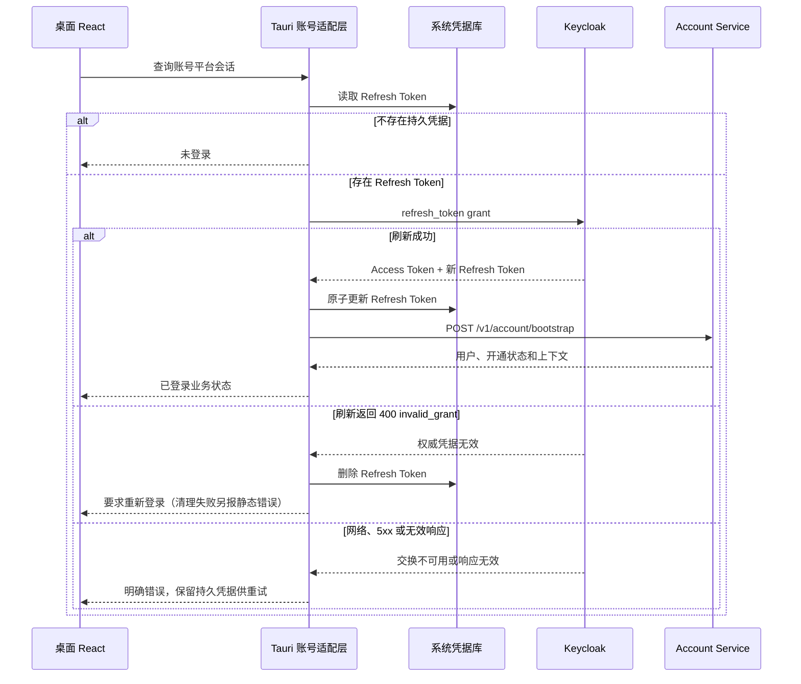
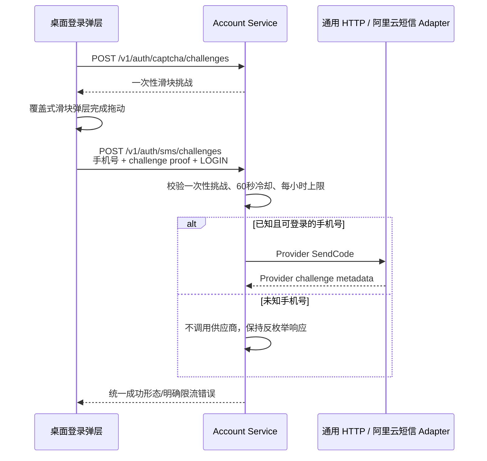
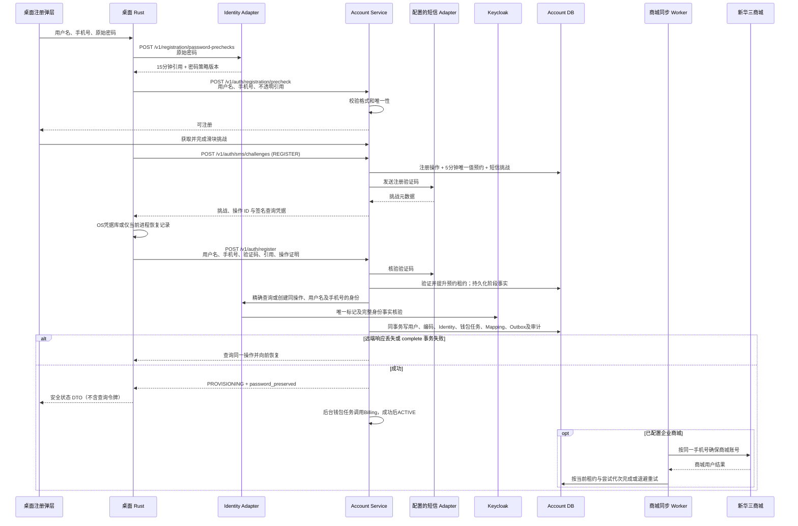
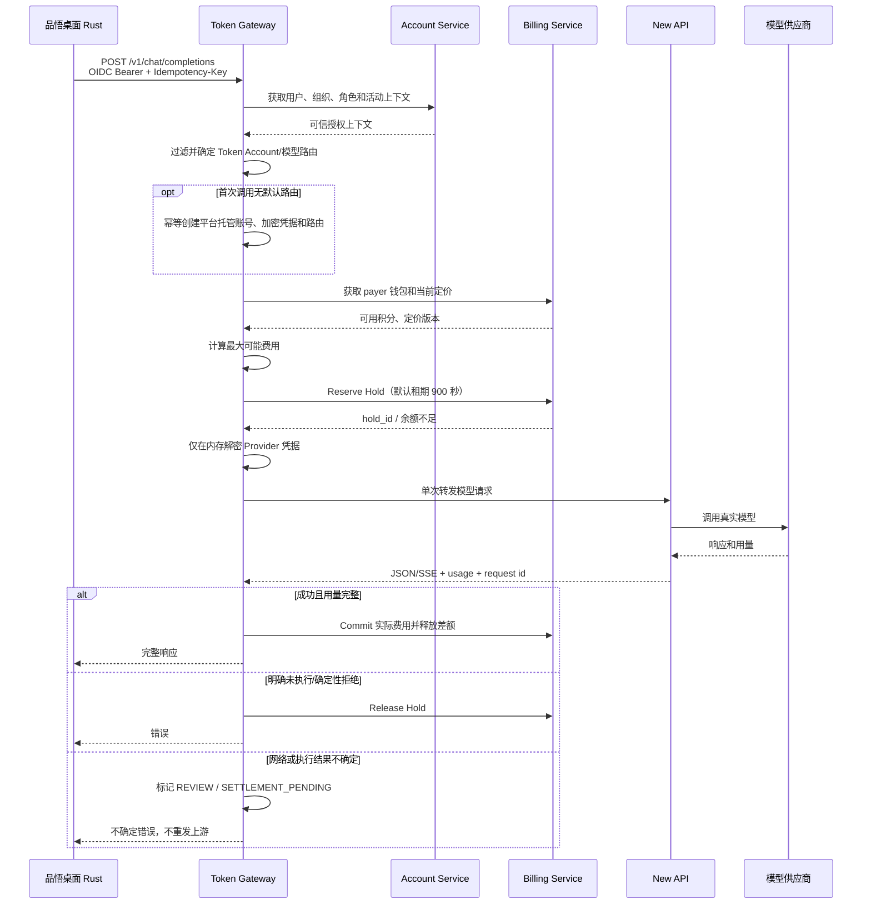
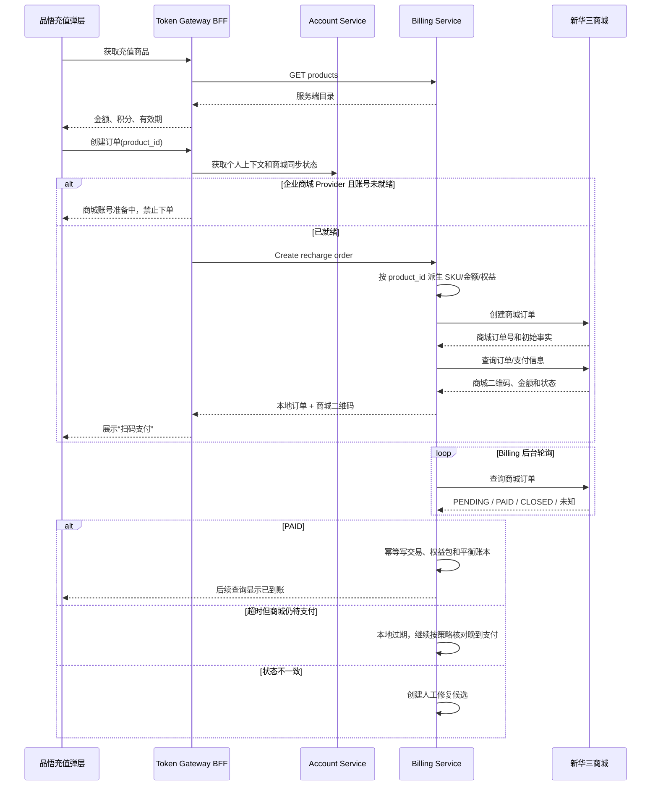
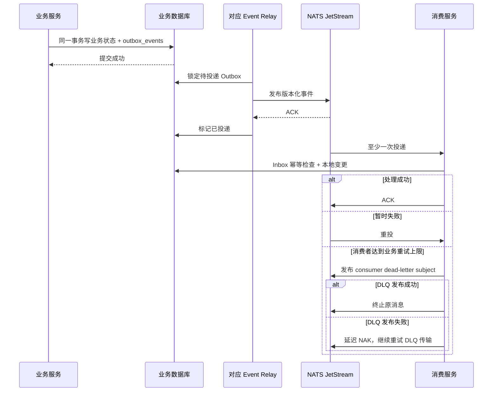

# 账号平台端到端调用流程

> 状态：当前实现基线
>
> 校准日期：2026-10-06；继承已审 A07 `d31f5f23`，本波实现与验证以最终固定源码为准
>
> 说明：本文描述业务调用顺序和失败收敛方式；具体字段以 `contracts/openapi/` 和事件 Schema 为准。
>
> 本波注册在 Identity 与 Account 成功后持久进入 `PROVISIONING`，通过后台持久任务异步初始化钱包；钱包完成前可登录和管理资料但不能调用平台模型或充值，超过 SLA 进入 `REPAIR_REQUIRED`，Billing 短暂不可用不得删除已验证身份。用户名/手机号资料变更及密码重置使用独立 Identity 端口。本波仍按 Session 保存上下文，使用固定 Token 预占和新华三轮询。用户级全局上下文、版本化计量单位、每协议公式、Hold 续租/追加、目标退款/四方对账和组成级组织授予仍属后续目标。

## 1. 入口与凭据

| 调用方 | 身份/凭据 | 主要入口 |
|---|---|---|
| 品悟桌面端 | Keycloak OIDC Access Token；Refresh Token 仅存系统凭据库 | Account Service、Token Gateway |
| 个人中心/运营后台 | Portal 服务端 OIDC 会话 Cookie + CSRF | Token Portal `/api/*` |
| Token Portal | 当前服务端会话中的 OIDC Token | Account、Billing、Token Gateway |
| 服务间调用 | 内部服务凭据 | `/internal/*` |
| Event Relay | 数据库凭据 + NATS 连接 | Outbox -> JetStream |
| Token Gateway -> New API | 内存中解密的 Provider 凭据 | 私网 OpenAI 兼容入口和日志查询入口 |

桌面 WebView 只能通过白名单 Tauri 命令访问账号平台。Access Token、Refresh Token、商城密钥和 Provider 密钥均不返回 React。

## 2. 应用启动与自动登录

密码登录和短信登录成功后也执行 bootstrap，再保存 Refresh Token。系统凭据库写入失败时，登录必须明确失败，不能降级到设置文件或 Web 存储。

刷新失败不一概等于凭据失效：只有刷新请求的 `400 invalid_grant` 映射为 `authentication_required` 并执行清理。网络/服务故障、坏响应和后续身份校验失败不能擅自删除原 Refresh Token，也不能用过期 Access Token 或历史业务缓存伪装成功。

用户主动登出时：

1. Rust 尽力结束当前认证会话。
2. 删除系统凭据库中的 Refresh Token。
3. 清空进程内 Access Token 和业务会话。
4. UI 立即恢复未登录弹层；下次启动不自动登录。

## 3. 密码登录

1. 用户在桌面弹层输入“手机号或用户名”和密码。
2. React 只做必填和长度提示，将数据通过 Tauri 命令交给 Rust。
3. Rust 调用 Keycloak Direct Access Grant；密码只在该请求期间存在。
4. Keycloak 校验账号状态和密码，返回 OIDC Token 或标准 OAuth 错误。
5. 成功后 Rust 调用 Account bootstrap，确保业务用户、身份映射和当前会话上下文存在；钱包由后台任务独立初始化。
6. Rust 将 Refresh Token 写入系统凭据库；UI 只收到用户展示信息、余额和上下文。
7. 密码错误、账号停用或 bootstrap 失败不允许用本地旧用户数据伪装登录成功。

## 4. 手机短信登录

### 4.1 请求验证码

前端收到成功后启动 60 秒倒计时。发送超时、丢失响应或不完整响应保留冷却；HTTP 通用协议没有权威未接受语义。仅 Aliyun 返回完整、明确的官方前置拒绝时可解除计数，解除回写有独立 2 秒截止期限，不把错误 HTTP 状态一概当未发送。

### 4.2 交换登录 Token

1. 用户提交手机号和短信验证码。
2. Rust 通过 Keycloak 自定义 Direct Grant 发起短信登录。
3. Keycloak 调用 Account 内部 `/internal/v1/auth/sms/verify`。
4. Account 调用配置的 SMS Adapter 核验验证码，并检查挑战用途、过期、尝试次数和一次性状态。
5. Keycloak 通过 Account 内部 mobile identity 接口绑定当前权威 subject，核验成功后签发 OIDC Token，再执行 bootstrap 和安全持久化。不能以手机号搜索的首个历史用户登录。
6. 验证码正确但用户身份不存在、停用或映射异常时，登录仍失败并留下可关联 Request/Trace ID，不能自动创建未知用户。

## 5. 手机注册

> 注册使用同一持久操作恢复，不能为恢复而删除已接受的 Keycloak 用户或重置首次密码；账号注销 Saga 仍未实现。

注册约束：

- 仅支持中国大陆手机号，统一规范化为 `+86` 身份。
- 用户名 3–32 位，以英文字母开头，后续可使用字母、数字、点、下划线和连字符；服务端按规范化值唯一。
- 密码 8–128 位可打印 ASCII，至少一个英文字母和一个数字；允许中间空格、拒绝首尾空格，不 trim 或规范化。前端两次输入必须一致，Identity 执行权威校验。
- 预检用于减少短信浪费，但最终提交仍必须在数据库唯一约束和事务中再次校验，防止并发注册竞争。
- `password_preserved=true` 时使用首次提交的密码登录，不自动用此次重试密码登录；恢复仍须新滑块/SMS，并精确匹配已持久化的用户名、手机号、issuer 和唯一标记。
- 商城 worker 仅在显式配置时启动；未配置时待处理 Mapping 不阻止社区注册、钱包或模拟充值。只有依赖该客户映射的企业支付要求已验证且同步的手机号，不泛化为所有 Provider 或组织 LEGACY 充值门禁。

## 6. Portal 登录与页面调用

1. 浏览器访问 `/account.html` 或 `/admin.html`。
2. 未登录时 Portal 发起 Keycloak Authorization Code + PKCE。
3. 回调由 Portal 服务端交换 Token，并将会话保存在 Redis；浏览器仅持有 HttpOnly 会话 Cookie。
4. 浏览器调用同源 `/api/*`，写操作携带 CSRF 证明。
5. Portal 只代理白名单内的 Account、Billing 和 Gateway API。
6. `/admin.html` 只复用 OIDC 主体；Account、Billing 和 Token Gateway 分别向 Account 权限系统校验当前操作的原子平台权限，迁移期 `platform-admin` Claim 不能授予或绕过权限。
7. Portal 登出删除 Redis 会话并结束浏览器身份会话。

## 7. 账号 Bootstrap 与活动上下文

### 7.1 Bootstrap

每次新登录或恢复会话后，桌面端调用 `POST /v1/account/bootstrap`：

1. Account 通过 OIDC issuer + subject 查找身份映射。
2. 幂等确保业务用户存在并更新最近活动信息。
3. 幂等确保持久钱包初始化任务；不在 bootstrap 请求内调用 Billing，返回当前开通状态。
4. 确保当前 OIDC Session 有合法活动上下文；默认个人上下文。
5. 返回用户展示信息、组织摘要和当前上下文。

### 7.2 切换上下文

1. 用户在个人中心选择“个人”或某个已加入组织。
2. 客户端提交目标类型和组织 ID 到 `/v1/sessions/current/active-context`。
3. Account 重新检查成员状态、组织状态和当前 OIDC Session。
4. Account 原子更新该 Session 的上下文并返回新的授权上下文。
5. 后续 Gateway 请求每次从 Account 解析可信上下文；客户端缓存只用于显示，不能决定扣费主体。

成员被移除、组织被停用或角色变化后，Account 会使不再合法的组织上下文失效；事件同时用于下游授权缓存收敛。

## 8. 内置模型聊天完整流程

### 8.1 请求约束

- 模型字段必填；普通请求体上限 4 MiB。
- 最大输出优先读取 `max_completion_tokens`，其次 `max_tokens`，缺省 4,096，上限 128,000。
- 流式请求强制要求最终 usage；桌面端用原生流式运行时，不通过普通业务 JSON 代理。
- 最大预占使用配置的最大输入 Token，当前默认 128,000，再加本次最大输出成本。
- 必须提供每逻辑调用独立的 `Idempotency-Key`；相同调用的网络重试复用键，新用户调用或改变实际请求内容使用新键。缺键返回 400，重复键不再派发或重复扣费；不按用户、Session、body 自动推导。

### 8.2 路由顺序

1. 若请求显式指定 Token Account，只检查该账号，失败即返回，不回退。
2. 过滤非 ACTIVE、健康异常、模型不允许或共享范围不符的候选。
3. 组织上下文优先节点默认，再组织默认，再选择唯一最高优先级。
4. 个人上下文只能使用当前用户拥有的个人账号。
5. 无显式账号且无候选时，创建平台托管默认路由后重试一次路由解析。

### 8.3 结算分类

| 上游结果 | Gateway 状态 | Billing 动作 |
|---|---|---|
| 2xx 且 usage 完整、费用在预占内 | `COMMITTED` | 按实际 Token 和价格版本提交，释放差额 |
| 400/401/403/404/422/429 等确定性拒绝 | `RELEASED`/失败 | 释放全部 Hold |
| 传输超时、连接断开、5xx | `REVIEW` | 暂保留 Hold，等待核对 |
| SSE 中途断开或没有最终 usage | `SETTLEMENT_PENDING` | 暂保留 Hold，等待核对 |
| 成功响应但缺失 usage | `SETTLEMENT_PENDING` | 暂保留 Hold，等待核对 |

同一时间可以有多次对话。每次请求独立预占，Billing 的可用余额等于已入账额度减去所有有效 Hold；余额不足时只拒绝新请求，不影响已在执行的请求。

## 9. New API 自动核对与人工补偿

1. Gateway 保存 New API 返回的请求 ID、Token Account、模型、定价版本、Hold 和尝试结果。
2. 后台 Usage Reconciler 周期扫描 `REVIEW`/`SETTLEMENT_PENDING`。
3. Reconciler 通过 New API 管理日志按请求 ID 查询实际用量。
4. 查到明确用量：使用请求时对应的历史价格结算 Hold。
5. 单条渠道错误日志不证明整个调用未消费，不能据此释放；只恢复代理已持久化的明确释放意图，或 Billing 已释放而本地终态未写入的情况。
6. 仍不确定：按退避策略重试；自动窗口最长 24 小时。
7. 超出窗口后保留人工复核状态和完整证据，不自动猜测。
8. 平台管理员可查看请求、New API 关联、尝试历史并触发人工重试；任何人工资金动作必须审计和幂等。

过期 Hold 回收不能无条件释放仍可能已消费的请求。回收任务必须结合用量请求状态和核对证据，无法证明未执行时进入人工处理。

管理员明确最终免单使用 Billing→Token→Billing 协调：Token 行锁拒绝 `UPSTREAM_ACTIVE` 并持久 actor/reason/hold 意图，Billing Hold 行锁裁决免单与 Commit 唯一赢家；已扣费返回冲突，成功免单两域均 `RELEASED` 且收费为零。原实际 usage 与计算证据保留，迟到消费证据不能再扣同一调用；投影失败由现有补偿 worker 重试持久意图，不因超时自动免单。

## 10. 充值完整流程

### 10.1 客户端行为

1. 点击“充值”总是从商品选择开始，不直接打开历史二维码。
2. 客户端只提交 `product_id`，不提交可信金额、SKU 或积分。
3. 二维码、商城订单号和应付金额均显示商城返回结果。
4. 客户端轮询只用于刷新界面；服务端轮询负责最终收敛。
5. 客户端关闭应用或二维码页面后，Billing 仍继续查询订单。
6. PAID 后重新读取强一致余额和权益包，不能仅在前端加数。

### 10.2 商城账号同步

注册成功后 Account 的商城同步 Worker：

注册提交建立供应商中立 Mapping/任务；只有显式配置当前 Adapter 时启动 worker。没有商城配置的社区注册不等待此流程。

1. 读取待同步任务和规范化手机号。
2. 调用商城用户查询/创建能力，确保一一对应账号。
3. 成功后以本次 claim 的精确租约、尝试代次和未过期条件记录引用与完成状态；队列中过期任务不执行，外部调用截止于租约期限。
4. 暂时失败采用指数退避；永久冲突进入可运营处理状态。
5. 企业商城充值检查已验证且同步的手机号；模拟器的个人 PLAN 与组织 LEGACY 充值不因此被禁止。

### 10.3 企业商城 Provider 能力边界

| 能力 | 当前处理 |
|---|---|
| 支付渠道 | 仅支付宝 |
| 主动关单 | UI 禁用；只查询商城，商城明确 CLOSED 后同步本地 |
| 退款 | UI 禁用；不得只改本地账本模拟退款 |
| 支付回调 | 不依赖；Billing 后台轮询替代 |
| 日终商城账单 | 无接口，不能自动完成外部账单对账 |
| 晚到支付 | 非人工冻结订单按事实核对；已因首次退款进入 MANUAL_REVIEW 的订单不得被迟到 PAID 解冻或自动入账 |
| 重复通知/查询 | 以商城订单号、支付交易和账本幂等键防重复入账 |

社区开发/测试使用 simulator，其 ALIPAY/WECHAT/UNIONPAY 能力不计作企业商城真实能力。个人 PLAN 按各 SKU 支持渠道和冻结快照购买并从实际入账起算期限；PLAN_TRIAL 仅 ALIPAY。组织 OWNER/BILLING_ADMIN 保留原四档 LEGACY 模拟充值；个人停售旧商品不复开、个人 PLAN 不发给组织，旧订单/普通 Credit 不加期限。新 PLAN 不可退款，原 LEGACY 退款继续保留。任何首次退款未入账事实在创建当前锁事务中即进入 MANUAL_REVIEW，重复键、查询/关闭及迟到成功回调均不得重开或自动入账。

## 11. 管理后台调用流程

1. 管理员通过 Token Portal 登录 Keycloak。
2. Portal 只代理 OIDC Access Token；Account、Billing 和 Token Gateway 对每个后台接口向 Account 权限系统校验原子权限，默认拒绝，不能只依赖前端隐藏页签或 Identity Provider 角色 Claim。
3. 用户/组织操作进入 Account Admin API；资金操作进入 Billing Admin API；Token/用量操作进入 Gateway Admin API。
4. Portal 的“系统运行”聚合各服务健康、Keycloak、New API、NATS 和 Relay 指标，不把基础设施凭据传给浏览器。
5. 所有变更记录操作者、资源、动作、结果、Request ID 和时间；高风险资金操作保留审批或人工修复记录。
6. Keycloak 自身管理不从 `/admin.html` 透传，运维人员使用受限隧道访问原生控制台。

## 12. 领域事件流程

事件消费者必须假设重复、延迟和短暂乱序。图中消费失败 DLQ 由消费者平台 helper 发布；Relay 自身发布失败则另按 Outbox 重试策略进入 Relay DLQ，不把这两个发送者混为一谈。事件不能承载密码、Token、真实供应商密钥或支付密钥。

普通重试与丢失 ACK 使用稳定的 event_id:publication_generation 去重身份；只有审计后的手动 Requeue 增代并真正重新发布。旧代或已过期租约的回写不能覆盖新代。Inbox 仍按业务 event ID 幂等，重放不会重复业务效果；DLQ 身份沿用对应发布代次，DLQ 发送失败必须继续重试而非提前 ACK。

## 13. 故障判断速查

| 用户现象 | 首查组件 | 关键证据 |
|---|---|---|
| 密码/短信登录失败 | Keycloak、Account | OIDC 错误码、短信挑战状态、身份映射、同一 Trace ID |
| 注册后用户名被占用但无法登录 | Account、Identity、Keycloak | 持久操作及遗留意图证明、精确远端标记、`identities` 映射与 password_preserved；不删除或重置远端身份 |
| 获取验证码失败 | Account、短信 Adapter | 滑块是否消费、冷却/小时上限、供应商结果是否权威；不得记录验证码或凭据 |
| 个人中心与聊天身份不一致 | 桌面 Rust 配置、Gateway | OIDC issuer/audience、请求 subject/session及会话代次 |
| 对话余额不足 | Gateway、Billing | 最大预占、当前价格、可用积分、其他有效 Hold |
| 对话返回但未结算 | Gateway、New API | usage 是否存在、上游请求 ID、Reconciler 尝试历史 |
| 二维码金额与商品不一致 | Billing、商城 | product_id 到 SKU 目录、商城订单返回金额；不要信客户端显示 |
| 订单长期 PENDING | Billing、商城 | 后台轮询日志、本地过期时间、商城查询事实、人工修复候选 |
| 支付成功未到账 | Billing | 商城 PAID 证据、支付交易幂等键、权益包、账本分录 |
| 组织页签不见 | Account、个人中心 | 用户是否存在有效组织成员关系；无组织时属于预期行为 |
