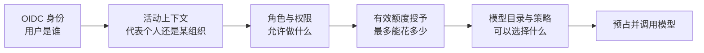
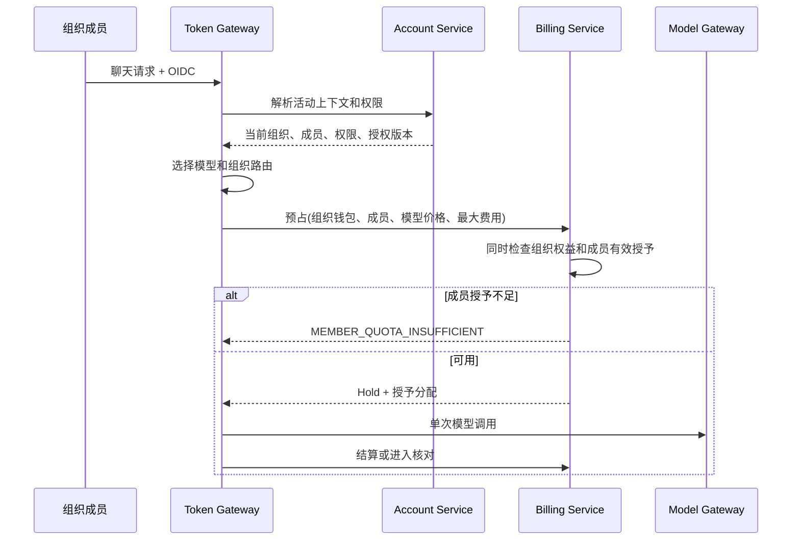

# 账号平台角色权限系统设计

> 状态：2026-08-26 安全审计与业务/财务/运维审计双重独立审核通过，待按任务实现
>
> 日期：2026-08-26
>
> 适用范围：平台管理后台、个人中心、组织管理、额度分配、模型选择、平台 Token Account 运营、计费运营和审计

## 1. 设计结论

角色权限系统采用“权限码驱动、三类权限、分作用域 RBAC”：

- 个人权限控制用户对自己账号、会话、钱包、订单、额度、用量和模型调用的能力。普通用户创建成功时自动获得内置 `PERSONAL_USER` 角色，该角色默认包含全部普通个人权限。
- 系统权限管理跨租户的用户、组织、定价、支付、Token Gateway、系统运行、运维、财务和审计能力。
- 组织角色只在一个组织或组织节点范围内生效，管理成员、组织额度和模型允许策略、目录范围等组织业务策略；真实 Token Account、路由和凭据不属于组织资源管理权限。
- 角色只是权限集合，不在业务代码中产生隐式特权；用户可以同时拥有个人、系统和多个组织作用域的角色。
- 用户级全局聊天和计费活动上下文、组织管理目标、额度授予和模型可用范围是独立维度，权限通过不代表资源、额度或状态条件通过。
- `OWNER` 保持特殊所有权关系，不允许通过普通角色分配接口增删。
- 首期使用系统内置角色，不允许组织自行组合任意权限；底层改为权限码关联，为以后增加受控自定义角色留出结构。
- 凡是会读取非公开数据、改变状态、产生费用、消耗额度、影响其他主体或触发外部副作用的操作，均必须在权威服务端校验稳定权限码；未注册权限、未知作用域、授权事实不可用或授权结果不确定时默认拒绝。
- 前端按权限隐藏或禁用入口只用于改善体验，不能作为安全控制；OIDC Claim 只证明登录主体，不直接授予业务权限。

## 2. 当前实现为什么需要重构

以 2026-08-26 的需求文档和代码为基线，当前事实如下：

| 领域 | 需求现状 | 代码现状 | 结论 |
|---|---|---|---|
| 身份与登录 | 客户端和 Web 支持密码/短信登录，手机登录和注册均有验证码策略 | Keycloak 是认证事实源，Account 提供短信核验；账号状态会阻断登录，但没有 `personal.session.login` 权限 | 缺个人登录权限及统一登录授权检查 |
| 个人中心 | 用户可查资料、余额、权益、订单、用量，修改资料、切换上下文和注销 | 主要依赖 OIDC、本人资源归属和状态机，没有个人权限码 | 敏感个人能力不能独立撤销或审计授权结果 |
| 充值与模型调用 | 个人可充值并消耗额度调用平台模型 | Token Gateway 校验上下文、余额和模型资格；个人上下文没有显式充值/调用权限 | 缺 `personal.recharge.create`、`personal.model.invoke` 等权限门禁 |
| 系统管理 | 需求已区分超级管理员、账号、组织、计费、财务、定价、模型、运维和审计职责 | Account 已有 `permissions/roles/role_permissions/role_assignments`；Billing、Token 大部分后台路由调用 Account 授权 | 主体结构可复用，但少数后台能力仅在仓储层校验或使用过宽权限 |
| 组织管理 | 需求按组织/节点作用域管理成员、角色、额度、模型策略和审计 | 多数 Account 组织命令已调用原子权限；Token 组织调用从授权上下文读取权限 | 存在 `OWNER`/`ORG_OWNER`、`AUDITOR`/`ORG_AUDITOR`、`org.*`/`organization.*` 历史命名不一致 |
| 服务身份 | 服务、任务、Relay 应使用最小工作负载权限 | 当前主要使用共享内部服务 Token，部分 Subject 级授权待生产环境收敛 | 不纳入人类三类角色，不得用系统角色替代 |
| 权限缓存 | 角色变化应即时失效 | 已有 `authorization_version`，但个人和系统同用空组织作用域，个人版本尚未独立表达 | 需要独立 `PERSONAL` 作用域和版本 |

当前数据库权限作用域只有 `PLATFORM/ORGANIZATION/UNIT`，角色分配也未为普通用户创建个人角色。重构后业务代码只判断权限码、目标主体和资源作用域，不直接判断角色名称；角色名称只负责组合权限。登录前注册、找回密码、支付回调等无法绑定已登录用户的入口不伪造个人权限，而使用专门的公开流程策略、一次性挑战、客户端认证或工作负载权限保护。

## 3. 四个独立判断维度

一次用户模型请求必须依次通过：



这四个维度不得互相替代：

- 拥有 `ORG_ADMIN` 不代表自动获得组织额度。
- 获得组织额度不代表可以分配额度、管理成员或查看其他成员用量。
- 个人钱包有余额时，组织上下文请求也不能退回个人钱包扣费。
- 模型已在上游配置不代表可用；仍必须满足激活、协议、定价、上下文元数据和健康路由条件。
- 平台管理员进入个人聊天时仍按其当前个人/组织上下文使用额度，不获得无限额度。

## 4. 三类权限与作用域

### 4.1 权限分类

| 权限类别 | 稳定前缀 | 资源作用域 | 授权来源 |
|---|---|---|---|
| 个人权限 | `personal.*` | `PERSONAL`，只允许作用于当前业务用户自身或其当前个人上下文 | 内置 `PERSONAL_USER` 角色；注册提交或历史迁移时自动授予 |
| 系统权限 | `platform.*` | `PLATFORM`，面向跨用户、跨组织或平台基础设施 | 平台内置角色的显式、可撤销和可到期绑定 |
| 组织权限 | `org.*` | `ORGANIZATION` 或 `UNIT`，必须带显式目标组织，节点角色还必须带目标节点 | 有效组织成员关系上的组织角色绑定 |

`internal.*` 工作负载权限不属于上述三类人类权限。未登录注册、滑块、短信发送、找回密码和支付回调也不创建“匿名角色”，而由其专用协议门禁保护。

### 4.2 个人角色

首期只定义一个不可由普通管理接口删除的系统内置角色：

| 角色代码 | 中文名称 | 绑定规则 | 权限边界 |
|---|---|---|---|
| `PERSONAL_USER` | 普通用户 | Account 用户创建成功时自动绑定；现有非终态用户迁移时回填 | 包含全部普通个人权限，只能操作本人和当前个人上下文，不包含任何系统或组织管理权限 |

普通用户默认拥有全部个人权限，不等于领域状态可以被绕过：`ACTIVE` 可按权限正常使用；`PROVISIONING/REPAIR_REQUIRED` 只允许登录、退出、读取/修复本人资料（含按 ID-20 安全门禁修改或恢复密码）和查看初始化状态；`CLOSING` 只允许退出、查询注销进度及执行服务端明确列出的修复动作；`DISABLED/DELETED/ANONYMIZED` 不得建立新会话。安全处置如需禁止登录、充值或模型调用，应通过受审计的账号状态/独立限制状态完成，不直接修改内置角色定义。退出登录、撤销本人会话和读取注销进度属于安全逃生能力，即使普通业务权限已受限也不能被前端隐藏造成无法退出。未来新增受限用户类型时可以增加新的个人角色，但不得在业务代码中判断角色名。

| 个人能力 | 权限码 | 默认普通用户 |
|---|---|---:|
| 客户端及 Web 个人中心登录 | `personal.session.login` | ✓ |
| 查看本人账号、授权和组织列表 | `personal.profile.read` | ✓ |
| 修改用户名、手机号和安全资料 | `personal.profile.update` | ✓ |
| 修改或恢复本人密码 | `personal.security.manage` | ✓ |
| 切换个人/组织活动上下文 | `personal.context.switch` | ✓ |
| 发起本人账号注销 | `personal.account.close.request` | ✓ |
| 查看本人注销状态和阻断 | `personal.account.close.read` | ✓ |
| 查看个人余额、权益包和订单 | `personal.billing.read` | ✓ |
| 创建个人充值订单 | `personal.recharge.create` | ✓ |
| 关闭本人待支付订单或提交晚到支付声明 | `personal.recharge.manage` | ✓ |
| 查看个人模型目录和协议 | `personal.models.read` | ✓ |
| 消耗个人额度调用平台模型 | `personal.model.invoke` | ✓ |
| 查看、取消本人模型调用及用量 | `personal.usage.read`、`personal.usage.cancel` | ✓ |
| 查看并接受指向本人的组织邀请 | `personal.invitations.read`、`personal.invitations.accept` | ✓ |

`PERSONAL_USER` 的精确权限真值表如下；迁移和运行时不得在此集合外追加隐式权限：

| 角色 | 精确权限集合 |
|---|---|
| `PERSONAL_USER` | `personal.session.login`、`personal.profile.read`、`personal.profile.update`、`personal.security.manage`、`personal.context.switch`、`personal.account.close.request`、`personal.account.close.read`、`personal.billing.read`、`personal.recharge.create`、`personal.recharge.manage`、`personal.models.read`、`personal.model.invoke`、`personal.usage.read`、`personal.usage.cancel`、`personal.invitations.read`、`personal.invitations.accept` |

个人权限只解决“本人能否执行该类动作”，不能绕过登录认证、近期重新认证、验证码、账号状态、钱包状态、余额、产品开关、支付能力、模型资格、幂等、限流或领域状态机。组织上下文中的购买、额度和模型调用必须同时满足相应组织权限，不能用个人权限代替。

### 4.3 作用域规则

| 数据库作用域 | 含义 | 允许的角色 |
|---|---|---|
| `PERSONAL` | 当前业务用户自身，不接收调用方指定的其他用户 ID | 个人角色 |
| `PLATFORM` | 全平台运营资源，不受个人中心活动上下文影响 | 系统角色 |
| `ORGANIZATION` | 指定组织及其全部节点 | 组织所有者、组织管理员、额度管理员、模型管理员、组织审计员 |
| `UNIT` | 指定组织节点及其后代节点 | 节点管理员 |

作用域规则：

1. 个人、系统和组织权限互不继承。系统管理员进入个人聊天时仍需个人权限并使用其个人/组织额度；系统权限不能冒充组织成员权限。
2. 个人权限的目标用户 ID 必须从已验证 OIDC 主体解析，不接受请求体、URL 或前端 Claim 自报。系统管理必须走 `/admin/*`；组织管理命令必须携带显式 `target_organization_id`。
3. 模型调用、额度展示和购买等计费动作使用用户级全局聊天和计费活动上下文；组织管理命令不要求也不改变聊天和计费上下文。
4. `UNIT` 绑定只覆盖指定节点及后代，不覆盖父节点、兄弟节点或整个组织。
5. 组织被停用、成员被移除、用户被停用或角色绑定被撤销/到期后，相关权限立即失效。最后一个有效超级管理员和唯一组织所有者继续由数据库不变量保护。
6. 个人、系统、各组织分别维护单调 `authorization_version`；活动上下文切换递增 `context_version`。Gateway、桌面和 Portal 不得用一个类别的版本缓存另一个类别的决策。
7. 进行中的模型调用保留开始时上下文、授权和计费快照；新的调用必须读取当前权限。任何授权服务超时、未知权限或作用域不匹配均失败关闭。

## 5. 系统角色

### 5.1 角色定义

| 角色代码 | 中文名称 | 主要职责 |
|---|---|---|
| `PLATFORM_SUPER_ADMIN` | 平台超级管理员 | 默认具备全部常驻平台管理能力；高风险操作继续受审批、审计、脱敏和不可回显约束，并保留最后一个超级管理员保护 |
| `PLATFORM_IDENTITY_ADMIN` | 账号管理员 | 用户查询、启停、资料修复、手机号/用户名异常和密码恢复运营 |
| `PLATFORM_ORGANIZATION_ADMIN` | 组织管理员 | 顶层组织创建、资料、状态、成员、结构、逻辑删除和所有者应急转让 |
| `PLATFORM_BILLING_OPERATOR` | 计费运营员 | 钱包、账本、订单同步、Hold、人工调整申请和人工财务修复申请 |
| `PLATFORM_BILLING_APPROVER` | 财务审批员 | 审批人工积分调整和人工财务修复；不能审批自己的申请 |
| `PLATFORM_PRICING_ADMIN` | 定价与商品管理员 | 全局/模型价格、版本化价格发布，以及充值商品添加、上架、下架和删除 |
| `PLATFORM_MODEL_ADMIN` | 平台模型运营员 | 模型网关目录同步、上下文元数据、平台/组织作用域的真实 Token Account、路由、Provisioning 和凭据有效性 |
| `PLATFORM_OPERATIONS_ADMIN` | 系统运维管理员 | 服务状态、事件积压、核对任务、重试和死信处理，不直接改资金事实 |
| `PLATFORM_AUDITOR` | 平台审计员 | 跨域只读查询、审计详情和导出，不执行业务变更 |

### 5.2 系统角色矩阵

符号：`✓` 可执行，`只读` 只能查看，`—` 无权限。

| 能力 | 超级管理员 | 账号管理员 | 组织管理员 | 计费运营员 | 财务审批员 | 定价与商品管理员 | 模型运营员 | 运维管理员 | 审计员 |
|---|---:|---:|---:|---:|---:|---:|---:|---:|---:|
| 平台角色分配 | ✓ | — | — | — | — | — | — | — | 只读 |
| 用户查询/启停 | ✓ | ✓ | — | — | — | — | — | — | 只读 |
| 用户资料安全修复 | ✓ | ✓ | — | — | — | — | — | — | 只读 |
| 顶层组织创建/启停 | ✓ | — | ✓ | — | — | — | — | — | 只读 |
| 组织资料、成员与结构治理 | ✓ | — | ✓ | — | — | — | — | — | 只读 |
| 组织删除/所有者应急转让 | ✓ | — | ✓ | — | — | — | — | — | 只读 |
| 钱包、账本、订单和 Hold | ✓ | — | — | ✓ | 只读 | — | — | — | 只读 |
| 人工调整/财务修复申请 | ✓ | — | — | ✓ | — | — | — | — | 只读 |
| 人工调整/财务修复审批 | ✓ | — | — | — | ✓ | — | — | — | 只读 |
| 模型价格读取/发布 | ✓ | — | — | — | — | ✓ | — | — | 只读 |
| 充值商品目录读取 | ✓ | — | — | 只读 | — | ✓ | — | — | 只读 |
| 充值商品添加/上架/下架/删除 | ✓ | — | — | — | — | ✓ | — | — | — |
| 模型网关目录同步 | ✓ | — | — | — | — | — | ✓ | — | — |
| Token Account/路由/凭据检查 | ✓ | — | — | — | — | — | ✓ | — | — |
| 用量核对人工重试 | ✓ | — | — | 只读 | — | — | ✓ | ✓ | 只读 |
| 服务状态、Relay 和死信 | ✓ | — | — | — | — | — | — | ✓ | 只读 |
| 全平台审计查询与脱敏导出 | ✓ | — | — | — | — | — | — | — | ✓ |

超级管理员默认具备全部常驻平台管理权限，包括真实 Token Account、路由、Provisioning 和凭据现场校验；权限扩大不改变资源接口的最小返回原则。超级管理员仍不能审批自己创建的资金申请，不能绕过不可变账本，不能查看真实供应商密钥、密文、Key ID、Provider 地址或原始错误。未脱敏 PII 导出仍要求独立、可到期的 `PLATFORM_AUDIT_PII_EXPORT`，不属于常驻平台管理权限。同一用户可以兼任计费运营和审批角色，允许不同用户互相审批各自申请；所有强制审批命令无论金额大小都只需一名独立审批人。普通退款领域命令保留 `AUDIT_ONLY` 分类，但当前没有用户或运营新建入口；该分类不构成开放授权。

业务管理员可以在其已有资源读取权限下查看该资源返回的脱敏操作时间线，但不能据此搜索全平台审计库。全平台审计查询和导出只授予 `PLATFORM_AUDITOR` 与 `PLATFORM_SUPER_ADMIN`；PII 导出仍只允许独立临时授权。

### 5.2.1 系统角色精确权限真值表

下表是数据库种子和测试的权威输入；实现必须原子替换内置角色权限集合，不能只追加：

| 角色 | 精确权限码 |
|---|---|
| `PLATFORM_SUPER_ADMIN` | `platform.roles.read`、`platform.roles.assign`、`platform.users.read`、`platform.users.status.manage`、`platform.users.identity.repair`、`platform.registrations.repair`、`platform.profile-changes.repair`、`platform.account-closures.read`、`platform.account-closures.repair`、`platform.organizations.read`、`platform.organizations.create`、`platform.organizations.profile.manage`、`platform.organizations.status.manage`、`platform.organizations.members.manage`、`platform.organizations.units.manage`、`platform.organizations.delete`、`platform.organizations.owner.transfer`、`platform.billing.wallets.read`、`platform.billing.ledger.read`、`platform.billing.orders.sync`、`platform.billing.repairs.request`、`platform.billing.repairs.approve`、`platform.billing.adjustments.request`、`platform.billing.adjustments.approve`、`platform.billing.holds.release`、`platform.billing.payment-controls.resume.request`、`platform.billing.payment-controls.resume.approve`、`platform.pricing.read`、`platform.pricing.manage`、`platform.products.read`、`platform.products.create`、`platform.products.publish`、`platform.products.unpublish`、`platform.products.delete`、`platform.models.read`、`platform.models.sync`、`platform.models.manage`、`platform.tokens.read`、`platform.tokens.manage`、`platform.tokens.credentials.validate`、`platform.usage.read`、`platform.usage.reconcile.retry`、`platform.system.status.read`、`platform.events.retry`、`platform.audit.read`、`platform.audit.export` |
| `PLATFORM_IDENTITY_ADMIN` | `platform.roles.read`、`platform.users.read`、`platform.users.status.manage`、`platform.users.identity.repair`、`platform.registrations.repair`、`platform.profile-changes.repair`、`platform.account-closures.read`、`platform.account-closures.repair` |
| `PLATFORM_ORGANIZATION_ADMIN` | `platform.roles.read`、`platform.organizations.read`、`platform.organizations.create`、`platform.organizations.profile.manage`、`platform.organizations.status.manage`、`platform.organizations.members.manage`、`platform.organizations.units.manage`、`platform.organizations.delete`、`platform.organizations.owner.transfer` |
| `PLATFORM_BILLING_OPERATOR` | `platform.billing.wallets.read`、`platform.billing.ledger.read`、`platform.billing.orders.sync`、`platform.billing.repairs.request`、`platform.billing.adjustments.request`、`platform.billing.holds.release`、`platform.billing.payment-controls.resume.request`、`platform.products.read`、`platform.usage.read` |
| `PLATFORM_BILLING_APPROVER` | `platform.billing.wallets.read`、`platform.billing.ledger.read`、`platform.billing.repairs.approve`、`platform.billing.adjustments.approve`、`platform.billing.payment-controls.resume.approve`、`platform.usage.read` |
| `PLATFORM_PRICING_ADMIN` | `platform.pricing.read`、`platform.pricing.manage`、`platform.products.read`、`platform.products.create`、`platform.products.publish`、`platform.products.unpublish`、`platform.products.delete` |
| `PLATFORM_MODEL_ADMIN` | `platform.models.read`、`platform.models.sync`、`platform.models.manage`、`platform.tokens.read`、`platform.tokens.manage`、`platform.tokens.credentials.validate`、`platform.usage.read`、`platform.usage.reconcile.retry` |
| `PLATFORM_OPERATIONS_ADMIN` | `platform.system.status.read`、`platform.events.retry`、`platform.usage.read`、`platform.usage.reconcile.retry` |
| `PLATFORM_AUDITOR` | `platform.roles.read`、`platform.users.read`、`platform.organizations.read`、`platform.billing.wallets.read`、`platform.billing.ledger.read`、`platform.pricing.read`、`platform.products.read`、`platform.models.read`、`platform.usage.read`、`platform.system.status.read`、`platform.audit.read`、`platform.audit.export` |

任何角色都不内置 `platform.audit.pii.export`。审批队列、详情和决定权限必须从对应 `approval_command_policies` 的冻结策略解析，不能硬编码为某一种财务审批权限。

### 5.3 初始化、临时授权与 Break-glass

- 部署时幂等创建用户名 `admin` 的首个 `PLATFORM_SUPER_ADMIN`，但在安全激活完成前保持 `BOOTSTRAP_PENDING`，不能建立后台会话或调用管理 API。
- 首选模式是在受控交互式终端通过无回显输入直接设置并确认正式密码；输入不经过命令行参数、环境变量、普通标准输出或部署文件。平台高权限密码为14–128位可打印 ASCII，遵守统一原始字符规则并拒绝用户名派生、常见和已泄露密码。
- 非交互式部署使用只用于设置正式密码的一次性引导凭据，而不是可登录密码。凭据由系统密码学安全随机源生成，最小熵128 bit、默认256 bit，编码为无填充 Base64URL（默认43字符，字符集 `A–Z a–z 0–9 - _`）；服务端只保存绑定用途和部署代次的不可逆校验值。
- 引导凭据默认15分钟有效、策略上限60分钟，累计最多5次失败并同时执行来源/凭据限流；第5次失败永久锁定并触发高优先级告警。普通公网登录入口永不接受引导凭据。
- 引导明文只通过受控终端或读取后销毁的 Secret 通道交付一次，首次成功读取确认后删除交付载荷；成功兑换在 Identity 边界原子设置正式密码、消费凭据、激活 admin、递增凭据/会话版本并删除校验值。过期、锁定、丢失或重新签发都会使旧凭据永久无效。
- 因凭据丢失、账号意外停用、身份系统故障或其他异常导致全部超级管理员无法有效登录时，运维人员使用只在主机/集群受限环境可执行的 Break-glass CLI 创建短时紧急授权或恢复指定账号。不得提供公网恢复 API，也不得使用 Break-glass 绕过最后一个有效超级管理员的主动注销保护或替代计划内角色交接。
- Break-glass 操作立即触发安全告警，记录操作者工作负载身份、原因、目标账号、有效期和结果，审计记录不可由该紧急账号删除。
- 平台及组织角色绑定支持 `valid_from`、`valid_until`；临时和紧急授权到期自动失效并递增授权版本。

### 5.4 审批对象与权限持续性

审批以 `command_type` 的版本化注册策略为准，不能根据页面、按钮名称或调用入口临时判断。全部后台写命令必须显式分类：

- `APPROVAL_REQUIRED`：人工钱包/权益调整、账本修复、应收核销，以及绕过正常状态机的支付、退款、拒付、对账和用量结算财务修复。申请人使用对应 `*.request` 权限，审批人使用对应 `*.approve` 权限；无论金额大小都只需一名独立审批人且禁止自审。
- `AUDIT_ONLY`：既有正常退款请求的状态机收敛和 Provider 证据处理、确定性 Hold/核对/对账任务、组织额度分配/回收、用户和组织治理、组织删除、角色/价格/模型/路由/凭据元数据管理及 Break-glass。它们仍执行重新认证、领域门禁、幂等和审计；普通退款当前不提供新建入口，命令分类不得绕过产品级关闭门禁；需要强制改账或忽略阻断时必须改用独立的财务修复命令。
- 未注册、策略版本未知或分类冲突的命令默认拒绝。服务账号、任务和 Event Relay 不能申请或批准；审批通过后只能由无申请/审批权限的最小权限执行身份消费 Outbox 命令。

同一用户可以兼任申请和审批角色，但自审按稳定业务用户 ID 拒绝；不同用户可以互相审批各自申请。申请与审批记录冻结角色绑定 ID、授权版本和到期时间，执行开始前强一致复核双方权限。任一授权撤销、到期、用户停用或授权事实不可确认都会使申请失效；已经原子进入执行的命令按冻结内容幂等完成，之后撤权不追溯回滚合法账本。

审批请求按 `DRAFT → SUBMITTED → APPROVED → EXECUTING → EXECUTED/EXECUTION_FAILED` 推进，`SUBMITTED` 还可进入 `REJECTED/WITHDRAWN/EXPIRED/INVALIDATED`，`APPROVED` 可在资源、策略或权限变化时进入 `INVALIDATED`。默认申请有效期24小时、上限72小时，批准后默认5分钟内开始执行。终态不能重开；重新提交创建新 ID 并用 `supersedes_request_id` 关联旧申请。

## 6. 组织角色

### 6.1 角色定义

| 角色代码 | 中文名称 | 作用域 | 说明 |
|---|---|---|---|
| `OWNER` | 组织所有者 | 组织 | 每个有效组织恰好一个；只能通过所有权转让变更 |
| `ORG_ADMIN` | 企业管理员 | 组织 | 组织日常管理，包括成员、节点、普通角色和成员额度分配 |
| `BILLING_ADMIN` | 额度与账务管理员 | 组织 | 可查看组织钱包、购买组织权益并分配/撤回成员额度，无组织结构管理权 |
| `ORG_MODEL_ADMIN` | 组织模型管理员 | 组织 | 管理组织的模型允许/拒绝策略、目录范围等业务策略，不管理真实 Token Account、路由、凭据或资金 |
| `UNIT_ADMIN` | 节点管理员 | 节点子树 | 管理被授予节点及后代的成员和结构，不分配组织额度 |
| `AUDITOR` | 组织审计员 | 组织 | 只读查看组织、成员、额度、用量和审计 |
| `MEMBER` | 普通成员 | 组织 | 每个有效成员自动具有的基础角色；只能查看自己并使用已授予额度 |

角色是可叠加的。`MEMBER` 是有效成员的隐式基础权限，不需要单独创建可删除的角色绑定。

组织成员邀请支持手机号、用户名和一次性链接三种目标。手机号和用户名邀请只允许当前已认证且目标身份匹配的用户接受；一次性链接以不可恢复的令牌摘要校验，接受、撤销或过期后均不能再次使用。邀请创建不查询目标是否已经注册，对外返回保持一致，避免借接口枚举账号。

成员新增、移除和所有权转让均以稳定幂等命令执行。同一命令键只能对应同一请求指纹；重复执行返回既有结果，键冲突则拒绝。移除成员只撤销当前有效和未来生效的角色绑定并保留成员、节点及角色历史，同时递增授权版本、使该组织的活动会话立即回退到个人上下文，并同步将 Billing 成员限制态置为 `REVOKED`；以更高成员版本重新加入时恢复为 `ACTIVE`。

有效组织在数据库提交时必须恰好存在一个有效所有者。`OWNER` 绑定禁止物理删除，只能通过所有权转让命令在同一事务中撤销旧绑定并创建新绑定；普通角色接口不能增删所有者，失败或重放不能形成零所有者或多所有者状态。

### 6.2 组织角色矩阵

| 能力 | 所有者 | 企业管理员 | 额度管理员 | 模型管理员 | 节点管理员 | 审计员 | 普通成员 |
|---|---:|---:|---:|---:|---:|---:|---:|
| 查看组织资料 | ✓ | ✓ | ✓ | ✓ | — | ✓ | ✓ |
| 修改组织名称/资料 | ✓ | ✓ | — | — | — | — | — |
| 请求逻辑删除组织 | ✓ | — | — | — | — | — | — |
| 转让所有者 | ✓ | — | — | — | — | — | — |
| 管理组织节点 | ✓ | ✓ | — | — | 限节点子树 | — | — |
| 添加/移除成员 | ✓ | ✓ | — | — | 限节点子树 | — | — |
| 分配普通组织角色 | ✓ | ✓ | — | — | — | — | — |
| 查看组织总额度池 | ✓ | ✓ | ✓ | — | — | ✓ | — |
| 在线购买组织权益 | ✓ | ✓ | ✓ | — | — | — | — |
| 分配/撤回成员额度 | ✓ | ✓ | ✓ | — | — | — | — |
| 查看全部成员额度/用量 | ✓ | ✓ | ✓ | — | — | ✓ | — |
| 查看自己的额度/用量 | ✓ | ✓ | ✓ | ✓ | ✓ | ✓ | ✓ |
| 管理组织模型允许策略/目录范围 | ✓ | ✓ | — | ✓ | — | — | — |
| 读取或管理真实 Token Account/路由/凭据元数据 | — | — | — | — | — | — | — |
| 查看 `CATALOG_VISIBLE` 模型；获得 `CONTEXT_ELIGIBLE` 提示；请求时实时判断 `RESERVABLE` | 按上下文 | 按上下文 | 按上下文 | 按上下文 | 按上下文 | 按上下文 | 按上下文 |
| 查看组织审计 | ✓ | ✓ | ✓ | — | — | ✓ | — |

组织角色不能：

- 修改平台模型价格。
- 给组织钱包直接加积分。
- 查看真实 Provider 密钥。
- 查看或管理任何平台/组织作用域的真实 Token Account、路由、凭据元数据和 Provisioning 内部状态。
- 把组织额度转入个人钱包。
- 在非活动组织上下文中消费该组织额度。

### 6.3 组织角色精确权限真值表

| 角色 | 精确权限码 |
|---|---|
| `OWNER` | `org.profile.read`、`org.profile.update`、`org.delete.request`、`org.owner.transfer`、`org.units.read`、`org.units.manage`、`org.members.read`、`org.members.manage`、`org.roles.read`、`org.roles.assign`、`org.wallet.read`、`org.entitlements.purchase`、`org.quota.read.self`、`org.quota.read.all`、`org.quota.allocate`、`org.quota.revoke`、`org.usage.read.self`、`org.usage.read.all`、`org.models.read`、`org.models.manage`、`org.audit.read`、`org.audit.export`、`org.grants.reclaim_closed`、`org.model.invoke`；所有权仍只能由专用转让命令改变 |
| `ORG_ADMIN` | `org.profile.read`、`org.profile.update`、`org.units.read`、`org.units.manage`、`org.members.read`、`org.members.manage`、`org.roles.read`、`org.roles.assign`、`org.wallet.read`、`org.entitlements.purchase`、`org.quota.read.self`、`org.quota.read.all`、`org.quota.allocate`、`org.quota.revoke`、`org.usage.read.self`、`org.usage.read.all`、`org.models.read`、`org.models.manage`、`org.audit.read`、`org.grants.reclaim_closed`、`org.model.invoke` |
| `BILLING_ADMIN` | `org.profile.read`、`org.wallet.read`、`org.entitlements.purchase`、`org.quota.read.self`、`org.quota.read.all`、`org.quota.allocate`、`org.quota.revoke`、`org.usage.read.self`、`org.usage.read.all`、`org.audit.read`、`org.grants.reclaim_closed`、`org.model.invoke` |
| `ORG_MODEL_ADMIN` | `org.profile.read`、`org.models.read`、`org.models.manage`、`org.usage.read.self`、`org.model.invoke` |
| `UNIT_ADMIN` | `org.units.read`、`org.units.manage`、`org.members.read`、`org.members.manage`、`org.quota.read.self`、`org.usage.read.self`、`org.models.read`、`org.model.invoke`，且每次决定必须保留并校验绑定节点子树；不含组织级额度分配、撤回或全部成员读取 |
| `AUDITOR` | `org.profile.read`、`org.units.read`、`org.members.read`、`org.roles.read`、`org.wallet.read`、`org.quota.read.self`、`org.quota.read.all`、`org.usage.read.self`、`org.usage.read.all`、`org.models.read`、`org.audit.read`、`org.audit.export` |
| `MEMBER` | `org.profile.read`、`org.roles.read`、`org.quota.read.self`、`org.usage.read.self`、`org.models.read`、`org.model.invoke`；不含全部成员列表读取 |

`UNIT_ADMIN` 的授权结果不得扁平化为组织级权限数组。返回给下游的每项节点权限必须携带 `permission_code + organization_id + unit_id + scope=UNIT`；目标节点或目标成员节点未知时拒绝。组织购买属于计费动作，必须切换到该组织活动上下文；成员、角色、节点、额度管理使用显式目标组织，不要求也不得隐式切换活动上下文。

## 7. 权限码

角色与权限通过数据库关联，业务代码只判断以下稳定权限码。新增角色时优先复用权限码，不在服务里增加角色名称分支。

### 7.1 个人权限码

```text
personal.session.login
personal.profile.read
personal.profile.update
personal.security.manage
personal.context.switch
personal.account.close.request
personal.account.close.read
personal.billing.read
personal.recharge.create
personal.recharge.manage
personal.models.read
personal.model.invoke
personal.usage.read
personal.usage.cancel
personal.invitations.read
personal.invitations.accept
```

所有个人权限只对权威身份映射得到的当前 `user_id` 生效。`personal.session.login` 在密码或短信凭据验证成功、签发客户端/Portal 会话前由 Identity 边界向 Account 强一致校验；不存在用户、用户状态无效、角色未生效或 Account 授权不可用时不签发会话。注册在主体尚不存在时按专用一次性挑战流程执行。忘记密码保持统一防枚举响应，但在服务端解析出已存在主体后仍须检查 `personal.security.manage`，且不能以该权限替代短信、滑块、近期认证或密码策略。密码安全生命周期固定为：`ACTIVE/PROVISIONING/REPAIR_REQUIRED` 可在上述门禁全部通过后修改或恢复，`CLOSING/DISABLED/DELETED/ANONYMIZED/BOOTSTRAP_PENDING` 拒绝普通改密与恢复；禁用或已删除主体的匿名请求只返回统一已受理结果，不发送验证码、不修改密码。

`personal.model.invoke` 是个人上下文模型调用权限；组织上下文调用继续要求 `org.model.invoke`。`personal.recharge.create` 只允许为本人个人钱包下单；组织购买要求 `org.entitlements.purchase`。普通退款产品级关闭门禁不能被任何个人权限解除。

### 7.2 系统权限码

```text
platform.roles.read
platform.roles.assign
platform.users.read
platform.users.status.manage
platform.users.identity.repair
platform.registrations.repair
platform.profile-changes.repair
platform.account-closures.read
platform.account-closures.repair
platform.organizations.read
platform.organizations.create
platform.organizations.profile.manage
platform.organizations.status.manage
platform.organizations.members.manage
platform.organizations.units.manage
platform.organizations.delete
platform.organizations.owner.transfer
platform.billing.wallets.read
platform.billing.ledger.read
platform.billing.orders.sync
platform.billing.repairs.request
platform.billing.repairs.approve
platform.billing.adjustments.request
platform.billing.adjustments.approve
platform.billing.holds.release
platform.billing.payment-controls.resume.request
platform.billing.payment-controls.resume.approve
platform.pricing.read
platform.pricing.manage
platform.products.read
platform.products.create
platform.products.publish
platform.products.unpublish
platform.products.delete
platform.models.read
platform.models.sync
platform.models.manage
platform.tokens.read
platform.tokens.manage
platform.tokens.credentials.validate
platform.usage.read
platform.usage.reconcile.retry
platform.system.status.read
platform.events.retry
platform.audit.read
platform.audit.export
platform.audit.pii.export
```

系统权限按职责分为账号安全、组织治理、计费/财务、定价、模型与凭据、用量核对、系统运维和审计八组。读取与写入、申请与审批、正常状态机与异常修复必须使用不同权限；不得用 `platform.system.status.read`、`platform.billing.wallets.read` 或某个宽泛 `manage` 权限代替无关敏感操作。新增后台端点必须先选择已有原子权限，确实没有等价语义时才新增权限码及角色矩阵。

`platform.tokens.read`、`platform.tokens.manage` 和 `platform.tokens.credentials.validate` 同时授予 `PLATFORM_SUPER_ADMIN` 与 `PLATFORM_MODEL_ADMIN`；其他平台角色不隐式继承。两类角色都只能读取脱敏凭据元数据和稳定校验结论，不能取得真实供应商密钥、密文、Key ID、Provider 地址或原始错误。审计员通过审计事件查看操作事实，不通过 Token Gateway 资源接口读取真实 Token Account、路由或凭据元数据。

`platform.audit.export` 只允许导出默认脱敏内容；未脱敏个人字段另需 `platform.audit.pii.export`，该权限不内置授予任何常驻角色，只能通过有到期时间、原因和审计的独立授权获得。密码、验证码、Token、Cookie、供应商/支付密钥和模型正文不属于可授权导出字段。

### 7.3 组织权限码

```text
org.profile.read
org.profile.update
org.delete.request
org.owner.transfer
org.units.read
org.units.manage
org.members.read
org.members.manage
org.roles.read
org.roles.assign
org.wallet.read
org.entitlements.purchase
org.quota.read.self
org.quota.read.all
org.quota.allocate
org.quota.revoke
org.usage.read.self
org.usage.read.all
org.models.read
org.models.manage
org.audit.read
org.audit.export
org.grants.reclaim_closed
org.model.invoke
```

`org.models.read` 只读取组织模型允许策略、目录范围和面向组织的生效结果；`org.models.manage` 只修改这些业务策略。历史设计中的 `org.tokens.read`、`org.tokens.manage` 永久退休，不授予任何组织角色，也不得复用为其他含义；真实 Token Account、路由、凭据和 Provisioning API 只接受 `platform.tokens.*` 对应的平台权限，该权限默认授予平台超级管理员和平台模型运营员。

写接口应只接受需要的最小权限。例如成员列表只要求 `org.members.read`，购买组织权益只要求 `org.entitlements.purchase`，分配额度只要求 `org.quota.allocate`，组织模型策略只要求 `org.models.manage`，不能统一要求 `ORG_ADMIN`。任何组织权限都不能满足平台 Token 运营接口。

历史 `model.invoke` 和 `organization.grant.reclaim_closed` 在迁移期分别只作为 `org.model.invoke`、`org.grants.reclaim_closed` 的只读别名解析，不再写入新角色或新授权上下文；迁移完成后删除别名。任何组织权限判断都必须同时验证有效成员关系、目标组织状态和节点范围。

### 7.4 服务身份权限

服务账号、后台任务和 Event Relay 不使用人类平台角色，而使用独立工作负载身份和稳定的内部权限：

```text
internal.account.context.resolve
internal.account.permissions.resolve
internal.billing.wallet.ensure
internal.billing.hold.reserve
internal.billing.hold.extend
internal.billing.usage.commit
internal.billing.usage.release
internal.billing.payment.reconcile
internal.billing.product-admission.verify
internal.billing.product-admission.revoke
internal.token.usage.reconcile
internal.events.outbox.read
internal.events.outbox.ack
internal.events.subject.publish:<subject-prefix>
```

约束如下：

1. 每个部署服务使用独立 Client/证书，短期凭据可轮换，不能共用人类管理员 Token。
2. 每个内部 HTTP 方法、任务、事件 Subject 和 CLI 都必须映射到精确 `internal.*` 权限；路径前缀或“持有任一内部 Token”不能代表整个服务权限。后台任务继承所属服务身份，只获得其任务所需权限；定时任务不能拥有人工审批权限。
3. Event Relay 只能读取和确认所属数据库的 Outbox，并向显式 Subject 前缀发布，不能调用用户、资金或角色管理 API。
4. 内部命令涉及人类授权时，actor 必须来自 Account 签发的短期、受众绑定、不可篡改委托上下文；不得信任请求体中的 `actor_user_id/created_by`。审计统一记录 `actor_type=SERVICE`、服务主体、委托人、权限、任务类型和 `job_run_id`。
5. 生产优先使用 mTLS 或 OIDC Client Credentials/工作负载身份；静态内部 Token 仅允许迁移期使用并必须可轮换。
6. Break-glass 审计 actor 必须从 OS 身份、受控终端、mTLS 证书或签名运维凭据派生；命令行只能填写原因和工单，不允许通过 `--workload-identity` 自报操作者。

## 8. 组织成员额度设计

### 8.1 业务含义

组织钱包是企业总额度池，成员额度是对组织权益的限额授权：

- 分配额度不会产生钱包转账，不增加成员个人钱包。
- 成员不能主动领取、申请自动发放或把额度带离组织。
- 企业管理员或额度管理员从组织“尚未分配”的具体有效权益包及其积分组成中选择成员和额度。
- 成员只能在该组织为活动上下文时看到和使用自己的有效授予。
- 切换到个人上下文后，只看到个人钱包和个人权益包。

本设计定义的是组织总额度池的内部授权，不把“分配”当作入账。组织正常资金来源为企业管理员在线购买组织权益：支付订单明确记录付款用户和受益组织，成功后直接创建组织权益包与组织钱包账本。平台人工调整只用于受审批修复，不能替代正常采购，也不能复用成员分配接口伪造资金来源。

### 8.2 推荐数据结构

Billing 域新增：

| 表 | 关键字段 | 作用 |
|---|---|---|
| `entitlement_package_components` | `package_id`、`kind=BASE/BONUS`、`total`、`remaining`、`reserved`、`allocated`、`used` | 将每个权益包拆成基础和赠送两个可核算组成 |
| `member_quota_grants` | `organization_id`、`member_user_id`、`component_id`、`allocated`、`reserved`、`used`、`valid_from/until`、`status`、`created_by` | 记录管理员从某个权益组成分配给成员的额度 |
| `member_quota_hold_allocations` | `hold_id`、`grant_id`、`reserved`、`settled`、`released` | 将模型 Hold 同时绑定到成员授予和组织权益 |

Billing 只保存 Account 的用户/组织 ID，不创建跨数据库外键。分配前通过 Account 内部授权接口验证操作者、成员关系和权限，并保存授权版本作为审计证据。

### 8.3 分配不变量

1. 同一权益组成的“未分配 + 已分配未消费 + 已消费 + 已过期”必须可完整解释。
2. 有效分配总额不能超过对应组织权益组成的可分配余额。
3. 授予到期时间不能晚于来源权益包到期时间。
4. 撤回只能撤回未消费且未被 Hold 占用的部分。
5. 成员被移除或组织被停用后禁止新 Hold；已有不确定 Hold 在来源权益有效期内继续核对，权益到期时按 8.5 节直接释放。
6. 额度分配、撤回、到期、预占、结算和释放全部写审计。
7. 管理员不能通过给自己分配额度绕过组织总额度池或权限检查。
8. 批量分配按成员逐项执行独立事务，允许部分成功；每项返回独立幂等结果和失败原因。
9. 成员被移除时，未消费授予转为 `SUSPENDED` 并继续占用来源权益，不回到组织池；在原有效期内重新加入同一组织时恢复，过期时间不变。
10. 有 `org.quota.allocate` 权限的管理员可以给自己分配；该操作与其他成员分配使用相同的来源、上限和审计规则。
11. 授予金额不可原地修改。调整必须先撤回未消费且未被 Hold 占用的部分，再从选定权益包创建新授予；显式撤回成功的余额返回原权益包，成员移除导致的暂停不返回。

### 8.4 消费顺序

组织成员和个人权益使用同一确定性顺序：

1. 到期时间最早的权益包优先。
2. 同一到期日内依次使用赠送积分、基础积分；增量商品仍由其权益包内的 `BASE/BONUS` 组成表达，不形成第三种积分类型。
3. 到期时间和类型都相同则按入账时间、稳定 ID 排序。

此顺序必须由 Billing 服务端执行并在个人中心展示，客户端不能自行选择扣减来源。人工赠送积分自入账起 30 天到期。

### 8.5 过期与不确定 Hold

权益到期时直接释放并移除仍处于不确定状态的 Hold，不因释放恢复已经过期的可用积分。若之后通过上游证据确认发生了真实用量，该费用进入人工损失复核，不再扣减用户或组织的其他权益。该策略必须记录原 Hold、权益来源、释放原因、后续证据和最终损失归属。

### 8.6 组织模型调用



## 9. 活动上下文与个人中心

活动上下文是用户级全局的“聊天和计费上下文”，不属于某个 OIDC Session，也不代表组织管理页面的目标组织。桌面与 Web 始终读取同一个 `active_context` 和单调递增的 `context_version`：

1. 任一端切换上下文后，其他端在收到更高版本、窗口聚焦或下一次 API 响应时自动同步并清空旧缓存。
2. 所有业务 API 在响应元数据或标准响应头中返回 `context_version`；涉及上下文的写请求携带期望版本，版本落后时拒绝并要求重读。
3. 已经开始的模型调用保存用户、组织、钱包、授予和上下文版本快照，之后切换不改变该调用的结算归属。
4. 成员被移除或组织停用时，Account 自动把受影响用户切回个人上下文并递增版本。
5. 平台后台权限独立于活动上下文，不因个人/组织切换而改变。
6. 组织管理 API 使用显式 `target_organization_id` 和对应 `authorization_version`；查看或管理组织不会切换 `active_context`。

### 9.1 展示规则

| 活动上下文 | 总可用积分 | 权益明细 | 管理入口 |
|---|---|---|---|
| 个人 | 个人有效权益剩余减个人 Hold | 个人每个包的基础/赠送、到期时间和顺序 | 个人充值、账号资料 |
| 组织 | 当前成员在该组织的有效授予剩余减成员 Hold | 按来源组织权益包拆分基础/赠送和到期时间 | 普通成员无分配入口；有权限者去组织管理页 |

个人中心不能同时显示其他组织或非活动个人/组织额度。切换上下文成功或检测到更高版本后，必须清空旧额度、权限、路由和组织缓存并重新读取强一致摘要。

### 9.2 即将到期提醒

服务端返回：

- 当前总可用积分。
- 每个权益包/授予的基础积分、赠送积分、已预占、已使用、剩余和到期时间。
- 服务端计算的消费顺序。
- `next_expiry_at` 和该时点将到期的积分。
- 建议提醒等级：7 天、3 天、1 天；具体文案由多语言 UI 提供。

提醒只是展示，不改变实际到期和消费顺序。

### 9.3 桌面与 Web 个人中心入口

- 品悟桌面账号 Popover 在登录状态下提供“打开 Web 个人中心”按钮，建议位于退出登录按钮上方。
- 桌面从受信配置读取 Portal 地址并固定打开账号独立域名根路径 `/`，使用不接收任意 URL 的专用 Tauri 命令。
- 跳转不携带桌面 OIDC Token。浏览器复用自己的 Portal 会话；没有会话时由 Portal 执行 Authorization Code + PKCE 登录。
- Web 个人中心保留“充值”入口。个人上下文可直接进入商品选择；组织上下文不得给组织或个人静默充值，应提示用户显式切换到个人上下文。
- 两个入口都复用简体中文、英文和日文文案，并具备键盘焦点、可访问名称和打开失败提示。

## 10. 模型目录、定价与动态预占

### 10.1 模型目录

Token Gateway 定时并支持管理员手动通过当前 Model Gateway Adapter 同步模型，保存：

- 上游模型 ID、显示名称、协议能力和激活状态。
- 协议版本、上下文窗口、最大输出 Token、Tokenizer/估算策略和预占公式版本。
- 最近同步时间、来源版本和健康状态。
- 可命中的 Token 路由。

用户模型列表以 Gateway 模型目录为唯一来源，并使用三层判断：`CATALOG_VISIBLE` 只表示目录发布和展示状态，不判断当前上下文、余额、路由是否已经准备或具体请求；`CONTEXT_ELIGIBLE` 判断当前聊天和计费上下文的权限、组织成员状态、模型策略、协议及至少一条 READY 且可命中的路由，不包含钱包余额、权益剩余、并发占用或具体请求预算；`RESERVABLE` 不是模型持久状态，而是紧邻 Hold 创建时结合请求预算、价格、钱包、权益、成员授予和并发占用计算的瞬时结果。客户端显示的“可调用”只能是提示，Gateway 对每次请求重新判断全部条件，并且只有 Hold 原子创建成功后才允许调用上游。

模型目录管理另使用 `DRAFT/PUBLISHED/DEPRECATED/REMOVED` 生命周期，与上述展示和调用资格分离。逻辑模型 ID 保持稳定；目录、协议、模型能力、价格和路由代次独立版本化，每个请求冻结全部引用。DEPRECATED 模型立即退出默认模型，可分别配置新会话和历史继续的截止时间；REMOVED 后禁止任何新请求，但历史会话继续按请求快照展示、搜索、导出和审计。使用替代模型继续时必须由用户显式选择并创建可追溯分支，不得静默改写原会话；生效前已受理的在途请求默认按原快照完成，紧急取消仍按实际证据和 Hold 规则收敛。

平台托管模型严格执行 `CATALOG_VISIBLE → 托管 Token Account/路由 Provisioning → CONTEXT_ELIGIBLE → 请求级 RESERVABLE → 原子 Hold → 上游调用`。模型发布、作用域建立、模型策略授予或请求发现缺失路由时，以作用域、模型、协议和期望代组成幂等键确保 Provisioning：

- `PENDING`：期望状态已持久化且任务正在排队/执行，任何部分资源都不可路由。
- `READY`：Token Account、加密凭据引用、路由和期望版本全部一致，并通过初始凭据检查；只有该状态参与上下文资格。
- `FAILED`：可重试失败，保存脱敏阶段、原因、次数和下次时间，按带抖动指数退避回到 PENDING。
- `REPAIR_REQUIRED`：不可重试、超过 SLA/最大次数或存在无法安全归并的部分资源；停止自动重试并进入运营修复。

修复器按期望状态幂等补建和核对，不生成未知密钥、不覆盖共享凭据、不删除未证明为孤儿的资源。人工修复需要模型与路由管理权限、操作原因和完整审计，只能把案件重新推进到 PENDING；READY 必须由协调器重新核验后产生。期望代变化采用新代 PENDING 和 READY 后原子切换；兼容且健康的旧代可以在切换前继续服务，否则立即退出新请求路由。

用户在桌面本地模型设置中直接配置的第三方云模型或本地模型不经过账号平台，不进入 Gateway 模型目录、平台钱包或 Token Account 管理。个人中心不提供用户供应商 Key 或自管 Token Account 功能。

### 10.2 价格策略

计价不再固定为 Token 三元组，而使用版本化计量单位。首批单位包括 `INPUT_TOKEN`、`CACHED_INPUT_TOKEN`、`OUTPUT_TOKEN`、`IMAGE`、`REQUEST`、`DOCUMENT`；每个单位版本声明最小计量精度、单价分母和舍入规则，允许以后以供应商中立代码追加单位。价格匹配先选择唯一 ACTIVE 模型覆盖版本，不存在时才整体选择唯一 ACTIVE 全局版本；同一作用域缺失或歧义时稳定失败，不按创建时间、版本号或数据库顺序猜测。每个策略可选择：

- `FLAT`：在有效期内使用同一组“计量单位 → 整数单价”映射。
- `TIME_BAND`：按 `Asia/Shanghai` 的每日半开区间 `[start, end)` 设置价格。

规则：

1. 分时区间不得重叠，必须覆盖完整 24 小时；跨午夜拆为两个区间。价格有效期使用半开区间 `[effective_from, effective_to)`。
2. 多个 DRAFT 可以重叠；发布时锁定同一作用域、协议/公式和币种定价空间，拒绝与 PUBLISHED/ACTIVE 的任意时间交集。并发发布通过 ETag/CAS、稳定幂等键和请求指纹保证最多一个成功。
3. 价格版本使用 `DRAFT → PUBLISHED → ACTIVE → ENDED`，尚未生效的 PUBLISHED 可以进入 `CANCELLED`。已发布版本不可编辑或删除；ACTIVE 只能非追溯地提前结束，并显式选择接续版本、全局继承或阻断新 Hold。
4. 全局价格的每个公式单位必须配置 `FIXED_PRICE`；模型覆盖的每个公式单位必须配置 `FIXED_PRICE` 或 `INHERIT_GLOBAL`。配置缺失不是继承，必须阻止发布或 Hold。
5. `FIXED_PRICE=0` 是显式免费并阻止回退；`INHERIT_GLOBAL` 只解析同一请求时间、协议/公式和币种下的唯一 ACTIVE 全局固定价格。继承来源缺失或歧义时整个请求失败，不能拼接其他时段或历史价格。
6. 预占时逐单位保存最终价格、模型/全局来源版本、配置类型、命中时段、计量单位版本、分母和舍入规则；续租、追加预占、结算和核对使用该不可变快照，不使用后续定义或价格。
7. 新同步模型没有模型覆盖版本时使用全局默认价格；没有任何可用价格、价格歧义或存在价格阻断时不得创建 Hold或调用上游，并向管理员告警。
8. 实际用量由 Model Gateway Adapter 归一化为版本化计量单位数量；预占、结算、账单和核对均保存单位、数量、单价和费用。
9. `INPUT_TOKEN` 与 `CACHED_INPUT_TOKEN` 是互斥数量。前者只包含未缓存输入，后者只包含缓存输入；账单中的总输入只由两者相加得到，不能再加入 Provider 返回的含缓存总输入量。

### 10.3 动态预占

不再使用统一的 `TOKEN_GATEWAY_MAX_INPUT_TOKENS=128000` 或固定 Chat Token 公式作为所有协议的计费上限。Chat、Embedding、Rerank、图像等每种协议分别发布不可变、版本化的预占公式：

```text
参数值 = 请求或模型元数据明确值；缺省时为 0
预占单位数量 = protocol_reservation_formula_version(参数, 模型元数据)
单位费用 = 计量单位数量 × 版本化单位单价 ÷ 单价分母，并按单位规则舍入
初始 Hold = 所有单位费用之和
```

公式只能产生协议声明的非负计量单位数量，求值必须确定、可复现、限制资源且不能执行任意代码或访问网络。公式引用的 `max_output_tokens`、图像数、文档数等参数缺省时为 `0`；常量仍按公式明确值计算。公式版本、单位定义缺失，或最终逐单位价格及来源未完整解析时拒绝创建 Hold。固定零价参与计算并得到零费用；模型级显式继承先解析全局固定价格，配置或继承目标缺失不能按零价处理。需要 `INPUT_TOKEN` 时使用 Tokenizer 或版本化估算器，二者都不可用时拒绝；非 Token 协议不强制配置 Tokenizer。

示例：Chat 可引用 `INPUT_TOKEN`、`CACHED_INPUT_TOKEN`、`OUTPUT_TOKEN`、`IMAGE`、`REQUEST`；Embedding 可引用 `INPUT_TOKEN`、`REQUEST`；Rerank 可引用 `INPUT_TOKEN`、`DOCUMENT`、`REQUEST`；图像协议可引用 `IMAGE`、`REQUEST`。价格版本只包含对应公式引用的单位。实际结算使用 Adapter 返回并归一化后的真实单位数量；未被公式引用的非零单位属于协议证据不匹配，进入核对而不能临时收费。模型或公式元数据变化只影响新请求；已创建 Hold 保存协议公式、计量单位和价格快照，保证可复核。

Provider 返回含缓存的总输入量和缓存量时，Adapter 写入 `INPUT_TOKEN = total_input_token - cached_input_token`、`CACHED_INPUT_TOKEN = cached_input_token`；Provider 未提供可信缓存拆分时写入全部 `INPUT_TOKEN` 和零 `CACHED_INPUT_TOKEN`。缓存量大于总输入量、负数或同一输入同时落入两类的证据无效，不进入自动结算并转核对。

长调用在 Hold 到期前续租。实际费用超过当前 Hold 时，Billing 先执行追加预占；追加成功后结算，追加失败时 Gateway 停止仍可控制的后续输出，仍按实际费用结算并进入人工复核。用量结算形成负数时必须按 BILL-29 同事务记录账本派生的 `wallet_balance` 负数投影和独立应收，任何路径都不能从其他个人或组织钱包补扣。拒付产生的订单级应收单独遵守 BILL-33，不能从聚合钱包余额反推。缓存输入费用只在实际用量返回后进入实际成本，因此可能触发追加预占。

### 10.4 负余额、应收与上下文冻结

- `BILL-29`：用量结算或受审计修复形成或扩大负余额时，同一 Billing 事务同时写不可变账本和独立 `wallet_receivables`；应收保存来源事务、证据、原始金额、已清偿金额、未清金额和状态。应收通过账本分录及清偿分配逐笔核对，不从聚合钱包余额反推。
- `BILL-30`：个人钱包为负只冻结个人聊天和计费上下文，用户仍可使用正常组织授予；组织钱包为负只冻结该组织上下文，不影响个人或其他组织上下文。
- `BILL-31`：仅现金充值的 BASE、退款追回和受审计人工还款可以清偿应收；每笔清偿显式分配到一个或多个应收 ID，并通过独立清偿分配记录关联到账本分录。超出应收的 BASE 才能成为可用权益。
- `BILL-32`：BONUS 不得清偿应收。因争议支付发放的关联 BONUS 可以随原交易权益撤销；其他订单或无关权益包的 BONUS 不改账、不冲销，但在对应钱包应收未清期间因上下文冻结而不可创建新 Hold。清偿后只按原有效期恢复仍有效的部分。
- `BILL-33`：拒付冲销绑定原 Provider 支付流水、内部支付事务、原订单和原权益包，优先撤销该权益包可撤销的 BASE 与关联 BONUS；不足现金本金形成订单级应收。不得改写其他订单或无关权益包，应收未清时冻结对应钱包上下文，后续现金充值 BASE 优先清偿。

登录、账单查看、充值、还款和必要管理不因负余额被禁止。只有对应钱包余额恢复为非负、独立应收清零且不存在其他冻结原因时，才恢复该钱包对应上下文的新 Hold 和模型调用。

## 11. 组织安全删除

组织删除采用“先停用、再预检、后逻辑删除”：

1. 将组织置为 `DISABLED`，阻止新上下文激活、新额度分配和新模型 Hold，并将当前组织会话切回个人。
2. Account 请求 Billing 删除预检，确认组织钱包余额和未清应收均为零、没有剩余有效权益、没有 ACTIVE/REVIEW/SETTLEMENT_PENDING Hold。
3. 同时确认没有未完成付款/退款、拒付、未关闭对账差异、暂停但未到期的成员授予和未收敛额度分配。
4. Account 确认没有未完成所有权转让、邀请或资料修复任务；Commerce 任务已经收敛或安全转为只读历史映射。
5. Token Gateway 确认没有待核对用量，并停用组织 Token 路由。
6. 再次校验组织版本和上述条件，写 `DELETED` 状态、撤销成员/邀请并保留账本和审计引用。

整个过程不做跨库分布式事务。停用状态负责关闭新增竞争，预检返回带版本的删除许可，Account 使用幂等删除命令完成最终状态。任何一步失败都保持组织停用，不产生部分物理删除。

## 12. 账号资料、注销与密码恢复

| 功能 | 服务端业务流程 | 平台运营权限 |
|---|---|---|
| 修改用户名 | Web 个人中心通过统一身份重新认证，Account/Identity 执行唯一性检查和资料变更 Saga；品悟客户端不提供入口 | `platform.users.identity.repair` 仅处理异常，不代替用户静默修改 |
| 修改手机号 | Web 个人中心重新认证并验证新手机号，Account/Identity 执行资料 Saga 与 Commerce Mapping 同步；品悟客户端不提供入口 | 只能发起受审计修复，不能绕过新手机号验证 |
| 密码恢复 | 品悟客户端未登录入口验证手机号短信，通过 Identity Adapter 重置密码并撤销会话；Web 个人中心不提供登录后改密 | 管理员不能设置或查看用户密码；运营触发流程必须使用独立权限、强审计和反枚举 |
| 主动注销 | 用户确认后执行余额、未清应收、订单和 Hold 强一致预检 | 管理员只能处理失败修复，不能绕过资金前置条件物理删除 |

修改用户名或手机号的 Account 提交完成后必须撤销其他登录会话和 Refresh Token。Commerce Provider 不支持原手机号换绑时，创建新的客户映射并保留旧映射审计；在同步完成前暂停新支付，不能影响已有支付订单的归属。

### 12.1 资料变更 Saga

Account Service 是资料变更协调者，使用 `identity_change_requests` 保存旧值、新值、字段预约、当前阶段、目标版本、Provider 引用、重试次数和最后错误：

```text
REQUESTED
  -> VERIFIED
  -> ACCOUNT_PENDING_RESERVED
  -> IDENTITY_UPDATE_PENDING
  -> IDENTITY_UPDATED
  -> ACCOUNT_COMMITTED
  -> COMMERCE_SYNCING       # 仅手机号
  -> COMPLETED

任一步不可自动收敛 -> REPAIR_REQUIRED
```

规则：

1. 创建请求时预约规范化后的用户名或手机号，避免验证完成后被其他账号占用；同一用户同一字段只允许一个未完成请求。
2. 用户名必须重新认证；手机号必须重新认证并验证新手机号。请求、验证和 Provider 更新全部使用稳定幂等键。
3. Account 先保存 `PENDING` 映射并预约唯一值；Identity Provider 更新成功但 Account 未提交时，身份解析通过变更请求把新标识映射到原稳定用户 ID，优先向前重试 Account 提交，不自动反向覆盖已经生效的登录凭据；期间禁止发起第二次同字段修改。
4. Account 提交使用用户资料版本做 CAS，把 `PENDING` 转为正式映射；用户名和手机号变更成功后都撤销其他会话，手机号随后异步更新 Commerce Mapping。
5. Commerce 同步失败不回滚登录或 Account 资料，用户仍可登录和调用模型，但新支付暂停并进入人工修复；旧映射继续负责既有订单对账。
6. 查询接口返回已确认资料、变更状态和可执行恢复动作，不向普通客户端暴露 Provider 原始错误或外部客户 ID。

### 12.2 主动注销与三年保留

注销前必须确认个人余额和未清应收均为零，没有本人未完成支付/退款订单，也没有本人 `ACTIVE`、`REVIEW` 或 `SETTLEMENT_PENDING` Hold。用户是任一有效组织唯一所有者时必须先完成所有权转让；普通成员不因组织余额被阻断。通过后：

1. 撤销全部会话和凭据，由 Identity Adapter 删除登录主体；Provider 无法物理删除时，把用户名/手机号替换为不可反查墓碑值并永久停用主体，确保原登录标识可以复用。
2. Account 用户转为 `DELETED`，用户名、手机号和其他直接身份字段替换为随机墓碑值；原用户名和手机号立即允许新账号注册。
3. Commerce Mapping 转为 `DETACHED`，仅保留处理历史订单、退款、拒付和对账所需的加密或不可逆外部引用。
4. 账本、订单、退款、对账和审计以不可逆内部主体 ID 保留 3 年；不保留可直接登录或联系用户的信息。法律保全存在时延长至保全解除。
5. 同一用户名或手机号重新注册时创建全新用户 ID，不自动恢复或关联旧权益、组织成员关系和账本。

### 12.3 注册持久 Provisioning Saga

注册的同步成功边界是 Identity 和 Account 均已成功创建。Account 以稳定用户 ID 持久保存 `PROVISIONING`，在同一事务写 Outbox 钱包初始化请求；Billing 异步、幂等确保唯一钱包，完成事件把账号推进为 `ACTIVE`。注册响应不得等待 Billing，也不得因 Billing 短暂不可用把已经创建的账号改写成失败。

```text
PROVISIONING
  -> ACTIVE                  # 钱包确认就绪
  -> REPAIR_REQUIRED         # 仅超过版本化 SLA 后

REPAIR_REQUIRED
  -> ACTIVE                  # 自动或人工幂等修复成功
```

- `PROVISIONING` 和 `REPAIR_REQUIRED` 账号可以登录、刷新/撤销会话和管理用户名、手机号及密码。
- 两种状态都不能调用个人或组织上下文的任何平台模型，也不能创建个人或组织充值订单；本地独立模型不受影响。
- Gateway 和支付 API 返回稳定状态码，客户端显示“账号已创建，服务初始化中”或“账号已创建，初始化需要处理”，不能显示注册失败或密码错误。
- SLA 从 Account 提交时间开始并保存配置版本；SLA 内持续退避重试且保持 `PROVISIONING`，超过 SLA 才进入运营修复队列。
- Account 一旦提交成功，钱包失败、Billing 熔断、事件积压或 SLA 超时都不能删除/停用 Identity、释放手机号或删除 Account。只有 Identity 创建成功但 Account 从未提交时，原注册补偿才可以处理 Identity。

## 13. 数据模型

Account 域新增/重构：

```text
permissions
roles
role_permissions
role_assignments
authorization_versions
user_active_contexts
identity_change_requests
account_deletion_requests
account_provisioning_tasks
commerce_customer_mappings
```

关键约束：

- `permissions.scope`、`roles.scope` 为 `PERSONAL`、`PLATFORM`、`ORGANIZATION` 或 `UNIT`。
- `role_assignments` 的组织和节点字段必须与角色作用域匹配：个人/系统角色不得带组织，组织角色必须带组织，节点角色必须同时带组织和节点。
- `PERSONAL_USER` 由用户生命周期自动维护，不能进入普通 assignment API；`OWNER` 单独使用所有权转让命令维护。
- 角色、权限和绑定采用逻辑停用并记录版本，不物理删除审计依据。
- 最后一个 `PLATFORM_SUPER_ADMIN` 和组织最后一个所有者都不能被删除。
- `user_active_contexts` 以 `user_id` 唯一并保存单调递增 `context_version`；OIDC Session 不再分别持有活动组织。
- `role_assignments` 保存 `valid_from`、`valid_until` 和授权来源，过期自动失效。
- `authorization_versions` 分别保存个人、系统及各组织作用域版本；个人角色、用户安全状态或限制状态变化只递增个人版本，不污染平台版本。

Billing 域新增：

```text
entitlement_package_components
member_quota_grants
member_quota_hold_allocations
pricing_policies
pricing_policy_versions
pricing_time_bands
metering_unit_definitions
protocol_metering_versions
protocol_reservation_formula_versions
pricing_version_unit_rates
organization_purchase_orders
refund_requests
refund_amount_reservations
payment_evidence
wallet_receivables
wallet_receivable_settlements
payment_reconciliation_runs
payment_reconciliation_differences
```

支付与退款约束：

- `payment_transactions.payment_order_id` 允许同一订单存在多笔支付尝试和实际流水。
- 支付来源 `entitlement_packages.source_payment_transaction_id` 非空并建立唯一约束；来源流水必须已确认成功，同一权益包不得关联多笔流水，同一流水的普通履约不得重复创建权益包。
- `refund_requests` 同时保存 `payment_order_id`、`payment_transaction_id`、`entitlement_package_id`、预约金额、币种、商品/价格快照、Provider 幂等键和状态；执行目标不能仅由订单 ID 推导。
- 同一支付流水与权益包组合只能存在一个未终结退款和一笔有效金额预约。退款意图与 Outbox 同事务写入，Provider 调用永远发生在提交后。

审批域新增：

```text
approval_command_policies
approval_requests
approval_request_snapshots
approval_decisions
approval_state_events
approval_executions
```

关键约束：

- `approval_command_policies` 以 `command_type + policy_version` 唯一，保存审批分类、申请/审批权限、关键资源字段 schema、有效期和执行身份；发布后不可原地改写。
- `approval_requests` 保存申请人稳定用户 ID、不可变命令指纹、策略版本、状态、`supersedes_request_id`、过期及执行窗口；终态不可重开。
- `approval_request_snapshots` 保存目标资源、关键版本、财务快照和申请人授权绑定版本；秘密和用户正文不得进入快照。
- `approval_decisions` 保存审批人稳定用户 ID、角色绑定/授权版本、决定和理由；数据库约束及领域校验共同禁止申请人与审批人为同一用户。
- `approval_executions` 以 `approval_request_id + command_type` 保证一个逻辑执行，保存稳定幂等键、执行服务身份、任务运行 ID、领域结果和账本引用。

Token 域新增：

```text
model_catalog
model_catalog_sync_runs
managed_route_provisionings
managed_route_provisioning_attempts
```

现有不可变账本、支付订单、Usage Request 和审计表继续保留，不通过重构覆盖历史事实。

## 14. 授权解析

每个受保护请求的服务端判断顺序：

1. 验证 OIDC issuer、audience、签名、过期和会话状态。
2. 查询用户状态和授权版本。
3. 根据端点声明选择且只选择一个主权限类别：个人 API 解析 `PERSONAL`，平台 API 解析 `PLATFORM`，组织 API 解析显式目标组织下的 `ORGANIZATION/UNIT`；跨类别组合必须在端点策略中显式声明。
4. 个人 API 从 OIDC 主体解析目标用户并检查个人权限；登录在凭据验证成功、会话签发前检查 `personal.session.login`。
5. 计费/模型 API 使用全局聊天和计费活动上下文：个人上下文检查个人权限，组织上下文检查对应组织权限；组织管理 API 只使用命令显式提供的 `target_organization_id`，不切换活动上下文。
6. 加载有效角色绑定，展开为权限码，并验证用户、角色、成员、组织、节点范围、有效期和授权版本。
7. 验证目标资源属于当前用户或授权组织/节点；先授权后返回存在性，避免越权枚举。
8. 资金/模型操作继续检查余额/额度授予、审批分离、产品开关、Provider 能力和模型策略。
9. 对敏感写操作以及所有授权拒绝写入审计；授权事实不可用、未知权限或类别/作用域不匹配均失败关闭。

Billing 和 Token Gateway 通过 Account 内部授权解析接口获取短期、带版本的授权上下文，不能信任 Portal 或桌面提交的角色数组。

## 15. 管理界面

### 15.1 平台后台

“角色与权限”页统一展示三类权限：

- 查看个人、系统和组织内置角色定义、权限类别、稳定权限码和矩阵。
- `PERSONAL_USER` 只显示系统自动绑定状态；后台不得把它当作普通平台角色手工授予给其他主体，也不得通过删除绑定绕过账号状态机。
- 查看平台管理员及其角色、状态、授予人、授予时间和到期时间。
- 只有超级管理员可以分配平台角色。
- 禁止删除最后一个超级管理员。
- 高风险角色变更要求重新认证、填写原因并写审计。
- 同一用户可兼任计费运营员和财务审批员；界面仍禁止其审批自己创建的申请，但不禁止两名用户互相审批。
- 展示 Break-glass 和临时授权状态、到期时间及审计，但恢复动作只能通过受限离线运维入口执行。

新增“财务审批”页：

- 申请人查看本人草稿和已提交申请，可在 `SUBMITTED` 状态撤回；终态只能基于最新资源创建关联旧申请的新申请。
- 审批人按命令类型、风险、状态、申请人、目标、提交/到期时间筛选可审批队列，并查看规范化命令、预期影响、关键资源/策略版本和脱敏证据。
- 页面根据服务端策略显示 `APPROVAL_REQUIRED` 或 `AUDIT_ONLY`，不允许前端覆盖分类；普通退款当前只展示既有记录和审计结果，不提供新建动作，组织删除及治理操作只在各自页面展示审计结果，不伪装成审批申请。
- 资源、策略或人员权限变化后显示结构化失效原因和新旧版本；失效、拒绝、撤回、过期和已执行申请不能重新批准。
- 执行失败页只允许对原命令的暂时性失败发起幂等重试；需要修改命令、目标、金额、快照或策略时必须新建申请。

其他页面按权限显示：账号、组织、计费、财务审批、定价、模型与路由、系统运行、审计。没有某页任何读取权限时不显示页签；写权限不足时显示只读状态。“模型与路由”页展示托管 Provisioning 状态、期望/实际代、脱敏错误、尝试次数和下次重试时间；具备写权限的管理员可以填写原因后发起修复，但不能直接修改为 READY 或查看真实凭据。

“审计”页的在线查询与文件导出分权：`platform.audit.read` 只允许页面内按作用域查询，`platform.audit.export` 还要求15分钟内重新认证并生成默认脱敏、带操作者水印的受控文件；未脱敏个人字段额外要求临时 `platform.audit.pii.export`。页面必须展示31天、100,000行、500MB、每用户2个并发和10个/日的服务端限制，不能通过前端分页拼接绕过配额。

### 15.2 组织后台

组织详情新增：

- “成员与角色”：分配组织角色和节点范围。
- “额度分配”：查看组织额度池、未分配额度、成员授予和到期时间；支持批量分配及撤回未占用额度。
- “购买组织权益”：拥有 `org.entitlements.purchase` 的所有者、企业管理员或额度与账务管理员选择组织商品并支付，订单明确显示付款用户和受益组织；页面不判断角色名。
- “模型”：展示 `CATALOG_VISIBLE` 目录状态、组织模型允许策略、目录范围和当前 `CONTEXT_ELIGIBLE` 提示；不得把请求级 `RESERVABLE` 持久化为模型状态。具有 `org.models.manage` 的角色只能修改业务策略，页面不得返回或提供真实 Token Account、路由、凭据元数据和 Provisioning 操作。
- “审计”：按权限查看成员、额度、模型和组织操作。

员工个人中心不提供“领取额度”按钮。

## 16. 迁移方案

### 16.1 角色迁移

| 当前角色/权限 | 新角色 |
|---|---|
| Keycloak `platform-admin` | 不自动全部升级为超级管理员；部署清单明确映射到具体平台角色 |
| 所有非终态 Account 用户 | 自动补充 `PERSONAL_USER` |
| `OWNER` | 保持 `OWNER`，仅由所有权命令维护 |
| `ORG_ADMIN` | `ORG_ADMIN` |
| `BILLING_ADMIN` | 保持 `BILLING_ADMIN`，收敛为组织购买、额度和用量权限 |
| `UNIT_ADMIN` + unit IDs | `UNIT_ADMIN` + `UNIT` 绑定 |
| `AUDITOR` | 保持 `AUDITOR` |
| `MEMBER` | 保持有效 Membership 的系统基础绑定，不允许成员自行删除 |
| 组织 `model.invoke` | 原地迁移为 `org.model.invoke`，只在过渡读取中兼容旧码 |

迁移步骤：

1. 扩展现有 `permissions/roles/role_permissions/role_assignments/authorization_versions`，加入 `PERSONAL`，创建个人权限和不可普通分配的 `PERSONAL_USER`。
2. 在同一迁移中为所有 `BOOTSTRAP_PENDING/PROVISIONING/ACTIVE/REPAIR_REQUIRED` 用户幂等回填个人角色；新用户在 Account 提交事务中创建绑定。失败不得留下“用户已创建但无个人角色”的可登录状态。
3. 将旧 `model.invoke`、`organization.grant.reclaim_closed` 角色映射迁移为规范权限；按本文件真值表原子替换全部内置角色的 `role_permissions`，明确移除 `UNIT_ADMIN` 的组织额度权限和 `MEMBER` 的全部成员读取权限，不能只追加。
4. Account 授权接口增加明确权限类别/作用域并保持默认拒绝；短期双读比较新旧组织决策，记录差异但不双写财务或模型结果。
5. Keycloak、Account、Billing、Token Gateway 逐端点接入权限；审批列表/详情/决定改为读取冻结策略权限；先服务端门禁，后 Portal/客户端按权威权限优化入口显示。
6. 显式映射现有平台管理员并至少保留一个有效超级管理员；Keycloak `platform-admin` Claim 继续不参与业务授权。
7. 校验每个有效组织恰好一个 `OWNER`；新增 `ORG_MODEL_ADMIN` 不自动提升历史成员，由管理员按需授予。
8. 当前迁移已把按 Session 保存的活动上下文收敛为每用户一条全局记录；后续迁移继续保留其确定规则及单调版本通知。
9. 移除或永久拒绝普通端点对真实 Token Account/路由/凭据的管理，将真实资源管理权限映射给 `PLATFORM_SUPER_ADMIN` 与 `PLATFORM_MODEL_ADMIN`；扫描历史普通用户/组织创建的远端凭据并进入受控隔离，不得自动提升其创建者为系统角色。
10. 对权限集合变化影响的个人、系统和每个组织作用域递增授权版本并发布失效事件；迁移前后生成机器可读差异，未声明扩权/收权阻断发布。
11. 内部服务逐接口接入精确工作负载权限和签名委托，移除请求体自报人类 actor；Break-glass 操作者改为可信执行环境派生。
12. 契约与回归门禁证明所有 HTTP、任务、事件、回调和 CLI 入口都声明个人/系统/组织权限或明确的工作负载/公开协议策略；未分类入口发布失败。

### 16.2 额度迁移

- 个人现有权益包拆成基础/赠送组成时，以支付订单商品快照为准；无法证明组成的旧调整额度标记为 `BASE` 并记录迁移来源。
- 组织现有余额不会自动发给成员，迁移后全部进入“未分配组织额度池”。
- 企业管理员必须主动分配后成员才能在组织上下文调用模型。
- 迁移过程中禁止新 Hold，完成账本、权益组成和分配总额审计后恢复流量。

### 16.3 删除旧模型路径

本节只约束品悟客户端代码、运行时资源、配置 schema、系统凭据、迁移工具、测试和直接相关文档。Account、Billing、Token Gateway、Identity Provider、New API 的服务端代码、数据库、接口和部署不在这项改动范围；服务端前置条件不满足时阻止客户端切换。

#### 16.3.1 客户端数据盘点和一次性迁移

1. 为旧客户端配置定义只读输入 schema，盘点旧 `llmapi_hub` 设备身份、旧 New API 用户/Token/模型绑定、登录和目录缓存、当前内置模型选择，以及系统凭据库中的旧凭据引用；盘点日志只记录类型、指纹和状态，不记录密钥明文。
2. 先创建切换前客户端配置备份，再在隔离暂存副本上执行迁移预检和完整迁移校验；预检不得修改真实配置。只有安装门禁全部通过后，更新器才以带事务日志的原子提交或可证明等价的失败回滚机制同时切换应用文件与配置。迁移步骤带版本和完成标记，可在任一步骤中断后重试，重复执行结果一致。
3. 旧内置模型能按稳定模型标识映射到 Gateway 目录时只迁移用户选择；无法映射时清除当前内置模型选择并提示重新选择，不静默选择其他模型。
4. 历史 Session 保留创建时的模型显示快照以供读取；从历史 Session 发起的新请求仍按新目录解析，不复活旧模型连接。
5. 本地独立模型和用户自配第三方云模型的配置、凭据和选择原样保留，不迁入账号平台、不上传、不删除。
6. 新配置写入并校验成功后，删除旧活动引用并清理对应系统凭据。凭据清理失败进入可重试状态并明确提示，但客户端仍不得继续使用该旧凭据。
7. 不迁移旧服务端账号、余额、Token Account 或模型数据，不把旧 New API API Key/Token 复制为账号平台凭据。

#### 16.3.2 发布门禁

1. 新构建进入正式更新渠道前确认服务端兼容版本、账号平台配置、OIDC、Gateway 目录和至少一个目标协议的 READY 路由，并通过 TOK-37 非计费 readiness；需要真实协议端到端验证时只使用隔离合成验收身份，不借用真实用户账号、钱包或权益。
2. 任一检查失败时不发布或不提升新客户端版本，更新渠道继续指向上一已发布版本。该行为不要求也不允许新构建包含旧模型路径。
3. TOK-37 所需服务端或发布基础设施能力不属于客户端迁移提交；未就绪时保持 No-Go，由独立任务先行完成。

#### 16.3.3 安装门禁

1. 更新器在替换当前版本前验证包签名、TOK-37 生成且绑定制品/环境/服务版本的短时签名准入证明及客户端/服务端兼容性，并在配置暂存副本完成只读盘点、迁移和校验；更新器不持有内部 readiness 工作负载凭据。
2. 预检、暂存迁移或提交任一步骤失败时，不替换旧版本；若提交已经开始，则依据安装事务日志恢复旧二进制与旧配置的匹配组合后才允许再次启动。
3. 全新安装失败时不留下可启动的半安装版本；升级失败时原版本及原数据保持可启动。安装成功标记只能在应用文件和配置共同提交后写入。

#### 16.3.4 运行门禁与版本级回滚

1. 新构建只注册账号平台和 Token Gateway 内置模型路径，删除 `PINVOU_ACCOUNT_PLATFORM_ENABLED` 分支和旧 `llmapi_hub` 身份开通、设备账号、旧 Token、旧模型列表、旧 New API 直连、旧登录缓存命令及运行时旧格式解析。
2. 把仍位于 `features/llmapi_hub` 的新路径客户端适配迁到职责明确的 `account_platform`/`model_gateway` 模块；桌面模型列表使用 Gateway 模型目录。
3. 缺少配置、未登录、目录不可用、路由未 READY 或模型无法映射时显示平台模型不可用、稳定原因和可执行修复动作，不退回旧后台；本地独立模型不受影响。
4. 删除个人中心自有供应商 Key、自管 Token Account、共享策略和路由入口；这不影响桌面本地独立模型配置。
5. 已安装新版本的回退只能由更新器/安装器重新安装上一客户端构建，并原子恢复兼容的切换前配置备份；新构建本身不提供旧路径开关、双写、双读或运行时回退。数据已无法安全降级时阻止版本回滚并进入修复流程。
6. 发布、安装、运行三层证据及版本级回滚演练由发布负责人分别审阅并形成 Go/No-Go；完成版本窗口后才移除迁移临时备份和不再需要的迁移入口。

## 17. 验收标准

### 17.1 权限

- 新注册用户和迁移后的有效用户都具有 `PERSONAL_USER`；没有 `personal.session.login` 或账号状态无效时，密码及短信登录都不能签发客户端或 Portal 会话。
- 个人资料、注销、充值、订单、余额、用量和模型调用分别要求设计声明的个人权限；篡改目标用户 ID 不能访问他人资源。
- 个人充值和个人模型调用权限不适用于组织上下文；组织购买和调用分别要求组织权限。
- 每个系统角色只看到并执行矩阵允许的操作；OIDC/Keycloak 角色 Claim、前端页签和调用方提交的角色数组不能绕过服务端权限。
- 计费运营员不能批准自己的申请；审计员不能执行任何写操作。
- 组织管理员不能修改平台价格；额度管理员不能管理成员或 Token。
- 组织所有者、企业管理员、组织模型管理员及其他组织角色都不能读取或管理真实 Token Account、路由、凭据元数据和 Provisioning；组织模型管理员只能管理显式目标组织的模型允许策略与目录范围。
- 直接向组织策略 API 注入 Token Account ID、路由 ID、凭据引用或 Provisioning 字段会被拒绝；以组织角色调用平台 Token 运营 API 返回无权限且不泄露资源是否存在。
- 节点管理员不能访问父节点、兄弟节点或其他组织。
- 修改前端请求中的角色、组织或用户 ID 不能越权。
- 删除最后一个超级管理员或组织所有者被拒绝。
- 枚举全部 HTTP、任务和事件入口后，每个敏感入口都必须映射到个人/系统/组织权限或明确的工作负载/公开协议策略；新增未分类入口时自动门禁失败。
- Account 授权服务不可用、权限不存在、角色作用域错误或授权版本陈旧时，Billing、Token Gateway、Portal 和客户端均失败关闭，不使用旧 Claim 或本地缓存放行。
- 普通用户及全部组织角色调用旧 `/v1/token-accounts*` 管理接口统一拒绝且不泄露资源存在性；只有 `/admin/v1/*` 的对应 `platform.tokens.*` 能力可操作真实资源。
- `UNIT_ADMIN` 的权限决定保留节点绑定，对父节点、兄弟节点、其他组织及全部组织额度操作拒绝；多个节点绑定不能经扁平聚合扩大范围。
- 仅持有 Provider 恢复、钱包调整或其他单项审批权限的用户，只能查看和决定策略声明的对应申请；审批实现不得硬编码通用修复审批权限。
- 角色权限真值表与数据库种子逐码一致；迁移删除旧权限后所有相关授权缓存立即失效。
- 被攻陷的单个服务身份不能调用白名单外内部接口，不能通过请求体伪造人类 actor；Break-glass 命令行自报身份不影响可信审计主体。

### 17.2 额度和上下文

- 新组织额度默认全部未分配，员工不能调用模型。
- 管理员分配后，员工只在该组织为聊天和计费活动上下文时看到并使用授予额度；管理员通过显式目标组织管理授予不会切换该上下文。
- 批量分配部分失败时，成功项保持提交，失败项返回明确原因；成员移除后授予暂停且不回池，重新加入且未过期时恢复。
- 同一成员在两个组织获得的额度互不影响。
- 个人余额不能为组织请求兜底，组织余额不能为个人请求兜底。
- 并发请求不能超过成员授予或组织钱包任一上限。
- 撤回、成员移除和组织停用不会在权益有效期内误释放不确定 Hold；权益到期时按既定策略直接释放并转人工损失复核。
- 桌面和 Web 切换同一全局上下文；已开始调用仍按开始快照结算，所有新响应携带最新上下文版本。

### 17.3 模型和定价

- Model Gateway 新增模型后，满足 `CATALOG_VISIBLE` 时可以展示；托管路由必须先通过 PENDING/FAILED 的自动修复或 REPAIR_REQUIRED 的受审计人工修复达到 READY，才可计算 `CONTEXT_ELIGIBLE`。客户端“可调用”提示不构成授权，Gateway 每次请求按当前版本执行请求级 `RESERVABLE` 计算并原子创建 Hold，成功后才能调用上游。
- Provisioning 任一阶段中断后重启不会产生重复 Token Account、凭据引用或路由；PENDING、FAILED、REPAIR_REQUIRED 路由均不能参与资格或承载 Hold，没有其他 READY 且获授权路由时请求必须停止；人工操作不能绕过协调器直接写 READY。
- 全局统一价、模型覆盖价、分时时段边界和未来生效价格均有确定测试。
- INPUT_TOKEN、CACHED_INPUT_TOKEN、OUTPUT_TOKEN、IMAGE、REQUEST、DOCUMENT 等计量单位定义和价格版本可以独立演进，历史请求固定使用原版本；每个价格版本只能且必须包含其协议公式引用的单位。
- Chat、Embedding、Rerank、图像等协议分别使用自己的预占公式；参数缺省为 0，缺公式、单位定义、价格配置或显式继承目标时在调用上游前拒绝。固定零价格可以正常发布、预占和结算为零，模型级显式继承解析到同一时刻全局固定价，二者都不能与价格缺失混淆。
- Provider 含缓存总输入量被规范化为互斥的 INPUT_TOKEN 与 CACHED_INPUT_TOKEN，两者之和等于总输入且没有重复费用；矛盾证据进入核对。
- 请求跨越价格时段时以 Hold 创建时命中的版本结算。
- 不同上下文长度模型产生不同的最大预占；超上下文请求在 Hold 前拒绝。
- 自动核对始终使用请求保存的历史价格版本。
- 公式需要 INPUT_TOKEN 时，无 Tokenizer 可使用版本化估算器且额外裕量为 0；不需要 Token 的协议不配置无意义的 Tokenizer。
- 长调用能够续租 Hold；实际费用超出时追加预占，追加失败按实际费用同时形成对应钱包负余额投影和独立应收并进入人工复核。
- 个人负余额只冻结个人上下文，组织负余额只冻结对应组织上下文；正常的其他上下文仍可使用其独立授予。
- 只有现金充值 BASE、退款追回和受审计人工还款可以清偿应收；BONUS 不得清偿现金拒付应收，债务未清时也不得成为可用积分。
- 拒付只撤销原支付流水对应权益包中可撤销的 BASE 和关联 BONUS，不修改其他订单或无关权益包；不足现金本金形成订单级应收并冻结对应钱包上下文。

### 17.4 支付履约与退款意图

普通退款的新建能力当前对普通用户和所有管理员关闭。以下规则继续约束保留的领域实现、既有请求收敛、未来重新开放后的兼容行为，以及强制退款/拒付等被动资金事实；任何角色或 Provider capability 均不能在当前阶段解除产品级关闭门禁。

- 一个订单同时存在失败、关闭、成功和晚到等多笔支付 transaction 时，每笔流水保持独立状态和证据；重复证据只归并到原 transaction。
- 两笔成功流水不能关联同一个权益包。符合履约策略时分别创建独立权益包；重复支付或晚到冲突进入复核，不得把第二笔金额追加到第一个权益包。
- 普通退款只接受匹配的 `payment_transaction_id + entitlement_package_id`；篡改其中任一 ID、仅提供订单 ID 或选择同订单其他支付渠道均被拒绝。
- 普通退款要求目标权益包的 BASE 和该支付产生的关联 BONUS 均从未消费，消费后冲正恢复余额也不恢复资格；现金退款只按全部未消费 BASE 计算，关联 BONUS 零折现。Provider 确认后在同一事务撤销全部未消费 BASE 与该支付产生的全部未消费关联 BONUS，不影响人工赠送、其他流水或其他权益包。
- 退款意图与并发额度分配/Hold 竞争时只有一方提交；数据库事务回滚不遗留冻结、预约或请求，提交后崩溃由 Outbox 使用同一 Provider 幂等键恢复。
- Provider 明确退款成功后只冲销目标权益包；同一订单其他 payment transaction、权益包和历史状态保持不变。
- Provider 主动产生的渠道强制部分退款属于已发生外部资金事实，不适用普通退款资格拒绝；必须先保存并进入独立异常复核，不能伪装成普通退款成功。

### 17.5 迁移和无旧路径

- 变更文件范围只包含品悟客户端代码、客户端运行时资源、配置/凭据迁移、客户端测试/工具和直接相关文档；服务端实现和部署零变更。
- 全新安装、旧内置数据升级、本地独立模型升级、两类模型混合升级、安装预检失败、暂存迁移中断、原子提交失败、提交后首次启动、凭据清理失败、模型无法映射、未登录、账号平台不可用和历史 Session 读取场景全部通过。
- 相同旧配置重复迁移结果一致；本地独立模型配置和凭据逐项不变；迁移报告和日志不含秘密明文。
- 构建产物不再注册旧内置模型账号、Token、模型列表和登录命令，搜索不到运行时 `PINVOU_ACCOUNT_PLATFORM_ENABLED` 和旧模型服务回退分支。
- 网络抓包、客户端日志或测试替身证明所有新平台模型请求只进入 Token Gateway；账号平台不可用时明确失败，不向旧 New API 发送请求。
- TOK-37 readiness 重复执行不创建 Hold、钱包分录、用户用量或真实收费推理请求；合成验收记录和成本与真实用户/组织完全隔离。
- 历史 Session 可读，但新请求不能使用历史旧模型连接；旧模型无法映射时要求用户选择新目录模型。
- 发布门禁失败时更新渠道仍指向上一版本；安装门禁失败时旧二进制与旧配置仍匹配可启动；运行门禁失败只显示平台模型不可用和修复动作。
- 上一客户端构建和切换前配置备份的版本级回滚演练通过；新构建内不存在运行时回退开关。
