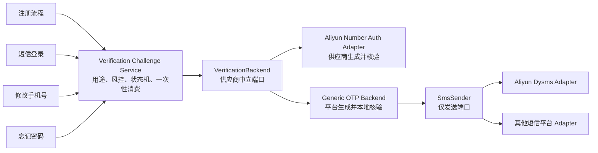

# 短信验证后端可替换设计

> 状态：双模式 Adapter、版本化运行配置、Provider 版本留痕、四类用途和后台运维配置已实现
>
> 日期：2026-08-22
>
> 适用范围：手机注册、短信登录、修改手机号、忘记密码及后续需要手机验证码的业务

## 1. 目标

短信验证业务必须独立于具体厂商和产品形态：

- 当前阿里云号码认证服务可以继续作为默认实现。
- 可以替换为阿里云普通短信发送服务，也可以替换为其他短信平台。
- 替换 Provider 不修改注册、登录、改手机号、找回密码的业务流程、公开 API、Keycloak 手机登录 Flow 或前端交互。
- 支持“供应商生成并核验验证码”和“平台生成验证码、供应商只发送短信”两类方案。
- 风控、挑战状态、一次性消费、反枚举和审计始终由品悟业务层控制，不能交给某一家供应商成为唯一事实源。

## 2. 当前实现

当前代码通过供应商中立接口提供两类实现：

```text
SMSProvider.Descriptor() -> provider_id + adapter_version
SMSProvider.SendCode(...) -> message_id + opaque_verification_data
SMSProvider.VerifyCode(...)
```

`SMS_PROVIDER` 提供首次部署默认值；上线后，具备 `platform.sms-config.read/manage` 权限的运维人员可在管理后台启停发送、选择已经由部署准备好的 Provider Profile，并配置阿里云签名与四类用途模板。每次变更生成不可变 revision，新挑战把 `provider_id + v1-c<revision>` 固定到挑战记录；切换后旧挑战仍按其原 revision 核验。前者由阿里云生成并核验验证码；后者使用密码学安全随机源在 Adapter 中生成验证码，通过通用 HTTPS 发送端点投递，并向 Account 返回带独立密钥的 HMAC 校验数据。核心挑战状态机不判断厂商，`sms_send_attempts` 只保存手机号、来源和设备的单向摘要用于限流审计。

后台只管理非敏感配置。Endpoint、AccessKey、AccessKey Secret、Bearer Token 和验证码 HMAC Key 始终由部署 Secret 注入，既不写入配置版本表，也不通过管理 API 或 UI 返回。启用一个未由部署准备好凭据的 Profile 会失败关闭。

## 3. 分层架构



### 3.1 业务层

Verification Challenge Service 负责：

- 手机号规范化。
- 业务用途和用户状态检查。
- 滑块挑战校验。
- 60 秒冷却、每小时次数、IP/设备扩展风控。
- 挑战创建、过期、尝试次数和一次性消费。
- 未知登录账号的反枚举响应。
- 业务错误码和审计。

业务层只能使用供应商中立字段，不知道阿里云 Action、签名算法、模板 CODE、BizId 或其他厂商字段。

### 3.2 验证后端端口

建议的逻辑接口：

```text
VerificationBackend.ID() -> string
VerificationBackend.Capabilities() -> MANAGED_CODE | SEND_ONLY
VerificationBackend.Start(StartChallenge) -> BackendChallenge
VerificationBackend.Verify(VerifyChallenge) -> PASS | REJECT | UNAVAILABLE
```

输入只包含：

- 品悟 Challenge ID。
- E.164 手机号。
- 供应商中立的模板键。
- 过期时间、验证码长度和语言。
- 幂等发送键和 Trace ID。

输出只包含：

- Provider 后端 ID 和版本。
- 脱敏后的 Provider 请求引用。
- 投递是否被明确接受。
- 核验结果和规范化错误类型。

业务接口不得直接返回厂商原始响应。

## 4. 两种验证模式

### 4.1 供应商托管验证码

适用于当前阿里云号码认证方案：

1. 品悟创建 Challenge 并完成业务限流。
2. Adapter 调用供应商发送接口，由供应商生成验证码。
3. 品悟只保存供应商 Challenge/请求引用，不保存验证码。
4. 用户提交验证码后，Adapter 调用供应商核验接口。
5. 品悟根据统一结果原子消费 Challenge。

当前 `SendSmsVerifyCode`/`CheckSmsVerifyCode` 逻辑迁入 `aliyun_number_auth` Adapter，业务服务不再直接引用它。

### 4.2 仅发送短信

适用于阿里云普通短信或其他只提供模板发送的厂商：

1. Generic OTP Backend 使用密码学安全随机数生成固定长度验证码。
2. 明文验证码只在当前进程内短暂存在，用于构造一次发送请求，不写数据库、日志、Trace 或队列。
3. 数据库只保存带服务端 Pepper 的 HMAC 摘要、摘要密钥版本和挑战元数据。
4. `SmsSender` Adapter 将模板键、手机号和验证码映射为厂商请求。
5. 核验时 Generic Backend 计算摘要并常量时间比较。
6. 验证失败递增尝试次数；达到上限、过期或成功后不可继续使用。

六位验证码空间很小，不能只保存普通 SHA 哈希；必须使用不在数据库中的高强度 Pepper，并由 Secret/KMS 管理。

## 5. 供应商中立用途与模板

业务层使用固定模板键：

```text
REGISTER
LOGIN
PROFILE_MOBILE
PASSWORD_RESET
```

每个 Adapter 自己把模板键映射到厂商签名、模板 ID 和参数名。例如阿里云模板使用 `code`/`min`，其他厂商可以使用完全不同的字段。业务代码和数据库不得保存“阿里云注册模板 CODE”作为领域字段。

增加新用途时：

1. 先在业务层定义用途及授权条件。
2. 为每个启用 Adapter 配置模板映射。
3. 合同测试确认所有生产 Adapter 支持该用途。
4. 缺少模板时服务启动失败或该用途明确不可用，不能静默复用错误模板。

## 6. 挑战数据模型

在现有 `sms_challenges` 上增加或迁移以下字段：

| 字段 | 含义 |
|---|---|
| `backend_id` | 创建挑战的验证后端，例如 `aliyun_number_auth`、`generic_sms` |
| `backend_version` | Adapter/协议版本，用于切换期间稳定核验 |
| `verification_mode` | `MANAGED_CODE` 或 `LOCAL_DIGEST` |
| `provider_reference` | 脱敏的厂商请求/挑战引用 |
| `template_key` | 供应商中立业务用途 |
| `code_digest` | 仅本地核验模式使用的 HMAC 摘要 |
| `digest_key_id` | Pepper/KMS 密钥版本，不保存密钥本身 |
| `delivery_status` | `CREATED`、`ACCEPTED`、`REJECTED`、`UNCERTAIN` |

挑战必须固定到创建时使用的 `backend_id`。配置切换后，旧挑战在其 5 分钟有效期和短暂宽限期内仍由原 Adapter 核验；不能拿新 Adapter 核验旧验证码。

## 7. Provider 注册与配置

启动装配层根据配置创建 Provider，不在业务流程中写厂商判断：

```text
SMS_VERIFICATION_BACKEND=aliyun_number_auth | generic_sms
SMS_SENDER_PROVIDER=aliyun_dysms | <other-provider>
SMS_TEMPLATE_REGISTER=<secret/config reference>
SMS_TEMPLATE_LOGIN=<secret/config reference>
SMS_TEMPLATE_PHONE_CHANGE=<secret/config reference>
SMS_TEMPLATE_PASSWORD_RESET=<secret/config reference>
SMS_OTP_PEPPER_KEY_ID=<secret-manager key reference>
```

具体 AccessKey、Secret 和 Endpoint 由对应 Adapter 的 Secret 配置读取。签名、用途模板、启停状态和预注册 Profile 选择由版本化后台配置控制；业务层只接收已经构造完成的 `VerificationBackend`。

管理 API 使用 `GET|PUT /account/admin/v1/sms-configuration`。写入要求 16～128 字符的 `Idempotency-Key`、当前 revision CAS、10～500 字符原因和近期认证；每个成功版本记录操作者与审计事件。配置停用后不再创建/发送新挑战，但既有挑战仍可按创建时版本核验，避免切换或紧急停用破坏用户已经收到的验证码。

推荐目录边界：

```text
internal/account/verification/             # 业务状态机、用途和端口
internal/account/verification/adapters/
  aliyun_number_auth/                      # 阿里云托管验证码适配
  generic/                                 # 平台 OTP 生成与本地核验
internal/platform/sms/
  sender.go                                # 仅发送端口
  aliyun_dysms/                            # 阿里云普通短信适配
  <other-provider>/                        # 其他厂商适配
cmd/account-service/sms_provider.go        # 配置解析与依赖装配
```

厂商 SDK/签名代码不得进入 `mobile_auth.go`、注册 Handler 或 Keycloak 扩展。

## 8. 切换和迁移

### 8.1 无中断切换

1. 部署新 Adapter，但保持当前阿里云号码认证为默认。
2. 新迁移为历史未结束 Challenge 写入 `aliyun_number_auth` 后端标识。
3. 用测试号码完成发送、错误验证码、正确验证码、过期、重放和限流验收。
4. 切换 `SMS_VERIFICATION_BACKEND`，新 Challenge 使用新后端。
5. 在最长挑战有效期加宽限期内保留旧 Adapter，只用于核验旧 Challenge。
6. 确认旧 Challenge 全部终止后才能移除旧 Provider Secret 和 Adapter。

切换不修改桌面 API、Portal API 或 Keycloak 手机登录 Flow。

### 8.2 不自动跨厂商重发

发送请求超时可能意味着厂商已经接收。系统不能在结果不确定时自动切换另一厂商重发，否则用户可能收到多个不同验证码。

- 明确拒绝：标记 `REJECTED`，不占用成功发送冷却，可由用户重新完成挑战。
- 明确接受：标记 `ACCEPTED`，进入正常冷却。
- 结果不确定：标记 `UNCERTAIN`，短期内禁止自动重发，由查询能力或超时策略收敛。
- 运行时多厂商容灾需要独立设计，不属于“可方便替换”的首期要求。

## 9. 错误模型

Adapter 将厂商错误映射为以下内部分类：

| 分类 | 业务处理 |
|---|---|
| `INVALID_CONFIGURATION` | Readiness 失败，不接受发送请求 |
| `PROVIDER_UNAVAILABLE` | 返回可重试服务不可用，不泄露厂商细节 |
| `PROVIDER_RATE_LIMITED` | 返回统一限流及可用 Retry-After |
| `DELIVERY_REJECTED` | 明确发送失败，挑战标记失败 |
| `DELIVERY_UNCERTAIN` | 不自动重发，保留核对状态 |
| `CODE_REJECTED` | 递增本地尝试次数并返回统一验证码错误 |
| `CHALLENGE_EXPIRED` | 终止挑战 |

前端继续使用稳定业务错误码，如 `SMS_RATE_LIMITED`、`SMS_SERVICE_UNAVAILABLE`、`SMS_CODE_INVALID`，不得显示厂商原始报错或 Request 签名信息。

## 10. 安全与隐私

- Provider Endpoint 必须 HTTPS，并按 Adapter 配置主机白名单。
- 每个 Provider 使用独立最小权限凭据，通过 Secret 管理注入。
- 不记录完整手机号；日志只使用脱敏手机号或不可逆关联 ID。
- 不记录验证码、验证码摘要、AccessKey、Authorization Header、完整厂商响应或模板敏感参数。
- 本地验证码使用密码学安全随机源，避免取模偏差。
- 摘要比较使用常量时间算法；Pepper 轮换通过 `digest_key_id` 支持。
- 业务限流不能因切换 Provider 被重置或绕过。
- 未知手机号反枚举行为在所有 Provider 下必须一致，不能由短信是否实际发送暴露账号存在性。

## 11. 可观测性与管理

系统运行页只展示：

- 当前验证后端和发送 Provider 名称。
- Provider 健康状态和配置完整性。
- 发送接受、拒绝、不确定和核验通过率。
- 限流次数、延迟和最近脱敏错误。
- 按模板键统计，不使用手机号、Challenge ID 或厂商 Request ID 作为指标标签。

后台不能展示 AccessKey Secret、短信验证码或完整请求签名。供应商切换属于运维配置变更，必须记录操作者、配置版本和验证结果。

## 12. 测试要求

### 12.1 统一合同测试

每个 Verification Backend 必须通过同一套测试：

- 注册、登录、改手机号、找回密码四种用途。
- 发送成功、明确拒绝、超时不确定、限流和服务不可用。
- 正确验证码、错误验证码、5 次失败、5 分钟过期和成功后重放。
- 同一 Challenge 始终路由到原后端。
- 日志和错误响应不包含验证码、手机号、密钥或厂商签名。

### 12.2 Generic Sender 合同测试

每个仅发送 Adapter 还必须验证：

- 模板键正确映射为厂商模板。
- 手机号和验证码参数符合厂商协议。
- 幂等键/外部流水号正确传递。
- 厂商错误稳定映射为内部分类。
- HTTP 重定向不会携带认证头到其他主机。

### 12.3 替换验收

使用 Fake Backend、当前阿里云号码认证和至少一个仅发送 Adapter 运行同一业务验收。替换 Provider 时，以下文件不应产生业务逻辑变更：

- 注册和登录 Handler。
- `MobileAuthService` 的预检、风控和身份创建逻辑。
- Keycloak 手机 Direct Grant 协议。
- 桌面登录/注册 UI 和 BFF Client。

## 13. 实施拆分建议

1. 提取供应商中立 Challenge Service 和 `VerificationBackend` 端口。
2. 将当前阿里云号码认证代码迁入独立 Adapter，保持行为不变。
3. 为 `sms_challenges` 增加后端、版本、模式和投递状态。
4. 增加 Provider Registry、配置校验和 Readiness。
5. 实现 Generic OTP Backend、HMAC 摘要和 Pepper 轮换。
6. 实现阿里云普通短信 `SmsSender` Adapter。
7. 将改手机号和忘记密码接入相同挑战服务。
8. 增加统一合同测试、切换测试、系统状态和运维文档。

每一步独立提交并保持当前阿里云号码认证路径可用；完成切换验收前不删除现有实现。
