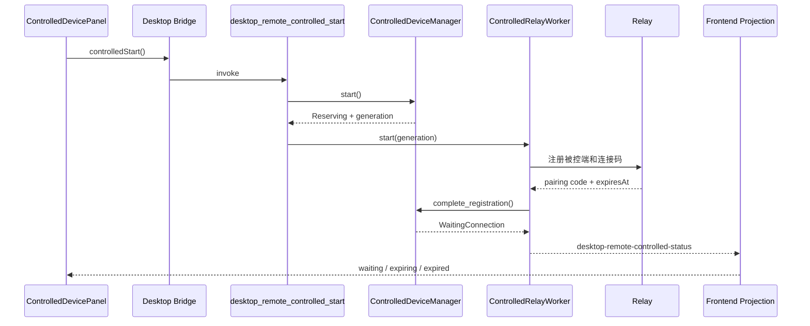
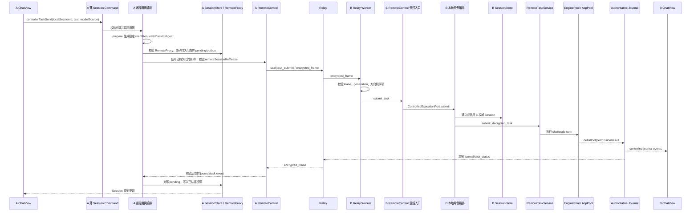

# Windows 双端远程控制代码架构

> 本文描述当前桌面双端远程控制的代码结构、状态所有权和业务调用流程，并给出后续无行为变更的整理方向。
>
> 本文中的双端远程控制，是指 Windows 桌面 A 端控制 B 端的加密远程会话，不是浏览器 WebUI 远程访问。WebUI 架构见 `docs/remote-control-phase1-architecture.md`。

## 1. 角色与边界

| 名称 | 角色 | 核心职责 |
|---|---|---|
| A 端 / Controller / 主控端 | 发起控制的一端 | 输入连接码、建立租约、创建远程会话、发送任务、查看回传结果 |
| B 端 / Controlled Device / 被控端 | 执行任务的一端 | 生成连接码、授权工作区、执行任务、维护权威 Session 和 Journal |
| Relay | 不可信业务中继 | 注册和认领连接码、转发控制帧和加密业务帧，不执行任务、不持有业务明文 |
| Tauri WebView | UI 投影与用户交互 | 展示状态、收集有限 UI 输入，不持有密钥、租约或完整模型凭据 |

核心边界与目标决策：

- Rust 是连接、租约、会话、任务和历史记录的权威状态源。
- 前端 `remote-control-state.js` 是状态投影与迟到结果过滤层，不是业务真相源。
- Relay 只负责鉴权和转发；任务正文通过双端派生的会话密钥加密。
- B 端复用本地 Session、EnginePool、Codex ACP、权限、附件和产物体系，不重复实现执行引擎。
- 设置页负责连接管理；连接后的主要任务交互复用统一 `ChatView`。
- `SessionStore`、`EnginePool`、`AcpPool` 与 `RemoteControl` 是并列 Rust 能力；不在其上新增 `ConversationRuntime`、`LocalRuntime` 或 `RemoteRuntime`。
- Tauri Command 是薄 IPC 入口；跨能力调用顺序、准入、权限和失败收口由无独立持久状态的用例编排完成。
- A 端远程会话使用 `SessionStore + RemoteControl`：`SessionStore` 保存 `RemoteProxy` 会话、A 本地 UI 元数据和已认证历史投影，`RemoteControl` 负责连接、加密通道、请求关联和恢复。
- B 端 Session、Journal、任务准入和执行终态始终是唯一业务权威；A 的 `RemoteProxy` 只是已认证投影，不得进入 A 本机 EnginePool/AcpPool。

## 2. 总体组件关系

```mermaid
flowchart LR
    subgraph A["A 端 · 主控设备"]
        ASettings["远程控制设置页"]
        AChat["ChatView"]
        ABridge["desktop-remote-control.js"]
        ACommands["薄 Controller Tauri Commands"]
        AUseCase["A 远程会话用例编排"]
        AStore["SessionStore<br/>RemoteProxy / 历史投影"]
        ARemote["RemoteControl<br/>连接 / 租约 / 加密通道"]
    end

    subgraph Relay["Relay 服务"]
        WS["认证 WebSocket"]
        Pairing["连接码注册与认领"]
        Forward["控制帧与加密业务帧转发"]
    end

    subgraph B["B 端 · 被控设备"]
        BSettings["远程控制设置页"]
        BChat["ChatView"]
        BBridge["desktop-remote-control.js"]
        BCommands["薄 Controlled Tauri Commands"]
        BState["ControlledDeviceManager"]
        BWorker["ControlledRelayWorker"]
        BLane["ControlledLaneState"]
        Ingress["RemoteControl 受控入口<br/>解密 / 认证 / 防重放"]
        Port["ControlledExecutionPort"]
        LocalUseCase["本地会话用例编排"]
        BStore["SessionStore"]
        Task["RemoteTaskService"]
        Engine["EnginePool / AcpPool"]
        Journal["Journal / History / Artifacts"]
    end

    ASettings --> ABridge
    AChat --> ABridge
    ABridge --> ACommands
    ACommands --> AUseCase
    AUseCase --> AStore
    AUseCase --> ARemote

    ARemote <--> WS
    WS --> Pairing
    WS --> Forward

    Pairing <--> BWorker
    Forward <--> BWorker
    BWorker --> BState
    BWorker --> BLane
    BLane --> Ingress
    Ingress --> Port
    Port --> LocalUseCase
    LocalUseCase --> BStore
    LocalUseCase --> Task
    Task --> Engine
    Task --> Journal
    Journal --> BLane
    BLane --> BWorker

    BSettings --> BBridge
    BChat --> BBridge
    BBridge --> BCommands
    BCommands --> BState
    Journal --> BBridge
    ARemote --> AUseCase
```



图中的用例编排是薄调用逻辑，可以是 Command 模块内的普通 Rust 函数，也可以在复杂度增长后提取为无持久状态的应用服务；它不是新 Runtime。`ControlledExecutionPort` 由远控 feature 定义、由 app 组合根注入实现，避免 `features/remote_control` 反向依赖 `app/commands`。

## 3. 当前代码分层

### 3.1 页面与交互层

路径：`pinvou3-app/src/features/remote-control/` 和 `pinvou3-app/src/features/chat/ChatView.jsx`。

主要职责：

- `RemoteControlSettingsPage.jsx`：双角色页签、29 个 UI 状态汇总。
- `ControlledDevicePanel.jsx`：B 端启停、连接码、倒计时、刷新和工作区授权。
- `RemoteControllerPanel.jsx`：A 端连接状态、断开和进入会话。
- `RemoteConnectForm.jsx`：连接码格式化、本地校验和连接提交。
- `ChatView.jsx`：当前主要远程会话界面，同时支持 A 端远程会话和 B 端权威本地会话。
- `RemoteConnectionShell.jsx`、`RemoteConversationView.jsx`：A 端弹窗会话路径，当前与 `ChatView` 存在部分职责重叠。
- `main.jsx`：连接成功后的导航、B 端自动进入聊天页和权威 Session 切换。

页面层只应提交以下 UI 级输入：

- 连接码；
- 会话标题和模式；
- 消息正文；
- 模型来源；
- 用户对权限请求的决定；
- 用户显式选择的本地工作区或文件。

协议标识、租约字段、任务 ID、摘要和加密材料均由 Rust 构造。

### 3.2 前端领域投影层

路径：`pinvou3-app/src/features/remote-control/`。

| 文件 | 职责 |
|---|---|
| `remote-control-logic.mjs` | 连接码规范化、29 个 UI 状态派生、错误分类、异步操作防竞态 |
| `remote-control-state.js` | 将 Rust 事件归并为前端只读投影，并按 intent、generation、connection、lease 和 revision 丢弃旧结果 |
| `chat-transcript-projection.mjs` | 将远程 Journal、任务状态转换为聊天消息模型 |
| `capability-request-loop.mjs` | 能力协商重试和超时控制的纯逻辑 |
| `remote-model-source.mjs` | 被控端模型与主控端临时模型的选择约束 |

前端投影主要包含：

```text
controlledDevice
controlledSession
controllerConnection
remoteCapabilities
remoteModels
remoteHistories
tasks / transcript
controlledTasks / controlledTranscript
remotePermissions
```

### 3.3 Tauri 前端适配层

主要文件：

- `pinvou3-app/src/platform/tauri/bridge/desktop-remote-control.js`
- `pinvou3-app/src/platform/tauri/bridge.js`
- `pinvou3-app/src/index.html`

职责：

1. 暴露 `bridge.desktopRemoteControl` API；
2. 将前端调用转换为 Tauri `invoke`；
3. 订阅 Rust 事件；
4. 将事件交给纯状态投影函数；
5. 发布 `desktopRemoteControl` 状态域更新；
6. 协调能力快照的超时、重试和续期。

主要事件：

| 事件 | 消费方 | 用途 |
|---|---|---|
| `desktop-remote-controlled-status` | B 端投影 | 被控端连接生命周期 |
| `desktop-remote-controller-status` | A 端投影 | 主控端连接生命周期 |
| `desktop-remote-controller-session` | A 端投影 | 会话身份与能力协商结果 |
| `desktop-remote-controlled-session` | B 端投影 | A 端 session ref 到 B 权威 Session 的映射 |
| `desktop-remote-task-status` | 双端投影 | 任务状态 |
| `desktop-remote-task-event` | B 端投影 | 本地任务事件 |
| `desktop-remote-task-content` | B 端投影 | 本地聊天正文 |
| `desktop-remote-controller-journal` | A 端投影 | A 端已认证远程 Journal |
| `desktop-remote-controlled-journal` | B 端投影 | B 端权威 Journal |

事件身份必须按事件族定义，不得使用“所有事件必填 A Session ID”的单一规则：

- 接收端的会话事件始终携带该接收端本地 Session ID；
- A 的 `RemoteProxy` 会话事件额外携带 `remote_session_ref` 和当前 live connection/lease/generation；
- B 的受控会话事件携带 B 权威 Session ID 及适用的 lease/generation；
- 纯连接事件只携带其 connection/lease/generation 必填字段，不伪造 Session 引用；
- task ID、journal epoch/sequence 和 capability revision 按事件类型要求，用于去重和迟到过滤。

### 3.4 Tauri Command 应用入口层

路径：`pinvou3-app/src-tauri/src/app/commands/`。

| 模块 | 职责 |
|---|---|
| `desktop_remote_controlled.rs` | B 端启停、刷新、立即断开、状态查询、工作区授权 |
| `desktop_remote_controller.rs` | A 端连接、断开、状态和连接历史 |
| `desktop_remote_controller_session.rs` | A 端会话、能力请求、任务和取消意图构造及加密发送 |
| `desktop_remote_controller_business.rs` | B 端解密业务帧到本地能力、任务和 Journal 服务的适配 |
| `desktop_remote_capabilities.rs` | 构造 B 端能力快照 |
| `desktop_remote_task.rs` | B 端权威 Session、任务准入、执行和状态投影 |
| `desktop_remote_permission.rs` | 权限请求与决策 |
| `desktop_remote_model.rs` | 可导出模型和任务级临时模型 |
| `desktop_remote_attachment.rs` | 附件上传和任务传输范围 |
| `desktop_remote_artifact.rs` | 产物索引、预览和下载 |
| `desktop_remote_history.rs` | Journal、快照和离线历史 |

Command 层负责 Tauri 参数、返回值和事件适配，不应成为连接状态、会话状态或任务状态的第二所有者。目标架构下，Command/薄用例编排按会话类型使用以下组合：

| 会话类型 | 调用组合 | 约束 |
|---|---|---|
| 本地普通 | `SessionStore + EnginePool` | 保持现有 Session 和 turn 准入语义 |
| 本地 ACP | `SessionStore + AcpPool` | 保持现有工作区、进程和 ACP 事件语义 |
| A 远程代理 | `SessionStore(RemoteProxy) + RemoteControl` | 不得调用 A 本机 EnginePool/AcpPool |
| B 远程受控 | `RemoteControl 入口 + 本地用例 + SessionStore + EnginePool/AcpPool` | B 只产生一个权威 Session |

用例编排可负责参数校验、会话类型检查、turn 准入、附件准备、调用顺序、失败回滚/收口、错误转换和事件投影；持久化和长生命周期状态仍归并列能力组件。

### 3.5 Rust 领域层

路径：`pinvou3-app/src-tauri/src/features/remote_control/controller/`。

| 模块 | 状态所有权或领域职责 |
|---|---|
| `controlled.rs` | B 端连接状态、generation、工作区授权、watchdog 和恢复材料 |
| `controlling.rs` | A 端连接状态、连接码、lease 和显式断开 |
| `controlling_session.rs` | A 端远程 Session 意图、能力 revision 和已构造任务 |
| `task.rs` | B 端任务账本、Session 映射、准入、执行器和清理 |
| `capabilities.rs` | B 端能力快照、有效期和工作区解析 |
| `permission.rs` | 权限请求状态机和唯一决策权 |
| `journal.rs` | 权威事件日志、序号、快照和缺口恢复 |
| `history.rs` | A 端远程历史副本 |
| `temporary_model.rs` | 任务级临时模型生命周期 |
| `transfer/` | 附件与产物的有界分块传输 |

### 3.6 安全协议与运行时层

| 模块 | 职责 |
|---|---|
| `protocol.rs` | 冻结的 controller v1 消息、字段、能力和大小约束 |
| `crypto.rs` | 握手密钥、签名、会话密钥和方向密钥派生 |
| `controlled_handshake.rs` | B 端握手状态机 |
| `controlling_handshake.rs` | A 端握手状态机 |
| `encrypted_lane.rs` | 加密业务帧、租约绑定、方向校验、序号和防重放 |
| `relay_transport.rs` | A 端 Relay 传输、背压和连接事件 |
| `relay_runtime.rs` | B 端注册、握手、加密业务帧派发和恢复运行时 |
| `controlling_service.rs` | A 端连接编排、通道保活、入站业务帧派发和恢复 |
| `liveness.rs` | 存活检测和 watchdog |
| `resume.rs` | 断线恢复状态机 |

### 3.7 Relay 与平台基础设施层

路径：`pinvou3-app/src-tauri/src/features/remote_control/`。

- `manager/`：远程 endpoint、Relay 设置、WebUI RPC 以及桌面 controller lane 的共享管理器。
- `relay_client.rs`：WebSocket 连接、重连、心跳、背压和发送队列。
- `platform/`：Windows、Unix 和 fallback 平台实现。
- `file_access.rs`：受控文件访问边界。

当前桌面双端远控复用了 Web Access 的长连接和 endpoint。`RemoteControlManager` 是基础设施复用点，不应被视为桌面双端远控的领域状态机。

## 4. 当前与目标状态所有权

| 状态 | 当前实现 | 目标权威所有者 | 前端表现/约束 |
|---|---|---|---|
| B 端连接生命周期 | `ControlledDeviceManager` | `ControlledDeviceManager` | `controlledDevice` |
| A 端连接生命周期 | `ControllingDeviceManager` | `ControllingDeviceManager` | `controllerConnection` |
| A 端远程 Session 意图和能力 revision | `ControllingSessionManager` | `RemoteControl` 领域状态 | 必须绑定当前 connection/lease/generation |
| A 本地远程会话身份和 UI 元数据 | 远控独立历史/前端投影 | `SessionStore` 中的 `RemoteProxy` | A 本地 Session ID 是 ChatView 会话身份 |
| A 端 pending 发送 | 远控任务/前端投影 | `SessionStore.RemoteProxy` 中的有界非权威投影 | 只能经 B 接纳或 Journal 对账为权威内容 |
| B 端权威 Session | `RemoteTaskService` + `SessionStore` | `RemoteTaskService` + `SessionStore` | `controlledSession`；仍是唯一业务事实源 |
| 加密通道 | `ControllingLaneState` / `ControlledLaneState` | `RemoteControl` 内的双端 lane state | 不直接暴露 |
| 任务状态 | `RemoteTaskService` / `RemoteTaskLedger` | B 端 `RemoteTaskService` / `RemoteTaskLedger` | A 只显示已认证投影 |
| 正文和工具事件 | B 端 `RemoteJournal` | B 端 `RemoteJournal` | A 投影必须校验 epoch/sequence |
| 权限 | `PermissionAuthority` | `PermissionAuthority` | `remotePermissions`；A 仍是远程任务唯一审批权威 |
| A 端离线副本 | `RemoteHistoryStore` | `SessionStore` 中的 `RemoteProxy` 已认证投影 | 断线后只读，不得发送业务帧 |
| 输入框、倒计时、按钮 pending | React 本地状态 | React 本地状态 | 不进入 Rust 领域状态机 |

`RemoteHistoryStore` 是当前实现现状，不是目标架构中与 `SessionStore` 并列的长期权威。迁移期内只能作为兼容读取或幂等迁移源，不得与 `SessionStore.RemoteProxy` 双写并同时向 UI 供数。

`RemoteProxy` 可持久化 A 本地 Session ID 与 opaque `remote_session_ref` 的历史来源映射，但这不是访问凭据。`remote_session_ref` 由 A 端可信 Rust 生成，B 在认证请求后幂等映射并确认。在原 resume 边界内恢复时仍需验证新的 transport 绑定；超出 resume 边界或重新配对后，A 必须重新打开会话并生成新引用，再绑定当前 connection/lease/generation，不得将磁盘上的旧引用直接用于变更操作。

## 5. 29 个 UI 子状态

29 个状态是设置页展示模型，由 B 端 12 个状态和 A 端 17 个状态组成。它们不是 29 个 Rust 协议状态。

### 5.1 B 端 12 个状态

Rust 状态机：

```text
Disabled
Reserving
WaitingConnection
SafetyHandshake
Connected
Reconnecting
Refreshing
Stopped
Error
```

UI 状态：

```text
off
reserving
waiting
expiring
expired
reserved
handshake
connected
reconnecting
refreshing
stopping
error
```

派生规则：

- `waiting`、`expiring`、`expired` 由 `WaitingConnection`、连接码和剩余时间共同决定；
- `reserved` 是连接码已被认领、后端即将进入安全握手时的短暂 UI 状态；
- `stopping` 是本地命令 pending 状态；
- `off` 统一覆盖 `Disabled`、`Stopped` 和初始空投影。

### 5.2 A 端 17 个状态

Rust 状态机：

```text
Idle
Connecting
SafetyHandshake
Connected
Reconnecting
Disconnected
Error
```

UI 状态：

```text
empty
typing
ready
format_invalid
invalid
connecting
safety_handshake
connected
reconnecting
disconnected
busy
offline
version
protocol
unsupported
local_busy
failed
```

派生规则：

- `empty`、`typing`、`ready`、`format_invalid` 来自本地连接码输入；
- `busy`、`offline`、`version`、`protocol`、`unsupported`、`local_busy`、`invalid`、`failed` 来自有界错误码分类；
- 其余状态直接来自 A 端 Rust 状态机。

## 6. 业务调用流程

### 6.1 B 端开启远程控制



关键约束：

- 每次开启或刷新都由新的 `generation` 隔离；
- 旧 generation 的回包和事件不能覆盖新状态；
- 连接码和握手材料只保存在内存中；
- 停止或刷新时先关闭对应 Relay lane，再清理这一代状态。

### 6.2 A 端建立连接

```mermaid
sequenceDiagram
    participant UI as RemoteConnectForm
    participant JS as Desktop Bridge
    participant CMD as Controller Command
    participant A as ControllingDeviceManager
    participant Relay as Relay
    participant B as ControlledRelayWorker
    participant Crypto as Handshake / EncryptedLane

    UI->>JS: controllerConnect(code)
    JS->>CMD: desktop_remote_controller_connect
    CMD->>A: connect(code)
    A-->>UI: Connecting
    CMD->>Relay: claim pairing code
    Relay->>B: controller_pairing_reserved
    A<->>B: 双向安全握手
    A->>Crypto: 安装 A 端租约和会话密钥
    B->>Crypto: 安装 B 端租约和会话密钥
    A-->>UI: Connected
    B-->>UI: Connected
```

连接成功时同时形成：

- `connection_id`；
- `controller_lease_id`；
- `lease_epoch`；
- `relay_epoch`；
- `remote_control_generation`；
- 双端会话密钥；
- 协商后的协议能力集合。

只有租约和加密业务通道均安装成功后，状态机才进入 `Connected`。

### 6.3 打开远程会话并协商能力

```text
ChatView
  → bridge.controllerSessionOpen
  → desktop_remote_controller_session_open
  → 薄 A 端会话用例编排
  → SessionStore 创建或幂等复用 RemoteProxy Session
  → ControllingSessionManager.open
  → 将 A 本地 Session ID、remoteSessionRef 与当前 connection/lease/generation 绑定
  → bridge.controllerCapabilitySend
  → 构造 capability_snapshot_request
  → ControllingLaneState.seal
  → Relay
  → B 端 ControlledRelayWorker 解密
  → DesktopControlledBusiness.capability_snapshot
  → CapabilitySnapshotManager 构造快照
  → B 端加密返回
  → A 端校验 lease、requestId 和 revision
  → 更新 SessionStore 中对应 RemoteProxy 的能力投影
  → desktop-remote-controller-session
  → 前端进入 capability ready
```

能力快照只包含经过裁剪的描述信息：

- 可用模式；
- 工具和 Skill 描述；
- 已授权工作区；
- 能力 revision 和有效期；
- 是否允许主控端临时模型。

完整模型配置和凭据不会投影到 WebView。`RemoteProxy` 可以保存能力摘要和 revision，但该投影不能替代 `RemoteControl` 对当前租约和新鲜度的校验。

### 6.4 A 端发送任务，B 端执行



任务实际执行复用：

- Chat：`EnginePoolChatEngine`；
- Code：`AcpPoolCodeTurnPort`；
- 会话：`SessionStore`；
- 任务准入和账本：`RemoteTaskService`、`RemoteTaskLedger`；
- 权限：`PermissionAuthority`；
- 附件和产物：transfer、attachment、artifact runtime；
- 正文恢复：`RemoteJournal` 和 `JournalSnapshot`。

B 端用户也可以在同一个权威 Session 中继续输入。`desktop_remote_controlled_task_send` 会构造同一协议形状的任务，再进入相同的任务准入、执行器和 Journal，不会形成第二套执行系统。

A 端必须遵循 `prepare → persist → dispatch`：pending/outbox 持久化失败时禁止发送；持久化内容包含稳定 `client_request_id/task_id`、输入摘要和所有非敏感语义参数的规范指纹，但不含临时凭证。只有 A 原进程存活、处于原 resume 边界并恢复同一 live binding 时，才能使用原 ID 和完全相同指纹向 B 幂等账本重试或经 Journal/快照对账；同 ID 异参必须拒绝。A 进程重启后旧 live binding 已失效，只恢复本地 `outcome_unknown`；在 controller v1 未定义新配对重新附着旧 B Session/账本前，不得自动发送、查询或对账旧请求。临时凭证在 dispatch 前丢失时，只有后端可证明从未尝试发送才能废弃原 pending 并创建新请求；否则继续保持 `outcome_unknown`。A 在 B 接纳前只能显示未确认 `pending/outcome_unknown`；只有当前有效绑定内 B 的已认证接纳结果、Journal 事件或快照才能将该投影对账为权威内容。

### 6.5 任务结果和 Journal 回流

B 端执行器产生事件后：

1. 先更新任务账本；
2. 再写入 B 端权威 Journal；
3. 向 B 端前端投影本地任务和正文；
4. 将 Session ID 改写回 A 端持有的 `sessionRef`；
5. 通过 B 端加密通道发送 `task_status` 或 `journal_event`；
6. A 端校验和解密；
7. A 端 `RemoteControl` 校验当前 connection/lease/generation、`remote_session_ref` 与 Journal 游标；
8. 在 `SessionStore` 中将对应 `RemoteProxy` 的 pending 投影对账为已认证副本；
9. 广播 Session 投影更新并渲染聊天正文。

Journal 发生缺口时，A 端请求 replay；如果缺口已经超出保留窗口，B 端返回权威 Session snapshot，A 在完成认证、序号和会话绑定校验后原子替换 `SessionStore.RemoteProxy` 的投影。A 不得用本地 UI 状态或 pending 记录反向覆盖 B。

### 6.6 断线恢复与清理

```text
transport disconnected
  → 双端进入 reconnecting
  → 暂停业务加密通道
  → 使用旧租约中的 resume token 发起恢复
  → Relay、B、A 多阶段确认
  → 更新 transport fingerprint
  → 恢复业务帧、心跳与 Journal
```

恢复失败或显式断开后清理：

- 本 generation 的活动任务；
- 待决权限；
- 会话密钥和加密通道；
- 临时模型；
- 工作区授权；
- 远程 Session 映射；
- 能力快照和前端任务投影。

## 7. 当前主要架构问题

### 7.1 A 端存在两套会话 UI

当前同时存在：

- `ChatView.jsx`：连接成功后的主要会话界面；
- `RemoteConversationView.jsx`：通过 `RemoteConnectionShell` 打开的弹窗会话界面。

两者都包含会话创建、能力协商和任务发送逻辑，存在行为漂移风险。建议最终以 `ChatView` 为唯一远程会话界面，弹窗只保留连接摘要或移除。

### 7.2 前端 Bridge 职责过多

`desktop-remote-control.js` 当前同时承担：

- Tauri Client；
- 事件订阅；
- 状态 Store；
- 能力协商重试与续期；
- 错误标准化；
- 乐观任务投影；
- 新旧命令兼容。

这使平台适配层承载了领域编排逻辑，不利于单独测试和复用。

### 7.3 Rust 目录无法从路径直接区分双端角色

`features/remote_control/controller/` 同时包含：

- A 端 `controlling*`；
- B 端 `controlled*`；
- 公共协议、任务、权限、历史、加密和传输。

“controller” 既像领域总称，又像 A 端角色名称，增加理解成本。

### 7.4 Relay 共享管理器边界较宽

`RemoteControlManager` 同时承载 Web Access 和桌面双端 controller lane。共享 endpoint 和 WebSocket 是合理复用，但领域层直接感知共享管理器会模糊边界。

### 7.5 Command 面存在重叠入口

当前同时存在：

- A 端协议入口：`controllerSessionOpen`、`controllerTaskSend`；
- B 端本地权威会话入口：`controlledTaskSend`；
- 较早的直接入口：`openRemoteSession`、`submitRemoteTask` 等。

需要明确消费者并逐步清理无实际调用方的遗留入口。

### 7.6 A 端远程历史与 SessionStore 分裂

当前 `RemoteHistoryStore` 和前端 `remoteHistories` 独立于本地 `SessionStore` 会话索引，导致统一 ChatView、会话列表、标题/置顶/隐藏元数据和离线历史需要两套供数链路。目标是将 A 端远程会话迁移为 `SessionStore` 的 `RemoteProxy` 类型，旧存储只作为幂等迁移源或短期兼容读取。

### 7.7 B 受控入口与本地用例复用边界不明

B 端网络入站和 Tauri Command 都需要进入相同的 Session、turn 准入、附件、执行器和 Journal 链路，但 feature 不能反向依赖 `app/commands`。目标架构需要从 Command 中提取普通 Rust 用例函数，并由组合根向 `RemoteControl` 注入窄 `ControlledExecutionPort`，避免内部 invoke、跨 Command 调用和第二套执行逻辑。

## 8. 推荐目标分层

以下是目标结构建议，不代表当前目录已经完成迁移。

### 8.1 前端

```text
src/features/remote-control/
├─ api/
│  └─ remote-control-client.js       # 仅封装 invoke/listen
├─ model/
│  ├─ state.js                       # 投影状态
│  ├─ reducer.js                     # 事件归并与迟到结果过滤
│  ├─ selectors.mjs                  # 29 状态及聊天投影
│  └─ contracts.mjs                  # 状态和错误码常量
├─ services/
│  ├─ capability-coordinator.js      # 能力请求、重试、续期
│  └─ remote-session-service.js      # 会话打开和任务发送编排
├─ views/
│  ├─ RemoteControlSettingsPage.jsx
│  ├─ ControlledDevicePanel.jsx
│  ├─ RemoteControllerPanel.jsx
│  └─ RemoteConnectForm.jsx
└─ integration/
   └─ remote-session-actions.js      # 为 RemoteProxy 提供远程操作，不持有会话副本
```

原则：

- `platform/tauri` 只做平台调用适配；
- 连接和会话编排回到 `features/remote-control`；
- `ChatView` 统一从会话列表/Session 投影获取正文，不再从 `remoteHistories` 第二份数据源获取远程正文；
- `RemoteProxy` 的发送、取消、审批和上传通过 remote session actions 进入 Rust，但路由决定仍由 Rust 的 Session 类型与绑定完成；
- 删除第二套远程会话正文 UI。

### 8.2 Rust

```text
src/features/remote_control/
├─ domain/
│  ├─ connection/
│  │  ├─ controlled.rs
│  │  ├─ controller.rs
│  │  ├─ lease.rs
│  │  ├─ liveness.rs
│  │  └─ resume.rs
│  ├─ session/
│  ├─ task/
│  ├─ capability/
│  ├─ permission/
│  ├─ journal/
│  └─ ports/
│     └─ controlled_execution.rs # B 受控请求进入本地用例的窄端口
├─ application/
│  ├─ controlled_service.rs
│  ├─ controller_service.rs
│  ├─ session_service.rs
│  └─ task_service.rs
├─ infrastructure/
│  ├─ relay/
│  ├─ crypto/
│  ├─ persistence/
│  └─ transfer/
└─ platform/

src/features/sessions/
├─ ...
└─ remote_proxy.rs                  # RemoteProxy 格式、字段级写权限和 pending 对账

src/features/conversation/                 # 无独立持久状态的跨能力用例编排
├─ local_chat.rs                    # SessionStore + EnginePool
├─ local_acp.rs                     # SessionStore + AcpPool
├─ remote_proxy.rs                  # SessionStore + RemoteControl
└─ controlled_execution.rs          # ControlledExecutionPort 实现

src/app/commands/remote_control/
├─ connection.rs
├─ session.rs
├─ task.rs
├─ permission.rs
├─ transfer.rs
└─ history.rs
```

上述目录是职责示意；`features/conversation` 只组合窄领域端口，不持有第二份 Session、Engine、ACP 或远控状态，也不形成 Runtime 抽象。具体装配由 `lib.rs` 组合根完成，并保持下述依赖方向：

```text
Tauri Commands → 薄用例编排 → SessionStore / EnginePool / AcpPool / RemoteControl

B RemoteControl 入站 → ControlledExecutionPort
                         ↑ 由 lib.rs 组合根注入 conversation feature 实现
                         └→ 薄本地用例 → SessionStore + EnginePool/AcpPool
```

领域层不得依赖 Tauri、WebView 或具体 Relay Manager；`features/remote_control` 不得依赖 `app/commands`。并列能力之间需要跨 feature 协作时，通过组合根注入窄端口，而不是形成 Runtime 包装层或反向调用 Command。

### 8.3 Relay 窄接口

建议由应用层依赖窄端口，而不是直接依赖共享 `RemoteControlManager`：

```rust
trait DesktopRelayPort {
    async fn open_controlled_lane(&self, generation: &str) -> Result<ControlledChannel, RelayError>;
    async fn open_controller_lane(&self, request: ControllerClaim) -> Result<ControllerChannel, RelayError>;
    fn close_generation(&self, generation: &str);
}
```

现有 `RemoteControlManager` 可以继续作为该端口的基础设施实现，从而保留 endpoint 和 WebSocket 复用，同时收窄领域依赖。

## 9. 推荐迁移顺序

### 阶段一：固化现有行为

- 固化 Tauri command 名称和参数；
- 固化九类前端事件；
- 固化 A/B 后端状态机；
- 固化 12 + 17 个 UI 状态映射；
- 补充连接、能力协商、任务、断线恢复的契约测试。

### 阶段二：引入 SessionStore RemoteProxy

- 为 `SessionStore` 增加版本化 `RemoteProxy` 类型和字段级写入权限：本地 UI 元数据与非权威 pending/outbox 可写，远程业务投影只能由已认证 B 事件/快照更新，并禁止本机 Engine/ACP；
- 定义 A 本地 Session ID、opaque `remote_session_ref` 和 connection/lease/generation 绑定；
- 实现 `prepare → persist → dispatch` pending/outbox 与 B 已认证 Journal/快照的对账；
- 提供 `RemoteHistoryStore` 到 `SessionStore.RemoteProxy` 的幂等迁移：持久化 schema/migration revision、源记录 ID 和稳定去重键，同键冲突失败关闭；
- 记录旧源 high-water cursor 并完成基线校验后，在单一写入门下冻结旧写入、补齐最终 cursor，再以单个原子事务同时切换写入目标、供数指针和 revision；切换前只写旧库，切换后写入与读取都只使用 `SessionStore`，旧 UI/Command 回退也必须代理读新库；
- 旧源在至少一个稳定版本的验证/回滚窗口内保留为只读恢复源，后续独立审计删除。

### 阶段三：收敛 Rust 用例编排

- 将本地普通、ACP 和 A 远程 Command 收敛为薄 IPC 适配；
- 保持 `SessionStore + EnginePool`、`SessionStore + AcpPool`、`SessionStore + RemoteControl` 三类显式编排，不引入统一 Runtime；
- 抽取本地与 B 受控入口共享的普通 Rust 用例函数；
- 由组合根注入 `ControlledExecutionPort` 实现，禁止 remote-control feature 反向依赖 Tauri Command；
- 保留 controller v1 wire contract 和 B 端唯一权威 Session。

### 阶段四：统一会话界面与拆分前端 Bridge

- 以 `ChatView` 为唯一远程会话正文界面，从 Session 投影读取 `RemoteProxy` 内容；
- 将权限、产物和历史入口整合进统一聊天上下文；
- 删除 `RemoteConversationView` 中重复的 session/capability/task 编排；

- 抽出纯 Tauri Client；
- 抽出 event reducer；
- 抽出 capability coordinator；
- 将高层业务 API 放回 remote-control feature；
- 保持 `bridge.desktopRemoteControl` 兼容代理，待消费者迁移后再收口。

### 阶段五：领域与基础设施整理

- 先抽 Relay port，不改变协议；
- 再迁移 connection/session/task 领域模块；
- 清理跨 command 模块调用和无消费者旧入口；
- 在兼容迁移完成后删除旧历史双路径和无调用方兼容代理；
- 保留事件名、controller v1 wire contract 和已验证的 WebUI v2 行为。

## 10. 关键约束

- `SessionStore`、`EnginePool`、`AcpPool` 与 `RemoteControl` 保持并列；不引入持有会话或任务状态的统一 Conversation Runtime。
- A 端远程会话必须经 `SessionStore.RemoteProxy + RemoteControl` 编排，不得进入 A 本机 EnginePool/AcpPool。
- A 只权威拥有本地 UI 元数据；远程正文、任务状态和终态只是经 B 已认证 Journal/快照对账的投影。
- B 端网络入站通过组合根注入的 `ControlledExecutionPort` 进入本地用例，不得反向调用 Tauri Command。
- 不因目录重构改变 controller v1 协议字段或加密语义。
- 不允许 React 构造 lease、task ID、摘要或临时模型包。
- 不允许凭据、连接码、resume token、会话密钥进入日志或持久化。
- 不允许 Relay 获得任务和 Journal 明文。
- B 端权威 Session 与 A 端历史副本必须保持明确区分。
- UI 关闭不等于断开连接；只有显式断开或安全状态机终止才能清理租约。
- 重连期间暂停业务帧；完成完整 resume 后才能恢复发送。
- 所有异步结果必须受 intent、generation、connection、lease 或 revision 约束。
- 新增界面文案必须复用 `src/shared/i18n.js` 对应的中、英、日文资源。

## 11. 关键代码索引

### 前端

- `pinvou3-app/src/features/remote-control/RemoteControlSettingsPage.jsx`
- `pinvou3-app/src/features/remote-control/ControlledDevicePanel.jsx`
- `pinvou3-app/src/features/remote-control/RemoteControllerPanel.jsx`
- `pinvou3-app/src/features/remote-control/RemoteConnectForm.jsx`
- `pinvou3-app/src/features/remote-control/remote-control-logic.mjs`
- `pinvou3-app/src/features/remote-control/remote-control-state.js`
- `pinvou3-app/src/features/chat/ChatView.jsx`
- `pinvou3-app/src/platform/tauri/bridge/desktop-remote-control.js`
- `pinvou3-app/src/app/main.jsx`

### Rust 应用入口

- `pinvou3-app/src-tauri/src/app/commands/desktop_remote_controlled.rs`
- `pinvou3-app/src-tauri/src/app/commands/desktop_remote_controller.rs`
- `pinvou3-app/src-tauri/src/app/commands/desktop_remote_controller_session.rs`
- `pinvou3-app/src-tauri/src/app/commands/desktop_remote_controller_business.rs`
- `pinvou3-app/src-tauri/src/app/commands/desktop_remote_task.rs`
- `pinvou3-app/src-tauri/src/app/commands/desktop_remote_history.rs`

### Rust 领域与基础设施

- `pinvou3-app/src-tauri/src/features/remote_control/controller/controlled.rs`
- `pinvou3-app/src-tauri/src/features/remote_control/controller/controlling.rs`
- `pinvou3-app/src-tauri/src/features/remote_control/controller/controlling_session.rs`
- `pinvou3-app/src-tauri/src/features/remote_control/controller/controlling_service.rs`
- `pinvou3-app/src-tauri/src/features/remote_control/controller/relay_runtime.rs`
- `pinvou3-app/src-tauri/src/features/remote_control/controller/encrypted_lane.rs`
- `pinvou3-app/src-tauri/src/features/remote_control/controller/task.rs`
- `pinvou3-app/src-tauri/src/features/remote_control/controller/journal.rs`
- `pinvou3-app/src-tauri/src/features/remote_control/controller/protocol.rs`
- `pinvou3-app/src-tauri/src/features/remote_control/manager/mod.rs`

## 12. 验证入口

前端远程控制契约测试位于 `pinvou3-app/tests/`，重点包括：

- `desktop_remote_state.test.mjs`
- `remote_control_ui_closure.test.mjs`
- `remote_control_race.test.mjs`
- `connect_remote_device_contract.test.mjs`
- `controlled_device_panel_contract.test.mjs`
- `controller_session_intent_contract.test.mjs`
- `remote_chat_projection.test.mjs`
- `remote_capability_request_loop.test.mjs`

Rust 领域测试集中在 `features/remote_control/controller/` 各模块及 controller crypto harness。

常用验证命令：

```bash
npm --prefix pinvou3-app test
python3 scripts/architecture-guard.py
cargo test --manifest-path pinvou3-app/src-tauri/Cargo.toml remote_control:: -- --test-threads=1
```
