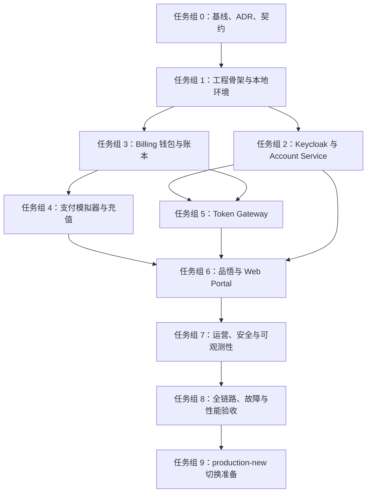

# 账号、组织、Token 与计费系统实施任务与验证计划

> 状态：实施前任务基线<br>
> 日期：2026-08-12<br>
> 架构依据：[账号、组织、Token 与计费系统架构设计](账号组织Token与计费系统-架构设计.md)<br>
> 本轮范围：先定义任务、依赖、测试、校验和交付门禁，不开始业务代码实现。

## 1. 实施结论与当前边界

### 1.1 本计划的完成目标

按架构文档完成一个独立于当前生产 New API 的新系统，形成以下真实业务闭环：

1. 用户通过 Keycloak 注册和登录，自动建立个人上下文和个人钱包。
2. 平台管理员创建组织并指定初始 Owner；用户可加入多个组织，在单个会话内激活个人或一个组织上下文。
3. 组织支持部门、内部子组织、邀请、成员、角色、撤权和审计。
4. 个人、组织和组织单元可持有不同 Token 账号，并按显式共享范围授权。
5. Token Gateway 在调用新 New API 前进行授权和积分预占，调用后按实际用量结算。
6. 品悟桌面端和 Token Web Portal 都能选择 ¥1、¥10、¥100、¥200，通过银联、支付宝、微信三种模拟渠道扫码充值。
7. 支付模拟器通过真实的“预下单—二维码—手机付款页—异步通知—查询—退款—对账”链路驱动 Billing Service，不提供绕过账本的直接加余额入口。
8. 钱包、不可变账本、充值批次、预占、结算、退款、对账和人工调整全部可审计。
9. Docker Compose 可在开发机和 CI 启动完整环境；生产部署材料提供 Helm、环境配置模板和运维 Runbook。
10. 当前生产 New API 始终不修改、不双写；新 New API 使用全新数据，旧账号不迁移。

### 1.2 当前已知条件下的实现边界

| 能力 | 本阶段交付标准 | 外部条件 |
|---|---|---|
| 账号、组织、权限 | 完整实现并自动化验收 | 无 |
| 钱包、账本、充值、退款 | 完整实现并自动化验收 | 无 |
| 银联/支付宝/微信支付 | 三个逻辑渠道由模拟器完整模拟 | 无真实资金清算 |
| 真实支付适配器 | 固定接口、配置和契约测试框架 | 需要商户号、证书、密钥、沙箱/生产权限后才能实现和验证 |
| Token Gateway | 完整授权、路由、预占、结算、审计 | 无 |
| 新 New API 调用 | 提供真实适配器和 Mock；有镜像/地址/凭据时执行真实 E2E | 当前仓库不含 New API 源码和部署清单 |
| 用量精确结算 | Mock 完整；真实路径优先读取逐请求 `usage` | 新 New API 必须可靠返回逐请求输入/输出 Token；否则不能通过生产门禁 |
| 品悟桌面端 | 完整 UI、Tauri Bridge 和兼容开关 | 无 |
| Token 服务前端 | 新建独立 Token Web Portal | 当前仓库没有 New API 前端源码，不能直接改其页面 |
| 生产高可用与 KMS | 提供部署配置、接口和演练脚本 | 真实云账号、域名、证书、KMS、Kubernetes 集群到位后执行最终验证 |

本阶段可以达到功能 UAT 和预生产质量；模拟支付通过不代表真实资金支付通过。真实支付、真实 New API、云 KMS 和生产灾备分别作为独立的外部门禁保留。

## 2. 代码与部署布局

新增根目录 `account-platform/`，采用一个 Go workspace、多个独立进程和独立数据库。服务可以共享协议生成物和通用基础设施，不得直接导入其他服务的领域或存储实现。

```text
account-platform/
├─ go.mod
├─ cmd/
│  ├─ account-service/
│  ├─ billing-service/
│  ├─ token-gateway/
│  └─ payment-simulator/
├─ internal/
│  ├─ account/
│  ├─ billing/
│  ├─ token/
│  ├─ paymentsim/
│  └─ platform/             # 日志、Trace、数据库、事件等低层公共能力
├─ contracts/
│  ├─ openapi/
│  ├─ proto/
│  ├─ events/
│  └─ generated/
├─ migrations/
│  ├─ account/
│  ├─ billing/
│  └─ token/
├─ web/                     # Token Web Portal
├─ test/
│  ├─ contract/
│  ├─ integration/
│  ├─ e2e/
│  ├─ load/
│  └─ fixtures/
└─ deploy/
   ├─ compose/
   ├─ keycloak/
   ├─ helm/
   ├─ dashboards/
   └─ runbooks/
```

品悟应用改动遵循现有边界：

```text
pinvou3-app/src/features/account-platform/        # 页面、状态和功能组件
pinvou3-app/src/platform/{tauri,web}/bridge/      # 宿主适配
pinvou3-app/src-tauri/src/features/account_platform/ # OIDC、凭据和后端调用
pinvou3-app/src-tauri/src/app/commands/           # Tauri 命令入口
```

实施过程中新增架构守卫，禁止：

- `internal/account`、`internal/billing`、`internal/token` 互相导入领域实现；
- 任一服务直接连接其他服务数据库；
- Billing 之外的代码直接更新余额；
- 模拟支付管理接口进入生产镜像或生产路由；
- React 绕过领域 Bridge 直接调用 Tauri 全局对象；
- 新代码继续以 BIOS 序列号充当用户身份。

## 3. 依赖关系与交付顺序



账号服务和 Billing 核心可以并行开发，但 Token Gateway 必须建立在两者稳定契约上；前端不得先用假数据实现后再替换，必须从第一版就通过 Mock Server 消费正式 OpenAPI。

## 4. 分任务实施计划

### 任务组 0：开工基线、决策记录和契约

#### T00 安全同步与任务建档

交付：

- 搜索现有 Issue、PR 和相关实现，确认无重复建设。
- 从最新 `origin/main` 建立任务分支，对齐 CodeWhale gitlink；不初始化非本任务所需的私有 submodule。
- 建立总 Issue 和分阶段子任务，记录范围、验收标准、外部门禁和负责人。
- 保存当前生产 New API 的只读基线：域名、版本、配置摘要和健康检查，不读取或复制用户敏感数据。

校验：

- `git status --short --branch` 只有本任务已知文件。
- `git submodule status CodeWhale` 与父仓 gitlink 一致。
- Issue 明确声明“不修改旧 New API、不迁移旧账号、不双写”。

#### T01 ADR 与术语冻结

交付：

- ADR-001 服务边界和数据库所有权。
- ADR-002 Keycloak 与业务账号边界。
- ADR-003 活动组织按会话保存。
- ADR-004 积分单位、账本和平衡分录。
- ADR-005 Token 预占—结算—释放。
- ADR-006 支付状态机、迟到支付和退款。
- ADR-007 模拟支付与真实支付的隔离。
- ADR-008 新旧 New API 隔离和切换。

校验：

- ADR 不保留会影响实现的未决选项。
- 每个 ADR 包含背景、决策、被拒绝方案、影响和回滚方式。
- 架构文档、ADR、API 枚举和数据库枚举使用相同术语。

#### T02 契约优先定义

交付：

- Account、Billing、Token Gateway 外部 OpenAPI 3.1。
- 内部 gRPC Protobuf。
- NATS 领域事件 JSON Schema/Protobuf。
- 统一错误信封、分页、幂等键、Trace ID、UUIDv7 和时间格式。
- Mock Server 和生成客户端，供前后端独立开发。

校验：

- OpenAPI lint 无错误，生成 Go/TypeScript 客户端可编译。
- `buf lint` 通过；从 `main` 比较时无未经批准的 breaking change。
- 契约示例均可被 Schema 校验。
- 敏感字段未出现在事件或可缓存响应中。

### 任务组 1：工程骨架、CI 和本地环境

#### T10 Go 服务骨架

交付：

- 四个独立二进制：Account、Billing、Token Gateway、Payment Simulator。
- 配置加载、优雅关闭、健康检查、Readiness、请求 ID、结构化日志和 OpenTelemetry 基础。
- 每个服务使用独立数据库 URL 和数据库角色。
- 编译时注入版本和提交 SHA。

测试：

- 配置缺失、非法 URL、端口冲突和关闭超时测试。
- 所有服务执行 `go test -race ./...`。
- 容器以非 root 用户运行，只读根文件系统下可启动。

#### T11 Docker Compose 开发栈

交付：

- PostgreSQL、Keycloak、Redis、NATS JetStream、四个业务服务、Token Web Portal、Mock New API。
- Account、Billing、Token、Keycloak 使用独立数据库和角色。
- 健康检查、依赖就绪和命名卷。
- `dev`、`test` 两套环境变量模板，只提交占位值。

测试：

- 从空环境一条命令启动并等待全部 Readiness 成功。
- 重启任一服务不丢失数据库数据。
- 删除应用容器不会删除数据库卷。
- 服务尝试连接其他服务数据库时因权限失败。

#### T12 数据库迁移框架

交付：

- Account、Billing、Token 独立迁移目录和迁移命令。
- 空库 `up`、受支持版本升级、可逆迁移和不可逆迁移说明。
- 迁移锁、失败回滚和 Schema 版本健康检查。

测试：

- `empty -> latest`、`previous -> latest`、`up -> down -> up`。
- 两个迁移进程并发时只有一个执行。
- 故意失败的迁移不会留下半应用状态。

#### T13 CI 路径门禁

交付：

- `.github/workflows/pr-check.yml` 增加 `account-platform` 路径识别和独立 required job。
- Go fmt/vet/test/race、契约 lint、Web Portal lint/build/test、Compose integration、依赖与镜像扫描。
- 真实模型、真实支付、云资源测试默认跳过并提供显式 opt-in workflow。

测试：

- CI 路由脚本测试覆盖 docs-only、Go-only、Portal-only、Pinvou-only、合同变化和部署变化。
- `required-gate` 对适用 job 的失败、取消、跳过逻辑正确。

### 任务组 2：Keycloak 与 Account Service

#### T20 Keycloak Realm 和客户端

交付：

- Realm、桌面公开客户端、Web BFF 机密客户端和服务客户端配置。
- Web Authorization Code + PKCE、桌面 Direct Access Grant、Refresh Token Rotation、MFA 和精确 Redirect URI。
- 开发 Realm 可重复导入；生产配置只含引用，不含密钥。

测试：

- 注册、登录、刷新、退出、刷新令牌重放和会话撤销。
- 错误 issuer、audience、签名、过期时间和 redirect URI 均拒绝。
- 桌面公开客户端允许 Direct Access Grant，但禁用 Implicit Flow；密码不持久化、不记录日志。

#### T21 用户开户与个人上下文

交付：

- `users`、`identities`、`sessions`、审计和 Outbox 表。
- `POST /v1/account/bootstrap` 幂等开户。
- Billing `EnsureWallet` Saga：`PROVISIONING -> ACTIVE`，失败可重试。
- 个人上下文默认激活。

测试：

- 同一 `issuer + subject` 并发开户只产生一个用户和一个钱包。
- Billing 暂停时用户保持 `PROVISIONING`，恢复后自动完成。
- Account 提交后响应丢失，重试不产生重复身份或钱包。

#### T22 组织和组织单元

交付：

- Organization、内部 Org Unit、Closure Table、父组织导航关系。
- 创建、重命名、移动、停用和查询树。
- 独立子组织与内部子组织使用不同边界。

测试：

- 任意深度祖先/后代查询正确。
- 环、跨组织移动、删除含子节点单元均拒绝。
- 并发移动使用串行化事务或聚合锁，不破坏 Closure Table。
- Closure Table 可从邻接关系重建且结果一致。

#### T23 成员、邀请和角色

交付：

- Membership、Membership Unit、Role Binding、一次性邀请。
- `OWNER`、`ORG_ADMIN`、`BILLING_ADMIN`、`UNIT_ADMIN`、`MEMBER`、`AUDITOR`。
- 所有权转移、成员停用和最后所有者保护。

测试：

- 邀请过期、撤销、重复接受、邮箱不匹配和跨组织重放。
- 完整角色×资源×动作授权矩阵。
- 最后一名所有者不能退出或被删除。
- Unit Admin 不能越出授权子树。

#### T24 活动上下文、撤权和审计

交付：

- `POST /v1/sessions/current/active-context`。
- 每会话唯一活动组织，`membership_version` 失效机制。
- 高风险操作实时回源；普通 Token 请求缓存最长 30 秒。
- 管理、财务、成员和上下文切换审计。

测试：

- 同一用户两个会话可分别激活不同组织且互不覆盖。
- 组织 A 的请求不能读取或修改组织 B 资源。
- 撤权后管理/财务操作立即失败，普通 Token 权限在 30 秒内失效。
- Account 不可用时组织 Token fail closed。

### 任务组 3：Billing 钱包、账本和 Token 结算

#### T30 钱包与平衡账本

交付：

- Wallet、Balance Snapshot、Ledger Account、Journal Entry、Posting、Credit Lot。
- `microcredit` 整数单位和 CNY 分。
- 账本只追加、业务引用唯一、分录和为零。
- 钱包冻结、关闭和余额重算。

测试：

- 属性测试生成充值、消费、释放、退款、冲正的随机序列，分录始终平衡。
- 普通数据库角色无权更新/删除已提交账本。
- 账本重算与余额快照一致。
- 最大值、零值、负值、整数溢出全部被拒绝。

#### T31 钱包和商品目录 API

交付：

- `EnsureWallet`、`GetBalance`、个人和组织钱包。
- ¥1、¥10、¥100、¥200 服务端商品目录及版本快照。
- 客户端只提交 `product_id + channel`。

测试：

- 篡改金额、积分、币种和禁用渠道均拒绝。
- 商品更新后历史订单仍保持旧快照。
- 非 Billing Admin 不能为组织创建充值订单。
- 余额强一致读取不经过 Redis 事实缓存。

#### T32 价格版本与预占—结算

交付：

- 模型输入、输出和缓存 Token 价格版本。
- `ReserveCredits`、`CommitUsage`、`ReleaseHold`。
- Hold 租约、待结算重试和异常核对队列。

测试：

- 100 个并发请求争抢同一余额不超扣、不为负。
- Reserve、Commit、Release 各自重复 100 次结果不变。
- Commit 与 Release 乱序时只允许一个合法终态。
- 价格版本更新不改变历史请求费用。
- 服务崩溃恢复后可识别并处理孤立 Hold。

#### T33 退款、调整和对账基础

交付：

- 按充值 Credit Lot 计算可退款余额。
- 全额/部分退款、退款冲正、`MANUAL_REVIEW`。
- 双人审批的人工调整分录模型。
- 钱包、账本、支付三方对账数据结构。

测试：

- 已消费部分不能自动退款。
- 促销积分不可退款。
- 重复退款不会超过原始可退款金额。
- 调整分录缺少第二审批人或原因时拒绝。

### 任务组 4：支付模拟器与充值订单

#### T40 支付模拟器核心

交付：

- `UNIONPAY`、`ALIPAY`、`WECHAT` 三个模拟渠道模式。
- 创建、查询、关单、退款和账单 API。
- 手机可访问的支付页，二维码只包含短期支付 URL。
- 每渠道独立 HMAC 密钥、通知时间戳和通知 ID。
- 模拟器独立数据库，不能访问 Billing 数据库。

测试：

- 三渠道接口返回不同渠道报文，由各自适配器映射到统一领域对象。
- 二维码 Token 过期、重复使用和篡改均拒绝。
- 模拟器不能直接创建 Billing 账本记录。
- 生产构建和生产 Helm values 无法启用模拟器管理接口。

#### T41 故障注入能力

交付：

- 成功、失败、取消、超时、迟到支付。
- 通知丢失、延迟、重复、乱序、错误金额、错误币种、错误商户号和错误签名。
- 查询超时、创建响应丢失、退款失败和账单差异。
- 测试时钟；管理入口只允许测试管理员。

测试：

- 每个场景都有确定、可重放的 Scenario ID。
- 故障参数不能由普通支付用户传入。
- 测试时钟不影响系统时钟或生产构建。

#### T42 Billing 支付订单和适配器

交付：

- `PaymentProvider` 接口及三个模拟渠道适配器。
- Payment Order、Transaction、Notification、Refund、Idempotency Record。
- `CREATED/PENDING/PAID/PAID_LATE/...` 与履约状态机。
- 15 分钟过期、二维码 `no-store`、创建超时按商户订单号恢复。

测试：

- 状态转换表逐边测试，非法倒退拒绝。
- 订单过期后的已验签成功通知进入 `PAID_LATE` 并入账。
- 相同幂等键不同请求返回 `IDEMPOTENCY_CONFLICT`。
- 渠道交易号唯一，两个内部订单不能消费同一交易。

#### T43 回调、主动查询、退款和日终对账

交付：

- 回调验签、请求摘要、防重放和事务内入账。
- Pending Order 退避查询、过期关单。
- 原路退款和退款回调。
- 模拟账单下载、三方对账、差异 Case 和安全重放。

测试：

- 100 次相同成功回调只产生一次入账。
- 数据库提交前不向渠道 ACK 成功。
- 回调期间 Billing 重启，渠道重试后最终入账一次。
- 用户关闭前端后付款，仍能回调入账。
- 对账识别“渠道已付未入账、内部已入账渠道不存在、金额不符、重复交易”。

### 任务组 5：Token Gateway 与新 New API

#### T50 Token 账号和凭据

交付：

- 个人、组织、组织单元 Token 账号。
- 供应商凭据版本、加密存储、指纹、验证、启停和轮换。
- 开发使用本地加密 Provider；生产使用 KMS/Vault Provider 接口。

测试：

- 数据库、API、事件、日志、Trace 和错误中均找不到明文 Token。
- 新凭据验证失败不替换旧活动凭据。
- 无 KMS 配置的生产模式拒绝启动。

#### T51 共享授权和确定性路由

交付：

- `OWNER_UNIT_ONLY`、`OWNER_SUBTREE`、`ORG_ALL`、`EXPLICIT_MEMBERS`。
- 显式 Token、单元默认、组织默认、优先级和健康状态路由。
- Token 与付款钱包分别解析；组织上下文不回退个人资源。

测试：

- 用户×组织×单元×共享范围的完整决策表。
- 同优先级歧义时拒绝而不是随机选择。
- 被撤权用户不能使用缓存 Token。
- Token Owner、活动组织和付款钱包不匹配时拒绝。

#### T52 New API 数据面适配器

交付：

- OpenAI 兼容代理、模型列表、流式响应、超时和取消。
- Mock New API，支持正常、限流、超时、断流、缺失 usage 和重复请求。
- 真实 New API 地址和凭据通过 Secret Provider 注入。
- New API 数据面只允许 Token Gateway 私网访问。

测试：

- 非 Gateway 调用不能访问新 New API。
- 流式响应保持顺序，客户端取消可终止上游请求。
- 上游超时不会因自动重试产生第二次可能计费的模型调用。
- 真实 New API E2E 必须显式设置 `REAL_NEWAPI_E2E=1`，默认测试不依赖网络和凭据。

#### T53 Token 调用计费编排

交付：

- 上下文解析、Token 授权、价格读取、最大费用估算、Reserve、代理、Commit/Release。
- `usage_request_id` 全链路追踪和本地待结算记录。
- 逐请求 Usage 与 New API 聚合用量核对。

测试：

- 余额不足时不调用 New API。
- Reserve 成功、上游未调用时全部释放。
- 上游已响应、Commit 超时时只重试结算，不重试模型。
- 缺失 usage 时进入异常核对并保留 Hold，不静默按零计费。
- 每次请求可追踪到用户、会话、组织、Token、钱包、价格和分录。

#### T54 充值 BFF

交付：

- `/v1/recharge/products`、创建/查询/关闭订单、余额读取。
- 只代理当前登录用户有权访问的订单和钱包。
- 桌面和 Web 共用契约。

测试：

- IDOR：不能通过枚举订单 ID 读取他人订单。
- BFF 不缓存二维码和强一致余额。
- Billing 不可用时返回稳定错误，不伪造旧余额成功状态。

### 任务组 6：品悟桌面端和 Token Web Portal

#### T60 桌面端身份登录与兼容开关

交付：

- `account-platform` feature、Tauri/Web Bridge、应用内账号密码登录、系统凭据存储。
- `PINVOU_ACCOUNT_PLATFORM_ENABLED` 或等价服务端能力开关，默认不影响旧 `llmapi_hub`。
- 新账号模式启用时不再以 BIOS SN 或 New API 用户名密码作为业务身份。

测试：

- 开关关闭时现有账号和模型路径行为不变。
- 开关开启时登录、刷新、退出、令牌过期恢复正常。
- 密码不持久化、不进入日志；Refresh Token 不进入前端 JS、日志或普通设置文件。
- Windows、macOS、Linux 对不支持状态给出明确错误。

#### T61 账号和组织 UI

交付：

- 个人资料、组织列表、组织切换、组织树、成员、邀请和角色页面；组织创建仅在 `platform-admin` 后台提供，并指定初始 Owner，普通用户无自建入口。
- 切换上下文时清空旧上下文余额、Token 和请求缓存。
- 中文、英文、日文文案全部进入 `shared/i18n.js`。

测试：

- React 逻辑测试、Bridge 合同测试和浏览器 Smoke。
- 三语完整性和禁止新增单语硬编码测试。
- 快速连续切换组织时旧请求不能覆盖新上下文状态。

#### T62 充值和余额 UI

交付：

- 四档金额、三渠道、二维码、倒计时、轮询、成功/失败/过期/迟到支付状态。
- 支付成功后强一致刷新余额。
- 页面关闭重开后查询最近订单。

测试：

- 客户端不能编辑实际金额；服务端返回值是唯一显示依据。
- 轮询从 2 秒退避到 5 秒并有抖动，过期后停止。
- 二维码不写入持久缓存，响应不被浏览器缓存。
- 付款时关闭窗口，重开后显示成功和准确余额。

#### T63 Token 选择和消费状态 UI

交付：

- 当前上下文可用 Token、模型、付款钱包和余额展示。
- 余额不足、权限撤销、Token 不可用、Billing 不可用、待结算等状态。
- 不允许组织上下文静默使用个人 Token。

测试：

- 上下文切换后 Token 候选立即重载。
- 无候选和候选歧义均展示可行动错误。
- 流式响应完成但结算暂挂时不重复发送模型请求。

#### T64 Token Web Portal

交付：

- 独立 Web Portal，复用相同 OIDC、组织、充值、余额、Token 和用量 API。
- BFF Cookie、CSRF 防护和精确 CORS。
- 可从新 New API 管理页面以普通链接进入，但不依赖其源码。

测试：

- Web 与桌面使用相同契约测试用例。
- CSRF Token 缺失、错误 Origin、跨组织 Cookie 重放均拒绝。
- 浏览器刷新和多标签页切换组织语义确定。

### 任务组 7：事件、运营、安全和可观测性

#### T70 Outbox/Inbox 与事件投递

交付：

- Account、Billing、Token 各自 Transactional Outbox/Inbox。
- NATS JetStream Stream、Consumer、重试、死信和重放工具。
- 聚合版本处理乱序事件。

测试：

- 发布前进程崩溃，恢复后事件仍可发送。
- 同一事件重复 100 次只应用一次。
- 版本 7 到达后版本 6 不覆盖状态。
- NATS 不可用期间核心本地事务可完成并产生积压告警。

#### T71 运营后台与审计

交付：

- 订单、钱包、Hold、分录、对账 Case 和用量只读查询。
- 安全重试查询/Outbox、冻结钱包/Token/组织、退款审批和调整审批。
- 所有运营操作不可绕过领域服务和审计。

测试：

- 普通管理员看不到密钥和完整支付报文。
- 无第二审批人不能调整余额。
- 数据库普通运维账号不能直接修改账本。

#### T72 可观测性

交付：

- OpenTelemetry Trace、Prometheus 指标、结构化日志。
- Grafana Dashboard 和 P0/P1 告警规则。
- `request_id/order_id/usage_request_id/trace_id` 关联查询。

测试：

- 一次充值和一次 Token 调用可从前端追踪到所有后端服务。
- 指标标签不含用户 ID、组织名、Token 或订单二维码。
- 强制制造账实差异、Outbox 积压和回调失败时告警触发。

#### T73 安全加固

交付：

- mTLS/服务身份、最小权限数据库角色、CSP/CORS/CSRF、限流、防重放。
- Secret Provider、密钥轮换、日志脱敏和镜像最小化。
- 威胁模型和数据保留/去标识化流程。

测试：

- BOLA/IDOR、JWT 替换、开放重定向、CSRF、CORS、通知伪造和重放。
- Gitleaks、`govulncheck`、`gosec`、npm audit、Trivy 镜像扫描。
- 生产配置含默认密钥、模拟器或明文 Token 时构建失败。

#### T74 备份、恢复和灾备材料

交付：

- 各数据库备份、PITR、恢复、账本重算和事件重放 Runbook。
- 恢复后支付查询、对账和 Hold 恢复流程。
- RPO/RTO 记录模板。

测试：

- 从备份恢复到新实例，执行迁移、Outbox 重放和账本重算。
- 恢复后的渠道订单不会重复入账。
- 演练记录证明开发/测试目标 RTO；生产 RPO/RTO 等云资源就绪后再认证。

### 任务组 8：全链路、并发、故障和性能验收

#### T80 完整功能 E2E

测试数据固定包括：

- 用户 Alice、Bob、Carol。
- 组织 ACME、独立子组织 ACME Lab。
- ACME 内部单元研发部、平台组、销售部。
- Alice 为 Owner/Billing Admin，Bob 为研发成员，Carol 为销售成员。
- 个人 Token、组织 Token、研发子树 Token、Carol 显式 Token。

核心旅程：

1. Alice 注册，个人钱包建立。
2. 平台管理员创建 ACME 并指定 Alice 为初始 Owner；Alice 管理组织结构，邀请 Bob/Carol。
3. Alice 为个人钱包模拟充值并使用个人 Token。
4. Alice 为组织钱包模拟充值并设置组织公共 Token。
5. Bob 激活 ACME，使用研发 Token，费用从组织钱包扣除。
6. Carol 无权使用研发 Token，但可以使用显式授权 Token。
7. Bob 被撤权，30 秒内不能继续使用组织 Token。
8. 用户付款时关闭品悟，回调仍入账，重新登录后余额正确。
9. 支付订单部分退款，只退未消费 Credit Lot。
10. 所有请求可由 Trace 和审计记录完整复盘。

#### T81 并发与幂等验收

- 100 个并发预占争抢不足以覆盖全部请求的钱包。
- 100 个相同创建订单请求。
- 100 个相同支付成功通知。
- 100 个相同 Commit/Release。
- 组织切换、成员撤权和 Token 请求并发。
- 退款与新消费同时发生。

通过标准：无负余额、无重复订单、无重复入账、无跨组织访问、账本平衡、最终状态确定。

#### T82 故障注入验收

- Account、Billing、Token Gateway、Payment Simulator、Mock New API 逐个停机和重启。
- PostgreSQL 主连接中断、Redis 清空、NATS 停止、Outbox 积压。
- 回调时 Billing 重启、模型响应后结算超时、支付创建响应丢失。
- 事件重复、延迟和乱序。

通过标准：没有资金和用量事实丢失；无法安全判断权限或余额时 fail closed；恢复后自动或按 Runbook 收敛。

#### T83 性能和容量验收

初始目标：

| 场景 | 目标 |
|---|---|
| Account 普通读取 | p95 ≤ 200 ms |
| Billing 强一致余额 | p95 ≤ 200 ms |
| Reserve/Commit | p95 ≤ 150 ms，不含跨地域网络 |
| 支付回调入账 | p99 ≤ 2 s |
| 撤权传播 | 普通 Token ≤ 30 s，高风险操作立即 |
| Token Gateway 流式附加开销 | 首字节附加 p95 ≤ 100 ms，不含 Billing/模型网络 |

负载测试必须记录硬件、并发、数据量、数据库连接池和原始报告；未达到目标时不得只提高阈值，需给出瓶颈证据和修复。

#### T84 安全验收

- 自动化 SAST、依赖、Secret、容器扫描无高危未处置项。
- 授权矩阵、支付伪造、JWT、CSRF/CORS、管理权限提升测试全部通过。
- 代码库、镜像、数据库抽样、日志和 Trace 中无明文凭据。
- 生产配置不能启用 Mock 管理接口或开发 Realm 用户。

### 任务组 9：production-new 与切换准备

#### T90 Helm、配置和环境隔离

交付：

- Account、Billing、Token Gateway、Keycloak、NATS、Redis、Web Portal 的 Helm Chart/values。
- `staging`、`production-new` 配置 Schema 和 Secret 引用。
- NetworkPolicy 默认拒绝；New API 数据面只接受 Gateway 流量。
- Payment Simulator 仅有 dev/test release，不进入 production-new。

校验：

- `helm lint` 和模板快照测试。
- Production values 无默认密码、无模拟支付地址、无公网数据库。
- 在临时 namespace 安装、升级、回滚和卸载应用，不删除持久数据。

#### T91 真实 New API 门禁

需要外部提供：

- 新 New API 镜像/版本、管理地址、OpenAI 兼容地址、管理凭据和逐请求 Usage 契约。
- 全新数据库和供应商配置；禁止复制旧用户、余额和 Token 数据。

校验：

- 模型列表、普通响应、流式响应、取消、限流和用量一致性。
- Token Gateway 外无法访问数据面。
- 本地价格计算与真实逐请求 Usage 对账无未解释差异。

#### T92 真实支付门禁

需要外部提供每个渠道的商户资格、测试/生产参数、证书、密钥、回调域名和正式合同要求。每个渠道分别完成创建、回调、查询、关单、退款、证书轮换和账单对账。未通过的渠道保持关闭，不影响模拟环境和其他已通过渠道。

#### T93 切换和回滚演练

交付：

- 新用户重新注册和重新配置 Token 的公告与操作指引。
- DNS/API Gateway 切换、监控、回滚和支付尾单处理 Runbook。
- 旧 New API 只读观察期和最终下线条件。

校验：

- 演练证明切换不会修改旧 New API。
- 回滚后新系统已支付订单仍会继续入账和对账。
- 不存在新旧账号、余额或 Token 双写。

## 5. 测试分层与统一执行方法

### 5.1 计划新增的统一命令

为避免 Windows、macOS、Linux 各写一套不一致的命令，新增 Node 编排入口：

```text
node scripts/account-platform.mjs bootstrap
node scripts/account-platform.mjs dev up
node scripts/account-platform.mjs dev down
node scripts/account-platform.mjs test unit
node scripts/account-platform.mjs test contract
node scripts/account-platform.mjs test integration
node scripts/account-platform.mjs test e2e
node scripts/account-platform.mjs test security
node scripts/account-platform.mjs verify
```

`verify` 只运行无需真实凭据的确定性门禁。真实外部服务测试必须显式开启：

```text
REAL_NEWAPI_E2E=1 node scripts/account-platform.mjs test real-newapi
REAL_PAYMENT_SANDBOX=1 node scripts/account-platform.mjs test real-payment
```

这些测试默认不进入普通本地测试，符合仓库对真实网络、凭据和外部服务测试的 opt-in 要求。

### 5.2 后端单元与属性测试

执行：

```text
cd account-platform
go test -race ./...
go test ./... -run 'Fuzz|Property'
```

重点：

- 组织授权决策表。
- 支付和履约状态机。
- 账本平衡、批次消费和退款。
- Token 费用估算、预占和结算。
- 幂等请求哈希和响应重放。
- 错误码稳定性和敏感字段脱敏。

关键领域包目标语句覆盖率不低于 90%，服务整体不低于 80%；覆盖率只作为缺口提示，不能替代属性测试、并发测试和故障测试。

### 5.3 数据库测试

- 每个测试使用独立临时数据库或 Testcontainers。
- 迁移从空库和上一版本执行。
- 用真实 PostgreSQL 验证约束、行锁、唯一键和事务隔离，不以 SQLite 替代。
- 每轮测试后执行账本不变量查询：

```sql
SELECT journal_entry_id
FROM ledger_postings
GROUP BY journal_entry_id
HAVING SUM(delta_microcredits) <> 0;
```

结果必须为空；同时校验 `posted_balance - reserved_balance >= 0` 和业务引用唯一性。

### 5.4 契约测试

- OpenAPI lint、示例 Schema 校验、客户端生成和 Breaking Change 检查。
- Protobuf `buf lint`、`buf breaking`。
- 每个事件生产者和消费者用同一事件 fixture。
- Payment Provider 契约套件对银联、支付宝、微信三个模拟适配器分别运行。
- New API Adapter 契约套件同时对 Mock 和 opt-in 真实 New API 运行。

### 5.5 服务集成测试

使用 Compose 启动真实 PostgreSQL、Redis、NATS、Keycloak 和各服务，验证：

- 开户 Saga 与补偿。
- Account 撤权事件到 Token 缓存失效。
- 支付回调事务与 Outbox。
- Token Reserve/Commit 和异常待结算。
- NATS 重复、乱序和重放。
- Redis 故障降级。

测试不得直接往业务表插入最终状态；数据通过公开 API、测试 Fixture API 或迁移 Seed 建立。

### 5.6 前端与 Tauri 测试

品悟现有门禁继续执行：

```text
python scripts/architecture-guard.py
npm --prefix pinvou3-app run lint:ui
npm --prefix pinvou3-app run build:ui
npm --prefix pinvou3-app test
cargo fmt --manifest-path pinvou3-app/src-tauri/Cargo.toml -- --check
cargo test --manifest-path pinvou3-app/src-tauri/Cargo.toml --lib -- --test-threads=1
```

新增：

- `account-platform` React 状态逻辑测试。
- Tauri/Web Bridge 同构契约测试。
- 账号、组织、充值、余额和 Token 页面浏览器 Smoke。
- UI 三语覆盖和无新增单语硬编码。
- 旧 `llmapi_hub` 开关关闭时兼容回归。

### 5.7 支付模拟器验收矩阵

每个渠道至少执行以下场景：

| 类别 | 场景 |
|---|---|
| 创建 | 正常、响应丢失、渠道超时、相同商户订单重复创建 |
| 支付 | 成功、失败、取消、订单过期、过期后迟到成功 |
| 通知 | 正常、丢失、延迟、重复 100 次、乱序、错误签名、错误金额、重放 |
| 查询 | Pending、Paid、Closed、查询超时、渠道状态与本地不一致 |
| 退款 | 全额、部分、重复、超过可退额、渠道失败、迟到退款通知 |
| 对账 | 完全一致、渠道有内部无、内部有渠道无、金额不符、重复交易 |

日常 PR 使用代表性组合；Merge Queue 或 Nightly 执行 `3 渠道 × 4 商品 × 完整状态矩阵`。

### 5.8 全链路人工校验

自动化通过后至少执行：

1. 用桌面端应用内账号密码表单完成 Keycloak 登录，并确认密码不被保存。
2. 在两个设备/两个会话激活不同组织，确认互不覆盖。
3. 手机扫描三个模拟渠道二维码并付款。
4. 付款前关闭品悟，确认后台仍入账，重开后余额正确。
5. 组织管理员撤销正在使用中的成员，确认管理操作立即失败、普通调用在 30 秒内失败。
6. 发起流式模型请求后中断网络，确认只产生一次上游调用和一个最终结算结果。
7. 重启 Billing、NATS 和 Token Gateway，确认恢复后账本与订单一致。

人工校验必须记录环境、构建 SHA、订单 ID、Usage Request ID、截图/Trace 和结果，不能只写“手测通过”。

## 6. 分阶段门禁

| 门禁 | 必须满足 | 不满足时 |
|---|---|---|
| G0 契约冻结 | ADR、OpenAPI、Proto、事件 Schema、术语一致 | 不开始领域实现 |
| G1 Account | 开户、组织、角色、活动上下文、撤权和审计通过 | 不接 Token Gateway |
| G2 Billing | 账本属性、并发不超扣、迁移和重算通过 | 不接支付和模型调用 |
| G3 模拟支付 | 三渠道全状态、100 次重复通知、退款和对账通过 | 不开发充值 UI 的完成态 |
| G4 Token | 授权、路由、Reserve/Commit、Mock New API 通过 | 不进行全链路 UAT |
| G5 客户端 | 桌面/Web、三语、兼容开关和扫码流程通过 | 不部署 production-new |
| G6 预生产 | 故障、性能、安全、恢复、可观测性全部通过 | 不开放真实用户 |
| G7 真实 New API | 逐请求用量、私网隔离和真实模型 E2E 通过 | 只能使用 Mock 数据面 |
| G8 真实支付 | 各渠道商户、签名、退款、账单和小额实付通过 | 对应真实渠道保持禁用 |
| G9 切换 | 生产新环境、回滚、公告、法务财务安全门禁完成 | 旧 New API 保持不动 |

## 7. PR 与提交拆分

建议按以下顺序提交，避免单个 PR 同时承载身份、资金、Token 和 UI 四类高风险变化：

1. **PR-01 文档、ADR、服务骨架、契约和 CI 路由。**
2. **PR-02 Keycloak、Account 数据模型、开户与会话。**
3. **PR-03 组织、成员、角色、活动上下文和审计。**
4. **PR-04 Billing 钱包、账本、商品和迁移。**
5. **PR-05 预占、结算、退款和对账核心。**
6. **PR-06 支付模拟器、三个适配器和支付订单状态机。**
7. **PR-07 Token 账号、共享授权、路由和密钥管理。**
8. **PR-08 New API 适配器、Token 调用计费和充值 BFF。**
9. **PR-09 品悟 OIDC、账号组织和充值 UI，兼容开关默认关闭。**
10. **PR-10 Token Web Portal 和组织计费 UI。**
11. **PR-11 运营后台、可观测性、安全和恢复工具。**
12. **PR-12 全链路 E2E、负载、故障、Helm 和切换 Runbook。**

每个 PR：

- 从当时最新 `origin/main` 开始；同一 PR 评审期间不因主线日常更新反复同步。
- 只包含一个可独立解释和回滚的业务增量。
- 数据库迁移、行为测试、契约和文档同 PR 提交。
- 使用中文提交信息、有效 `Signed-off-by`。
- 身份、账本、权限、依赖锁和部署安全类 PR 在 Merge Queue 中单独入队。
- 在 PR 正文列出实际运行的命令、未运行的外部测试和已知风险。

## 8. 最终 Definition of Done

“全部实现”在当前模拟支付范围内必须同时满足：

1. 架构文档的所有非外部依赖能力均有实现、自动化测试和操作文档。
2. 桌面端和 Token Web Portal 均完成注册、组织、充值、余额、Token 调用闭环。
3. 银联、支付宝、微信三种模拟渠道不是直接加余额，而是完整走支付适配器和异步通知。
4. 100 次重复通知只入账一次，100 个并发消费不超扣。
5. 任意钱包账本平衡，余额快照可从账本重建。
6. 任意 Token 请求可追踪到用户、会话、组织、Token、钱包、价格和分录。
7. 权限撤销、服务故障、事件重复、回调丢失和进程重启均有自动恢复或可执行 Runbook。
8. 旧 New API 未被修改、未发生双写、未迁移旧账号。
9. 模拟器、开发密钥和测试用户无法进入生产配置。
10. 所有仓库门禁和新增 Account Platform required checks 通过。

真实资金生产上线还必须额外满足 G7、G8、G9；这些外部门禁不能用模拟测试结果替代。
