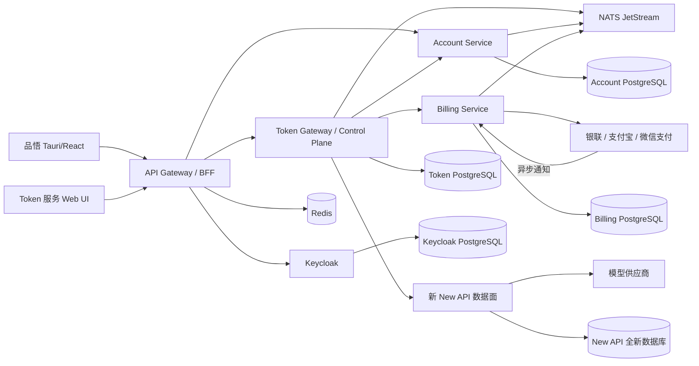
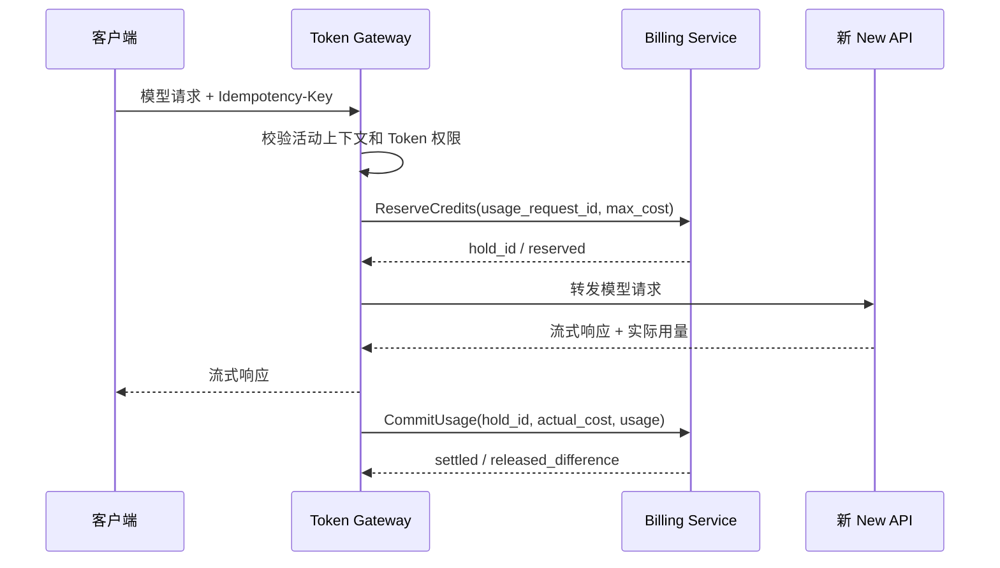
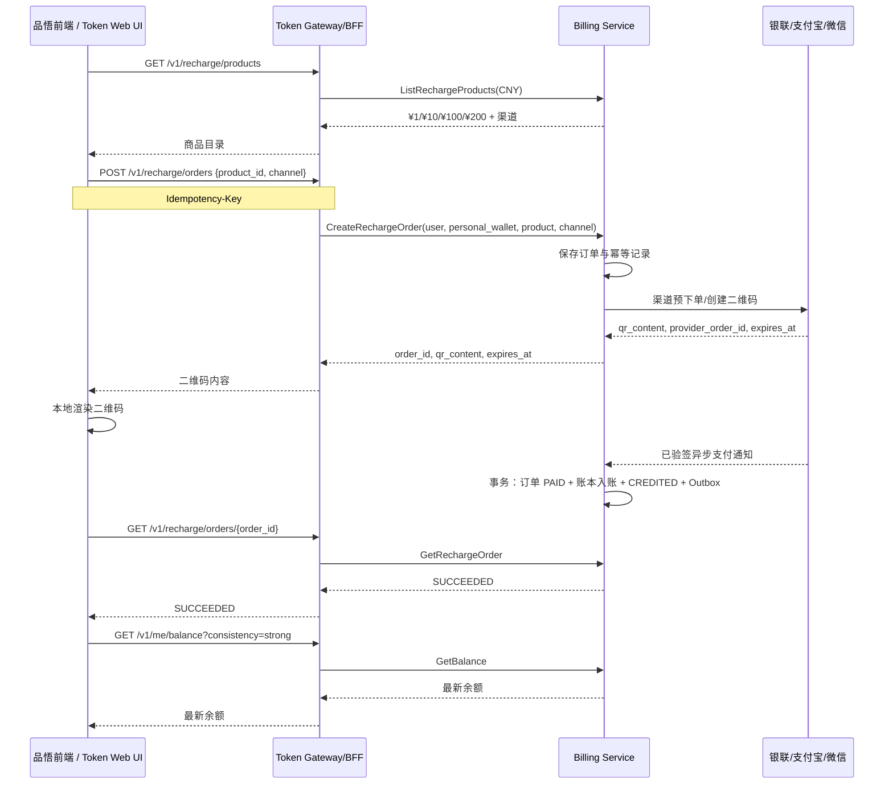

# 账号、组织、Token 与计费系统架构设计

> 状态：推荐方案，作为后续详细设计与实施基线  
> 日期：2026-08-12  
> 适用范围：品悟应用、新部署的 New API、账号与组织、Token 访问控制、积分计费、银联/支付宝/微信支付  
> 迁移约束：新系统验收完成前不得修改或切换当前生产 New API；新 New API 独立部署、使用全新数据，不迁移旧账号。

> **历史文档提示（2026-08-22）：** 本文保留最初方案和设计背景，其中支付渠道、回调、退款、商品目录、部署形态和完成状态已与当前实现不同。当前事实请以 [`../account-platform/docs/README.md`](../account-platform/docs/README.md) 及其架构、需求、调用流程和部署文档为准。

## 1. 结论摘要

采用“身份认证、业务账号、Token 控制、计费支付”分域架构：

1. 使用 Keycloak 承担注册、登录、密码、MFA、会话和 OIDC 协议，不自行实现认证协议。
2. 新建独立的账号服务，负责个人资料、组织、部门/子组织、成员关系、角色、邀请和当前组织上下文。
3. 新建 Token Gateway/Control Plane，负责 Token 账号授权、路由、用量采集和计费编排；新部署的 New API 仅作为模型请求数据面，不承载账号、组织或资金账本。
4. 将现有充值能力演进为独立 Billing Service，统一拥有钱包、不可变账本、充值订单、支付渠道、退款、对账和余额。余额只以 Billing Service 为准。
5. 个人和组织分别拥有钱包；组织公共 Token 的消费必须从明确的组织钱包扣费，不允许隐式扣某个成员的个人余额。
6. 当前激活组织按“会话”保存，每个会话最多一个；`null` 表示个人上下文。不同设备可同时激活不同组织。
7. 支付支持银联、支付宝、微信支付三种二维码渠道。支付回调是入账主路径，前端轮询只用于展示结果，后台主动查询和日终对账负责补偿。
8. 积分不使用浮点数。支付金额以分存储，账本以 `microcredit` 存储；暂定 `1 元 = 100 展示积分 = 1,000,000 microcredits`。
9. Token 消费采用“预占—结算—释放”模型，解决流式响应结束前无法知道准确用量和并发超扣问题。
10. 服务间不使用分布式事务，使用本地事务、幂等键、Transactional Outbox/Inbox、可重放事件和定期对账实现最终一致。

这套边界使身份、权限、密钥、资金各自只有一个事实源，既能支持个人场景，也能安全扩展组织、部门和公共 Token。

## 2. 目标与非目标

### 2.1 目标

- 个人完成注册后自动获得个人上下文和个人钱包。
- 一个用户可加入多个组织；一个登录会话在任意时刻最多激活一个组织。
- 组织包含多级部门/子组织，成员可属于一个或多个组织单元。
- 个人上下文只能访问个人 Token；组织上下文按明确共享规则访问组织或组织单元的公共 Token。
- 品悟前端和 Token 服务前端复用同一套充值订单、支付状态和余额 API。
- ¥1、¥10、¥100、¥200 四档金额由服务端商品目录控制，客户端不可篡改金额。
- 对支付重复通知、乱序通知、请求超时、服务重启、消息重复、并发消费等情况可恢复且不重复入账。
- 新旧 New API 并行隔离，完整验收后一次性切换；不迁移旧账号和旧 New API 数据。

### 2.2 非目标

- 不在本期迁移旧账号、旧余额、旧 Token 配置或历史账单。
- 不允许积分提现、用户间转让、跨币种兑换或作为通用支付工具。
- 不把 Keycloak 当成组织和业务授权数据库。
- 不在 New API 内直接维护组织、成员关系或支付账本。
- 不以 Redis、消息队列、前端缓存或 New API 本地余额作为资金事实源。
- 首期不建设复杂财务 ERP；提供可审计流水、退款和对账接口，为后续财务系统集成留出边界。

## 3. 独立审核问题与最终决策

| 审核发现 | 风险 | 最终决策 |
|---|---|---|
| “账号”同时指用户、组织、Token 和余额 | 权限、归属和数据表容易混乱 | 固定使用用户、上下文、组织、Token 账号、钱包五组术语 |
| 账号服务是否独立不明确 | 组织权限进入 New API 或支付服务后难以演进 | 独立账号服务；认证交给 Keycloak |
| 当前组织的作用域不明确 | 多设备互相覆盖，出现跨组织误操作 | 当前组织按会话保存，每个请求只能有个人或一个组织上下文 |
| 部门/子组织的继承规则未定义 | 成员可能越权使用祖先或子部门 Token | 使用显式共享范围，禁止默认上下行继承 |
| 公共 Token 由谁付费未定义 | 误扣成员个人余额或无法审计成本 | 公共 Token 绑定组织钱包；个人 Token 绑定个人钱包 |
| Token 凭据与付费主体混在一起 | 密钥轮换、预算和权限相互耦合 | Token 账号和钱包解耦，每次请求同时解析两者 |
| 余额刷新可能被理解为本地加款 | 多服务余额漂移 | Billing Service 是唯一余额事实源，“刷新”仅重新查询 |
| 只依赖前端轮询支付结果 | 用户关闭页面后可能不到账 | 支付回调主导入账，主动查询与对账补偿，轮询仅改善体验 |
| 支付重复回调/创建超时 | 重复加积分或产生多张订单 | 全链路幂等、渠道交易号唯一、订单行锁和事务内入账 |
| 金额和积分精度未定义 | 浮点误差、少扣或多扣 | 金额用分，积分账本用整数 microcredit |
| 流式调用结束前不知道费用 | 并发超扣、负余额 | 预占最大费用，结束后按实际用量结算并释放差额 |
| 退款和拒付规则缺失 | 已消费积分仍退款造成坏账 | 充值批次追踪；只自动退未消费部分，异常进入人工处理 |
| 成员被移除后的缓存授权 | 已离职成员继续使用组织 Token | 短令牌、成员版本、事件失效；不确定时对高风险操作 fail closed |
| 组织所有者退出/注销未定义 | 形成无主组织或账本丢失 | 所有者必须先转让；财务记录不可随账号删除 |
| 三个支付渠道差异泄漏到业务层 | 业务代码充满渠道分支 | 统一支付适配器接口，渠道状态映射到内部状态机 |
| 旧 New API 与新系统边界不明确 | 改坏现网或形成双写 | 完全独立部署、独立域名和数据库；验收前不改现网，不做双写 |
| 监控、对账和灾备缺失 | 账实不符时无法发现或恢复 | 建立支付对账、账本不变量监控、PITR、恢复演练和审计追踪 |

## 4. 统一领域术语与强制不变量

### 4.1 术语

- **用户（User）**：自然人业务主体。所有注册都创建用户，不直接注册组织。
- **身份（Identity）**：Keycloak 中的登录身份，以及账号服务中映射的 `issuer + subject`。
- **个人上下文（Personal Context）**：用户以个人身份操作时的授权和计费上下文。
- **组织（Organization）**：多人协作、共同持有资源和承担费用的租户。
- **组织单元（Org Unit）**：同一租户和账务边界内的部门或内部子组织，可形成树形层级。
- **成员关系（Membership）**：用户加入组织及组织单元的关系和角色。
- **活动上下文（Active Context）**：当前会话的个人或单一组织上下文。
- **Token 账号（Token Account）**：模型供应商凭据、可用模型、路由和限额的逻辑集合，不等同于登录账号。
- **钱包（Wallet）**：个人或组织持有积分的账户。
- **账本（Ledger）**：所有积分变动的不可变事实记录。
- **支付订单（Payment Order）**：一次法币充值意图及其渠道状态。
- **用量请求（Usage Request）**：一次模型调用及其预占、实际用量和结算记录。

### 4.2 强制不变量

1. 一个身份唯一映射一个用户；一个用户可关联多个未来扩展身份。
2. 一个会话只能是个人上下文，或激活一个该用户仍有有效成员关系的组织。
3. 每次 Token 请求必须确定唯一的 `user_id`、`context`、`token_account_id`、`payer_wallet_id` 和 `price_version_id`。
4. 组织上下文不得自动回退到个人 Token 或个人钱包；需要用户显式切换上下文。
5. Token 原始密钥只存在于 Token 域的加密存储中，不进入账号服务、Billing Service、JWT、浏览器和日志。
6. 任何积分变化必须来自平衡的账本分录；禁止直接执行“更新余额 +N”而不写账本。
7. 钱包可用余额不得小于零：`available = posted_balance - reserved_balance >= 0`。
8. 一笔渠道交易最多使一个支付订单成功，一笔支付订单最多入账一次。
9. 客户端提交商品 ID，不提交可被信任的价格或积分数。
10. 支付成功、账本入账、订单标记已履约和 Outbox 事件必须在同一数据库事务中提交。
11. 账号注销不删除支付、账本、用量和审计事实；业务标识做去标识化处理。
12. 所有跨服务消息均可能重复、延迟或乱序，消费者必须幂等。

## 5. 总体架构



### 5.1 组件职责

| 组件 | 负责 | 不负责 |
|---|---|---|
| Keycloak | 注册、登录、密码、MFA、OIDC、会话、令牌签发 | 组织层级、业务角色、钱包、Token 凭据 |
| Account Service | 用户业务资料、组织、组织单元、成员、角色、邀请、活动上下文、授权判断、审计 | 密码、支付、余额、模型调用 |
| Token Gateway/Control Plane | Token 账号、共享策略、选择与路由、用量、计费预占/结算、充值 BFF | 组织事实、资金账本、支付渠道事实 |
| 新 New API | 接收兼容模型 API、执行路由和调用模型供应商 | 登录账号事实、组织权限、支付和余额 |
| Billing Service | 商品目录、钱包、账本、预占、支付、退款、主动查询、对账 | 登录认证、组织成员、供应商 Token 密钥 |
| API Gateway/BFF | TLS、路由、统一鉴权、限流、请求关联；为两个前端提供稳定入口 | 持久化业务事实 |
| NATS JetStream | 领域事件可靠投递和重放 | 同步鉴权、余额事实、分布式事务 |
| Redis | 限流、短期授权缓存、幂等响应缓存、会话辅助 | 永久成员关系和余额事实 |

### 5.2 为什么账号服务必须独立

账号和组织是 Token 使用、充值、审计、未来品悟其他业务共同依赖的业务能力。若放进 New API，会把产品账号生命周期绑定到第三方数据模型和升级节奏；若放进 Billing Service，又会让权限模型与财务模型相互污染。因此账号服务应独立，但认证协议交给成熟 IdP，避免重复建设密码、MFA 和 OAuth/OIDC 安全能力。

### 5.3 New API 的集成方式

- 当前生产 New API 保持原样。
- 新建独立的新 New API 实例，使用独立域名、网络、数据库、密钥和存储。
- 新 New API 数据面只允许 Token Gateway 从私网访问；对外需要 OpenAI 兼容 API 时也先进入 Token Gateway，不能绕过授权和计费直连数据面。
- Token Gateway 在业务层完成授权和计费后，才携带内部凭据调用新 New API。
- 若 New API 已能完成供应商路由，继续复用；组织授权、钱包扣费和支付不得写入其内部表。
- Token Gateway 记录业务用量，New API/供应商用量作为可对账证据。两边不一致时先冻结异常请求结算，进入自动或人工核对。
- 新实例的数据重新配置，不迁移旧账号；供应商渠道和模型配置按新环境安全录入，禁止从旧库直接复制密文。

## 6. 身份、个人账号与组织模型

### 6.1 登录与开户

1. Web 客户端通过 Keycloak 使用 OIDC Authorization Code + PKCE 登录；桌面客户端通过 Rust 调用 Keycloak Direct Access Grant，在应用内完成基础账号密码登录。
2. 首次登录调用 `POST /v1/account/bootstrap`。
3. Account Service 以 `issuer + subject` 幂等创建用户和个人上下文。
4. Account Service 同步调用 Billing Service 的 `EnsureWallet`，创建个人钱包；同时写 Outbox 事件用于补偿。
5. 钱包成功后用户状态从 `PROVISIONING` 变为 `ACTIVE`。未完成时不得充值或调用 Token，客户端展示可重试状态。

Web 端采用 BFF + `HttpOnly; Secure; SameSite` Cookie；Tauri 端只通过 Rust 接收并一次性提交密码，不持久化密码，只把 Refresh Token 写入系统安全凭据存储，不把长期令牌写入 `localStorage` 或普通配置文件。注册、找回密码、第三方身份和复杂 MFA 仍使用独立流程。

### 6.2 当前激活组织

当前组织按会话而不是按用户全局保存：

```text
session.active_org_id = null       -> 个人上下文
session.active_org_id = <org_id>   -> 单一组织上下文
```

切换流程：

1. 客户端请求切换到组织或个人。
2. Account Service 以数据库事实重新检查成员状态，不只依赖缓存或旧 JWT。
3. 更新会话活动上下文和 `membership_version`。
4. 轮换短期访问令牌或 BFF 会话，后续请求携带新上下文。
5. 前端清空上个上下文的 Token 列表、余额和缓存，重新加载。

`users.last_active_org_id` 只可作为下次登录的界面偏好，不参与授权。这样同一用户可在电脑使用组织 A、手机使用组织 B，而每次请求仍只有一个确定租户。

### 6.3 组织层级

- `organization` 是成员、权限、数据和钱包的租户边界；`org_unit` 是该边界内的部门或内部子组织。
- 若“子组织”需要独立所有者、独立成员、独立钱包或独立数据边界，则创建为新的 `organization`，可保存 `parent_organization_id` 供导航和集团报表使用；父子组织之间不自动继承权限、Token 或余额。
- 不需要独立边界的部门和内部子组织统一建模为 `org_unit`，组织有唯一根单元。
- 使用邻接表保存直接父子关系，Closure Table 保存祖先—后代关系，用于稳定查询任意深度层级。
- 组织单元移动必须在串行化事务中更新 Closure Table，并记录审计日志。
- 禁止环、跨组织父子关系和删除仍有子节点/Token/成员的单元。
- 成员可直接属于组织，也可绑定一个或多个组织单元。

### 6.4 角色与权限

推荐内置角色：

| 角色 | 主要权限 |
|---|---|
| `OWNER` | 组织最终所有者、转让所有权、解散组织 |
| `ORG_ADMIN` | 管理组织资料、单元、成员和普通角色 |
| `BILLING_ADMIN` | 组织充值、预算、退款申请、账单和对账查看 |
| `UNIT_ADMIN` | 管理授权范围内组织单元的成员和 Token 绑定 |
| `MEMBER` | 使用被授权资源 |
| `AUDITOR` | 只读查看审计、用量和账务报告 |

授权使用 RBAC 与资源范围组合，而不是把所有权限塞入角色名。角色绑定包含 `scope_type = ORGANIZATION | ORG_UNIT` 和 `scope_id`。组织所有者至少一人；最后一名所有者退出、被删除或停用前必须完成所有权转让。

### 6.5 邀请、离职和注销

- 邀请使用一次性、短有效期、哈希存储的 Token，并绑定目标组织、角色和可选邮箱。
- 接受邀请前再次检查邀请状态、组织状态和用户身份；重复接受必须幂等。
- 成员停用后 Account Service 立即增加组织的 `membership_version` 并发事件，Token Gateway 清除授权缓存。
- 授权上下文中的全局 `membership_version` 用于用户级会话失效；组织上下文另行返回 `organization_membership_version`，其值来自当前 `memberships.version`。Token Gateway 必须把后者冻结到用量请求并用于成员额度预占，不得用全局版本代替或在字段缺失时回退。
- 组织成员仍为 `ACTIVE` 但版本因角色等事实变化而递增时，Billing 同步推进所有未过期 ACTIVE 成员额度授予的成员版本，不移动余额；该推进必须写审计和 Outbox。
- Billing `000078` 对上线前已存在的 ACTIVE 错版授予执行一次同规则对齐；相同生命周期事件的幂等重放也会补齐遗漏投影，已对齐授予不会重复生成审计或 Outbox。
- 管理员、计费和密钥操作实时回源校验；普通调用的撤权传播目标不超过 30 秒。
- 若权限事实不可确认，组织 Token 请求必须拒绝，不以旧缓存放行。
- 用户注销先停用登录和个人 Token，再处理组织所有权；账本和支付订单保留，个人信息按合规策略去标识化。

## 7. Token 账号、共享与路由

### 7.1 Token 账号归属

```text
owner_type = USER       -> 个人 Token 账号，仅本人个人上下文可用
owner_type = ORG        -> 组织公共 Token 账号
owner_type = ORG_UNIT   -> 部门/子组织公共 Token 账号
```

一个 Token 账号可包含一个或多个经加密的供应商凭据版本，但任意时刻只有明确的活动版本。轮换时先验证新凭据，再原子切换活动版本，旧版本在宽限期后撤销。

### 7.2 公共 Token 共享范围

每个组织或组织单元 Token 必须设置以下一种共享策略：

| 范围 | 可使用者 |
|---|---|
| `OWNER_UNIT_ONLY` | 直接属于所有者组织单元的成员 |
| `OWNER_SUBTREE` | 所有者单元及所有后代单元成员 |
| `ORG_ALL` | 该组织全部有效成员 |
| `EXPLICIT_MEMBERS` | 显式授权的成员集合 |

默认值为最小权限的 `OWNER_UNIT_ONLY`；组织根节点可默认 `ORG_ALL`，但创建页面必须明确展示影响范围。父级成员不会自动获得子单元 Token，子级成员也不会自动获得父级 Token，只有上述策略显式允许时才可用。

### 7.3 Token 和付款钱包选择

| 活动上下文 | Token 候选 | 付款钱包 |
|---|---|---|
| 个人 | 当前用户拥有且启用的个人 Token | 当前用户个人钱包 |
| 组织 | 按成员、单元和共享策略计算出的公共 Token | Token 绑定的组织钱包，或经批准的组织单元预算钱包 |

首期每个组织只有一个主钱包；组织单元预算通过额度规则控制，不创建可互转的独立货币。未来如需独立核算，可增加组织单元子钱包，但不能改变历史付款钱包。

确定性路由顺序：

1. 请求显式指定且有权使用的 Token 账号；
2. 当前组织单元配置的默认 Token；
3. 组织默认 Token；
4. 按启用状态、模型能力、优先级和健康状态选择唯一候选；
5. 无候选或同优先级歧义时返回明确错误，不静默跨上下文回退。

### 7.4 密钥安全

- 供应商密钥仅 Token Gateway/New API 数据面进程可解密。
- 使用 KMS/Vault 信封加密：数据库只存密文、Key ID、版本和指纹。
- 前端和普通管理员只看到掩码、创建者、最后验证时间和状态。
- 密钥不进入 URL、事件、Trace、错误详情和普通审计日志。
- 服务身份使用短期凭据或 `private_key_jwt`/mTLS；不同服务、环境和渠道使用不同密钥。

## 8. 钱包、积分与账本

### 8.1 单位与定价

- 法币仅支持 CNY，金额字段统一为整数 `amount_fen`。
- 暂定兑换：`1 CNY = 100 展示积分`。
- 账本最小单位：`1 展示积分 = 10,000 microcredits`，因此 `1 CNY = 1,000,000 microcredits`。
- 所有数量使用 `BIGINT`，禁止浮点运算。
- 模型单价按每百万输入/输出 Token 记录为 microcredits，使用版本化价格表。
- 一次用量永久记录 `price_version_id`；价格更新不得重算历史流水。

四个首期充值商品：

| product_id | 支付金额 | 获得积分 | 账本数量 |
|---|---:|---:|---:|
| `CNY_1` | ¥1 | 100 | 1,000,000 microcredits |
| `CNY_10` | ¥10 | 1,000 | 10,000,000 microcredits |
| `CNY_100` | ¥100 | 10,000 | 100,000,000 microcredits |
| `CNY_200` | ¥200 | 20,000 | 200,000,000 microcredits |

商品目录由 Billing Service 返回。订单创建时保存商品、金额、积分和目录版本的快照；客户端金额仅用于显示，不参与服务端计算。

### 8.2 钱包和账本模型

首期钱包类型：

- `PERSONAL`：个人充值和个人 Token 消费。
- `ORGANIZATION`：组织充值和公共 Token 消费，仅计费管理员可操作充值和退款。

账本采用平衡分录。每个 `journal_entry` 的所有 `posting.delta_microcredits` 之和必须为零。例如：

```text
充值成功：个人钱包 +1,000,000；支付清算账户 -1,000,000
模型消费：个人钱包   -12,345；模型消费账户      +12,345
退款冲正：个人钱包  -1,000,000；支付清算账户 +1,000,000
```

钱包表中的 `posted_balance` 是账本聚合快照，用于高效查询；事务写入分录时以行锁同步更新快照。每天从不可变分录重算并核对快照，任何不一致立即告警并停止异常钱包的新扣费。

### 8.3 充值批次、有效期和退款

- 购买积分默认不失效。
- 赠送积分必须建立独立批次，可设置有效期，消费时优先使用最早失效批次。
- 积分不可转让、赠送或提现。
- 退款原路退回，仅自动退款该充值批次尚未消费且未预占的部分。
- 已消费金额、渠道拒付、退款金额与剩余批次不一致时，订单进入 `MANUAL_REVIEW`；不得把钱包直接扣成负数。
- 退款成功后写反向账本分录，历史分录不修改、不删除。

### 8.4 Token 消费的预占与结算



规则：

1. Token Gateway 根据模型、最大输入、最大输出和价格版本计算保守的 `max_cost`。
2. Billing Service 在单一事务中锁钱包，检查可用余额并创建 `hold`。
3. 成功调用后按实际用量结算，释放差额；调用确定失败且未产生用量时释放全部预占。
4. `usage_request_id` 全局唯一；重试只能返回同一预占/结算结果。
5. 网关在响应完成但结算超时时写本地待结算记录并重试，不得再次调用模型。
6. 预占到期不能直接释放仍在运行的请求；后台先检查请求租约和 New API 用量，无法确定时进入核对队列。
7. 首期同步调用 Billing Service，余额服务不可用时 fail closed。高并发阶段可另行引入短期预算租约，但不是首期实现。

## 9. 支付与充值设计

### 9.1 渠道适配器

Billing Service 通过供应商中立接口和版本化能力声明接入具体支付渠道；当前生产 Adapter 是新华三商城，开发 Simulator 只能在显式开发/测试环境启用。领域层先读取能力，再决定是否开放查询、关单、退款、通知、账单或人工修复动作：

```go
type PaymentProvider interface {
    Capabilities(ctx context.Context) (PaymentCapabilities, error)
    CreateQR(ctx context.Context, req CreateQRRequest) (CreateQRResult, error)
    Query(ctx context.Context, providerOrderID string) (ProviderPayment, error)
    Close(ctx context.Context, providerOrderID string) error
    Refund(ctx context.Context, req RefundRequest) (RefundResult, error)
    VerifyNotification(ctx context.Context, headers http.Header, body []byte) (VerifiedNotification, error)
}
```

适配器负责签名、证书、报文字段和渠道状态映射；领域层只识别统一订单、支付流水、退款和复核状态。渠道文档或 SDK 升级不得改变前端 API 与账本结构。能力按 Provider/Adapter 版本冻结到商品映射和订单；无回调无账单 Provider 只有同时具备长期历史查询、有限支付/晚到窗口、权威未支付终态和足够证据保留期时才允许正式收款。

### 9.2 订单状态

渠道支付状态与积分履约状态分离，避免“渠道已付款但事务尚未入账”无法表达：

```text
payment_status:
  CREATED -> PENDING -> PAID
                    -> CLOSED | EXPIRED | FAILED
  EXPIRED -> PAID_LATE（仅允许已验签的渠道事实触发）
fulfillment_status:
  NOT_CREDITED -> CREDITED
```

支付成功流水是不可变历史事实，退款不再覆盖支付状态或履约摘要。普通退款是独立聚合，必须精确绑定支付流水及该流水产生的权益包；调用方不传金额，只允许对尚未消费、预占、到期或异常冻结的全部 BASE 与关联 BONUS 执行一次整笔剩余退款。渠道强制退款使用独立证据和复核案件，不能伪装成普通退款。

支付订单默认 15 分钟过期。只有 `payment_status IN (PAID, PAID_LATE) && fulfillment_status=CREDITED` 才向前端返回业务成功。订单过期后出现可信成功事实时仍前进到 `PAID_LATE` 并幂等履约；不能简单丢弃，也不能由人工直接标记已支付。除显式的渠道事实修正外，终态不得倒退。

### 9.3 品悟和 Token 服务前端充值流程



实现要求：

- 两个前端都只访问 Token Gateway/BFF，符合“品悟前端经 Token 服务请求充值”的路径。
- 前端不能直接调用 Billing Service 或支付渠道后台接口。
- Billing Service 返回 `qr_content`，前端本地渲染二维码；不长期保存二维码图片。
- 轮询建议前 30 秒每 2 秒一次，此后每 5 秒一次并加随机抖动，到订单过期停止；可增加 SSE 作为体验优化，但不能依赖长连接完成入账。
- 页面关闭不会影响支付回调和入账。用户再次打开页面可按订单 ID 查询。
- 支付成功后的“刷新余额”是强一致地读取 Billing Service，不是在 Token 服务中二次加款。

### 9.4 支付回调事务

回调处理顺序必须固定：

1. 限制 Body 大小，保存请求摘要，验证渠道证书/签名、时间戳和防重放信息。
2. 校验商户号、应用号、内部订单号、渠道订单号、金额、币种和渠道。
3. 以内部订单 ID 加行锁，检查渠道交易号唯一约束。
4. 若已入账，返回渠道成功响应；不得重复记账。
5. 在一个数据库事务中更新支付事实、写账本分录、更新钱包快照、标记履约成功、写 Outbox。
6. 数据库提交成功后才向渠道确认成功；提交失败则让渠道重试。

不得仅凭前端“已支付”页面、客户端截图或未经验证的查询结果加积分。

### 9.5 幂等、查询和对账

- 创建订单必须携带 `Idempotency-Key`，作用域为 `caller + user + endpoint`，保存请求哈希和完整响应。
- 相同键、相同请求返回原结果；相同键、不同请求返回 `409 IDEMPOTENCY_CONFLICT`。
- 调用渠道超时后先以商户订单号查询，禁止立即创建第二笔渠道订单。
- 待支付订单由后台任务按 Provider 最小查询间隔退避查询；关单只在能力声明支持时调用，不支持时继续保留外部可能支付事实。
- 订单在72小时边界执行最后查询，仍未收敛则幂等创建唯一 P2 晚到支付案件并停止高频任务；前7天每日、此后每周复核，认领和安排不能重置创建时钟。
- 回调、账单 API、受控账单文件和查询降级是不同对账模式。能力不支持账单时，只能称“查询快照降级核对”，不能伪造渠道账单；文件导入逐批、逐行不可变保存。
- 未支付归档必须越过支付窗口、晚到窗口和七日宽限期，并存在期限后成功的权威未支付查询，且无支付流水、冲突证据或未复核用户申诉。否则升级 `PROVIDER_BLIND`、停用该 Provider 版本新单并继续人工处置。
- 差异进入独立 `reconciliation_case`；自动修复只允许执行证明安全的幂等操作，金额不符、多付、拒付和强制退款进入受审计人工队列。

## 10. 核心数据模型

所有主键建议使用 UUIDv7；时间统一存 UTC `timestamptz`；枚举使用受约束字符串或数据库枚举；所有可变聚合包含 `version` 以支持乐观锁。服务数据库之间不建立外键，只保存外部 ID 快照并通过事件校验。

### 10.1 Account 数据库

| 表 | 关键字段与约束 |
|---|---|
| `users` | `id`, `status`, `display_name`, `last_active_org_id`（仅偏好）, `version` |
| `identities` | `user_id`, `issuer`, `subject`; `UNIQUE(issuer, subject)` |
| `organizations` | `id`, `parent_organization_id`（仅导航/报表关系）, `name`, `status`, `membership_version`, `version` |
| `org_units` | `id`, `organization_id`, `parent_id`, `type`, `status`; 禁止跨组织父子 |
| `org_unit_closure` | `ancestor_id`, `descendant_id`, `depth`; 复合唯一 |
| `memberships` | `id`, `user_id`, `organization_id`, `status`; 活跃关系唯一 |
| `membership_units` | `membership_id`, `org_unit_id`; 复合唯一 |
| `role_bindings` | `membership_id`, `role`, `scope_type`, `scope_id` |
| `invitations` | `token_hash`, `organization_id`, `email_hash`, `expires_at`, `status` |
| `sessions` | `sid`, `user_id`, `active_org_id`, `membership_version`, `expires_at` |
| `audit_logs` | 行为人、上下文、动作、资源、结果、请求 ID、前后字段摘要 |
| `outbox_events` / `inbox_messages` | 可靠事件与消费幂等 |

关键索引包括有效成员的 `organization_id + user_id`、组织单元 Closure 的祖先和后代双向索引，以及会话 `sid` 唯一索引。

### 10.2 Token 数据库

| 表 | 关键字段与约束 |
|---|---|
| `token_accounts` | `id`, `owner_type`, `owner_id`, `name`, `status`, `default_priority` |
| `provider_credentials` | `token_account_id`, `ciphertext`, `key_id`, `fingerprint`, `version`, `status` |
| `token_share_policies` | `token_account_id`, `scope`, `owner_org_id`, `owner_unit_id` |
| `token_explicit_members` | `token_account_id`, `user_id`; 复合唯一 |
| `routing_policies` | 模型能力、默认账号、优先级、失败切换规则 |
| `usage_requests` | `id`, `idempotency_key`, 用户/组织/Token/钱包/价格快照、状态、估算和实际费用 |
| `usage_attempts` | New API 请求 ID、供应商请求 ID、开始结束时间、Token 数和错误分类 |
| `authorization_cache_versions` | 组织成员版本和最后同步时间 |
| `outbox_events` / `inbox_messages` | 可靠事件与消费幂等 |

### 10.3 Billing 数据库

| 表 | 关键字段与约束 |
|---|---|
| `wallets` | `id`, `owner_type`, `owner_id`, `currency=CREDIT`, `status`; 所有者类型与 ID 唯一 |
| `wallet_balances` | `wallet_id`, `posted_microcredits`, `reserved_microcredits`, `version` |
| `ledger_accounts` | 钱包账户和系统对手账户 |
| `journal_entries` | `id`, `type`, `reference_type`, `reference_id`, `occurred_at`; 业务引用唯一 |
| `ledger_postings` | `journal_entry_id`, `ledger_account_id`, `delta_microcredits`, 批次引用 |
| `credit_lots` | 来源订单、总额、剩余、到期时间、是否可退款 |
| `holds` | `id`, `wallet_id`, `usage_request_id`, `amount`, `status`, `lease_expires_at`; 用量请求唯一 |
| `price_versions` | 模型、输入/输出/缓存价格、有效期、版本、审批人 |
| `recharge_products` | `product_id`, `amount_fen`, `credit_microcredits`, `channels`, `catalog_version`, `enabled` |
| `payment_orders` | 内部订单、钱包、付款人/受益方、Provider/商品/能力快照、金额、渠道、两类摘要状态、支付期限、72小时边界和最终归档期限 |
| `payment_transactions` | Provider 订单号、渠道交易号、金额/币种/付款人和不可变成功事实；Provider+渠道交易号唯一 |
| `provider_notifications` | 通知 ID/哈希、验签结果、处理结果；敏感字段脱敏或加密 |
| `payment_evidence` | 回调、查询、关单观察、账单和人工修复的不可变载荷摘要与归并结果 |
| `refunds` | 精确支付流水与权益包目标、由流水派生的整笔金额、渠道退款号、状态、幂等键 |
| `refund_component_reservations` / `refund_grant_reservations` | 普通退款冻结的全部 BASE/关联 BONUS 组成及组织授予快照 |
| `forced_refund_cases` | 渠道主动退款事实、精确目标、冻结和人工复核状态 |
| `manual_review_cases` / `manual_review_case_events` | P0/P1/P2 案件 SLA、责任人、阶段时间和不可变操作时间线 |
| `late_payment_review_cases` / `late_payment_review_evidence` | 72小时晚到案件、复核计划、严格归档、blind 状态与用户申诉/查询证据 |
| `provider_bill_imports` / `provider_bill_rows` | 受控账单文件的不可变批次、摘要和逐行记录 |
| `payment_provider_controls` | Provider/Adapter 版本新单开关及事实盲区原因 |
| `reconciliation_cases` | 渠道、内部和账本差异及处置状态 |
| `idempotency_records` | 调用方、键、请求哈希、响应、过期时间；复合唯一 |
| `outbox_events` / `inbox_messages` | 可靠事件与消费幂等 |

账本平衡由事务内校验或 deferred constraint 保证；业务代码和数据库约束双重防护。账本表只允许追加，不开放普通 `UPDATE/DELETE` 权限。

## 11. API 与事件契约

### 11.1 外部 REST API

API 使用 `/v1`、JSON、OpenAPI 3.1；错误包含稳定的 `code`、面向用户的 `message`、`request_id` 和可选 `details`，不得暴露内部堆栈。

#### 账号与上下文

```http
POST /v1/account/bootstrap
GET  /v1/me
GET  /v1/me/organizations
POST /v1/sessions/current/active-context
```

切换请求：

```json
{
  "context_type": "ORGANIZATION",
  "organization_id": "0198..."
}
```

切回个人使用：

```json
{
  "context_type": "PERSONAL"
}
```

组织管理：

```http
POST /v1/organizations
POST /v1/organizations/{org_id}/units
POST /v1/organizations/{org_id}/invitations
POST /v1/invitations/{token}/accept
PUT  /v1/organizations/{org_id}/members/{member_id}/roles
DELETE /v1/organizations/{org_id}/members/{member_id}
```

#### Token 与充值 BFF

```http
GET  /v1/token-accounts/eligible
GET  /v1/recharge/products
POST /v1/recharge/orders
GET  /v1/recharge/orders/{order_id}
POST /v1/recharge/orders/{order_id}/close
GET  /v1/me/balance?context=personal&consistency=strong
```

创建充值订单：

```http
POST /v1/recharge/orders
Idempotency-Key: 018f...
Content-Type: application/json

{
  "product_id": "CNY_100",
  "channel": "WECHAT"
}
```

响应：

```json
{
  "order_id": "0198...",
  "status": "PENDING",
  "product_id": "CNY_100",
  "amount_fen": 10000,
  "credit_points": 10000,
  "channel": "WECHAT",
  "qr_content": "weixin://...",
  "expires_at": "2026-08-12T04:30:00Z",
  "poll_after_ms": 2000
}
```

二维码内容属于短期敏感数据，响应必须设置 `Cache-Control: no-store`，日志中只记录订单 ID 和渠道。

### 11.2 内部同步 API

内部使用 Protobuf + gRPC，服务身份使用 mTLS 或工作负载身份；所有写操作携带业务幂等键。

Account Service：

- `ResolveContext(user_id, session_id)`
- `AuthorizeTokenAccount(user_id, active_org_id, token_account_id)`
- `GetMembershipSnapshot(user_id, organization_id)`

Billing Service：

- `EnsureWallet(owner_type, owner_id)`
- `ListRechargeProducts(currency, channel)`
- `CreateRechargeOrder(...)`
- `GetRechargeOrder(order_id, requester_id)`
- `GetBalance(wallet_id)`
- `ReserveCredits(usage_request_id, wallet_id, max_cost, price_version_id)`
- `CommitUsage(usage_request_id, hold_id, actual_cost, usage_snapshot)`
- `ReleaseHold(usage_request_id, hold_id, reason)`
- `RequestRefund(order_id, amount_fen, reason)`

### 11.3 领域事件

事件信封固定包含：

```json
{
  "event_id": "0198...",
  "event_type": "account.membership.changed.v1",
  "aggregate_id": "0198...",
  "aggregate_version": 7,
  "occurred_at": "2026-08-12T04:20:00Z",
  "trace_id": "...",
  "payload": {}
}
```

首期事件：

- `account.user.provisioned.v1`
- `account.organization.created.v1`
- `account.membership.changed.v1`
- `account.org_unit.changed.v1`
- `billing.wallet.created.v1`
- `billing.recharge.succeeded.v1`
- `billing.balance.changed.v1`
- `billing.hold.expired.v1`
- `billing.refund.succeeded.v1`
- `token.usage.settled.v1`

事件只传播必要 ID、状态和版本，不传播 Token 密钥、支付完整报文、个人敏感信息或余额作为另一个服务的可写副本。

### 11.4 标准错误码

| HTTP | 错误码 | 含义 |
|---:|---|---|
| 401 | `AUTH_REQUIRED` | 未登录或令牌无效 |
| 403 | `ACTIVE_ORG_FORBIDDEN` | 无权激活目标组织 |
| 403 | `MEMBERSHIP_REVOKED` | 成员关系已撤销 |
| 403 | `TOKEN_ACCOUNT_NOT_ELIGIBLE` | 无权使用目标 Token |
| 409 | `IDEMPOTENCY_CONFLICT` | 同一幂等键对应不同请求 |
| 409 | `CONTEXT_CHANGED` | 请求期间活动上下文已变化 |
| 422 | `ORDER_PRODUCT_INVALID` | 商品或渠道不可用 |
| 422 | `ORDER_EXPIRED` | 订单已过期 |
| 402 | `WALLET_INSUFFICIENT` | 可用积分不足 |
| 409 | `USAGE_ALREADY_SETTLED` | 用量已经结算 |
| 503 | `PAYMENT_PROVIDER_UNAVAILABLE` | 支付渠道暂时不可用 |
| 503 | `BILLING_UNAVAILABLE` | 无法安全确认余额，拒绝调用 |

## 12. 一致性、并发与故障处理

### 12.1 不使用分布式事务

每个服务只在自己的 PostgreSQL 中提交本地事务。跨服务状态通过以下组合收敛：

- 同步命令返回明确结果；
- Transactional Outbox 与业务数据同事务提交；
- 发布器至少一次投递；
- Inbox 以 `event_id` 去重；
- 事件带聚合版本，旧版本不得覆盖新版本；
- 定时任务扫描卡住状态并补偿；
- 财务事实通过渠道、订单、账本三方对账。

### 12.2 关键故障策略

| 场景 | 处理 |
|---|---|
| 首次开户时钱包服务不可用 | 用户保持 `PROVISIONING`，后台重试；不得创建半可用账号 |
| 切换组织后 Token Gateway 缓存未更新 | JWT/会话携带成员版本；版本不匹配时回源校验 |
| 预占成功但 New API 调用未发出 | 释放预占；操作幂等 |
| 模型已响应但结算调用超时 | 记录待结算并重试，不重复调用模型 |
| 支付创建请求超时 | 以商户订单号查询后恢复原订单，不创建新订单 |
| 支付通知重复或乱序 | 行锁、状态机和唯一约束保证幂等，终态不倒退 |
| 通知到达时 Billing Service 不可用 | 渠道重试；主动查询与对账兜底 |
| Outbox 发布重复 | 消费者 Inbox 去重 |
| Redis 故障 | 降级到数据库和本地限流；余额不受影响 |
| 消息队列故障 | 同步核心流程继续，本地 Outbox 积压并告警 |
| 权限服务无法确认组织资格 | 组织 Token fail closed，个人请求仍按独立状态处理 |

### 12.3 并发控制

- 钱包预占/结算使用钱包行锁或条件更新，事务隔离至少 `READ COMMITTED` 配合显式锁。
- 支付回调锁定订单行；渠道交易号和业务入账引用设唯一索引。
- 组织层级移动和所有权转移使用串行化事务或聚合级互斥锁。
- 所有更新检查聚合版本，冲突返回 `409` 并让调用方刷新。
- 不通过进程内锁保证跨副本一致性。

## 13. 安全、隐私与合规

### 13.1 认证与会话

- Keycloak 的 Web 客户端使用 OIDC Authorization Code + PKCE；公开桌面客户端按产品要求启用 Direct Access Grant，禁用 Implicit。
- 桌面密码只允许经 Tauri IPC 进入 Rust，并通过 HTTPS Token Endpoint 一次性提交；禁止持久化、日志记录或传入业务服务。
- 生产回调地址使用精确白名单和 HTTPS。
- Access Token 建议 10 分钟，Refresh Token 启用轮换和重用检测。
- JWT 必须验证 `iss`、`aud`、签名、有效期和授权上下文；不把余额、完整组织树或 Token 权限列表写入 JWT。
- `OWNER`、`ORG_ADMIN`、`BILLING_ADMIN` 强制 MFA；退款、所有权转移、密钥查看/轮换要求近期重新认证。
- Web BFF 防 CSRF；CORS 使用精确来源白名单；反向代理清洗外部传入的身份和转发头。

### 13.2 服务和数据安全

- 服务间 mTLS/工作负载身份，按调用方法授予最小权限。
- 支付证书、商户私钥和供应商 Token 放入 KMS/Vault；定期轮换并记录审批。
- PostgreSQL 各服务独立数据库、角色和备份策略，禁止跨库直连查询。
- 个人信息字段分级，加密敏感字段；日志、Trace 和指标统一脱敏。
- 审计日志防篡改、只追加，至少记录管理员、财务、组织权限和密钥操作。
- 对外接口实施用户/IP/设备多维限流；支付回调单独配置渠道来源校验和防重放，但不把来源 IP 当作唯一安全依据。
- 对二维码内容进行长度和格式限制；客户端只将其作为二维码文本渲染，不自动打开任意 URL。

### 13.3 业务与合规边界

- 积分仅用于平台内模型服务，不能转让、提现或兑付现金。
- 退款只能原路退回，不能退至不同账户。
- 上线前必须完成三渠道商户入网、虚拟服务/积分规则、退款条款、隐私政策、发票和财税处理的法务/财务确认。
- 法务确认不会改变钱包和账本边界，但属于生产支付启用硬门禁；未通过的渠道保持禁用。
- 支付、退款、账本和审计记录的保留期限按适用法律和财税要求配置，账号注销不得物理删除这些事实。

## 14. 技术选型

| 层 | 选型 | 理由 |
|---|---|---|
| 服务端语言 | Go 当前受支持稳定版，锁定 toolchain | 并发、流式代理和网络服务成熟，部署简单 |
| 外部 API | REST/JSON + OpenAPI 3.1 | 适合前端和第三方接入，契约易审查 |
| 内部 API | Protobuf + gRPC | 强类型、低开销、超时和重试语义明确 |
| 认证 | Keycloak 稳定版，固定镜像摘要 | OIDC、MFA、会话和身份联邦成熟 |
| 主数据库 | PostgreSQL 17+ 的受支持版本，托管 HA 优先 | 事务、约束、行锁、PITR 和 JSON 支持完善 |
| 缓存/限流 | Redis 7+ | 适合短期缓存与限流；不作为账本事实源 |
| 事件总线 | NATS JetStream | 运维成本低于 Kafka，支持持久化、重放和消费确认 |
| 密钥管理 | 云 KMS + Vault/云 Secret Manager | 信封加密、审计和轮换 |
| 可观测性 | OpenTelemetry + Prometheus/Grafana + Loki + Tempo | 统一 Trace、指标、日志和跨服务请求关联 |
| 部署 | Kubernetes + Helm；Terraform 管理基础设施 | 独立扩缩容、滚动发布、网络策略和密钥挂载 |
| 持续交付 | GitHub Actions + GitOps/Argo CD | 构建与部署分离、可审计回滚 |
| 数据访问 | `pgx` + `sqlc`，迁移使用 Goose/Atlas 二选一并统一 | 保留 SQL 可控性，减少 ORM 隐式行为 |

不建议首期引入 Kafka、服务网格、分布式 SQL 或独立“账本微服务”。三个业务域配合 Keycloak、New API 已足够；在数据量或团队边界证明需要前，不继续拆分。

## 15. 部署拓扑与环境隔离

### 15.1 环境

- `dev`：Docker Compose，可使用支付渠道 Mock。
- `staging`：与生产拓扑一致，连接三渠道沙箱/测试环境。
- `production-new`：全新的账号、Billing、Token Gateway、Keycloak 和 New API，独立域名与数据库；迁移期间仅测试用户可访问。
- `production-legacy`：当前生产 New API，整个迁移完成前保持代码、数据库和流量不变。

任何环境禁止共享商户密钥、Token、Cookie、数据库或消息主题。所有资源名和 DNS 显式带环境标识。

### 15.2 PostgreSQL

- 可在同一托管 PostgreSQL 集群中使用独立数据库和角色起步，但账务数据库使用独立实例/高可用资源更稳妥。
- 开启 WAL 归档和 PITR；生产至少一主一同步备，备份加密。
- 账务数据库在可用区内目标 RPO 0；区域灾难以备份能力设定 RPO，初始目标不超过 5 分钟。
- 初始 RTO 目标 60 分钟，每季度执行恢复演练并保存结果。

### 15.3 网络

- 仅 API Gateway 暴露业务入口；Billing Service 额外暴露独立支付回调入口。
- 数据库、Redis、NATS、Keycloak 管理端和 New API 管理端位于私网。
- Kubernetes NetworkPolicy 默认拒绝，只开放文档中明确的调用边。
- 支付回调与管理 API 使用不同域名、路由、限流和 WAF 策略。

## 16. 可观测性与运维

### 16.1 服务目标

- Account、Token、Billing 用户 API 月可用性：99.9%。
- 支付回调接收端月可用性：99.95%。
- 余额强一致读取 p95：200 ms 以内。
- 积分预占/结算 p95：150 ms 以内，不含跨地域网络。
- 成员撤权传播：普通 Token 调用 30 秒内；管理和财务操作立即回源。
- 已验证支付回调从接收到完成账本入账 p99：2 秒以内。

### 16.2 核心指标和告警

| 指标 | 告警建议 |
|---|---|
| `ledger_unbalanced_entries_total` | 必须恒为 0，出现即 P0 |
| `wallet_negative_available_total` | 必须恒为 0，出现即 P0 并冻结扣费 |
| `payment_paid_not_credited` | 持续 1 分钟即 P0 |
| `payment_callback_verify_fail_rate` | 5 分钟显著高于基线即 P1 |
| `payment_success_rate{channel}` | 分渠道监控，低于基线告警 |
| `reconciliation_mismatch_total` | 新增差异即 P1/P2，按金额分级 |
| `billing_hold_expired_total` | 异常上升告警并检查网关结算 |
| `usage_cost_mismatch` | New API/供应商与本地计算不符时告警 |
| `membership_event_lag_seconds` | 超过 15 秒预警，30 秒 P1 |
| `outbox_oldest_age_seconds` | 超过 60 秒告警 |

所有链路传递 `trace_id`、`request_id`，支付订单使用内部 `order_id`，模型调用使用 `usage_request_id`。指标标签禁止使用用户 ID、组织名、Token、手机号等高基数或敏感值。

### 16.3 运维工具

后台必须提供受审计的只读查询和有限处置能力：

- 按内部订单号、渠道订单号查询支付和履约状态；
- 重新触发安全的支付查询或 Outbox 发布；
- 查看钱包余额、预占和账本分录，但不能直接改余额；
- 发起有审批记录的退款；
- 冻结异常钱包、Token 账号或组织；
- 查看对账差异和处置历史。

任何人工修复余额都必须通过专用“调整分录”完成，要求双人审批、原因、附件和审计记录，禁止数据库手工更新。

## 17. 实施与切换步骤

### 阶段 0：设计冻结与基础契约

- 评审本文档，建立 ADR：服务边界、活动组织作用域、积分精度、支付状态机、预占结算。
- 完成 OpenAPI/Protobuf/事件 Schema、威胁模型和数据分类。
- 与法务/财务完成积分、退款、发票、三渠道商户资格上线门禁。
- 建立各环境、密钥管理、日志脱敏和基础 CI。

验收：契约可生成客户端和服务桩；安全与合规门禁有明确责任人和证据位置。

### 阶段 1：身份与账号服务

- 部署 Keycloak，配置品悟桌面端和 Web/BFF 客户端、PKCE、MFA、令牌生命周期。
- 实现用户开户、个人上下文、组织、单元、成员、角色、邀请和活动上下文。
- 实现组织权限矩阵、版本失效和审计。
- 实现 Billing `EnsureWallet` 协议和开户补偿。

验收：多设备上下文隔离、成员撤权、所有权转移和越权测试通过。

### 阶段 2：Billing 核心与支付

- 实现钱包、平衡账本、余额快照、商品目录、幂等和 Outbox。
- 实现银联、支付宝、微信适配器及各自证书/签名测试。
- 实现回调、主动查询、关单、退款和日终对账。
- 先接渠道沙箱，再逐渠道小额生产验证；未验证渠道保持功能开关关闭。

验收：重复回调不重复入账，支付成功与余额一致，退款和三方对账可闭环。

### 阶段 3：新 Token 平面与新 New API

- 独立部署 Token Gateway 和新 New API，使用全新数据库和配置。
- 通过安全流程重新录入供应商 Token、模型和路由，不迁移旧账号数据。
- 实现个人/组织 Token 归属、共享策略、确定性路由和密钥轮换。
- 实现用量预占、实际结算、失败释放和异常核对。

验收：并发扣费无负余额，组织权限矩阵正确，New API 故障不会重复调用或重复结算。

### 阶段 4：两个前端完整闭环

- 品悟前端增加个人充值页面：¥1、¥10、¥100、¥200，三渠道选择、二维码、倒计时、轮询和余额刷新。
- Token 服务 Web UI 复用同一 API 和状态组件。
- 完成登录、组织切换、Token 选择、余额不足、支付失败/过期/成功等多语言错误状态。
- 前端不得写死商品价格或信任本地支付状态。

验收：两个入口完成端到端真机扫码；关闭页面后支付仍能到账，重开可查询。

### 阶段 5：组织计费和运营能力

- 实现组织钱包充值、Billing Admin 权限、组织预算和用量报表。
- 实现退款审批、钱包冻结、对账差异、账本重算和恢复工具。
- 完成容量、灾备、渗透和故障演练。

公共 Token 不得早于组织钱包和计费管理员闭环上线。

### 阶段 6：验收、切换与回滚

1. `production-new` 完成全量回归、支付生产小额验证和至少一个完整账期的对账演练。
2. 冻结新系统配置，备份并执行切换演练。
3. 明确告知用户：新系统不迁移旧账号、余额或 Token 配置，需要重新注册和设置。
4. 在网关/DNS 层一次性将正式入口切到新系统；旧 New API 只读保留一段观察期，不做双写。
5. 监控登录、支付、Token 成功率、账本不变量和渠道差异。
6. 如触发回滚阈值，入口切回旧 New API；新系统订单继续由 Billing Service 完成回调和对账，不丢弃已支付订单。

回滚不会把新账号或余额写入旧系统。再次切换前，必须核对回滚期间新系统已经发生的支付和用量。

## 18. 测试方案

### 18.1 单元和属性测试

- 任意账本分录之和为零。
- 任意操作序列下可用余额不为负。
- 充值、消费、释放、部分退款和冲正后的批次余额正确。
- 组织树禁止环和跨组织移动。
- 共享策略对祖先、当前单元、后代和无关单元的授权矩阵正确。
- 状态机不允许终态倒退。

### 18.2 并发和幂等测试

- 100 个并发消费争抢同一余额，不超扣、不出现负余额。
- 同一创建订单请求重复 100 次只产生一张有效订单。
- 同一渠道成功通知重复 100 次只入账一次。
- `CommitUsage`、`ReleaseHold` 重复和乱序到达时结果确定。
- 组织切换与请求并发时，旧上下文请求被拒绝或完整落在旧上下文，不发生混合计费。

### 18.3 渠道契约与端到端测试

每个支付渠道覆盖：

- 创建二维码、查询、关单、成功通知、失败通知、通知验签失败；
- 重复通知、乱序通知、超时后成功、过期后迟到支付；
- 全额退款、部分退款、退款失败、重复退款；
- 证书轮换、错误商户号、错误金额、错误币种和重放攻击。

两个前端分别执行 ¥1、¥10、¥100、¥200 与三渠道组合测试；生产只需对代表性金额做小额验证，其余使用渠道测试环境和契约测试。

### 18.4 故障与恢复测试

- Billing Service、NATS、Redis、New API 和单个数据库副本分别中断。
- 支付回调到达时应用重启或数据库主备切换。
- Outbox 积压、消息重复、事件乱序和消费者重建。
- 备份恢复后重放 Outbox，并执行钱包快照和渠道对账。
- 模型流式响应中断、供应商返回用量缺失、结算超时。

### 18.5 安全测试

- BOLA/IDOR：跨用户、跨组织读取订单、余额、Token 或成员信息。
- JWT 的 issuer/audience/签名/过期/上下文替换。
- CSRF、CORS、开放重定向、刷新令牌重放。
- 支付通知伪造、签名绕过、Body 替换和重放。
- 二维码内容注入、日志泄密、密钥扫描、依赖漏洞和容器镜像扫描。
- 管理员权限提升、最后所有者删除和离职后缓存访问。

## 19. 上线验收标准

以下条件全部满足才允许切换：

1. 当前生产 New API 在验收期间未被修改，且有可执行回滚路径。
2. 新系统没有旧账号/旧余额/旧 Token 数据依赖，重新注册和配置流程已验证。
3. 个人和组织权限矩阵、活动组织会话隔离、撤权传播均通过自动化测试。
4. 三渠道二维码创建、成功、失败、过期、查询、退款和对账均通过。
5. 100 次重复支付通知只产生一笔积分入账。
6. 100 个并发扣费请求不超扣且钱包不出现负余额。
7. 任意一次 Token 请求均能追踪到用户、会话、组织、Token 账号、钱包、价格版本和账本分录。
8. 支付成功后即使前端关闭，积分仍能自动到账；重新登录可读取准确余额。
9. 账本重算与钱包快照完全一致，渠道账单、支付订单和账本无未解释差异。
10. 密钥不出现在数据库明文、日志、Trace、事件、前端包和错误信息中。
11. PITR 恢复演练、渠道回调积压恢复和 Outbox 重放通过。
12. 法务/财务/安全门禁完成，生产商户密钥轮换和应急联系人已配置。

## 20. 后续扩展边界

以下能力可在不改变核心账本和账号边界的前提下后续增加：

- 企业 SSO/SCIM：作为 Keycloak 身份联邦和账号服务成员同步适配器。
- 组织单元子钱包：通过父组织拨付分录实现，不直接共享数据库余额。
- 发票：独立 Invoice 模块订阅支付成功事件，不能阻塞积分入账。
- 优惠券和促销积分：独立 Credit Lot，明确有效期和不可退款属性。
- 高并发预算租约：Billing Service 向 Token Gateway 发放短时、可回收预算，仍由账本最终结算。
- 更多支付渠道：实现统一 `PaymentProvider`，不修改订单和账本核心。
- 更多产品：商品目录新增版本，历史订单继续保留创建时快照。

## 21. 官方规范参考

- [Keycloak：使用 OpenID Connect 保护应用和服务](https://www.keycloak.org/securing-apps/oidc-layers)
- [RFC 9700：OAuth 2.0 Security Best Current Practice](https://www.rfc-editor.org/rfc/rfc9700.html)
- [RFC 8252：OAuth 2.0 for Native Apps](https://www.rfc-editor.org/rfc/rfc8252.html)
- [微信支付商户文档](https://pay.weixin.qq.com/doc/v3/merchant/)
- [支付宝开放平台文档](https://opendocs.alipay.com/)
- [中国银联开放平台：二维码支付](https://open.unionpay.com/tjweb/acproduct/list?apiSvcId=468)
- [PostgreSQL：Transaction Isolation](https://www.postgresql.org/docs/current/transaction-iso.html)
- [OpenTelemetry 文档](https://opentelemetry.io/docs/)

支付渠道的具体字段、签名算法、证书轮换和应答格式必须在实施时以商户签约产品对应的最新官方文档为准；本文只固定内部领域接口和安全不变量。
